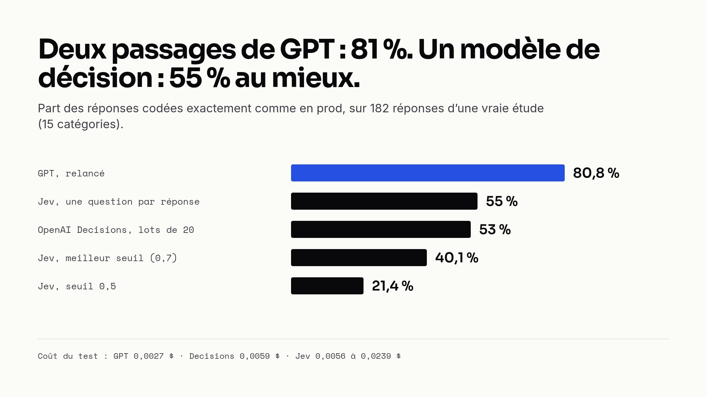
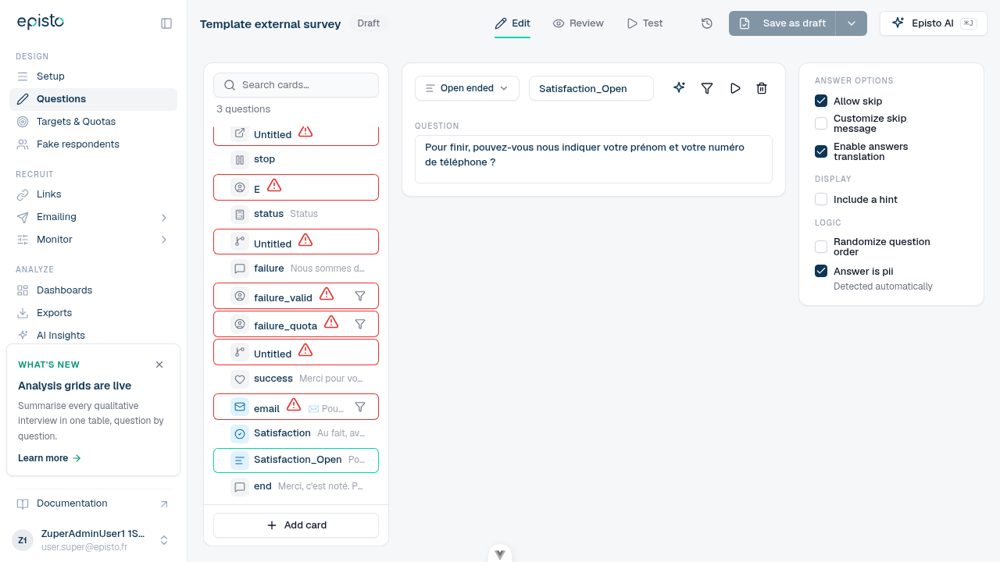

En septembre, TypeSafe AI a sorti [Jev](https://docs.typesafe.ai), un modèle qui n'écrit pas de texte. On lui donne un contexte et une liste de questions typées, il répond à toutes en une seule passe, avec des probabilités calibrées. Il annonce 70 à 500 ms par appel, 0,042 $ le million de tokens en entrée, et une sortie gratuite.

Dans notre app, qui sert à mener des études de marché, on demande plusieurs fois par jour à GPT de classer les réponses ouvertes des répondants dans des catégories. Sur le papier, c'est exactement le travail d'un modèle de décision. On a donc branché Jev dessus, mesuré, puis refait le test avec l'[API Decisions](https://developers.openai.com/api/docs/guides/decisions) qu'OpenAI a sortie quelques semaines plus tard. On n'a gardé ni l'un ni l'autre pour ce travail. L'un des deux est pourtant en prod, pour autre chose.



## Un modèle qui tranche au lieu d'écrire

Un modèle de décision prend un `state` (du texte ou du JSON) et des questions de trois types : un choix parmi 255 options au plus, un score sur une échelle, ou un oui/non qui renvoie la probabilité du « oui ». Chaque question reçoit sa réponse typée et ses probabilités, jamais une phrase.

La différence avec un LLM compte pour la suite : le modèle évalue chaque question à part, en parallèle. C'est ce qui le rend rapide. C'est aussi ce qui va nous coûter cher.

## Le cas : coder des réponses ouvertes

Une étude demande « Qu'avez-vous retenu de cette publicité ? » et récolte quelques centaines de réponses libres. On les code dans 10 à 15 catégories, souvent plusieurs par réponse, avec un sentiment. Aujourd'hui, GPT (gpt-6-luna) reçoit un lot de réponses avec la liste des catégories, et renvoie les codes.

Pour brancher Jev, on a transformé chaque catégorie en question. En choix multiple, ça fait une question oui/non par catégorie, plus une question de sentiment par catégorie :

```json
{
  "model": "jev-latest",
  "state": { "research_focus": "Ce qui déplaît dans l'app de la banque", "answer": "Lent, moche, cher" },
  "questions": {
    "category_2": { "type": "noul", "instructions": "Does what the respondent said in `answer` match the category \"Lenteur\"?" },
    "sentiment_2": { "type": "choice", "instructions": "What is the respondent's sentiment about \"Lenteur\"?",
                     "criteria": { "positive": "…", "neutral": "…", "negative": "…" } }
  }
}
```

Une catégorie était retenue au-delà de 50 % de probabilité. Et comme Jev ne prend qu'un `state` par requête, chaque réponse est un appel.

## Premier test : 120 réponses fabriquées

On a écrit 120 réponses sur une app bancaire, avec 8 catégories bien distinctes et la réponse attendue pour chacune.

| 120 réponses · 8 catégories | Réponses parfaites | Temps | Coût |
| --- | --- | --- | --- |
| GPT, choix multiple | 100 % | 16,0 s | 0,0012 $ |
| Jev, choix multiple | 65,8 % | 3,6 s | 0,0035 $ |
| Jev, seuil 0,8 + question en contexte | 90,0 % | ≈ 3,5 s | 0,0035 $ |
| GPT, choix unique | 97,5 % | 12,3 s | 0,0012 $ |
| Jev, choix unique | 95,0 % | 3,2 s | 0,0025 $ |

Jev est quatre fois plus rapide, et avec deux réglages il monte à 90 %. Encourageant, sauf que le jeu est facile, et que les réponses attendues ont été écrites par Claude, un modèle de la même famille que GPT. D'où un deuxième test.

## Deuxième test : une vraie codification de prod

Avec le feu vert RGPD en interne, on a extrait 192 réponses d'une vraie étude (un post-test publicitaire), emails et numéros masqués dès la requête SQL, avec ses 15 catégories et le sentiment. Il n'y a pas d'étiquettes humaines, donc on compare tout au codage GPT fait en prod. Pour avoir un repère, on a relancé GPT une seconde fois : **deux passages de GPT ne sont d'accord que sur 81 % des réponses**. C'est le plafond.

| 192 réponses · 15 catégories + sentiment | Identique à GPT prod | F1 | Temps | Coût |
| --- | --- | --- | --- | --- |
| GPT, relancé | 80,8 % | 90,5 % | 34,4 s | 0,0027 $ |
| Jev, seuil 0,5 | 21,4 % | 64,9 % | 6,2 s | 0,0239 $ |
| Jev, meilleur seuil (0,7) | 40,1 % | 71,9 % | ≈ 6 s | 0,0239 $ |

Au mieux 40 % contre 81 %, neuf fois plus cher, cinq fois plus rapide.

## Pourquoi ça ne marche pas

On a relu 22 désaccords à la main, et GPT avait raison dans la majorité des cas. Deux problèmes expliquent presque tout.

**Chaque catégorie est jugée seule.** Une question oui/non sur « Autres réponses » ne peut pas savoir que les autres catégories n'ont pas collé : une catégorie fourre-tout n'a de sens que comparée au reste. Jev a manqué « Autres réponses » 11 fois. Il en a aussi ajouté : « j'en sais rien » a reçu « Aucune idée », mais aussi « Publicité peu claire ».

**Aucun seuil ne fonctionne.** Les bonnes catégories obtiennent entre 0,5 et 0,7, comme les fausses. Monter le seuil retire autant de vrais codes que de faux.

## Pourquoi c'est plus cher

Le prix au token est plus bas que celui de GPT. Le nombre de tokens, non.

GPT lit les 15 catégories une fois par lot et n'écrit que les codes : environ 54 tokens par réponse, sortie comprise. Jev pose 30 questions par réponse, chacune avec ses instructions, et chaque requête ajoute 250 à 300 tokens fixes : environ 3 000 tokens par réponse. **Le coût suit réponses × catégories.** Plus la grille est riche, plus Jev coûte cher.

On a essayé trois leviers avant d'abandonner :

| Levier | Tokens / réponse | Coût | Identique à GPT prod |
| --- | --- | --- | --- |
| Une seule question `choice` + un sentiment par réponse | 737 | 0,0056 $ | 55 % |
| Questions oui/non allégées | 691 | 0,0053 $ | 34 % au mieux |
| Jev quand il est sûr, sinon GPT (51 % vers GPT) | n/a | 0,0070 $ | 75 % |

Aucun ne bat GPT à la fois sur le coût et sur la fiabilité. Et pour situer : coder toutes nos réponses ouvertes avec GPT coûte de l'ordre de 6 $ par trimestre. Le coût n'a jamais été le vrai argument.

## OpenAI Decisions : même idée, même plafond

OpenAI a annoncé sa version au DevDay du 29 septembre : `POST /v1/decisions`, sur gpt-6-luna, 0,10 $ le million de tokens en entrée, sortie gratuite. Deux différences comptent pour nous : jusqu'à 400 questions par requête, donc on peut regrouper les réponses, et c'est OpenAI, qui traite déjà ces données. Pas de nouveau fournisseur à faire valider.

| 182 réponses distinctes · 15 catégories | Identique à GPT prod | Catégorie principale juste | Tokens / réponse | Coût | Temps |
| --- | --- | --- | --- | --- | --- |
| GPT, relancé | 80,8 % | n/a | ≈ 54 | 0,0027 $ | 34,4 s |
| Jev, une `choice` par réponse | 55 % | 88 % | 737 | 0,0056 $ | 4,0 s |
| Decisions, une `choice`, lots de 20 | 53 % | 86 % | 326 | 0,0059 $ | 1,5 s |
| Decisions, 15 prédicats, lots de 20 | 52 % | n/a | 2 352 | 0,0428 $ | 2,4 s |

Même plafond que Jev : le problème vient du principe, pas du fournisseur. La catégorie principale est souvent juste, mais les catégories secondaires sont rarement attribuées (19 réponses multi-catégories, contre 67 pour GPT). Et sur « Jsp » ou « je ne sais pas », l'API a renvoyé un refus, sans aucune réponse.

On voulait aussi savoir si on payait la rapidité. On a compté les tokens réellement envoyés et comparé à ce que l'API facture : **environ 150 tokens par question, quelle que soit sa taille**.

| Un lot de 20 réponses | Tokens envoyés | Tokens facturés |
| --- | --- | --- |
| 40 questions (un choix + un sentiment par réponse) | 3 822 | 6 556 |
| 300 questions (15 oui/non par réponse) | 8 062 | 47 036 |

Même prix unitaire que GPT : on paie le nombre de questions. Indirectement, oui, c'est le prix de la rapidité : chaque question est une évaluation indépendante.

## Là où ça marche : une seule question oui/non

Notre éditeur de questionnaires a une option « Answer is pii » sur les questions ouvertes. Elle exclut les réponses de toutes les fonctions IA et déclenche un rappel pour les supprimer après le terrain. En six mois, une question ouverte sur 1 559 l'avait cochée. Une trentaine d'autres demandaient pourtant un prénom, un téléphone ou un email.

Une seule question oui/non, un texte court, aucune donnée de répondant : c'est exactement ce que sait faire un modèle de décision. Sur 181 questions de prod (dont 11 PII) :

| Approche | Précision | Rappel | Temps moyen |
| --- | --- | --- | --- |
| Mots-clés | 13,6 % | 100 % | instantané |
| OpenAI Decisions | 100 % | 100 % | 0,31 s |
| GPT | 100 % | 100 % | 2,17 s |

Les mots-clés confondent « votre nom » et « les marques que vous connaissez, ne serait-ce que de nom ». Les deux modèles font un sans-faute, et Decisions tranche net : 0,99 à 1,0 sur les questions PII, 0,05 au plus sur les autres. On a pris Decisions, sept fois plus rapide pour un coût négligeable.

Le prompt vit dans un agent, comme nos autres fonctionnalités IA, sur une nouvelle classe de base à côté de celles de l'API Responses :

```ruby
class Ai::Agents::PiiQuestionDetection < Ai::Agents::Decision
  QUESTION = 'pii'

  def initialize(question:, survey: nil, user: nil)
    super(feature_token: :pii_detection, survey:, user:)
    @question = question
  end

  private

  def input = "Open-ended survey question: #{@question}"

  def questions
    [{ type: 'predicate', name: QUESTION, instructions: }]
  end
end
```

Le `call` de la base passe par le même wrapper que tous nos appels LLM : chaque détection arrive dans Langfuse avec son coût et son utilisateur (le wrapper est décrit dans [notre article sur l'observabilité LLM](https://qraft.tech/blog/observabilite-llm-ce-que-langfuse-voit-et-ce-qu-il-ne-voit-pas)).

Les règles ont pris plus de temps que le modèle. Une revue de code a trouvé deux pièges avant le merge : une ancienne carte pouvait passer en PII sur une sauvegarde sans rapport, en plein terrain, et un client passant par notre serveur MCP ne pouvait pas annuler une détection. Désormais :

- l'option est cochée au-delà de 0,8, avec la mention « Detected automatically » ;
- la détection ne tourne qu'à la création de la question ou quand son texte change ;
- toute modification de la case par une personne devient un choix manuel, jamais écrasé ;
- une erreur de l'API ne bloque jamais l'enregistrement : la carte passe en `pending` et la détection est retentée à la sauvegarde suivante.



Sur ses cinq premiers jours en prod : 44 appels, aucun échec, environ 250 tokens par appel, un dixième de centime au total.

## Ce qu'on en retient

Un modèle de décision n'est pas un LLM moins cher. Il est excellent sur une question oui/non bien posée, et mauvais dès qu'il faut comparer plusieurs options liées, ce qui est exactement le cas d'une codification.

Ce qui reste :

- Corriger la trentaine de questions PII déjà en prod, et brancher la détection sur les autres générateurs de questionnaires.
- Tester Decisions sur les codifications à choix unique, où sa catégorie principale est juste dans 86 % des cas.
- Travailler GPT lui-même : on relance une codification, et une réponse sur cinq change de codes 😅
