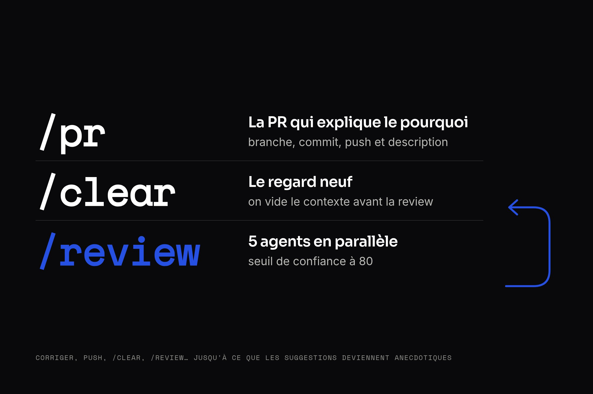

Depuis quelques semaines, j'ai un workflow qui tient en trois commandes. Trois slash commands dans Claude Code qui ont changé la qualité de ce que je livre pour nos clients chez Qraft. Pas de setup compliqué, pas d'outillage supplémentaire. Juste `/pr`, `/clear`, `/review`, et des itérations.

---

## `/pr` : la PR qui explique le pourquoi

La première commande, c'est `/pr`. C'est une [custom slash command](https://docs.claude.ai/en/docs/slash-commands) que j'ai écrite. Elle crée une branche, commit, push et ouvre une PR sur GitHub en une seule passe.

Le point clé : elle rédige la description de la PR autour du **pourquoi**. Pas une liste de fichiers modifiés. Le contexte, l'intention, le besoin métier derrière le code.

Concrètement, voici la structure de description que la commande génère :

```markdown
## Why

[La raison pour laquelle cette PR existe - quel problème,
quel besoin a déclenché ce travail]

## What

[L'approche choisie - la solution à haut niveau]

## Changes

[Liste des modifications spécifiques]
```

La section "Why" est la plus importante. Un reviewer qui comprend la motivation derrière le code fait une meilleure review. Et ça force aussi à clarifier son intention avant de pousser : si Claude ne comprend pas le "pourquoi" depuis le diff, il me demande d'expliquer le contexte.

> [!NOTE]
> Dans Claude Code, une slash command c'est un simple fichier Markdown dans `~/.claude/commands/`. Il suffit de créer le fichier et la commande est disponible.

Voici mon fichier `~/.claude/commands/pr.md` :

```markdown
---
allowed-tools: Bash(git:*), Bash(gh:*), AskUserQuestion
description: Create branch, commit, push and open a PR
---

Current branch: !`git branch --show-current`
Changes: !`git status --short`
Diff: !`git diff HEAD`

# PR Workflow

Create a pull request with a meaningful description
that explains the WHY.

## Steps

1. Check base branch (ask if unclear, default: main)
2. Create feature branch (feat/... or fix/...)
3. Stage and commit (conventional commits)
4. Push with upstream tracking
5. Create PR with `gh pr create`

## Important

- NEVER create a PR without understanding WHY
- If the purpose is unclear from the diff, ASK
- Keep the description concise but complete
```

La syntaxe  !`commande`  exécute du bash au moment où la commande se lance. Quand je tape `/pr`, Claude a déjà le contexte : la branche, les fichiers modifiés, le diff complet. Il n'a plus qu'à travailler.

---

## `/clear` : le regard neuf

Deuxième commande, et c'est une commande native de Claude Code. Après avoir créé la PR, je tape `/clear`. Ça vide le contexte de la conversation. Complètement.

Pourquoi ? Parce que la review doit se faire avec un regard neuf.

Si je lance la review dans la même session que le dev, Claude a tout l'historique : les choix techniques, les compromis, les pistes abandonnées. La review sera biaisée. Claude aura tendance à valider ce qu'il a lui-même construit, ou à ignorer des problèmes dans du code qu'il connaît déjà "par coeur".

`/clear` casse ce biais. Après le clear, c'est comme si un autre développeur regardait le code pour la première fois.

---

## `/review` : la code review automatisée

Troisième commande : `/review` suivi du lien de la PR. C'est un [plugin officiel Claude Code](https://github.com/anthropics/claude-code/tree/main/plugins/code-review) qui lance une review multi-agents.

Sous le capot, la commande lance 5 agents en parallèle :

1. **Conformité** [**CLAUDE.md**](http://claude.md/) : vérifie que le code respecte les conventions du projet
2. **Scan de bugs** : lecture superficielle du diff pour les bugs évidents
3. **Contexte historique** : analyse le `git blame` et l'historique pour détecter des régressions
4. **PRs précédentes** : vérifie si des commentaires sur d'anciens PRs touchant ces fichiers s'appliquent
5. **Commentaires de code** : vérifie que les changements respectent les indications dans les commentaires existants

Chaque problème détecté reçoit un score de confiance de 0 à 100. Seuls les problèmes avec un score supérieur à 80 remontent dans le résultat final. Ça filtre le bruit et les faux positifs.

Le résultat : une liste concise de vrais problèmes, avec des liens vers les lignes concernées.

---

## Le vrai gain : l'itération

Le workflow en lui-même est simple. Mais le vrai gain, c'est l'itération.

Je ne merge jamais au premier passage. Voici la boucle :

1. `/pr` -- je crée la PR
2. `/clear` -- je vide le contexte
3. `/review <lien PR>` -- Claude analyse avec un regard neuf
4. Je trie les suggestions. Je choisis ce que je corrige.
5. Claude applique les changements.
6. Je push sur la PR.
7. Retour à l'étape 2.



À chaque passage, il y a du code mort, des abstractions inutiles, de la complexité superflue. Chaque itération nettoie et rend le code plus lean. Quand les suggestions deviennent anecdotiques, je merge.

---

## Pourquoi pas la GitHub Action Claude ?

On pourrait utiliser la [GitHub Action Claude](https://docs.claude.ai/en/docs/github-actions) pour automatiser la review directement sur GitHub. Mais je préfère travailler depuis le terminal pour deux raisons :

**L'itération est plus rapide.** Je vois les suggestions, je choisis ce que je modifie, Claude applique, je push. Pas besoin de naviguer entre GitHub et mon éditeur.

**Les tokens.** Depuis le terminal, j'utilise mes tokens Claude Code (inclus dans l'abonnement Max). La GitHub Action consomme des tokens API Anthropic, facturés à part.

---

## Ce qu'il faut retenir

- `/pr` crée des PRs avec une description orientée métier, pas technique
- `/clear` avant la review casse le biais de la session de dev
- `/review` lance 5 agents en parallèle avec un filtrage par score de confiance
- La boucle `/pr` -> `/clear` -> `/review` -> corriger -> push -> `/clear` -> `/review` est le vrai multiplicateur de qualité

---

_Merci d'avoir lu. J'essaierai de partager ici régulièrement comment on travaille chez Qraft avec Claude._
