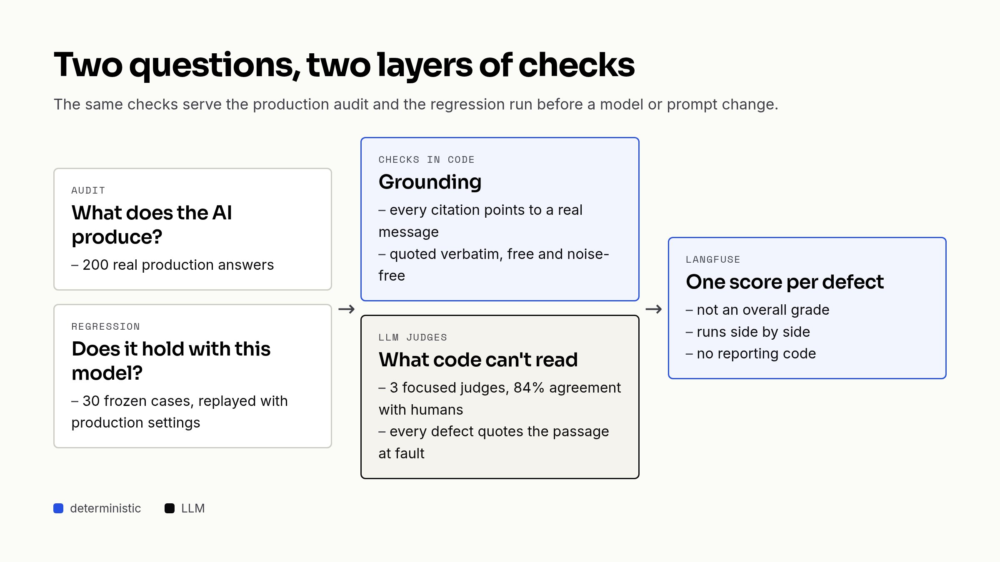
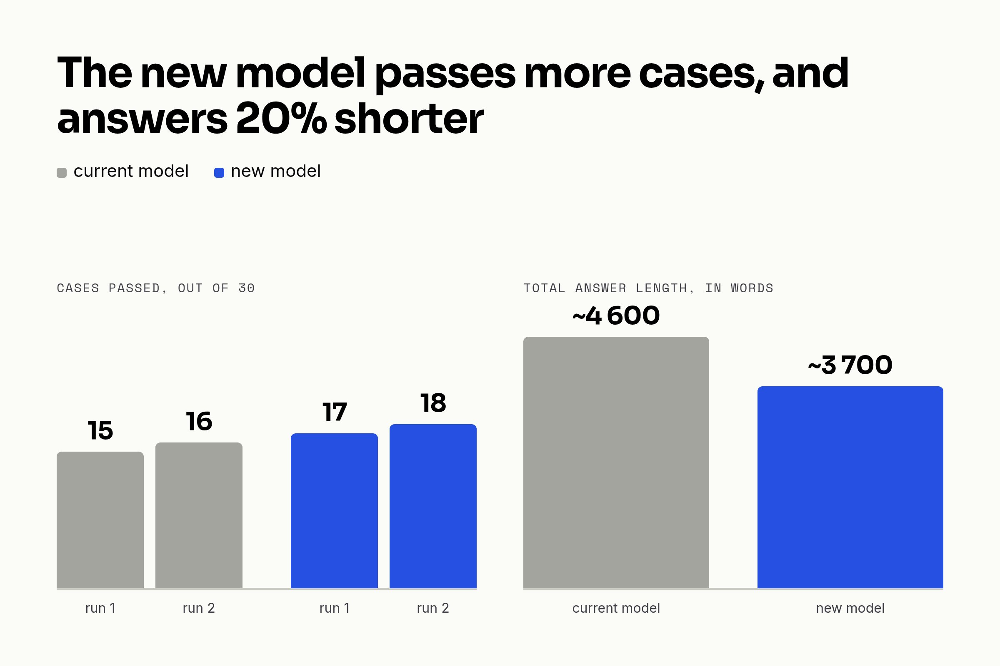

We work on an analysis assistant: analysts ask questions about survey results, and an LLM agent answers with figures, findings and verbatim quotes from respondents. We change its model or its prompt almost every month, and for a long time we checked those changes by re-reading a few answers by hand. It's reassuring, but it tells you nothing about the 200 answers you didn't read.

That's what pushed us to write evals. Here is how they work, what they taught us, and what they missed.

## Two different questions

A unit test checks an exact output, and an LLM answer is never the same twice. So we needed something else, and we soon realised we were actually asking two questions:

- what does the AI produce right now? For that, we take 200 real production answers and score them. That's the audit.
- does it still hold with this new model or this new prompt? Here we replay a fixed set of cases and compare runs. That's the regression.

Both share the same checks, which we split into two layers.



## What code can check

Anything that can be counted or looked up in a table is checked in Ruby, without an LLM, so without noise. For this assistant, that mostly means grounding: every reference must point to a real question, and every quote to a real message from the right respondent, copied word for word.

```ruby
MODES = %w[unknown_ref unknown_message_id wrong_respondent_id non_verbatim_quote].freeze

def citation_violation(citation)
  message = @messages[citation.message_id]

  if message.nil?
    violation('unknown_message_id', citation.raw, 'No respondent message carries this id.')
  elsif !CitationParser.same_respondent?(citation.respondent_id, message['respondent_id'])
    violation('wrong_respondent_id', citation.raw, "Message belongs to #{message['respondent_id']}.")
  elsif citation.quote.nil?
    nil
  elsif !verbatim?(citation.quote, message['text'])
    violation('non_verbatim_quote', citation.quote, 'Quote is absent from the cited message.')
  end
end
```

The first audit found 79 % of answers fully grounded. We expected hallucinations, but the most common defect was elsewhere: 9.6 % of quotes had been translated into the analyst's language. Looking closer, our own prompt contradicted itself, asking both to "answer in the language of the question" and to "never translate a quote". The model was doing its best. Settling that is a product decision, and the eval now measures the effect of each fix.

## LLM judges for the rest

A generic answer, findings listed side by side with no hierarchy, an exact quote used to say something it doesn't: code can't read that. We hand it to LLM judges, each responsible for a few specific defects, and every flagged defect must cite the passage in question. Before trusting them, we compared them with human labels: a single judge carrying 17 rules agreed with humans 79 % of the time, three narrower judges reached 84 %.

What really made the results useful was publishing one score per type of defect rather than a global grade. A global grade can't be sorted or filtered, and doesn't tell you what changed between two runs.

```ruby
# Numeric rather than boolean: an answer can break the same rule several times,
# and `> 0` still filters the answers concerned.
def insight_mode_evaluators(modes)
  modes.map do |mode|
    lambda { |output:, **|
      hits = Array(output['violations']).select { |violation| violation['mode'] == mode }
      Langfuse::Evaluation.new(name: mode, value: hits.size, data_type: :numeric,
                               comment: hits.first&.fetch('evidence', nil).to_s.truncate(200).presence)
    }
  end
end
```

On the tooling side, everything goes through rake tasks. We capture production answers, push them as a [Langfuse dataset](https://langfuse.com/docs/evaluation/dataset-runs/datasets), then run an [experiment](https://langfuse.com/docs/evaluation/experiments/overview), with the code checks only (free) or with the judges:

```bash
bundle exec rake 'eval:insight:snapshot[tmp/insight.jsonl,200,30]'
bundle exec rake 'eval:insight:push_dataset[tmp/insight.jsonl,AI Insight - prod]'
bundle exec rake 'eval:insight:experiment[AI Insight - prod,none]'  # code checks only
bundle exec rake 'eval:insight:experiment[AI Insight - prod]'       # + judges
```

Runs end up side by side in the Langfuse UI, and we wrote no reporting code.

## Replaying without the production database

The regression took a bit more thought. The agent relies on tools that read a database full of real respondents; replaying it offline would mean grading it against an empty survey. So a regression case keeps the tool outputs and the conversation history, but re-reads the system prompt from the code when the case is created. If we froze the prompt too, a prompt change would go unnoticed on replay.

```ruby
'input' => {
  'question' => insight_previous_question(answer),
  'system_prompt' => agent.send(:instructions),
  # Production sends [system, …history…, question]; without the earlier turns
  # a follow-up like "yes" cannot be answered at all.
  'history' => insight_history(answer),
  'tool_outputs' => insight_tool_outputs(survey)
},
```

To test another model, we replay the cases. To test a reworked prompt, we regenerate the cases (it's instant, there's no LLM call), then replay. We got caught once by replaying at the API's default reasoning effort: the model passed 16 cases out of 30 at `medium`, but only 12 at `minimal`, which is what production actually sent. Since then we always replay with the production parameters.

## The model migration

All of this paid off this autumn, when we migrated to a new generation of models. The last step covered the most demanding features, and we had made it conditional on the evals. We regenerated 30 cases from production and replayed them twice with each model:

|  | Current model | New model |
| --- | --- | --- |
| Cases passed (run 1 / run 2) | 15 / 16 | 17 / 18 |
| Quotes copied word for word | 118 / 120 | 94 / 95 |
| Total answer length | ~4,600 words | ~3,700 words |



Fourteen cases pass every time, ten fail every time, and four change from one run to the next, as many on each side. That's the normal noise of models and judges, and it's why we look at the total rather than at each case. The conclusion: the new model is at least as good, quotes more faithfully, and answers about 20 % shorter, which analysts will notice. We migrated.

## What the evals didn't see

The first production incident of that migration had nothing to do with answer quality, though. Our code guessed the reasoning effort from the model name:

```ruby
def default_reasoning
  case @model
  when /gpt-5\.\d+/i then { effort: :none }
  when /gpt-4/i then nil
  else { effort: :minimal }
  end
end
```

The new models all fell into the `else`, and refused `minimal`: `minimal is not supported with the gpt-6-luna model`. No eval could have seen that. We replaced the guess with explicit tiers (a model and an effort), and the code now says `tier: :advanced` instead of naming a model.

A judge also lost 2 to 4 % of its reports after the model change, quietly: the response no longer parsed, the error was swallowed and the log said `completed`. Evals protect what goes to production, but once it's there you need other tools. That's the subject of the next article, on observability.

## What's still pending

- The eval is code, and it has its own bugs. Six times, a result we blamed on the model actually came from the eval: a regex spilling over several lines, French « » quotation marks, a rule better left to a judge. When a number is surprising, we now look at the checker first.
- Our Langfuse SDK called a deprecated API, and for seven weeks our experiments were recorded but didn't show up in the Experiments view. A version bump was enough, once someone noticed.
- There's no CI gate yet. The suites run on demand, in a few minutes; the next step is to run them automatically when a prompt or a model changes.
