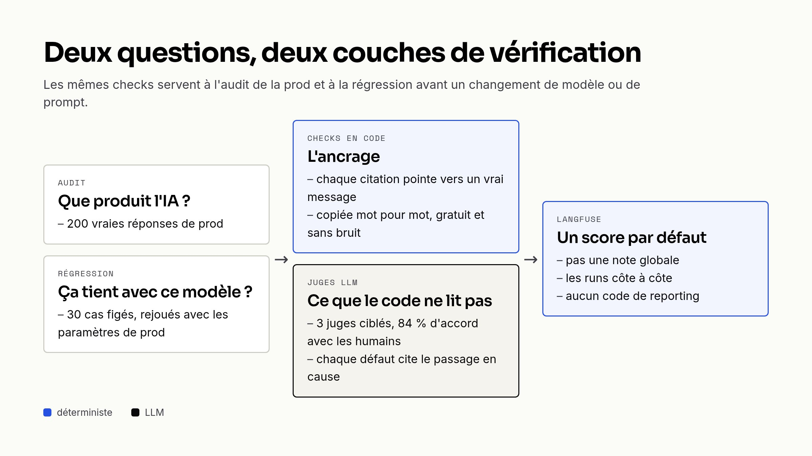

On travaille sur un assistant d'analyse : des analystes posent des questions sur les résultats d'une étude, et un agent LLM répond avec des chiffres, des constats et des verbatims de répondants. On change son modèle ou son prompt presque tous les mois, et pendant longtemps on validait ces changements en relisant quelques réponses à la main. Ça rassure, mais ça ne dit rien des 200 réponses qu'on n'a pas lues.

C'est ce qui nous a poussés à écrire des evals. Voilà comment elles fonctionnent, ce qu'elles nous ont appris, et ce qu'elles ont raté.

## Deux questions différentes

Un test unitaire vérifie une sortie exacte, alors qu'une réponse de LLM n'est jamais deux fois la même. Il faut donc autre chose, et on s'est vite rendu compte qu'on se posait en fait deux questions :

- que produit l'IA en ce moment ? Pour ça, on prend 200 vraies réponses de production et on les note. C'est l'audit.
- est-ce que ça tient avec ce nouveau modèle ou ce nouveau prompt ? Là, on rejoue un jeu de cas figés et on compare les runs. C'est la régression.

Les deux partagent les mêmes vérifications, qu'on a séparées en deux couches.



## Ce qui se vérifie en code

Tout ce qui peut se compter ou se retrouver dans une table est vérifié en Ruby, sans LLM, donc sans bruit. Pour cet assistant, c'est surtout l'ancrage des réponses : chaque référence doit pointer vers une vraie question, chaque citation vers un vrai message du bon répondant, copié mot pour mot.

```ruby
MODES = %w[unknown_ref unknown_message_id wrong_respondent_id non_verbatim_quote].freeze

def citation_violation(citation)
  message = @messages[citation.message_id]

  if message.nil?
    violation('unknown_message_id', citation.raw, 'No respondent message carries this id.')
  elsif !CitationParser.same_respondent?(citation.respondent_id, message['respondent_id'])
    violation('wrong_respondent_id', citation.raw, "Message belongs to #{message['respondent_id']}.")
  elsif citation.quote.nil?
    nil
  elsif !verbatim?(citation.quote, message['text'])
    violation('non_verbatim_quote', citation.quote, 'Quote is absent from the cited message.')
  end
end
```

Le premier audit a donné 79 % de réponses parfaitement ancrées. On s'attendait à des hallucinations, mais le défaut le plus fréquent était ailleurs : 9,6 % des citations étaient traduites dans la langue de l'analyste. En regardant de plus près, c'était notre prompt qui se contredisait, en demandant à la fois de « répondre dans la langue de la question » et de « ne jamais traduire une citation ». Le modèle faisait comme il pouvait. Trancher, c'est une décision produit, et l'eval sert maintenant à mesurer l'effet de chaque correctif.

## Des juges LLM pour le reste

Une réponse passe-partout, des constats posés côte à côte sans hiérarchie, une citation exacte mais détournée de son sens : le code ne sait pas lire ça. On le confie à des juges LLM, chacun responsable de quelques défauts précis, et chaque défaut signalé doit citer le passage en cause. Avant de leur faire confiance, on les a comparés à des notes humaines : un juge unique qui portait 17 règles était d'accord avec les humains à 79 %, trois juges plus ciblés sont montés à 84 %.

Ce qui a vraiment rendu les résultats utiles, c'est de publier un score par type de défaut plutôt qu'une note globale. Une note globale ne se trie pas, ne se filtre pas, et ne dit pas ce qui a changé entre deux runs.

```ruby
# Numeric rather than boolean: an answer can break the same rule several times,
# and `> 0` still filters the answers concerned.
def insight_mode_evaluators(modes)
  modes.map do |mode|
    lambda { |output:, **|
      hits = Array(output['violations']).select { |violation| violation['mode'] == mode }
      Langfuse::Evaluation.new(name: mode, value: hits.size, data_type: :numeric,
                               comment: hits.first&.fetch('evidence', nil).to_s.truncate(200).presence)
    }
  end
end
```

Côté outillage, tout passe par des tâches rake. On capture des réponses de prod, on les pousse en [dataset Langfuse](https://langfuse.com/docs/evaluation/dataset-runs/datasets), puis on lance un [experiment](https://langfuse.com/docs/evaluation/experiments/overview), avec seulement les checks en code (gratuit) ou avec les juges :

```bash
bundle exec rake 'eval:insight:snapshot[tmp/insight.jsonl,200,30]'
bundle exec rake 'eval:insight:push_dataset[tmp/insight.jsonl,AI Insight - prod]'
bundle exec rake 'eval:insight:experiment[AI Insight - prod,none]'  # checks en code seuls
bundle exec rake 'eval:insight:experiment[AI Insight - prod]'       # + les juges
```

Les runs se retrouvent côte à côte dans l'interface Langfuse, et on n'a écrit aucun code de reporting.

## Rejouer sans la base de prod

La régression a demandé un peu plus de réflexion. L'agent s'appuie sur des tools qui lisent une base pleine de vrais répondants ; le rejouer hors ligne, ce serait le noter face à une étude vide. Un cas de régression garde donc les sorties des tools et l'historique de la conversation, mais relit le prompt système depuis le code au moment où on le crée. Si on figeait aussi le prompt, un changement de prompt passerait inaperçu au replay.

```ruby
'input' => {
  'question' => insight_previous_question(answer),
  'system_prompt' => agent.send(:instructions),
  # Production sends [system, …history…, question]; without the earlier turns
  # a follow-up like "yes" cannot be answered at all.
  'history' => insight_history(answer),
  'tool_outputs' => insight_tool_outputs(survey)
},
```

Pour tester un autre modèle, on rejoue les cas. Pour tester un prompt retravaillé, on régénère les cas (c'est instantané, il n'y a pas d'appel LLM), puis on rejoue. On s'est fait avoir une fois en rejouant avec l'effort de raisonnement par défaut de l'API : le modèle passait 16 cas sur 30 en `medium`, mais 12 seulement en `minimal`, qui est ce que la prod envoyait vraiment. Depuis, on rejoue toujours avec les paramètres de prod.

## La migration de modèle

Tout ça a servi cet automne, quand on a migré vers une nouvelle génération de modèles. La dernière étape concernait les features les plus exigeantes, et on l'avait conditionnée aux evals. On a régénéré 30 cas depuis la prod et on les a rejoués deux fois avec chaque modèle :

|  | Modèle actuel | Nouveau modèle |
| --- | --- | --- |
| Cas passés (run 1 / run 2) | 15 / 16 | 17 / 18 |
| Citations copiées mot pour mot | 118 / 120 | 94 / 95 |
| Longueur totale des réponses | ~4 600 mots | ~3 700 mots |


Quatorze cas passent à chaque fois, dix échouent à chaque fois, et quatre changent d'un run à l'autre, autant d'un côté que de l'autre. C'est le bruit normal des modèles et des juges, et c'est pour ça qu'on regarde le total plutôt que chaque cas. La conclusion : le nouveau modèle est au moins aussi bon, cite plus fidèlement, et répond environ 20 % plus court, ce que les analystes vont remarquer. On a migré.

## Ce que les evals n'ont pas vu

Le premier incident de prod de cette migration n'avait pourtant rien à voir avec la qualité des réponses. Notre code devinait l'effort de raisonnement à partir du nom du modèle :

```ruby
def default_reasoning
  case @model
  when /gpt-5\.\d+/i then { effort: :none }
  when /gpt-4/i then nil
  else { effort: :minimal }
  end
end
```

Les nouveaux modèles tombaient tous dans le `else`, et refusaient `minimal` : `minimal is not supported with the gpt-6-luna model`. Aucune eval ne pouvait voir ça. On a remplacé la devinette par des paliers explicites (un modèle et un effort), et le code dit maintenant `tier: :advanced` au lieu de nommer un modèle.

Un juge a aussi perdu 2 à 4 % de ses rapports après le changement de modèle, sans bruit : la réponse ne se parsait plus, l'erreur était avalée et le log disait `completed`. Les evals protègent ce qui part en prod, mais une fois en prod il faut d'autres outils. On en parle dans le prochain article, sur l'observabilité.

## Ce qui reste

- L'eval est du code, et elle a ses propres bugs. Six fois, un résultat qu'on mettait sur le dos du modèle venait en fait de l'eval : une regex qui débordait sur plusieurs lignes, les guillemets français « », une règle qu'il valait mieux confier à un juge. Quand un chiffre surprend, on regarde maintenant d'abord le vérificateur.
- Notre SDK Langfuse appelait une API dépréciée, et pendant sept semaines nos experiments étaient bien enregistrés mais n'apparaissaient pas dans la vue Experiments. Une montée de version a suffi, encore fallait-il s'en rendre compte.
- Il n'y a pas encore de gate en CI. Les suites tournent à la demande, en quelques minutes ; la prochaine étape est de les lancer automatiquement quand un prompt ou un modèle change.
