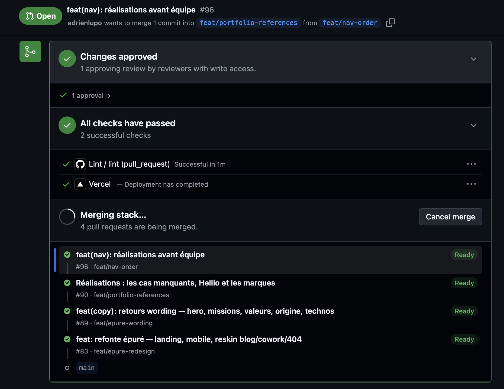
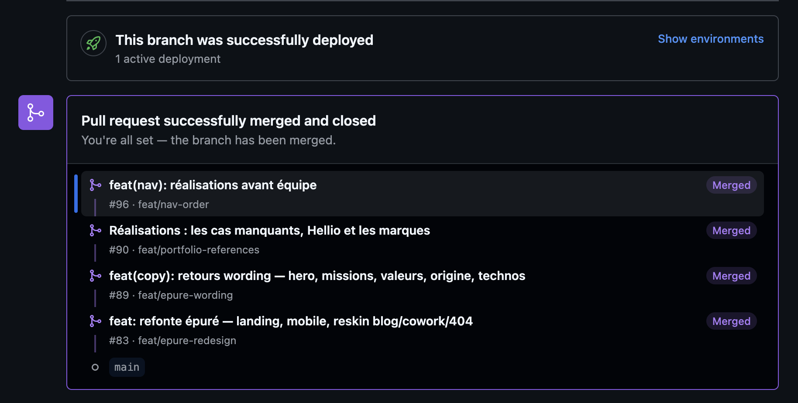

We'd been waiting a long time. Meta has used them internally for years, Graphite built a product out of them, GitLab has had them in its CLI since 2024 - and GitHub, the biggest code host, had nothing. Since late July, that's settled: stacked PRs are in public preview on every repository.

Adrien walked us through them at Tech My Breath Away on September 1st, our Tuesday tech breakfast, after a month of use. Here's what they are, what they look like, and what we do with them.

## 1. A long wait

Stacked diffs come from Phabricator, Facebook's review tool: one change = one diff, and a feature = a stack of diffs reviewed one at a time. When Phabricator shut down, Meta released [Sapling](https://sapling-scm.com/), Graphite built [a whole product](https://graphite.dev/) on this workflow on top of GitHub, and [ghstack](https://github.com/ezyang/ghstack) hacked it together for PyTorch. GitLab followed with [stacked diffs](https://docs.gitlab.com/user/project/merge_requests/stacked_diffs/) in `glab` (v1.42, experimental).

GitHub had been talking about it for two or three years without shipping anything - a white whale. A private preview in the spring, per-repo allowlist, then on [July 30, 2026, the public preview](https://github.blog/changelog/2026-07-30-stacked-pull-requests-are-now-in-public-preview/) for everyone, free. It made quite a bit of noise, and rightly so: it's the first time the workflow is native where most of our code lives.

```bash
gh extension install github/gh-stack   # gh 2.0 or later
```

The install also offers the `gh-stack` skill for coding agents: an agent with it knows how to create and manipulate a stack on its own.

→ [Documentation](https://docs.github.com/en/pull-requests/how-tos/stacked-pull-requests), [command reference](https://docs.github.com/en/pull-requests/reference/stacked-prs-cli-commands).

## 2. Syntactic sugar over stacked branches

A stack is branches based on one another, and one PR per branch, each PR targeting the branch below rather than `main`. Nothing new: we've all done it by hand, and we've all regretted it when it came time to change the first branch - cascading rebase, the same conflict to resolve three times, and nobody knows which branch sits on which anymore.

Git already does a good part of the work:

```bash
# rebase the whole stack on main, moving the intermediate branches along
git rebase --update-refs main
```

What GitHub adds is the tooling around it: the stack is an object GitHub knows about, visible on every PR, handled with a few commands, and merged in one go. Syntactic sugar - but sugar that makes the workflow accessible without being a git expert.

## 3. What it looks like

We used it on our website redesign: four stacked PRs - the redesign, the copy feedback, the case studies, the nav order. On every PR, the stack panel shows the layers, and the header says plainly that the PR targets the layer below, not `main`:



One click on the top layer merges the whole stack, layer by layer, in order:



In the terminal, `gh stack view` gives the same view, with the current layer:

```text
$ gh stack view
  feat/nav-order            #96  ← you are here
  feat/portfolio-references #90
  feat/epure-wording        #89
  feat/epure-redesign       #83
  main
```

## 4. What it brings

- **Visualizing.** You see your stack, on GitHub and in the terminal, and you move around in it (`gh stack up`, `gh stack down`, `gh stack checkout`)
- **Merging in one go.** Merging a layer merges everything below it; you can merge the whole stack, or only the bottom while the top is still under review
- **Changing a lower layer.** A change on the first branch, and `gh stack rebase` moves every layer above it. A conflict gets resolved once, not on every layer
- **Following** **`main`****.** When `main` has moved, `gh stack sync` fetches, rebases the whole stack, pushes, and updates the PRs

```bash
gh stack init feature/export      # the stack starts from the current branch
gh stack add feature/export-2     # one layer on top
gh stack submit                   # push branches, create the linked PRs
# ... a change on the bottom layer
gh stack rebase                   # move the rest up
gh stack sync                     # main moved: fetch, rebase, push, PRs updated
```

## 5. One use: splitting a feature for review

That's the case Adrien presents in his talk. With agents producing ever more code, a feature quickly ends up as a 1,000-line PR nobody wants to read. His flow: build the whole feature with the agent, then ask it to split the diff into a stack of 4-5 PRs. He reviews PR 1, leaves comments, puts the agent on them - and while the agent handles PR 1, he reviews PR 2.

```text
Split this diff into a stack of 4 PRs: schema, backend, frontend, documentation.
Each PR must pass the tests on its own. Push the stack.
```

Two things he takes away after a month. Splitting by layer (schema, backend, frontend) reviews worse than by vertical slice - one PR per piece of the feature that stands on its own. And making a PR reviewable is not making it deployable: merging the bottom layers alone must not change the contract with production.

The limits he ran into: CI runs on every layer at every sync (his GitHub minutes bill went over the plan), you have to keep the stack in your head - and tell the agent, which otherwise develops at the top of the stack and pushes to the wrong layer - and twelve PRs a day, stacked or not, is still twelve PRs to understand.

The details are in the talk: [Tech My Breath Away - Stacked PRs GitHub](https://qrafttech.notion.site/Tech-My-Breath-Away-Stacked-PRs-GitHub-3ce218ed56d78143ac86e4b1de2eafa5).

## What's still pending

- Public preview, "subject to change"; merge queue support is rolling out progressively
- Our usage is still small-scale: one stack on the website, Adrien's tests on his projects. The team flow, with different reviewers per layer, is still to be tested
- Per-layer CI has a cost; worth watching on repos where it's heavy

## All links

- [Stacked pull requests are now in public preview](https://github.blog/changelog/2026-07-30-stacked-pull-requests-are-now-in-public-preview/) — GitHub changelog
- [About stacked pull requests](https://docs.github.com/en/pull-requests/get-started/about-stacked-prs) · [Managing stacked pull requests](https://docs.github.com/en/pull-requests/how-tos/create-pull-requests/managing-stacked-pull-requests) · [CLI commands](https://docs.github.com/en/pull-requests/reference/stacked-prs-cli-commands)
- [github/gh-stack](https://github.com/github/gh-stack) — the extension
- [GitLab stacked diffs](https://docs.gitlab.com/user/project/merge_requests/stacked_diffs/) · [Sapling](https://sapling-scm.com/) · [Graphite](https://graphite.dev/) · [ghstack](https://github.com/ezyang/ghstack)
- [Tech My Breath Away - Stacked PRs GitHub](https://qrafttech.notion.site/Tech-My-Breath-Away-Stacked-PRs-GitHub-3ce218ed56d78143ac86e4b1de2eafa5) — Adrien's talk
