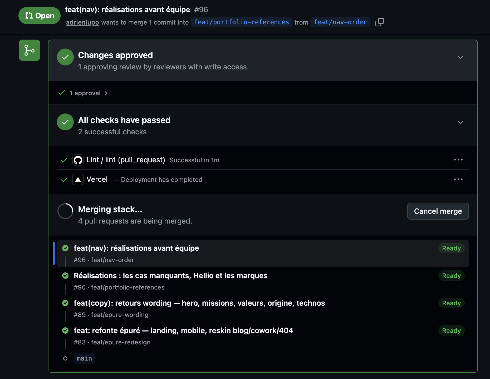
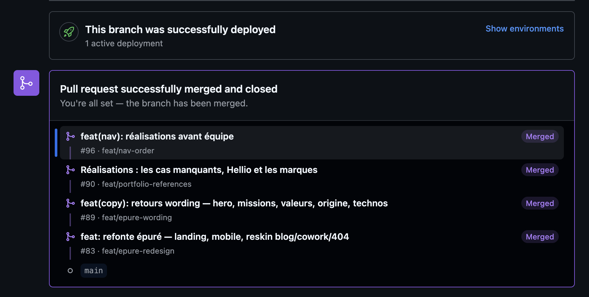

On les attendait depuis longtemps. Meta les pratique en interne depuis des années, Graphite en a fait un produit, GitLab les a dans son CLI depuis 2024 - et GitHub, le plus gros hébergeur de code, n'avait rien. Depuis fin juillet, c'est réglé : les stacked PRs sont en public preview sur tous les repos.

Adrien nous en a fait le tour au Tech My Breath Away du 1er septembre, notre petit-déj tech du mardi, après un mois d'usage. Voici ce que c'est, à quoi ça ressemble, et ce qu'on en fait.

## 1. Une longue attente

Le principe des stacked diffs vient de Phabricator, l'outil de review de Facebook : un changement = un diff, et une feature = une pile de diffs qui se relisent un par un. Quand Phabricator s'est arrêté, Meta a sorti [Sapling](https://sapling-scm.com/), Graphite a bâti [un produit entier](https://graphite.dev/) sur ce workflow au-dessus de GitHub, et [ghstack](https://github.com/ezyang/ghstack) l'a bricolé côté PyTorch. GitLab a suivi avec les [stacked diffs](https://docs.gitlab.com/user/project/merge_requests/stacked_diffs/) dans `glab` (v1.42, en expérimental).

GitHub, lui, en parlait depuis deux ou trois ans sans rien sortir - un serpent de mer. Une preview privée au printemps, sur liste blanche par repo, puis le [30 juillet 2026, la public preview](https://github.blog/changelog/2026-07-30-stacked-pull-requests-are-now-in-public-preview/) pour tout le monde, gratuite. Ça a fait pas mal de bruit, et à raison : c'est la première fois que le workflow est natif là où vit le code de la plupart d'entre nous.

```bash
gh extension install github/gh-stack   # gh 2.0 ou plus
```

L'installation propose aussi la skill `gh-stack` pour les agents de code : un agent qui l'a sait créer et manipuler une pile lui-même.

→ [Documentation](https://docs.github.com/en/pull-requests/how-tos/stacked-pull-requests), [référence des commandes](https://docs.github.com/en/pull-requests/reference/stacked-prs-cli-commands).

## 2. Du sucre syntaxique sur des branches empilées

Une stack, c'est des branches basées les unes sur les autres, et une PR par branche, chaque PR ciblant la branche du dessous plutôt que `main`. Rien de nouveau : on a tous déjà fait ça à la main, et on a tous déjà regretté au moment de modifier la première branche - rebase en cascade, le même conflit à résoudre trois fois, et plus personne ne sait quelle branche est au-dessus de laquelle.

Git sait déjà faire une bonne partie du travail :

```bash
# rebase la pile entière sur main, en déplaçant les branches intermédiaires
git rebase --update-refs main
```

Ce que GitHub ajoute, c'est un utilitaire autour : la pile est un objet que GitHub connaît, qu'on voit sur chaque PR, qu'on manipule en quelques commandes, et qu'on merge d'un coup. Du sucre syntaxique - mais du sucre qui rend le workflow accessible sans être un expert git.

## 3. À quoi ça ressemble

On l'a utilisé sur la refonte de notre site : quatre PRs empilées - la refonte, les retours wording, les réalisations, l'ordre de la nav. Sur chaque PR, l'encart de la pile montre les étages, et l'en-tête dit clairement que la PR cible l'étage du dessous, pas `main` :



Un clic sur l'étage du haut merge toute la pile, étage par étage, dans l'ordre :



En terminal, `gh stack view` donne la même vue, avec l'étage courant :

```text
$ gh stack view
  feat/nav-order            #96  ← vous êtes ici
  feat/portfolio-references #90
  feat/epure-wording        #89
  feat/epure-redesign       #83
  main
```

## 4. Ce que ça apporte

- **Visualiser.** On voit sa pile, sur GitHub et dans le terminal, et on se déplace dedans (`gh stack up`, `gh stack down`, `gh stack checkout`)
- **Merger d'un coup.** Merger un étage merge tout ce qu'il y a en dessous ; on peut merger toute la pile, ou seulement le bas en attendant la review du haut
- **Modifier un étage du bas.** Une modif sur la première branche, et `gh stack rebase` remonte tous les étages du dessus. Un conflit se résout une fois, pas à chaque étage
- **Suivre** **`main`****.** Quand `main` a avancé, `gh stack sync` fetch, rebase toute la pile, pousse, et met à jour les PRs

```bash
gh stack init feature/export      # la pile part de la branche courante
gh stack add feature/export-2     # un étage au-dessus
gh stack submit                   # pousse les branches, crée les PRs liées
# ... une modif sur l'étage du bas
gh stack rebase                   # remonte le reste
gh stack sync                     # main a bougé : fetch, rebase, push, PRs à jour
```

## 5. Un usage : découper une feature pour la review

C'est le cas qu'Adrien présente dans son talk. Avec des agents qui produisent toujours plus de code, une feature finit vite en une PR de 1 000 lignes que personne n'a envie de relire. Son flow : développer la feature entière avec l'agent, puis lui demander de découper la diff en une pile de 4-5 PRs. Il review la PR 1, laisse ses commentaires, met l'agent dessus - et pendant que l'agent traite la PR 1, il review la PR 2.

```text
Découpe cette diff en une stack de 4 PRs : schéma, backend, frontend, documentation.
Chaque PR doit passer les tests seule. Pousse la stack.
```

Deux choses qu'il retient après un mois. Le découpage par couche (schéma, back, front) se review moins bien que par tranche verticale - une PR par morceau de feature qui tient debout. Et rendre une PR reviewable, c'est pas la rendre déployable : merger les étages du bas seuls ne doit pas changer le contrat avec la prod.

Les limites qu'il a trouvées : la CI tourne pour chaque étage à chaque sync (sa facture de minutes GitHub a dépassé le forfait), il faut garder la pile en tête - et le dire à l'agent, qui sinon développe en haut de la pile et pousse au mauvais étage - et douze PRs par jour, stackées ou pas, ça reste douze PRs à comprendre.

Le détail est dans le talk : [Tech My Breath Away - Stacked PRs GitHub](https://qrafttech.notion.site/Tech-My-Breath-Away-Stacked-PRs-GitHub-3ce218ed56d78143ac86e4b1de2eafa5).

## Ce qui reste

- Public preview, « subject to change » ; le support des merge queues se déploie progressivement
- Notre usage est encore à petite échelle : une pile sur le site, les tests d'Adrien sur ses projets. Le flow en équipe, avec des reviewers différents par étage, reste à éprouver
- La CI par étage se paie ; à surveiller sur les repos où elle est lourde

## Tous les liens

- [Stacked pull requests are now in public preview](https://github.blog/changelog/2026-07-30-stacked-pull-requests-are-now-in-public-preview/) — changelog GitHub
- [About stacked pull requests](https://docs.github.com/en/pull-requests/get-started/about-stacked-prs) · [Managing stacked pull requests](https://docs.github.com/en/pull-requests/how-tos/create-pull-requests/managing-stacked-pull-requests) · [CLI commands](https://docs.github.com/en/pull-requests/reference/stacked-prs-cli-commands)
- [github/gh-stack](https://github.com/github/gh-stack) — l'extension
- [Stacked diffs GitLab](https://docs.gitlab.com/user/project/merge_requests/stacked_diffs/) · [Sapling](https://sapling-scm.com/) · [Graphite](https://graphite.dev/) · [ghstack](https://github.com/ezyang/ghstack)
- [Tech My Breath Away - Stacked PRs GitHub](https://qrafttech.notion.site/Tech-My-Breath-Away-Stacked-PRs-GitHub-3ce218ed56d78143ac86e4b1de2eafa5) — le talk d'Adrien
