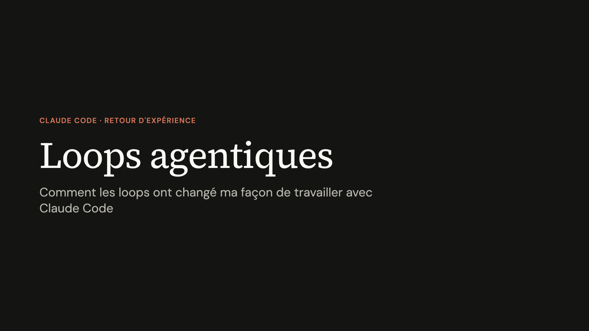

Au petit déjeuner chez Qraft, j'ai présenté ma façon de coder avec des loops dans Claude Code. Le principe tient en trois étapes : lever l'ambiguïté, écrire des definitions of done, et donner à chacune un check qui décide si la loop continue ou s'arrête. Voici le fil de la présentation.

## Ce qu'en disent ceux qui les font tourner

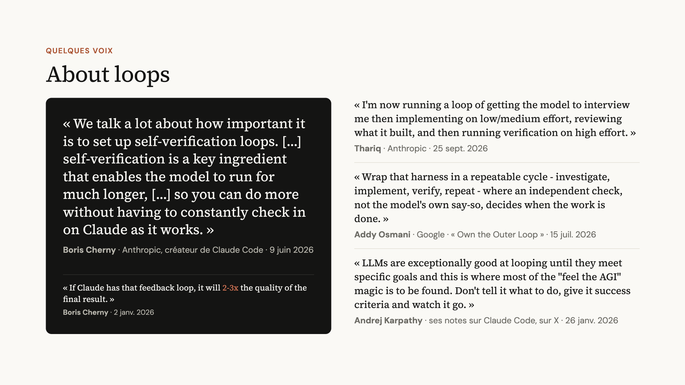

Quatre voix, une même idée : c'est un check indépendant, et non le modèle, qui décide quand le travail est fini. Boris Cherny, le créateur de Claude Code, le chiffre : « If Claude has that feedback loop, it will 2-3x the quality of the final result. » Et Thariq, chez Anthropic, commence lui aussi par se faire interviewer par le modèle avant d'implémenter.

## Une loop, c'est quoi ?

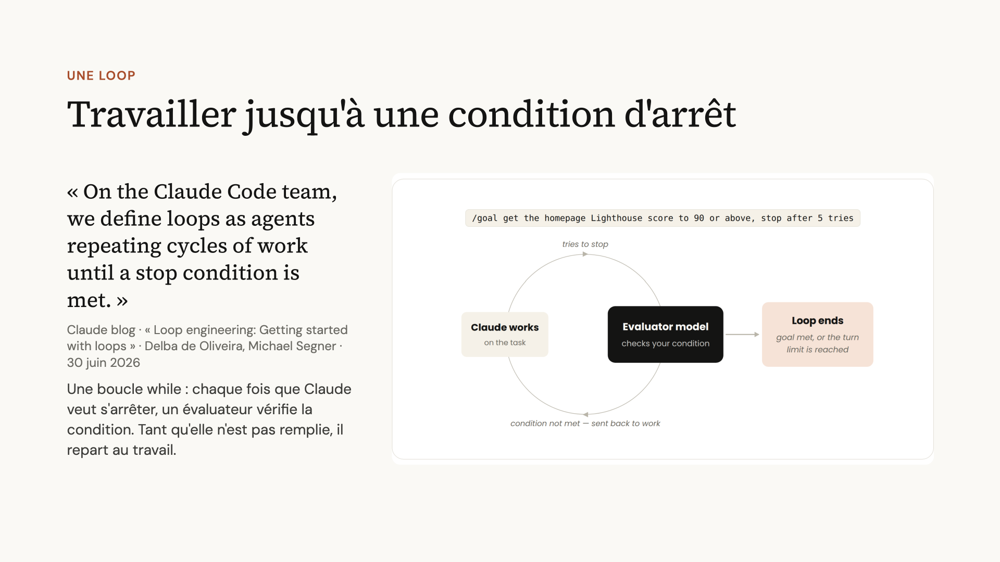

> « On the Claude Code team, we define loops as agents repeating cycles of work until a stop condition is met. »\
> — [Loop engineering: Getting started with loops](https://claude.com/blog/getting-started-with-loops), Claude blog, 30 juin 2026

Concrètement, c'est une boucle while. Chaque fois que Claude veut s'arrêter, un évaluateur vérifie la condition. Tant qu'elle n'est pas remplie, Claude repart au travail. La loop finit quand la condition est remplie ou quand la limite de tours est atteinte.

## Dire comment, ou dire quoi

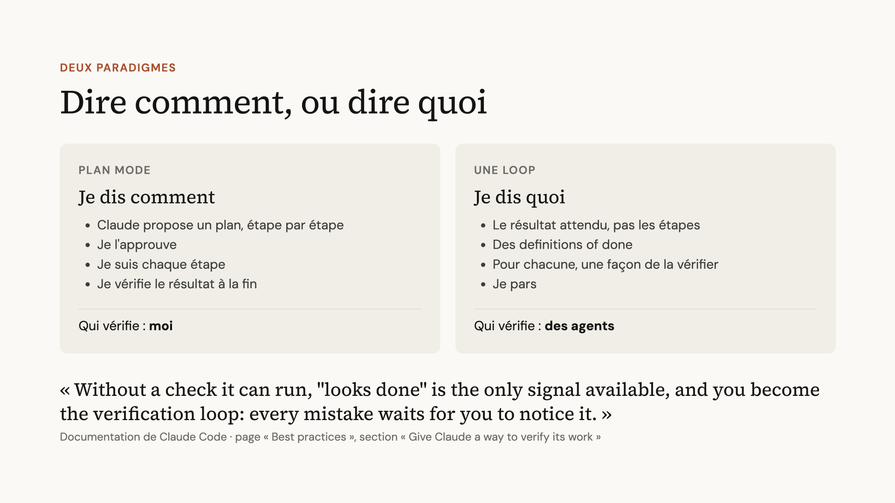

En plan mode, je dis **comment**. Claude propose un plan étape par étape, je l'approuve, je suis chaque étape et je vérifie le résultat à la fin. Celui qui vérifie, c'est moi.

Dans une loop, je dis **quoi** : le résultat attendu, pas les étapes. J'écris des definitions of done et, pour chacune, une façon de la vérifier. Puis je pars. Ceux qui vérifient, ce sont des agents.

> « Without a check it can run, "looks done" is the only signal available, and you become the verification loop: every mistake waits for you to notice it. »\
> — [Best practices de Claude Code](https://code.claude.com/docs/en/best-practices), section « Give Claude a way to verify its work »

## Une loop ne remplace pas ma review

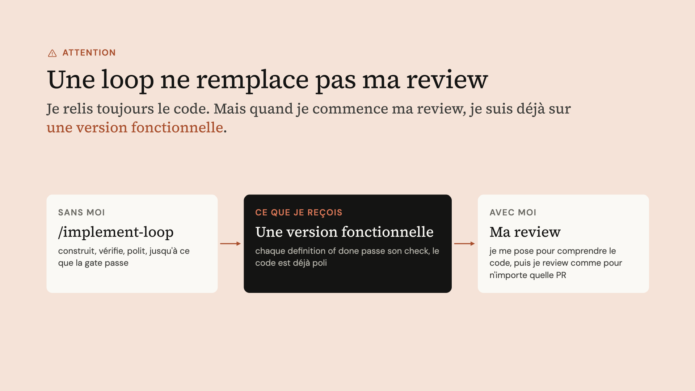

> [!WARNING]
> La loop ne veut pas dire que je ne relis pas le code. Je relis tout, et je prends le temps de le comprendre.

La différence, c'est le point de départ. Quand je commence ma review, chaque definition of done passe déjà son check, la gate est passée et le code a déjà été poli. Je relis une version qui marche, pas un premier jet. Ensuite, je fais ma review comme pour n'importe quelle PR.

## Mes skills maison

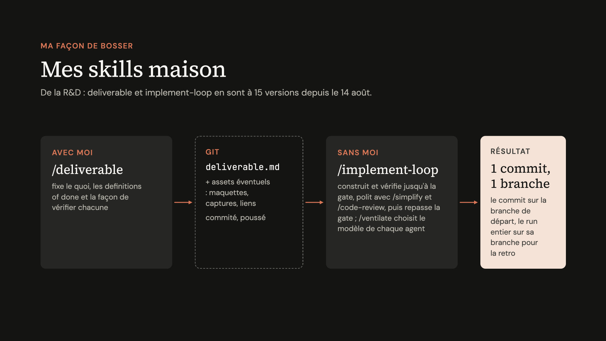

J'ai écrit mes propres skills pour ça. C'est de la R&D : deliverable et implement-loop en sont à 15 versions depuis le 14 août.

- **/deliverable**, avec moi : fixe le quoi, les definitions of done et la façon de vérifier chacune. Il produit un `deliverable.md` (plus les assets éventuels : maquettes, captures, liens), commité et poussé.
- **/implement-loop**, sans moi : construit et vérifie jusqu'à la gate, polit avec /simplify et /code-review, puis repasse la gate. /ventilate choisit le modèle de chaque agent.
- **Résultat** : 1 commit sur la branche de départ, et le run entier sur sa propre branche pour la retro.

## /deliverable : des critères de succès plutôt que des instructions

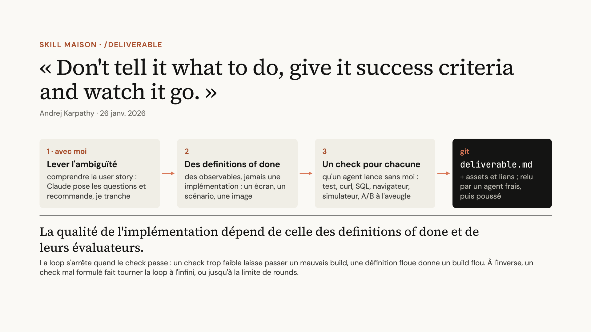

> « Don't tell it what to do, give it success criteria and watch it go. »\
> — Andrej Karpathy, 26 janv. 2026

1. **Lever l'ambiguïté**, avec moi : comprendre la user story. Claude pose les questions et recommande, je tranche.
2. **Écrire des definitions of done** : des observables, jamais une implémentation. Un écran, un scénario, une image.
3. **Un check pour chacune**, qu'un agent lance sans moi : test, curl, SQL, navigateur, simulateur, A/B à l'aveugle.

Le tout finit dans `deliverable.md`, avec ses assets et ses liens. Un agent frais le relit, puis il est poussé sur git.

> [!TIP]
> **La qualité de l'implémentation dépend de celle des definitions of done et de leurs évaluateurs.** La loop s'arrête quand le check passe : un check trop faible laisse passer un mauvais build, et une définition floue donne un build flou. À l'inverse, un check mal formulé fait tourner la loop à l'infini, ou jusqu'à la limite de rounds.

## Des évals dures, des évals molles

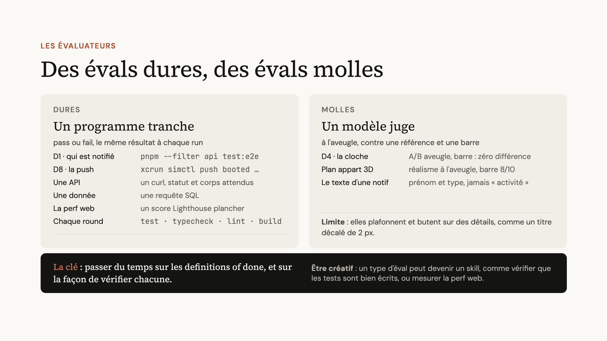

**Évals dures : un programme tranche.** C'est pass ou fail, avec le même résultat à chaque run.

| Ce qu'on vérifie | Le check |
| --- | --- |
| D1 · qui est notifié | `pnpm --filter api test:e2e` |
| D8 · la push | `xcrun simctl push booted …` |
| Une API | un curl, statut et corps attendus |
| Une donnée | une requête SQL |
| La perf web | un score Lighthouse plancher |
| Chaque round | `test · typecheck · lint · build` |

**Évals molles : un modèle juge**, à l'aveugle, contre une référence et une barre.

| Ce qu'on vérifie | La barre |
| --- | --- |
| D4 · la cloche | A/B aveugle, barre : zéro différence |
| Plan appart 3D | réalisme à l'aveugle, barre 8/10 |
| Le texte d'une notif | prénom et type, jamais « activité » |

> [!WARNING]
> **Limite** : les évals molles plafonnent et butent sur des détails, comme un titre décalé de 2 px.

> [!TIP]
> **La clé** : passer du temps sur les definitions of done, et sur la façon de vérifier chacune. Il faut aussi être créatif : un type d'éval peut devenir un skill, par exemple pour vérifier que les tests sont bien écrits ou pour mesurer la perf web.

## /implement-loop : construire, vérifier, recommencer

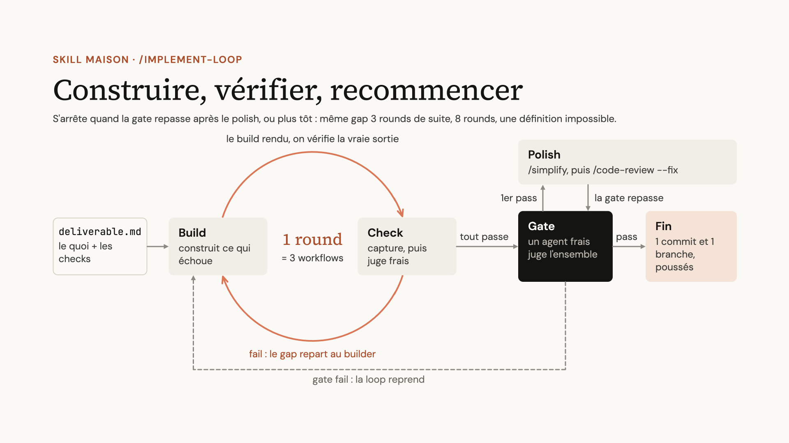

Un round, c'est trois workflows. Le build construit ce qui échoue. Le check capture la vraie sortie, puis un juge frais la note. Quand une définition échoue, le gap repart au builder.

Quand tout passe, c'est la gate : un agent frais juge l'ensemble. Au premier pass vient le polish : un agent lance /simplify, puis un autre agent frais lance /code-review high --fix, tous deux sur tout le diff du run. La gate repasse ensuite sur des captures fraîches. Si elle échoue, deux rounds de réparation suivent. S'ils ne suffisent pas, on revient à l'arbre qui avait passé la gate.

La loop s'arrête quand la gate repasse après le polish, ou plus tôt : même gap trois rounds de suite, 8 rounds atteints, ou une définition impossible. Le polish ne compte pas dans les 8 rounds. À la fin, il reste un commit sur la branche de départ, sans le brief, et une branche `implement-loop/<stamp>` qui garde chaque round, le brief et le log pour la retro.

## L'architecte ne touche jamais au code

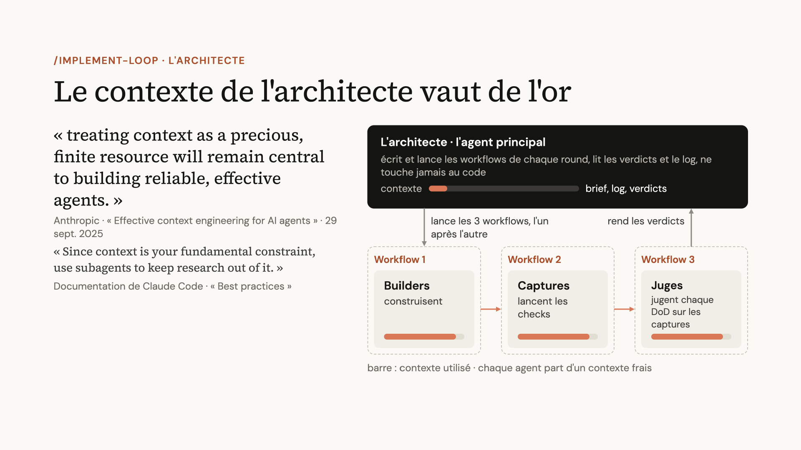

> « treating context as a precious, finite resource will remain central to building reliable, effective agents. »\
> — Anthropic, [Effective context engineering for AI agents](https://www.anthropic.com/engineering/effective-context-engineering-for-ai-agents), 29 sept. 2025

L'agent principal joue l'architecte. Il écrit et lance les workflows de chaque round, lit les verdicts et le log, et ne touche jamais au code. Son contexte se limite au brief, au log et aux verdicts. Le gros du travail part dans trois workflows lancés l'un après l'autre, et chaque agent y part d'un contexte frais.

| Workflow | Agents | Rôle |
| --- | --- | --- |
| 1 | Builders | construisent |
| 2 | Captures | lancent les checks |
| 3 | Juges | jugent chaque DoD sur les captures |

## Un modèle et un effort par rôle

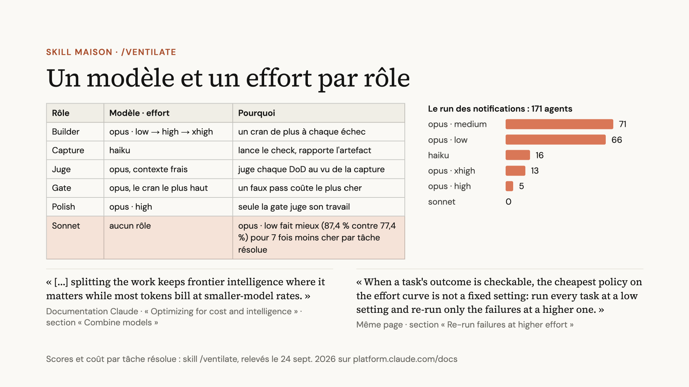

Le skill /ventilate choisit le modèle et l'effort de chaque agent.

| Rôle | Modèle · effort | Pourquoi |
| --- | --- | --- |
| Builder | opus · low → high → xhigh | un cran de plus à chaque échec |
| Capture | haiku | lance le check, rapporte l'artefact |
| Juge | opus, contexte frais | juge chaque DoD au vu de la capture |
| Gate | opus, le cran le plus haut | un faux pass coûte le plus cher |
| Polish | opus · high | seule la gate juge son travail |
| Sonnet | aucun rôle | opus · low fait mieux (87,4 % contre 77,4 %) pour 7 fois moins cher par tâche résolue |

Sur le run des notifications, 171 agents :

| Modèle · effort | Agents |  |
| --- | --- | --- |
| opus · medium | 71 | ██████████████ |
| opus · low | 66 | █████████████ |
| haiku | 16 | ███ |
| opus · xhigh | 13 | ███ |
| opus · high | 5 | █ |
| sonnet | 0 |  |

> « When a task's outcome is checkable, the cheapest policy on the effort curve is not a fixed setting: run every task at a low setting and re-run only the failures at a higher one. »\
> — Documentation Claude, « Optimizing for cost and intelligence »

_Scores et coût par tâche résolue : skill /ventilate, relevés le 24 sept. 2026 sur_ [_platform.claude.com/docs_](https://platform.claude.com/docs)_._

## Un vrai run : 16 h 16 et 171 agents, sans moi

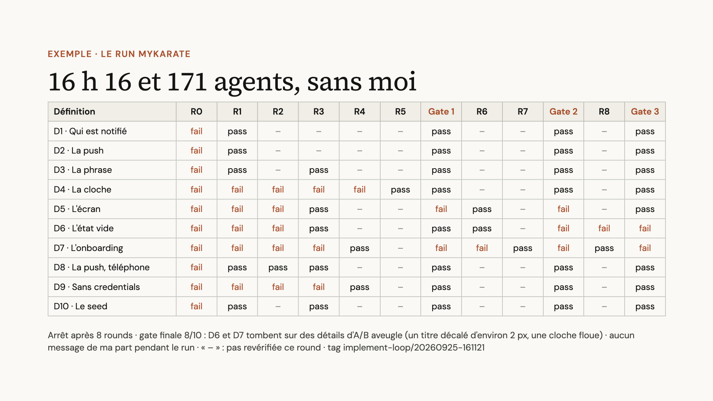

Voici le run des notifications de MyKarate : 10 definitions of done, 8 rounds et 3 gates. Je n'ai envoyé aucun message pendant le run.

| Définition | R0 | R1 | R2 | R3 | R4 | R5 | **Gate 1** | R6 | R7 | **Gate 2** | R8 | **Gate 3** |
| --- | --- | --- | --- | --- | --- | --- | --- | --- | --- | --- | --- | --- |
| D1 · Qui est notifié | fail | pass | – | – | – | – | pass | – | – | pass | – | pass |
| D2 · La push | fail | pass | – | – | – | – | pass | – | – | pass | – | pass |
| D3 · La phrase | fail | pass | – | pass | – | – | pass | – | – | pass | – | pass |
| D4 · La cloche | fail | fail | fail | fail | fail | pass | pass | – | – | pass | – | pass |
| D5 · L'écran | fail | fail | fail | pass | – | – | fail | pass | – | fail | – | pass |
| D6 · L'état vide | fail | fail | fail | pass | – | – | pass | pass | – | fail | fail | fail |
| D7 · L'onboarding | fail | fail | fail | fail | pass | – | fail | fail | pass | fail | pass | fail |
| D8 · La push, téléphone | fail | pass | pass | pass | – | – | pass | – | – | pass | – | pass |
| D9 · Sans credentials | fail | fail | fail | fail | pass | – | pass | – | – | pass | – | pass |
| D10 · Le seed | fail | pass | – | pass | – | – | pass | – | – | pass | – | pass |

_« – » : pas revérifiée ce round · tag_ `implement-loop/20260925-161121`

La loop s'est arrêtée après 8 rounds, avec une gate finale à 8/10. D6 et D7 tombent sur des détails d'A/B aveugle : un titre décalé d'environ 2 px et une cloche floue. C'est exactement la limite des évals molles décrite plus haut.

## /retro : améliorer mes loops en itérant

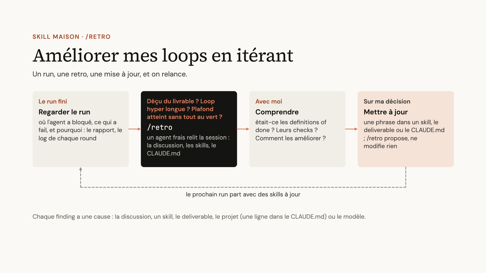

Le cycle est simple : un run, une retro, une mise à jour, et on relance.

1. **Regarder le run** : où l'agent a bloqué, ce qui a échoué et pourquoi, à partir du rapport et du log de chaque round.
2. **Lancer /retro** quand le livrable me déçoit, que la loop a été hyper longue, ou qu'elle a atteint son plafond sans tout au vert. Un agent frais relit la session : la discussion, les skills, le `CLAUDE.md`.
3. **Comprendre**, avec moi : le problème venait-il des definitions of done ? De leurs checks ? Comment les améliorer ?
4. **Mettre à jour**, sur ma décision : une phrase dans un skill, dans le deliverable ou dans le `CLAUDE.md`. /retro propose, il ne modifie rien.

Le prochain run part avec des skills à jour. Chaque finding a une cause : la discussion, un skill, le deliverable, le projet (une ligne dans le `CLAUDE.md`) ou le modèle.

## Ce qu'il faut retenir

- Je ne dis plus à Claude comment faire, je lui dis quoi obtenir : des definitions of done observables, chacune avec un check qu'un agent lance sans moi.
- La qualité du build dépend de celle des definitions of done et de leurs évaluateurs. C'est là que je passe mon temps.
- J'utilise des évals dures quand un programme peut trancher, et des évals molles quand il faut un juge, en sachant qu'elles plafonnent.
- Une loop ne remplace pas ma review : elle me livre une version fonctionnelle à relire.
- Après chaque run, une retro améliore les skills pour le suivant.

---

_Reste une question : où faire tourner des loops de plusieurs heures ? Ce sera le sujet d'un prochain article._
