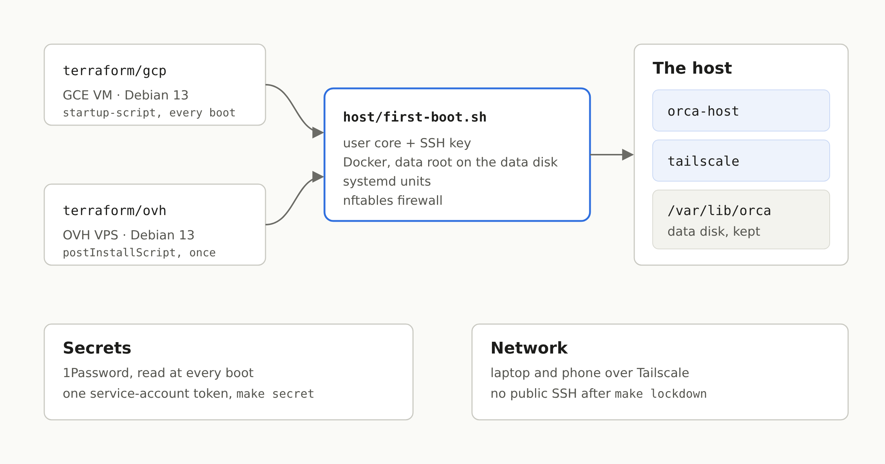

My coding agents have been running on a VM for a few weeks: one VM per person, [Orca](https://github.com/stablyai/orca) on it, driven from the laptop or the phone over Tailscale ([the setup](/en/blog/ship-my-laptop-getting-claude-code-off-my-computer), [two weeks later](/en/blog/a-vm-for-my-coding-agents-two-weeks-in)). Both articles ended on the same open point: about $126 a month on GCP, against an OVH VPS for a fraction of that. The host now runs on OVH, for €13.30 excl. VAT a month, and the GCP version still works from the same code.



## Why it wasn't just "another Terraform provider"

On GCP, the host was an immutable OS, [Flatcar](https://www.flatcar.org/), configured at boot by [Ignition](https://coreos.github.io/ignition/) from Terraform, with the 1Password token in Secret Manager. None of it moves to an OVH VPS: it takes no custom image and no user-data. What it does take is one of OVH's own images, and a bash script run once at the first boot after a reinstall (`postInstallScript` on [`POST /vps/{serviceName}/rebuild`](https://eu.api.ovh.com/console/?section=%2Fvps&branch=v1)).

That left two options: keep Flatcar on GCP and write a second host for OVH, or make one host that boots the same way everywhere. I took the second one. The VM is now Debian 13 on both providers, and everything it is fits in one script, `host/first-boot.sh.tftpl`, rendered by Terraform: the `core` user and its SSH key, the data disk mounted on `/var/lib/orca`, Docker pinned from Docker's apt repository with its data root on that disk, the systemd units, the firewall. The containers didn't change.

The two providers run it differently. On GCP it is the instance's `startup-script`, run at every boot; on OVH it runs once. So the script has to stop at once when it has already been applied:

```bash
# This very script, applied already: nothing to do. Its hash is on the boot disk, so a new VM runs it in full.
stamp=/etc/orca-host/first-boot.sha256
self=$( [ ! -f "$0" ] || sha256sum < "$0" )
[ -z "$self" ] || [ "$self" != "$(cat "$stamp" 2>/dev/null)" ] || exit 0
```

The cost of that choice: the OS is no longer immutable. A Debian with unattended upgrades, which the script also sets up, rather than an image you swap out whole.

## One Terraform root per provider

`terraform/gcp/` and `terraform/ovh/` sit side by side, and the Makefile picks one with `PROVIDER`. On OVH, Terraform orders the VPS when you give it none, or imports the one you already have:

```hcl
import {
  for_each = var.service_name == "" ? [] : [var.service_name]
  to       = ovh_vps.vps
  id       = each.value
}

resource "ovh_vps" "vps" {
  display_name         = var.name
  ovh_subsidiary       = var.ovh_subsidiary
  do_not_send_password = true
  plan = [{
    duration     = "P1M"
    plan_code    = var.plan_code
    pricing_mode = "default"
    configuration = [
      { label = "vps_datacenter", value = var.datacenter },
      { label = "vps_os", value = var.image_name },
    ]
  }]

  lifecycle {
    prevent_destroy = true
    ignore_changes  = [ovh_subsidiary, plan, plan_option, image_id, public_ssh_key, do_not_send_password]
  }
}
```

An order costs money, so `prevent_destroy` matters more here than anywhere else: Terraform refuses any plan that would delete the VPS, so it never terminates it, and never replaces it either, which would be a second order. Termination stays in the control panel, where OVH confirms it by email anyway.

The [`ovh` provider](https://registry.terraform.io/providers/ovh/ovh/latest/docs/resources/vps) doesn't pass a post-install script. The install is therefore a `terraform_data` that calls the [`ovhcloud` CLI](https://github.com/ovh/ovhcloud-cli), replaced, meaning the VPS reinstalled, when the image or the SSH key changes:

```hcl
environment = {
  SERVICE = ovh_vps.vps.service_name
  IMAGE   = var.image_name
  # The script compressed: OVH answers a 500 to it as it is, some 18 kB.
  BODY = jsonencode({
    publicSshKey      = var.ssh_public_key
    postInstallScript = "#!/bin/bash\necho '${base64gzip(local.first_boot)}' | base64 -d | gunzip | bash\n"
  })
}
```

> [!WARNING]
> OVH documents no size limit for `postInstallScript`, but the API answered a 500 to our 18 kB script. Gzipped and base64-encoded behind those two lines, it is 9 kB and goes through.

Terraform and `ovhcloud` run from a small pinned tools image, under `op run`: the OVH API credentials are a 1Password item, and nothing has to be installed on the laptop. The state stays in a GCS bucket, one prefix per host.

## The secret, without Secret Manager

Everything the host needs (Tailscale key, Claude and GitHub tokens, the MCP servers' tokens) is resolved from a 1Password vault at every boot, with one service-account token. On GCP that token lived in Secret Manager, readable by the VM's service account. OVH has no equivalent, so it is now the same everywhere: `make secret` reads the token from 1Password on the laptop and writes it over SSH to `/var/lib/orca/op-token`. No secret ever goes through Terraform or its state.

The first time, there's a chicken-and-egg problem: the host joins the tailnet with a key it reads… with that very token. So the first `make secret` goes through the way in that exists before the tailnet, IAP on GCP and the public address on OVH. Once the host shows up on the tailnet, `make lockdown` closes SSH on the public address.

The firewall is nftables, in its own table so it doesn't touch Docker's rules. Its `forward` chain is the part that matters most: a project's `ports:` in a compose file publishes on `0.0.0.0`, and on a VPS with a public IP that would put a dev database on the internet.

```
chain forward {
  type filter hook forward priority filter; policy accept;
  ct state established,related accept
  iifname "tailscale0" accept
  iifname "docker0" accept
  iifname "br-*" accept
  ct state new drop
}
```

## A new host, on OVH

```bash
export PROVIDER=ovh TFVARS=~/dev/claude/config/orca-host/ovh.tfvars
make init      # once per checkout
make apply     # orders or imports the VPS, reinstalls it: Debian, Docker, the stack
make secret    # the service-account token, over SSH: the public address the first time
make pair      # the desktop client, then a QR code for the phone
make lockdown  # SSH on the tailnet only
```

The tfvars live in my own Claude Code config repository, next to the GCP one: a host name, the VPS, the 1Password vault, my SSH key and the image the host runs (the base image plus my tools, built by my repo's CI).

## What it costs, and what it gives up

A VPS-2: 4 vCores, 8 GB of RAM, 75 GB of disk, €8.49 a month. Plus a 100 GB additional disk for `/var/lib/orca` (€4.31), which survives a reinstall, and OVH's automated backup (€0.50). €13.30 excl. VAT, against about $126 for the GCP defaults. To work on several projects at once, I'd rather recommend a VPS-4 (8 vCores, 24 GB of RAM, 200 GB): €19.96 excl. VAT a month on a one-year commitment, about €24 with the additional disk. Still about a fifth of the GCP price, with more RAM.

What it gives up:

- **Half the RAM** of the GCP default (16 GB). At about 4 GB per Docker Compose stack, that's one or two projects running at once rather than three. A bigger VPS is a `plan_code`.
- **The replicated disk.** On GCP the data disk is regional, replicated across two zones, snapshotted every day with seven kept. On OVH it's one disk, and I haven't yet checked what the automated backup covers of it.
- **Logins made by hand on a host stay on that host.** gog's Google accounts, the MCP servers that only do OAuth (Sentry, Cloudflare): their tokens live in the home directory, and a new host asks for them again. The fix is to move them to 1Password too, where the service can take it.

And a detail that will catch you on the first host: the Tailscale auth key is single-use. A new host needs a new key in the 1Password item, or the `tailscale` container exits with `invalid key`.
