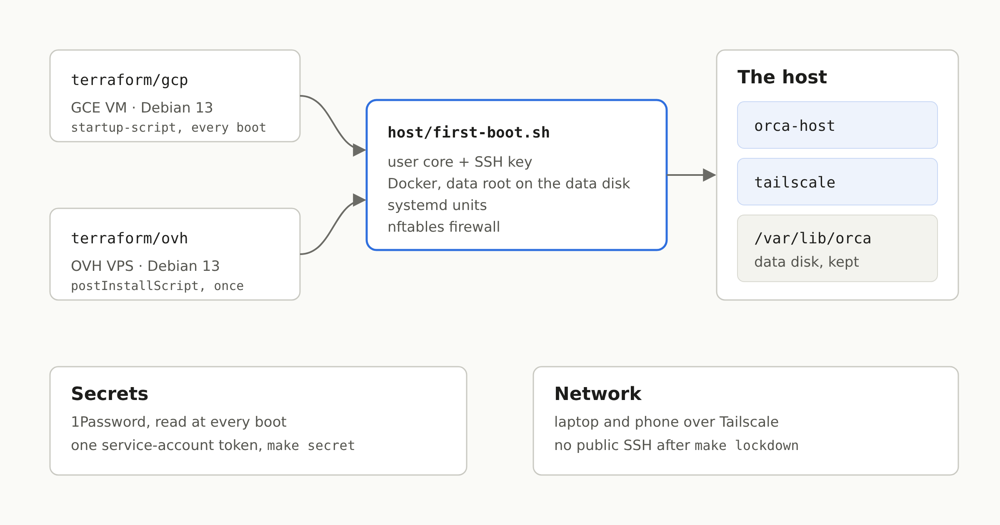

Mes agents de code tournent depuis quelques semaines sur une VM : une VM par personne, [Orca](https://github.com/stablyai/orca) dessus, pilotée depuis le laptop ou le téléphone par Tailscale ([la mise en place](/blog/ship-my-laptop-sortir-claude-code-de-mon-ordi), [deux semaines après](/blog/une-vm-pour-mes-agents-de-code-deux-semaines-apres)). Les deux articles finissaient sur le même point ouvert : environ 126 $ par mois sur GCP, contre une fraction de ça pour un VPS OVH. L'hôte tourne maintenant sur OVH, pour 13,30 € HT par mois, et la version GCP marche toujours, depuis le même code.



## Pourquoi ce n'était pas juste « un provider Terraform de plus »

Sur GCP, l'hôte était un OS immuable, [Flatcar](https://www.flatcar.org/), configuré au démarrage par [Ignition](https://coreos.github.io/ignition/) depuis Terraform, avec le token 1Password dans Secret Manager. Rien de tout ça ne passe sur un VPS OVH : il ne prend ni image perso, ni user-data. Ce qu'il prend, c'est une des images d'OVH, et un script bash lancé une fois au premier démarrage après une réinstallation (`postInstallScript` sur [`POST /vps/{serviceName}/rebuild`](https://eu.api.ovh.com/console/?section=%2Fvps&branch=v1)).

Il y avait donc deux options : garder Flatcar sur GCP et écrire un deuxième hôte pour OVH, ou faire un seul hôte qui démarre pareil partout. J'ai pris la deuxième. La VM est maintenant une Debian 13 sur les deux providers, et tout ce qu'elle est tient dans un script, `host/first-boot.sh.tftpl`, rendu par Terraform : l'utilisateur `core` et sa clé SSH, le disque de données monté sur `/var/lib/orca`, Docker épinglé depuis son dépôt apt avec sa racine sur ce disque, les units systemd, le pare-feu. Les conteneurs n'ont pas bougé.

Les deux providers ne le lancent pas pareil. Sur GCP, c'est le `startup-script` de l'instance, relancé à chaque démarrage ; sur OVH, il tourne une fois. Le script doit donc s'arrêter tout de suite quand il a déjà été appliqué :

```bash
# This very script, applied already: nothing to do. Its hash is on the boot disk, so a new VM runs it in full.
stamp=/etc/orca-host/first-boot.sha256
self=$( [ ! -f "$0" ] || sha256sum < "$0" )
[ -z "$self" ] || [ "$self" != "$(cat "$stamp" 2>/dev/null)" ] || exit 0
```

Le prix de ce choix : l'OS n'est plus immuable. Une Debian avec les mises à jour automatiques, que le script installe aussi, plutôt qu'une image qu'on remplace d'un bloc.

## Un répertoire Terraform par provider

`terraform/gcp/` et `terraform/ovh/` sont côte à côte, et le Makefile choisit avec `PROVIDER`. Sur OVH, Terraform commande le VPS si on ne lui en donne pas, ou importe celui qu'on a déjà :

```hcl
import {
  for_each = var.service_name == "" ? [] : [var.service_name]
  to       = ovh_vps.vps
  id       = each.value
}

resource "ovh_vps" "vps" {
  display_name         = var.name
  ovh_subsidiary       = var.ovh_subsidiary
  do_not_send_password = true
  plan = [{
    duration     = "P1M"
    plan_code    = var.plan_code
    pricing_mode = "default"
    configuration = [
      { label = "vps_datacenter", value = var.datacenter },
      { label = "vps_os", value = var.image_name },
    ]
  }]

  lifecycle {
    prevent_destroy = true
    ignore_changes  = [ovh_subsidiary, plan, plan_option, image_id, public_ssh_key, do_not_send_password]
  }
}
```

Une commande coûte de l'argent, donc `prevent_destroy` compte plus ici qu'ailleurs : Terraform refuse tout plan qui supprimerait le VPS, donc il ne le résilie jamais, et ne le remplace jamais non plus, ce qui serait une deuxième commande. La résiliation reste dans le panneau OVH, où OVH la confirme de toute façon par email.

Le [provider `ovh`](https://registry.terraform.io/providers/ovh/ovh/latest/docs/resources/vps) ne transmet pas de script de post-installation. L'installation est donc un `terraform_data` qui appelle la [CLI `ovhcloud`](https://github.com/ovh/ovhcloud-cli), remplacé, c'est-à-dire le VPS réinstallé, quand l'image ou la clé SSH change :

```hcl
environment = {
  SERVICE = ovh_vps.vps.service_name
  IMAGE   = var.image_name
  # The script compressed: OVH answers a 500 to it as it is, some 18 kB.
  BODY = jsonencode({
    publicSshKey      = var.ssh_public_key
    postInstallScript = "#!/bin/bash\necho '${base64gzip(local.first_boot)}' | base64 -d | gunzip | bash\n"
  })
}
```

> [!WARNING]
> OVH ne documente aucune limite de taille pour `postInstallScript`, mais l'API a répondu 500 à notre script de 18 Ko. Compressé en gzip et encodé en base64 derrière ces deux lignes, il fait 9 Ko et passe.

Terraform et `ovhcloud` tournent depuis une petite image d'outils épinglée, sous `op run` : les identifiants de l'API OVH sont un item 1Password, et rien n'est à installer sur le laptop. Le state reste dans un bucket GCS, un préfixe par hôte.

## Le secret, sans Secret Manager

Tout ce dont l'hôte a besoin (clé Tailscale, tokens Claude et GitHub, tokens des serveurs MCP) est lu dans un vault 1Password à chaque démarrage, avec un seul token de compte de service. Sur GCP, ce token était dans Secret Manager, lisible par le compte de service de la VM. OVH n'a pas d'équivalent, donc c'est maintenant pareil partout : `make secret` lit le token dans 1Password sur le laptop et l'écrit par SSH dans `/var/lib/orca/op-token`. Aucun secret ne passe par Terraform ni par son state.

La première fois, il y a un problème de poule et d'œuf : l'hôte rejoint le tailnet avec une clé qu'il lit… avec ce même token. Le premier `make secret` passe donc par l'accès qui existe avant le tailnet, IAP sur GCP et l'IP publique sur OVH. Une fois l'hôte apparu sur le tailnet, `make lockdown` ferme le SSH sur l'IP publique.

Le pare-feu est en nftables, dans sa propre table pour ne pas toucher aux règles de Docker. Sa chaîne `forward` est la partie qui compte le plus : les `ports:` d'un fichier compose publient sur `0.0.0.0`, et sur un VPS avec une IP publique, ça mettrait une base de dev sur internet.

```
chain forward {
  type filter hook forward priority filter; policy accept;
  ct state established,related accept
  iifname "tailscale0" accept
  iifname "docker0" accept
  iifname "br-*" accept
  ct state new drop
}
```

## Un nouvel hôte, sur OVH

```bash
export PROVIDER=ovh TFVARS=~/dev/claude/config/orca-host/ovh.tfvars
make init      # once per checkout
make apply     # orders or imports the VPS, reinstalls it: Debian, Docker, the stack
make secret    # the service-account token, over SSH: the public address the first time
make pair      # the desktop client, then a QR code for the phone
make lockdown  # SSH on the tailnet only
```

Les tfvars vivent dans mon repo de config Claude Code, à côté de celui de GCP : un nom d'hôte, le VPS, le vault 1Password, ma clé SSH et l'image que fait tourner l'hôte (l'image de base plus mes outils, buildée par la CI de mon repo).

## Ce que ça coûte, et ce qu'on y perd

Un VPS-2 : 4 vCores, 8 Go de RAM, 75 Go de disque, 8,49 € par mois. Plus un disque additionnel de 100 Go pour `/var/lib/orca` (4,31 €), qui survit à une réinstallation, et le backup automatique d'OVH (0,50 €). 13,30 € HT, contre environ 126 $ pour les valeurs par défaut sur GCP. Pour plusieurs projets en parallèle, je recommande plutôt un VPS-4 (8 vCores, 24 Go de RAM, 200 Go) : 19,96 € HT par mois engagé sur un an, environ 24 € avec le disque additionnel. Toujours près de cinq fois moins cher que GCP, avec plus de RAM.

Ce qu'on y perd :

- **La moitié de la RAM** du défaut GCP (16 Go). À environ 4 Go par stack Docker Compose, c'est un ou deux projets lancés en même temps plutôt que trois. Un VPS plus gros, c'est un `plan_code`.
- **Le disque répliqué.** Sur GCP, le disque de données est régional, répliqué sur deux zones, avec un snapshot par jour et sept gardés. Sur OVH, c'est un disque, et je n'ai pas encore vérifié ce que le backup automatique en couvre.
- **Les connexions faites à la main sur un hôte restent sur cet hôte.** Les comptes Google de gog, les serveurs MCP qui ne font que de l'OAuth (Sentry, Cloudflare) : leurs tokens sont dans le home, et un nouvel hôte les redemande. La solution, c'est de les passer eux aussi dans 1Password, là où le service le permet.

Et un détail qui piège au premier hôte : la clé d'authentification Tailscale ne sert qu'une fois. Un nouvel hôte a besoin d'une nouvelle clé dans l'item 1Password, sinon le conteneur `tailscale` s'arrête sur `invalid key`.
