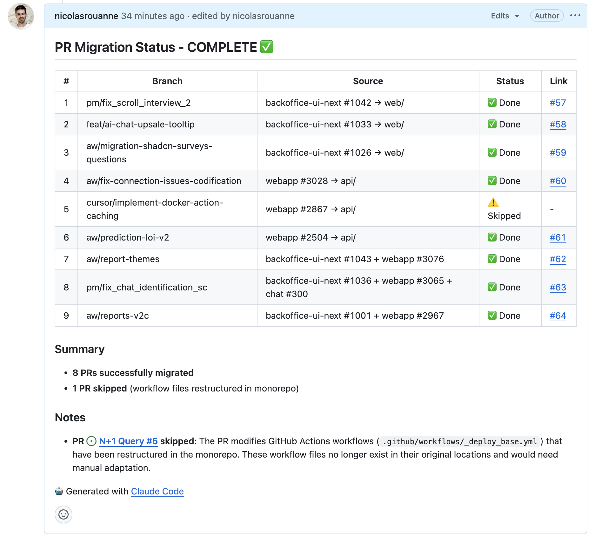

## Ever tried to migrate open PRs when consolidating repositories?

We recently moved from three separate repos (backoffice-ui-next, webapp, chat) to a single monorepo. The code migration was straightforward enough—but we had 13 open PRs that needed to come along for the ride.

Rebasing them manually? That would have been painful. Recreating them from scratch? Even worse. Instead, I used `git format-patch` and `git am` to surgically transplant each PR's commits into the new structure.

## The Setup

Our monorepo maps the old repos like this:

| Source Repo | Target Directory |
| --- | --- |
| backoffice-ui-next | `web/` |
| webapp | `api/` |
| chat | `chat/` |

Some PRs touched only one repo. Others—the tricky ones—spanned multiple repos and needed to be combined into a single monorepo PR.

## The Core Technique

The magic happens in two commands:

```bash
# Generate a patch file containing all commits from a branch
git format-patch origin/develop..origin/feature-branch --stdout > /tmp/feature.patch

# Apply the patch with a directory prefix
git am --directory=web/ /tmp/feature.patch
```

The `--directory` flag is the key. It prepends a path to every file in the patch, effectively relocating the changes to their new home in the monorepo.

## Setting Up the Remotes

First, I added all source repositories as remotes:

```bash
cd /path/to/monorepo
git remote add backoffice-ui-next https://github.com/org/backoffice-ui-next.git
git remote add webapp https://github.com/org/webapp.git
git remote add chat https://github.com/org/chat.git
git fetch --all
```

This gives you access to all branches from all repos—essential for generating the patches.

## Handling Conflicts

Of course, it wasn't all smooth sailing. When `git am` fails, you have options:

```bash
# Try 3-way merge (often resolves conflicts automatically)
git am --abort
git am --3way --directory=web/ /tmp/feature.patch

# If that fails, resolve manually
git status  # See what's conflicted
# Fix the conflicts...
git add <resolved-files>
git am --continue
```

The most common conflicts I hit:

1. **Deleted files**: Files that existed in the source repo but were removed in the monorepo. Solution: `git add` the PR's version or `git rm` if the deletion was intentional.
2. **Add/add conflicts**: Both repos created the same file. Solution: `git checkout --theirs <file>` to accept the PR's version.
3. **Structure changes**: The monorepo had refactored certain things (like GitHub workflow files). Some PRs couldn't be migrated cleanly—I skipped one that modified workflow files that no longer existed.

## Combining Multiple PRs

For features that spanned repos, I applied patches sequentially:

```bash
# Create branch
git checkout -b aw/report-themes

# Apply frontend changes
git am --directory=web/ /tmp/report-themes-backoffice.patch

# Apply backend changes
git am --directory=api/ /tmp/report-themes-webapp.patch

# Push and create PR
git push -u origin aw/report-themes
gh pr create --base develop --title "feat: report themes"
```

The result: a single PR containing changes from what were originally separate PRs across different repos.

## Git LFS Gotchas

One PR included a large ML model file tracked by Git LFS. The push failed initially:

```javascript
error: failed to push some refs
Git LFS upload failed: (missing) model.safetensors
```

The fix:

```bash
git lfs fetch webapp --all  # Fetch LFS objects from source repo
git lfs pull                 # Ensure local files are present
git push                     # Now it works
```

## The Results

| Outcome | Count |
| --- | --- |
| Successfully migrated | 8 |
| Skipped (incompatible) | 1 |
| Total PRs created | 8 |

The one skipped PR modified GitHub Actions workflows that had been completely restructured in the monorepo. Rather than force it, I flagged it for manual handling.

## What I Learned

**Do:**

- Use `--3way` when conflicts arise—it's smarter about resolving them
- Keep the original PR references in your new PR descriptions for traceability
- Test one simple PR first before tackling the complex multi-repo ones

**Don't:**

- Assume workflow/CI files will migrate cleanly—they often get restructured
- Forget about Git LFS if your repos use it
- Try to force PRs that touch deleted files—sometimes skipping is the right call

## The Automation Potential

This whole process could be scripted. The pattern is consistent:

1. Generate patch from source branch
2. Apply with directory prefix
3. Resolve conflicts (the manual part)
4. Push and create PR

For a larger migration, I'd write a script that handles steps 1, 2, and 4, pausing for human intervention on step 3 when needed.

## Tracking Progress in GitHub

One nice touch: I created a GitHub issue (#56) with the full migration plan upfront, including the source→target mapping and execution order. As Claude Code worked through each PR, it posted progress updates directly to that issue as comments.

The comment was edited in place as each PR was completed, giving a live dashboard of migration status:



This made it easy to:

- Track progress without switching contexts
- Share status with teammates who were waiting on the migration
- Have a permanent record of what was migrated and what was skipped

The issue description served as both the plan and the documentation—no separate doc needed.

---

_This migration was done with Claude Code, which handled the repetitive git commands, conflict resolution, and even posted progress updates to GitHub while I monitored the process. The combination of AI assistance for mechanical tasks and human judgment for conflict resolution worked well._
