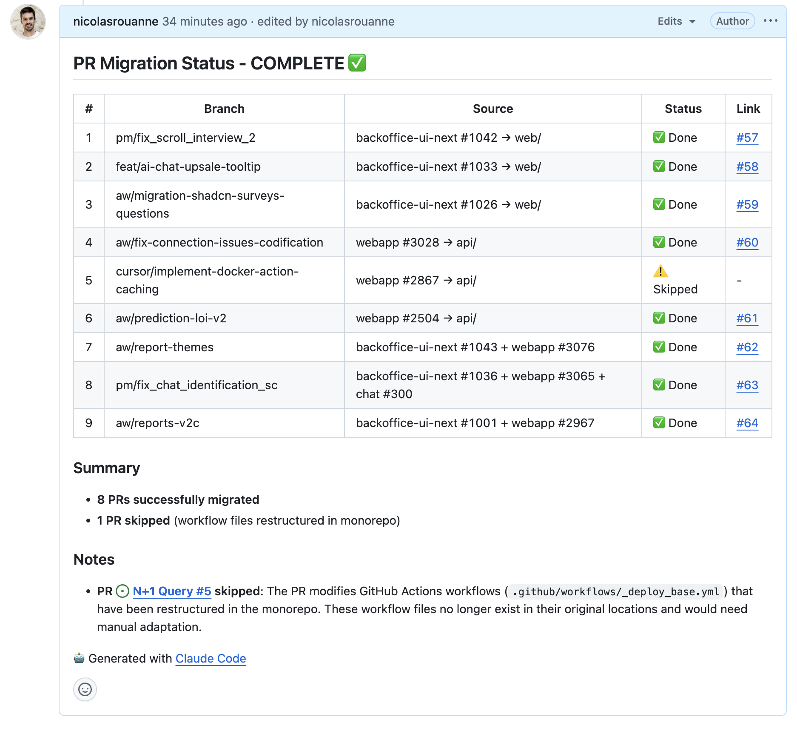

## Vous avez déjà essayé de migrer des PRs ouvertes lors d'une consolidation de repositories ?

Nous avons récemment migré de trois repos séparés (backoffice-ui-next, webapp, chat) vers un monorepo unique. La migration du code était assez simple—mais nous avions 13 PRs ouvertes qui devaient suivre.

Les rebaser manuellement ? Douloureux. Les recréer from scratch ? Encore pire. À la place, j'ai utilisé `git format-patch` et `git am` pour transplanter chirurgicalement les commits de chaque PR dans la nouvelle structure.

## La Configuration

Notre monorepo mappe les anciens repos ainsi :

| Repo Source | Répertoire Cible |
| --- | --- |
| backoffice-ui-next | `web/` |
| webapp | `api/` |
| chat | `chat/` |

Certaines PRs ne touchaient qu'un seul repo. D'autres—les plus complexes—traversaient plusieurs repos et devaient être combinées en une seule PR monorepo.

## La Technique Principale

La magie opère en deux commandes :

```bash
# Générer un fichier patch contenant tous les commits d'une branche
git format-patch origin/develop..origin/feature-branch --stdout > /tmp/feature.patch

# Appliquer le patch avec un préfixe de répertoire
git am --directory=web/ /tmp/feature.patch
```

Le flag `--directory` est la clé. Il ajoute un chemin devant chaque fichier du patch, relocalisant ainsi les changements vers leur nouveau foyer dans le monorepo.

## Configurer les Remotes

D'abord, j'ai ajouté tous les repositories sources comme remotes :

```bash
cd /chemin/vers/monorepo
git remote add backoffice-ui-next https://github.com/org/backoffice-ui-next.git
git remote add webapp https://github.com/org/webapp.git
git remote add chat https://github.com/org/chat.git
git fetch --all
```

Cela donne accès à toutes les branches de tous les repos—essentiel pour générer les patches.

## Gérer les Conflits

Bien sûr, tout n'était pas parfait. Quand `git am` échoue, plusieurs options :

```bash
# Essayer le merge 3-way (résout souvent les conflits automatiquement)
git am --abort
git am --3way --directory=web/ /tmp/feature.patch

# Si ça échoue, résoudre manuellement
git status  # Voir ce qui est en conflit
# Corriger les conflits...
git add <fichiers-résolus>
git am --continue
```

Les conflits les plus fréquents :

1. **Fichiers supprimés** : Des fichiers qui existaient dans le repo source mais ont été supprimés dans le monorepo. Solution : `git add` la version de la PR ou `git rm` si la suppression était intentionnelle.
2. **Conflits add/add** : Les deux repos ont créé le même fichier. Solution : `git checkout --theirs <fichier>` pour accepter la version de la PR.
3. **Changements de structure** : Le monorepo avait refactorisé certaines choses (comme les fichiers GitHub workflow). Certaines PRs ne pouvaient pas migrer proprement—j'en ai sauté une qui modifiait des fichiers workflow qui n'existaient plus.

## Combiner Plusieurs PRs

Pour les features qui traversaient plusieurs repos, j'ai appliqué les patches séquentiellement :

```bash
# Créer la branche
git checkout -b aw/report-themes

# Appliquer les changements frontend
git am --directory=web/ /tmp/report-themes-backoffice.patch

# Appliquer les changements backend
git am --directory=api/ /tmp/report-themes-webapp.patch

# Push et créer la PR
git push -u origin aw/report-themes
gh pr create --base develop --title "feat: report themes"
```

Le résultat : une seule PR contenant les changements de ce qui était à l'origine des PRs séparées dans différents repos.

## Les Pièges Git LFS

Une PR incluait un gros fichier de modèle ML tracké par Git LFS. Le push a échoué initialement :

```javascript
error: failed to push some refs
Git LFS upload failed: (missing) model.safetensors
```

La solution :

```bash
git lfs fetch webapp --all  # Récupérer les objets LFS du repo source
git lfs pull                 # S'assurer que les fichiers locaux sont présents
git push                     # Maintenant ça marche
```

## Les Résultats

| Résultat | Nombre |
| --- | --- |
| Migrées avec succès | 8 |
| Ignorées (incompatibles) | 1 |
| Total PRs créées | 8 |

La PR ignorée modifiait des workflows GitHub Actions qui avaient été complètement restructurés dans le monorepo. Plutôt que de forcer, je l'ai marquée pour traitement manuel.

## Ce que j'ai appris

**À faire :**

- Utiliser `--3way` quand il y a des conflits—c'est plus intelligent pour les résoudre
- Garder les références des PRs originales dans les descriptions des nouvelles PRs pour la traçabilité
- Tester une PR simple d'abord avant de s'attaquer aux multi-repos complexes

**À éviter :**

- Supposer que les fichiers workflow/CI migreront proprement—ils sont souvent restructurés
- Oublier Git LFS si vos repos l'utilisent
- Essayer de forcer des PRs qui touchent des fichiers supprimés—parfois ignorer est le bon choix

## Le Potentiel d'Automatisation

Tout ce processus pourrait être scripté. Le pattern est cohérent :

1. Générer le patch depuis la branche source
2. Appliquer avec le préfixe de répertoire
3. Résoudre les conflits (la partie manuelle)
4. Push et créer la PR

Pour une migration plus large, j'écrirais un script qui gère les étapes 1, 2 et 4, en pausant pour intervention humaine à l'étape 3 si nécessaire.

## Suivi de la Progression dans GitHub

Un plus appréciable : j'ai créé une issue GitHub (#56) avec le plan de migration complet dès le départ, incluant le mapping source→cible et l'ordre d'exécution. Pendant que Claude Code traitait chaque PR, il postait des mises à jour directement sur cette issue en commentaires.

Le commentaire était édité au fur et à mesure que chaque PR était complétée, offrant un tableau de bord en temps réel du statut de migration :\




Cela permettait de :

- Suivre la progression sans changer de contexte
- Partager le statut avec les collègues qui attendaient la migration
- Avoir un historique permanent de ce qui a été migré et ce qui a été ignoré

La description de l'issue servait à la fois de plan et de documentation—pas besoin de doc séparée.

---

_Cette migration a été réalisée avec Claude Code, qui a géré les commandes git répétitives, la résolution des conflits, et même posté les mises à jour de progression sur GitHub pendant que je supervisais le processus. La combinaison de l'assistance IA pour les tâches mécaniques et du jugement humain pour la résolution des conflits a bien fonctionné._
