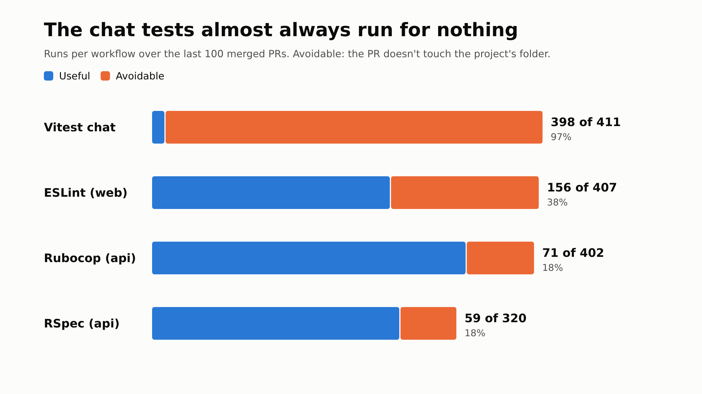
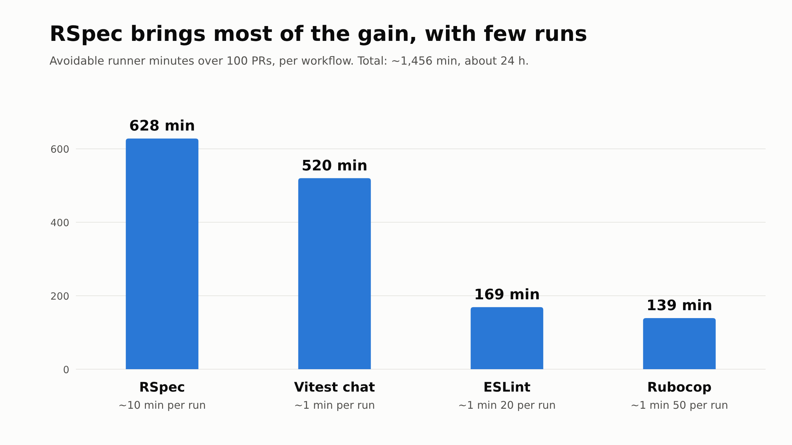
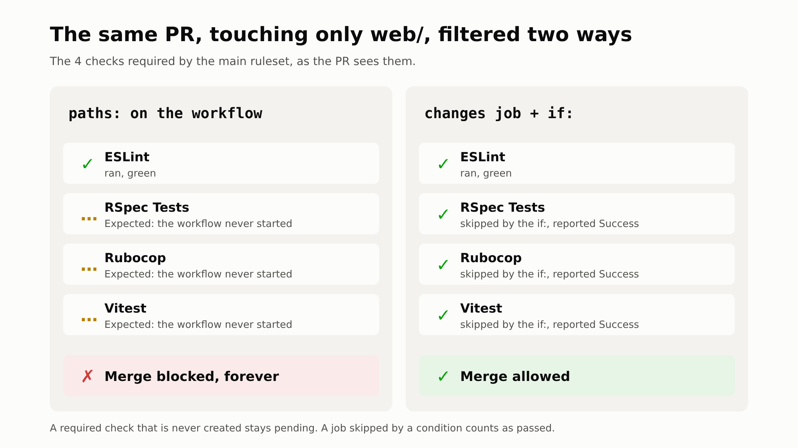
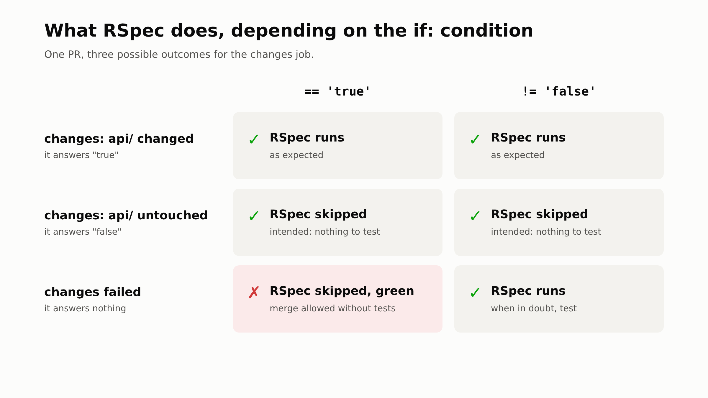
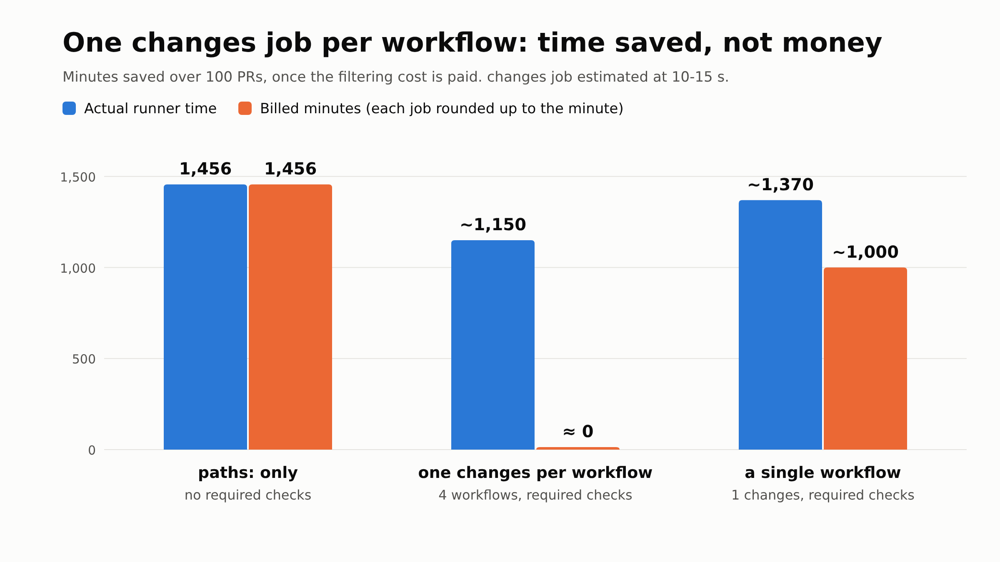

On one of the products we work on, the monorepo holds three projects: a Rails API (`api/`), a front end (`web/`) and a chat (`chat/`). Every PR runs four checks: RSpec, Rubocop, ESLint and the chat's Vitest tests. All four are required to merge into `main`, and all four run whatever part the PR changes. So a PR that only touches the front end still runs RSpec, which takes about ten minutes.

Before changing anything, we measured what it costs.

## What runs for nothing

We took the last 100 merged PRs and all their CI runs (passed or failed, cancelled runs left out), with their actual duration. A run is avoidable when the PR doesn't touch its project's folder.



Out of 1,540 runs, 684 were avoidable. The chat tests are the extreme case: 398 runs out of 411 for PRs that didn't touch the chat, because very few PRs change it.

In minutes, RSpec weighs the most. It has few avoidable runs (59), but each one lasts about 10 minutes.



In total, about 1,456 runner minutes, roughly 24 hours per 100 PRs. That's the ceiling: what we'd save if filtering cost nothing.

## Why `paths:` isn't enough

The first idea is a `paths:` filter on the workflow's trigger:

```yaml
name: API - Tests

on:
  pull_request:
    paths:
      - 'api/**'
      - '.github/workflows/api-test.yml'
```

With that, a PR that doesn't touch `api/` doesn't start this workflow at all: no RSpec, no runner.

The problem comes from the protection rules on `main`. Our ruleset requires four checks to be green before merging: `RSpec Tests`, `Rubocop`, `ESLint` and `Vitest`. A workflow that doesn't start doesn't create its check. On a PR that only touches `web/`, GitHub waits for an `RSpec Tests` check that will never come: it shows it as "Expected", and the merge button stays blocked.



GitHub's docs say so in [Handling skipped but required checks](https://docs.github.com/en/pull-requests/collaborating-with-pull-requests/collaborating-on-repositories-with-code-quality-features/troubleshooting-required-status-checks#handling-skipped-but-required-checks): a workflow skipped by path filtering leaves its checks pending and blocks the merge, while a job skipped by an `if:` condition is reported as passed. And a ruleset can't require a check for some paths only.

We could remove those checks from the required ones to unblock the merge. But we could then merge a PR with red tests, and we don't want that.

## A `changes` job and an `if:`

We keep the four workflows and run them on every PR, but each one starts with a small `changes` job that looks at which folders the PR changes (with `dorny/paths-filter`). The heavy job depends on it, and only runs if its folder changed:

```yaml
jobs:
  changes:
    runs-on: ubuntu-latest
    permissions:
      contents: read
      pull-requests: read
    outputs:
      api: ${{ steps.filter.outputs.api }}
    steps:
      - uses: actions/checkout@v6
      - uses: dorny/paths-filter@v4
        id: filter
        with:
          filters: |
            api:
              - 'api/**'
              - '.github/workflows/api-test.yml'

  test:
    name: RSpec Tests
    needs: changes
    if: ${{ !cancelled() && needs.changes.outputs.api != 'false' }}
    runs-on: ubuntu-latest
    # ...
```

When the heavy job is skipped, GitHub counts it as passed. The required `RSpec Tests` check passes, and the ruleset doesn't change. The workflow file is part of its own filter, so that a PR changing the workflow tests it.

On a push to `main`, the same `changes` job compares the commit with the previous one. Since we merge with merge commits, that diff holds all the PR's files.

## When the detection fails

The `changes` job can fail, during a GitHub outage for instance. It then answers neither "yes" nor "no": its `api` output is empty. Everything depends on how RSpec's `if:` is written.



- `== 'true'`: RSpec runs only if the detection answered "yes". If it fails, RSpec is skipped, so counted as passed, and the PR can be merged without a single test having run.
- `!= 'false'`: RSpec runs unless the detection answered "no". If it fails, RSpec runs, as before the filtering.

The `!cancelled()` at the start of the condition is needed. Without it, GitHub skips a job whose dependency failed outright, without even looking at the rest of the `if:`.

The two conditions look a lot alike. In our PR, one replaced the other for a while, and the review caught it.

## What it saves, in time and on the bill

The `changes` job isn't free. It runs on every run, for about ten seconds. Over 1,540 runs, that's between 260 and 385 minutes of actual runner time.

On the bill it's worse: GitHub rounds each job up to the minute. Each `changes` is billed one minute, about 1,540 billed minutes, roughly what we avoid.



- `paths:` alone saves everything, but without required checks;
- a `changes` job in each of the four workflows saves about 1,150 minutes of actual runner time (about twenty hours per 100 PRs), and almost nothing in billed minutes;
- a single workflow with a single `changes` job shared by all jobs pays for the filtering once per push: about 411 billed minutes, so about 1,000 billed minutes saved.

We kept four separate workflows: each project keeps its own file, and it stays readable. On the bill the gap is small anyway: a Linux minute costs a few tenths of a cent at the standard rate. What we get back is mostly runners freed up sooner for the other PRs.

## Keeping the CI metrics right

We already send each check's duration to PostHog to track CI feedback (we wrote about it in [Tracking a team's tech OKRs in PostHog](/en/blog/tracking-a-team-s-tech-okrs-in-posthog-straight-from-github-actions)). A skipped check now finishes in about ten seconds, with only its `changes` job. Sent as is, it would bring RSpec's average duration down without RSpec getting any faster.

So the script reads each check's jobs, and doesn't send the duration of a check where only `changes` ran. PostHog ignores a missing value in an average, so the per-check averages only measure real runs. The developer's total wait still counts every check.

> [!NOTE]
> The figures come from 100 PRs, with run durations excluding queue time. The `changes` job's duration is estimated from a few runs, and the billed minutes assume GitHub's standard rate, which depends on the repo's plan.
