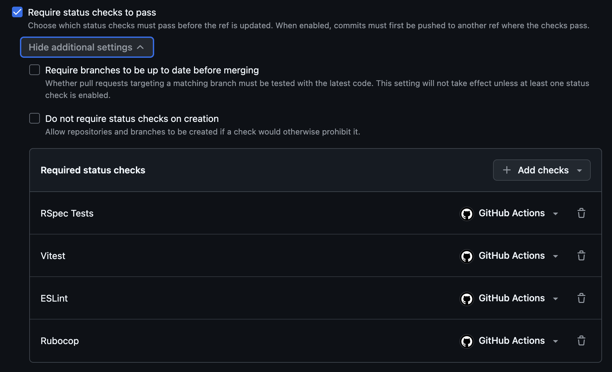
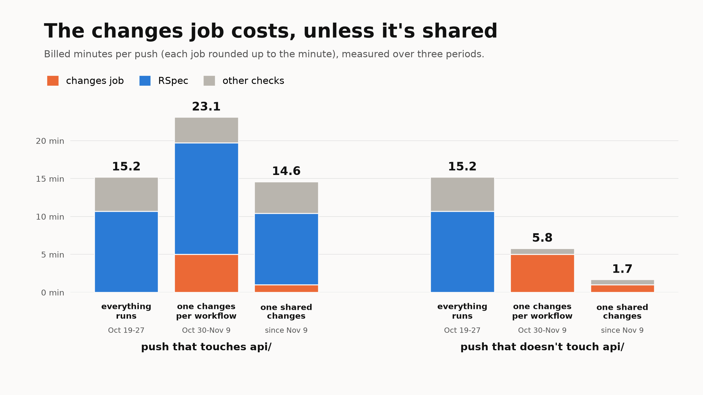
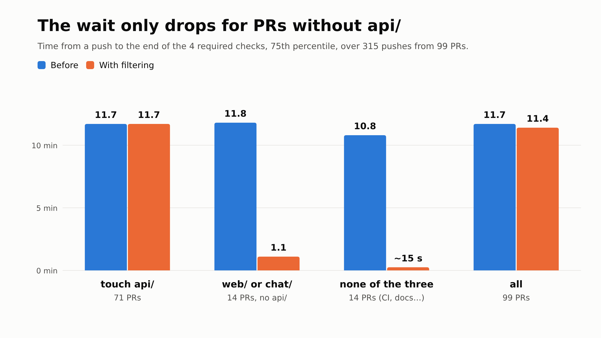

On one of the products we work on, the monorepo holds three projects: a Rails API (`api/`), a front end (`web/`) and a chat (`chat/`). Every PR runs four checks: RSpec, Rubocop, ESLint and the chat's Vitest tests. All four are required to merge into `main`, and all four run whatever part the PR changes. So a PR that only touches the front end still runs RSpec, which takes about ten minutes.

Before changing anything, we measured what it costs.

## What runs for nothing

We took the last 100 merged PRs and all their CI runs (passed or failed, cancelled runs left out), with their actual duration. A run is avoidable when the PR doesn't touch its project's folder.


Out of 1,540 runs, 684 were avoidable. The chat tests are the extreme case: 398 runs out of 411 for PRs that didn't touch the chat, because very few PRs change it.

In minutes, RSpec weighs the most. It has few avoidable runs (59), but each one lasts about 10 minutes.


In total, about 1,456 runner minutes, roughly 24 hours per 100 PRs. That's the ceiling: what we'd save if filtering cost nothing.

## Why `paths:` isn't enough

The first idea is a `paths:` filter on the workflow's trigger:

```yaml
name: API - Tests

on:
  pull_request:
    paths:
      - 'api/**'
      - '.github/workflows/api-test.yml'
```

With that, a PR that doesn't touch `api/` doesn't start this workflow at all: no RSpec, no runner.

The problem comes from the protection rules on `main`. Our ruleset requires four checks to be green before merging: `RSpec Tests`, `Rubocop`, `ESLint` and `Vitest`. A workflow that doesn't start doesn't create its check. On a PR that only touches `web/`, GitHub waits for an `RSpec Tests` check that will never come: it shows it as "Expected", and the merge button stays blocked.




GitHub's docs say so in [Handling skipped but required checks](https://docs.github.com/en/pull-requests/collaborating-with-pull-requests/collaborating-on-repositories-with-code-quality-features/troubleshooting-required-status-checks#handling-skipped-but-required-checks): a workflow skipped by path filtering leaves its checks pending and blocks the merge, while a job skipped by an `if:` condition is reported as passed. And a ruleset can't require a check for some paths only.

We could remove those checks from the required ones to unblock the merge. But we could then merge a PR with red tests, and we don't want that.

## A `changes` job and an `if:`

We keep the four workflows and run them on every PR, but each one starts with a small `changes` job that looks at which folders the PR changes (with `dorny/paths-filter`). The heavy job depends on it, and only runs if its folder changed:

```yaml
jobs:
  changes:
    runs-on: ubuntu-latest
    permissions:
      contents: read
      pull-requests: read
    outputs:
      api: ${{ steps.filter.outputs.api }}
    steps:
      - uses: actions/checkout@v6
      - uses: dorny/paths-filter@v4
        id: filter
        with:
          filters: |
            api:
              - 'api/**'
              - '.github/workflows/api-test.yml'

  test:
    name: RSpec Tests
    needs: changes
    if: ${{ !cancelled() && needs.changes.outputs.api != 'false' }}
    runs-on: ubuntu-latest
    # ...
```

When the heavy job is skipped, GitHub counts it as passed. The required `RSpec Tests` check passes, and the ruleset doesn't change. The workflow file is part of its own filter, so that a PR changing the workflow tests it.

On a push to `main`, the same `changes` job compares the commit with the previous one. Since we merge with merge commits, that diff holds all the PR's files.

## When the detection fails

The `changes` job can fail, during a GitHub outage for instance. It then answers neither "yes" nor "no": its `api` output is empty. Everything depends on how RSpec's `if:` is written.


- `== 'true'`: RSpec runs only if the detection answered "yes". If it fails, RSpec is skipped, so counted as passed, and the PR can be merged without a single test having run.
- `!= 'false'`: RSpec runs unless the detection answered "no". If it fails, RSpec runs, as before the filtering.

The `!cancelled()` at the start of the condition is needed. Without it, GitHub skips a job whose dependency failed outright, without even looking at the rest of the `if:`.

The two conditions look a lot alike. In our PR, one replaced the other for a while, and the review caught it.

## What it saves, in time and on the bill

The `changes` job isn't free. It runs on every run, for about ten seconds. Over 1,540 runs, that's between 260 and 385 minutes of actual runner time.

On the bill it's worse: GitHub rounds each job up to the minute. Each `changes` is billed one minute, about 1,540 billed minutes, roughly what we avoid.


- `paths:` alone saves everything, but without required checks;
- a `changes` job in each of the four workflows saves about 1,150 minutes of actual runner time (about twenty hours per 100 PRs), and almost nothing in billed minutes;
- a single workflow with a single `changes` job shared by all jobs pays for the filtering once per push: about 411 billed minutes, so about 1,000 billed minutes saved.

We first kept a `changes` job in each workflow: each project keeps its own file, and it stays readable. In the meantime, the front end's tests (Vitest) joined the CI. That makes five workflows, so five `changes` jobs billed on every push.

## A single `changes` job, each project keeps its file

In the end we didn't have to choose between readable files and the bill. A `ci.yml` workflow runs the `changes` job once per push, then calls each project's workflow with `workflow_call`, passing it a boolean:

```yaml
name: CI

on:
  pull_request:
  push:
    branches: [main]

jobs:
  changes:
    runs-on: ubuntu-latest
    permissions:
      contents: read
      pull-requests: read
    outputs:
      api: ${{ steps.filter.outputs.api }}
    steps:
      - uses: actions/checkout@v6
      - uses: dorny/paths-filter@v4
        id: filter
        with:
          filters: |
            api: [api/**, .github/workflows/api-test.yml, .github/workflows/ci.yml]

  api-test:
    name: API - Tests
    needs: changes
    if: ${{ !cancelled() }}
    uses: ./.github/workflows/api-test.yml
    with:
      run: ${{ needs.changes.result != 'success' || needs.changes.outputs.api == 'true' }}
```

The API workflow no longer triggers on its own on a PR. It runs when `ci.yml` calls it, and it's the one that skips its job:

```yaml
name: API - Tests

on:
  workflow_call:
    inputs:
      run:
        type: boolean
        required: true

jobs:
  test:
    name: RSpec Tests
    if: ${{ inputs.run }}
    runs-on: ubuntu-latest
    # ...
```

The skip has to happen there, in the called workflow. With an `if:` on the `api-test` job of `ci.yml`, the API workflow would never start: the `RSpec Tests` check wouldn't exist, and we'd be back to the "Expected" check that blocks the merge. Skipped in the called workflow, the job is created, then reported as successful. We checked it before merging, with a demo PR that only touches `web/` and a test ruleset: RSpec, Rubocop and the chat's tests were skipped, and the PR was mergeable.

The condition also spells out what happens when detection crashes: if the `changes` job didn't succeed, everything runs. Same principle as `!= 'false'`, without having to remember what an empty output evaluates to.

One trap at merge time: the checks get new names. `RSpec Tests` becomes `API - Tests / RSpec Tests`. The `main` ruleset has to be updated right after the merge, or it waits for the old names and blocks every PR. Open PRs pick up the new checks on their next push.

## What it changed on the bill, measured

We redid the count on the real runs, over three periods: before filtering (October 19 to 27, 166 pushes), with one `changes` per workflow (October 30 to November 9, 171 pushes) and with the shared `changes` (since November 9, 70 pushes). For each push, we add up the billed minutes of each job, rounded up to the minute.



- A push that doesn't touch `api/` goes from 15.2 billed minutes to 5.8 with one `changes` per workflow, 5 of which are the `changes` jobs alone. With the shared job, it drops to 1.7.
- A push that touches `api/` costs more with one `changes` per workflow: 5 more minutes to decide to run what was already running. With the shared job, that overhead drops to one minute.

The blue moves too, but that's not the filtering. RSpec slowed down in late October: the suite keeps growing, and its duration depends on which CPU the runner lands on. Then it sped up on November 9, with other changes merged the same day (more on that below).

To isolate the filtering, we keep RSpec at its earlier duration and take the real mix of pushes: 77% touch `api/`. A push cost 15.2 billed minutes without filtering. With one `changes` per workflow, it's 16.0, so 5% more than not filtering at all. With the shared job, it's 12.6, 17% less. Over about 1,400 pushes a month, that's about 3,600 billed minutes, around twenty dollars at the standard rate.

In dollars, that's not much. What we mostly get back is runners freed up sooner, and PRs that no longer wait for the CI when they don't touch the API.

## And the wait?

Runner minutes are the bill. For a developer, what matters is the time between their push and the moment the four required checks are done. Before changing anything, we computed it on the same 100 PRs: 315 pushes, queue time included.

The four checks run in parallel, so you wait for the longest one. That's RSpec in 310 pushes out of 315. And 71 PRs out of 99 touch `api/`: for those, RSpec runs anyway, and nothing changes.



- PRs that touch `api/`: 11.7 min at the 75th percentile, before and after;
- PRs that only touch `web/` or `chat/`: from 11.8 min to 1.1 min;
- PRs that touch none of the three (CI, docs): from 10.8 min to about fifteen seconds, the time of the `changes` job.

The measurements on the real runs confirm it: a push that doesn't touch `api/` waits 1.1 min at the 75th percentile, with one `changes` per workflow as with the shared job.

For the typical PR, the one that touches the API, filtering saves nothing: RSpec itself has to get faster. That's the next part of the work, and three changes were merged on November 9. The permissions catalog, resynced in a good share of the tests, is now loaded once per suite. The job's setup is lighter. And the tool that flags lines changed without tests is no longer compiled on every new PR. Over the first 16 pushes that touch `api/`, the RSpec job goes from 14.7 to 9.4 minutes on average, and the wait from 16.8 to 10.2 min at the 75th percentile. That's still few pushes, but that's where the rest of the bill is: RSpec makes up nearly two thirds of the billed minutes.

## Keeping the CI metrics right

We already send each check's duration to PostHog to track CI feedback (we wrote about it in [Tracking a team's tech OKRs in PostHog](/en/blog/tracking-a-team-s-tech-okrs-in-posthog-straight-from-github-actions)). A skipped check now finishes in a few seconds. Sent as is, it would bring RSpec's average duration down without RSpec getting any faster.

So the script reads the run's jobs, and doesn't send the duration of a skipped check. PostHog ignores a missing value in an average, so the per-check averages only measure real runs. The developer's total wait still counts every check.

> [!NOTE]
> The estimates come from 100 PRs, and the wait includes queue time. The measurements come from the real runs of the three periods (166, 171 and 70 pushes), without cancelled runs. The last one only covers a day and a half, and its pushes touch the API less often than usual, hence the calculation with a constant mix. Billed minutes are recomputed job by job, at GitHub's standard rate ($0.006 per Linux minute), which depends on the repo's plan.
