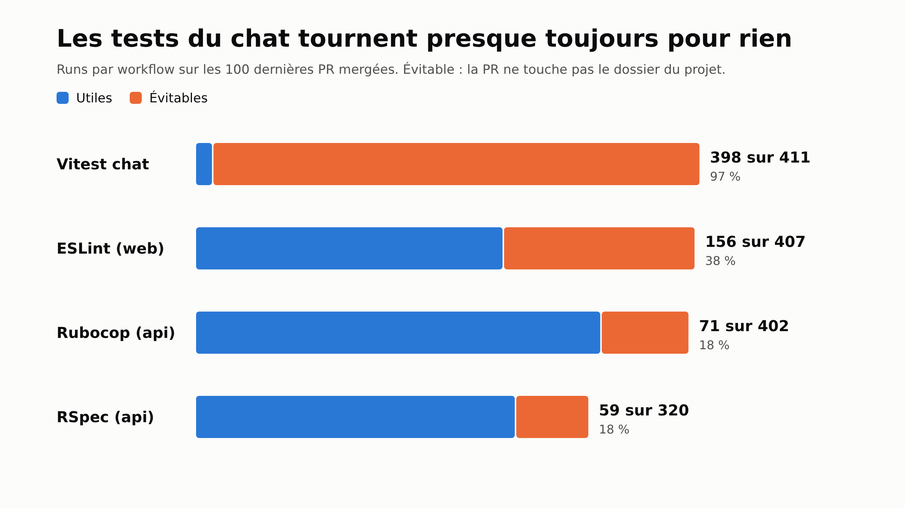
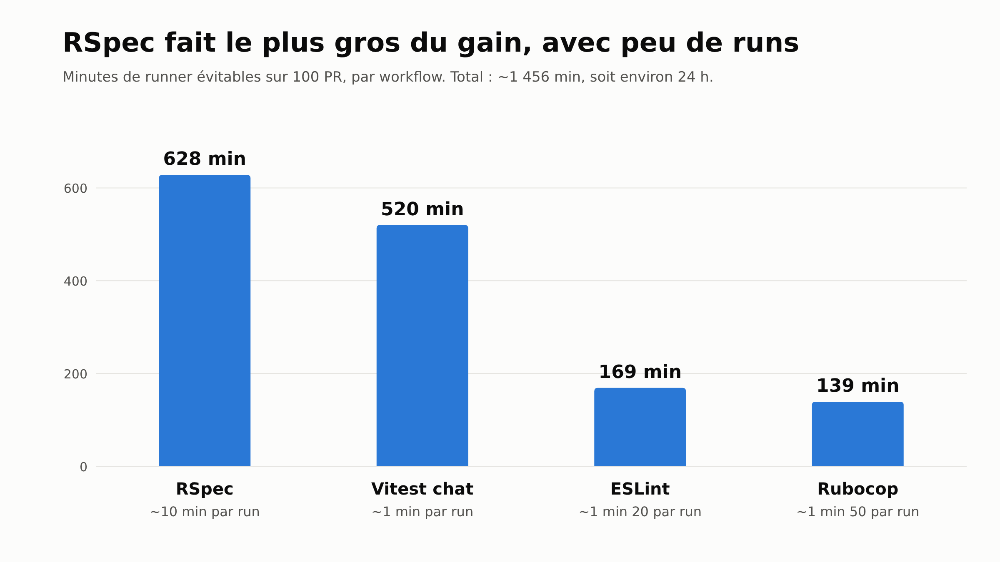
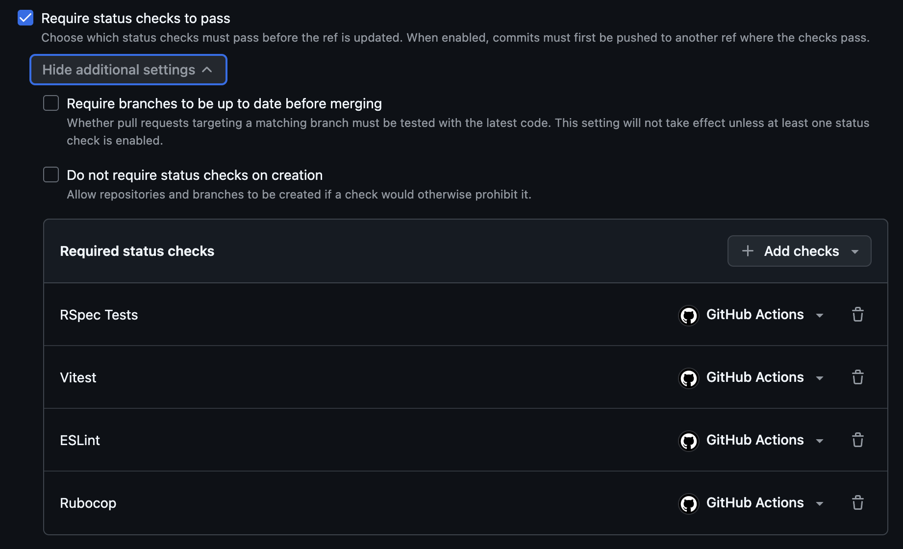
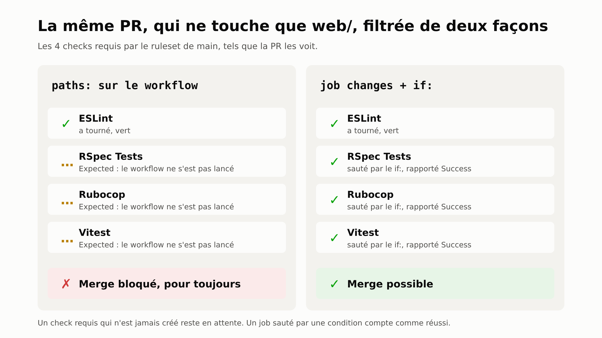
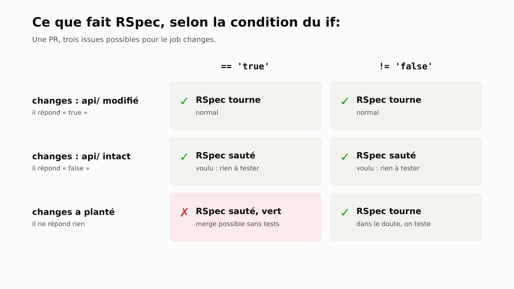
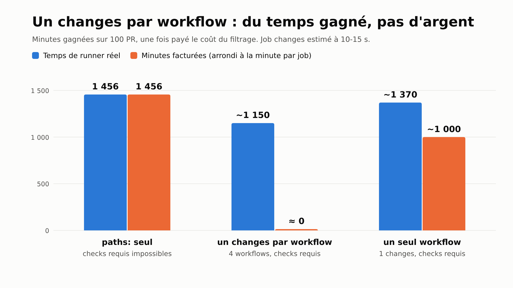

Sur un des produits sur lesquels on travaille, le monorepo contient trois projets : une API Rails (`api/`), un front (`web/`) et un chat (`chat/`). Chaque PR lance quatre checks : RSpec, Rubocop, ESLint et les tests Vitest du chat. Les quatre sont requis pour merger sur `main`, et les quatre tournent quelle que soit la partie modifiée par la PR. Une PR qui ne touche que le front lance donc quand même RSpec, qui prend une dizaine de minutes.

Avant de changer quoi que ce soit, on a mesuré ce que ça coûte.

## Ce qui tourne pour rien

On a pris les 100 dernières PR mergées et tous leurs runs de CI (succès ou échec, sans les runs annulés), avec leur durée réelle. Un run est évitable quand la PR ne touche pas le dossier de son projet.



Sur 1 540 runs, 684 étaient évitables. Les tests du chat sont le cas extrême : 398 runs sur 411 pour des PR qui ne touchaient pas au chat, parce que très peu de PR le modifient.

En minutes, c'est RSpec qui pèse le plus. Il a peu de runs évitables (59), mais chacun dure environ 10 minutes.



Au total, environ 1 456 minutes de runner, à peu près 24 heures pour 100 PR. C'est le plafond : ce qu'on gagne si filtrer ne coûte rien.

## Pourquoi `paths:` ne suffit pas

La première idée, c'est un filtre `paths:` sur le déclencheur du workflow :

```yaml
name: API - Tests

on:
  pull_request:
    paths:
      - 'api/**'
      - '.github/workflows/api-test.yml'
```

Avec ça, une PR qui ne touche pas `api/` ne lance plus du tout ce workflow : pas de RSpec, pas de runner.

Le problème vient des règles de protection de `main`. Notre ruleset exige que quatre checks soient verts avant de merger : `RSpec Tests`, `Rubocop`, `ESLint` et `Vitest`. Un workflow qui ne se lance pas ne crée pas son check. Sur une PR qui ne touche que `web/`, GitHub attend donc un check `RSpec Tests` qui n'arrivera jamais : il l'affiche en « Expected », et le bouton de merge reste bloqué.





C'est écrit dans la doc de GitHub, dans [Handling skipped but required checks](https://docs.github.com/en/pull-requests/collaborating-with-pull-requests/collaborating-on-repositories-with-code-quality-features/troubleshooting-required-status-checks#handling-skipped-but-required-checks) : un workflow sauté par un filtre de chemins laisse ses checks en attente et bloque le merge, alors qu'un job sauté par une condition `if:` est rapporté comme réussi. Et un ruleset ne permet pas de rendre un check requis seulement pour certains chemins.

On pourrait retirer ces checks des checks requis pour débloquer le merge. Mais on pourrait alors merger une PR dont les tests sont rouges, et on ne veut pas de ça.

## Un job `changes` et un `if:`

On garde les quatre workflows et on les lance à chaque PR, mais chacun commence par un petit job `changes` qui regarde quels dossiers la PR modifie (avec `dorny/paths-filter`). Le job lourd en dépend, et ne tourne que si son dossier a changé :

```yaml
jobs:
  changes:
    runs-on: ubuntu-latest
    permissions:
      contents: read
      pull-requests: read
    outputs:
      api: ${{ steps.filter.outputs.api }}
    steps:
      - uses: actions/checkout@v6
      - uses: dorny/paths-filter@v4
        id: filter
        with:
          filters: |
            api:
              - 'api/**'
              - '.github/workflows/api-test.yml'

  test:
    name: RSpec Tests
    needs: changes
    if: ${{ !cancelled() && needs.changes.outputs.api != 'false' }}
    runs-on: ubuntu-latest
    # ...
```

Quand le job lourd est sauté, GitHub le compte comme réussi. Le check requis `RSpec Tests` passe, et le ruleset ne change pas. Le fichier du workflow fait partie de son filtre, pour qu'une PR qui modifie le workflow le teste.

Sur un push sur `main`, le même job `changes` compare le commit au précédent. Comme on merge avec des merge commits, ce diff contient tous les fichiers de la PR.

## Quand la détection plante

Le job `changes` peut planter, par exemple pendant une panne de GitHub. Il ne répond alors ni « oui » ni « non » : sa sortie `api` est vide. Tout dépend de la façon dont on a écrit le `if:` de RSpec.



- `== 'true'` : RSpec tourne seulement si la détection a répondu « oui ». Si elle plante, RSpec est sauté, donc compté comme réussi, et la PR peut être mergée sans qu'aucun test n'ait tourné.
- `!= 'false'` : RSpec tourne sauf si la détection a répondu « non ». Si elle plante, RSpec tourne, comme avant le filtrage.

Le `!cancelled()` au début de la condition est nécessaire. Sans lui, GitHub saute d'office un job dont une dépendance a échoué, sans même regarder la suite du `if:`.

Les deux conditions se ressemblent beaucoup. Dans notre PR, l'une a remplacé l'autre pendant un moment, et c'est la relecture qui l'a vu.

## Ce que ça rapporte, en temps et en facture

Le job `changes` n'est pas gratuit. Il tourne à chaque run, une dizaine de secondes. Pour 1 540 runs, ça fait entre 260 et 385 minutes de runner réel.

Sur la facture, c'est pire : GitHub arrondit chaque job à la minute supérieure. Chaque `changes` est donc facturé une minute, soit environ 1 540 minutes facturées, à peu près ce qu'on évite.



- `paths:` seul gagne tout, mais sans checks requis ;
- un job `changes` dans chacun des quatre workflows gagne environ 1 150 minutes de runner réel (une vingtaine d'heures pour 100 PR), et presque rien en minutes facturées ;
- un seul workflow avec un seul job `changes` partagé par tous les jobs ne paie le filtrage qu'une fois par push : environ 411 minutes facturées, donc environ 1 000 minutes facturées de gagnées.

On a gardé quatre workflows séparés : chaque projet garde son fichier, et ça reste lisible. Sur la facture, l'écart est faible de toute façon : une minute Linux coûte quelques dixièmes de centime au tarif standard. Ce qu'on récupère, ce sont surtout des runners libres plus tôt pour les autres PR.

## Garder des métriques de CI justes

On envoie déjà la durée de chaque check à PostHog pour suivre le retour de CI (on l'a raconté dans [Suivre les OKR tech d'une équipe dans PostHog](/blog/suivre-les-okr-tech-d-une-equipe-dans-posthog-depuis-github-actions)). Un check sauté finit maintenant en une dizaine de secondes, avec seulement son job `changes`. Envoyé tel quel, il ferait baisser la durée moyenne de RSpec sans que RSpec soit plus rapide.

Le script lit donc les jobs de chaque check, et n'envoie pas la durée d'un check où seul `changes` a tourné. PostHog ignore une valeur absente dans une moyenne, donc les moyennes par check ne mesurent que les vrais runs. L'attente totale du développeur, elle, compte toujours tous les checks.

> [!NOTE]
> Les chiffres viennent de 100 PR, avec les durées des runs hors file d'attente. La durée du job `changes` est estimée à partir de quelques runs, et les minutes facturées supposent le tarif standard de GitHub, qui dépend du plan du repo.
