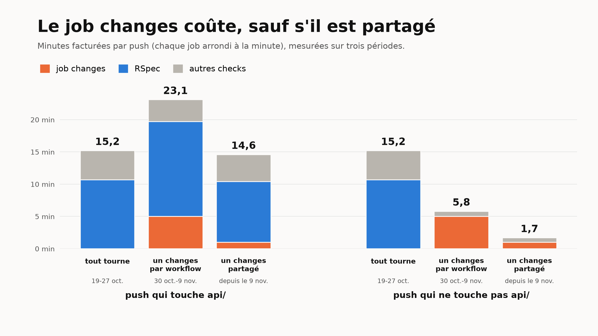
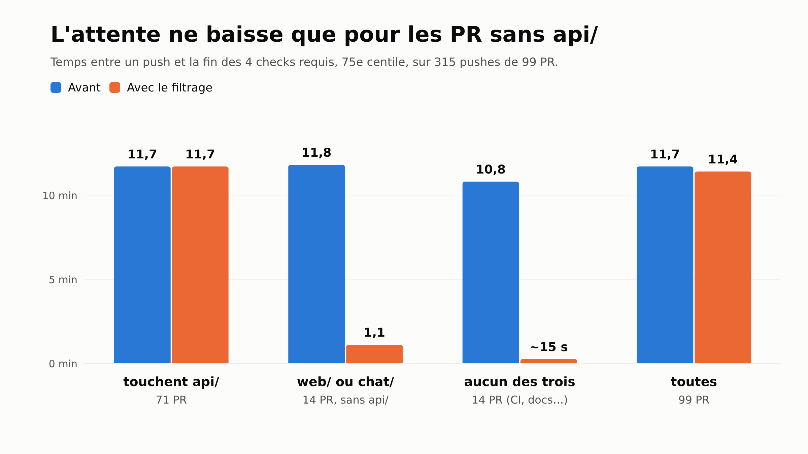

Sur un des produits sur lesquels on travaille, le monorepo contient trois projets : une API Rails (`api/`), un front (`web/`) et un chat (`chat/`). Chaque PR lance quatre checks : RSpec, Rubocop, ESLint et les tests Vitest du chat. Les quatre sont requis pour merger sur `main`, et les quatre tournent quelle que soit la partie modifiée par la PR. Une PR qui ne touche que le front lance donc quand même RSpec, qui prend une dizaine de minutes.

Avant de changer quoi que ce soit, on a mesuré ce que ça coûte.

## Ce qui tourne pour rien

On a pris les 100 dernières PR mergées et tous leurs runs de CI (succès ou échec, sans les runs annulés), avec leur durée réelle. Un run est évitable quand la PR ne touche pas le dossier de son projet.


Sur 1 540 runs, 684 étaient évitables. Les tests du chat sont le cas extrême : 398 runs sur 411 pour des PR qui ne touchaient pas au chat, parce que très peu de PR le modifient.

En minutes, c'est RSpec qui pèse le plus. Il a peu de runs évitables (59), mais chacun dure environ 10 minutes.


Au total, environ 1 456 minutes de runner, à peu près 24 heures pour 100 PR. C'est le plafond : ce qu'on gagne si filtrer ne coûte rien.

## Pourquoi `paths:` ne suffit pas

La première idée, c'est un filtre `paths:` sur le déclencheur du workflow :

```yaml
name: API - Tests

on:
  pull_request:
    paths:
      - 'api/**'
      - '.github/workflows/api-test.yml'
```

Avec ça, une PR qui ne touche pas `api/` ne lance plus du tout ce workflow : pas de RSpec, pas de runner.

Le problème vient des règles de protection de `main`. Notre ruleset exige que quatre checks soient verts avant de merger : `RSpec Tests`, `Rubocop`, `ESLint` et `Vitest`. Un workflow qui ne se lance pas ne crée pas son check. Sur une PR qui ne touche que `web/`, GitHub attend donc un check `RSpec Tests` qui n'arrivera jamais : il l'affiche en « Expected », et le bouton de merge reste bloqué.


C'est écrit dans la doc de GitHub, dans [Handling skipped but required checks](https://docs.github.com/en/pull-requests/collaborating-with-pull-requests/collaborating-on-repositories-with-code-quality-features/troubleshooting-required-status-checks#handling-skipped-but-required-checks) : un workflow sauté par un filtre de chemins laisse ses checks en attente et bloque le merge, alors qu'un job sauté par une condition `if:` est rapporté comme réussi. Et un ruleset ne permet pas de rendre un check requis seulement pour certains chemins.

On pourrait retirer ces checks des checks requis pour débloquer le merge. Mais on pourrait alors merger une PR dont les tests sont rouges, et on ne veut pas de ça.

## Un job `changes` et un `if:`

On garde les quatre workflows et on les lance à chaque PR, mais chacun commence par un petit job `changes` qui regarde quels dossiers la PR modifie (avec `dorny/paths-filter`). Le job lourd en dépend, et ne tourne que si son dossier a changé :

```yaml
jobs:
  changes:
    runs-on: ubuntu-latest
    permissions:
      contents: read
      pull-requests: read
    outputs:
      api: ${{ steps.filter.outputs.api }}
    steps:
      - uses: actions/checkout@v6
      - uses: dorny/paths-filter@v4
        id: filter
        with:
          filters: |
            api:
              - 'api/**'
              - '.github/workflows/api-test.yml'

  test:
    name: RSpec Tests
    needs: changes
    if: ${{ !cancelled() && needs.changes.outputs.api != 'false' }}
    runs-on: ubuntu-latest
    # ...
```

Quand le job lourd est sauté, GitHub le compte comme réussi. Le check requis `RSpec Tests` passe, et le ruleset ne change pas. Le fichier du workflow fait partie de son filtre, pour qu'une PR qui modifie le workflow le teste.

Sur un push sur `main`, le même job `changes` compare le commit au précédent. Comme on merge avec des merge commits, ce diff contient tous les fichiers de la PR.

## Quand la détection plante

Le job `changes` peut planter, par exemple pendant une panne de GitHub. Il ne répond alors ni « oui » ni « non » : sa sortie `api` est vide. Tout dépend de la façon dont on a écrit le `if:` de RSpec.


- `== 'true'` : RSpec tourne seulement si la détection a répondu « oui ». Si elle plante, RSpec est sauté, donc compté comme réussi, et la PR peut être mergée sans qu'aucun test n'ait tourné.
- `!= 'false'` : RSpec tourne sauf si la détection a répondu « non ». Si elle plante, RSpec tourne, comme avant le filtrage.

Le `!cancelled()` au début de la condition est nécessaire. Sans lui, GitHub saute d'office un job dont une dépendance a échoué, sans même regarder la suite du `if:`.

Les deux conditions se ressemblent beaucoup. Dans notre PR, l'une a remplacé l'autre pendant un moment, et c'est la relecture qui l'a vu.

## Ce que ça rapporte, en temps et en facture

Le job `changes` n'est pas gratuit. Il tourne à chaque run, une dizaine de secondes. Pour 1 540 runs, ça fait entre 260 et 385 minutes de runner réel.

Sur la facture, c'est pire : GitHub arrondit chaque job à la minute supérieure. Chaque `changes` est donc facturé une minute, soit environ 1 540 minutes facturées, à peu près ce qu'on évite.


- `paths:` seul gagne tout, mais sans checks requis ;
- un job `changes` dans chacun des quatre workflows gagne environ 1 150 minutes de runner réel (une vingtaine d'heures pour 100 PR), et presque rien en minutes facturées ;
- un seul workflow avec un seul job `changes` partagé par tous les jobs ne paie le filtrage qu'une fois par push : environ 411 minutes facturées, donc environ 1 000 minutes facturées de gagnées.

On a d'abord gardé un job `changes` dans chaque workflow : chaque projet garde son fichier, et ça reste lisible. Entre-temps, les tests du front (Vitest) sont arrivés en CI. Ça fait cinq workflows, donc cinq jobs `changes` facturés à chaque push.

## Un seul job `changes`, chaque projet garde son fichier

On n'a finalement pas eu à choisir entre des fichiers lisibles et la facture. Un workflow `ci.yml` lance le job `changes` une fois par push, puis appelle le workflow de chaque projet avec `workflow_call`, en lui passant un booléen :

```yaml
name: CI

on:
  pull_request:
  push:
    branches: [main]

jobs:
  changes:
    runs-on: ubuntu-latest
    permissions:
      contents: read
      pull-requests: read
    outputs:
      api: ${{ steps.filter.outputs.api }}
    steps:
      - uses: actions/checkout@v6
      - uses: dorny/paths-filter@v4
        id: filter
        with:
          filters: |
            api: [api/**, .github/workflows/api-test.yml, .github/workflows/ci.yml]

  api-test:
    name: API - Tests
    needs: changes
    if: ${{ !cancelled() }}
    uses: ./.github/workflows/api-test.yml
    with:
      run: ${{ needs.changes.result != 'success' || needs.changes.outputs.api == 'true' }}
```

Le workflow de l'API ne se déclenche plus tout seul sur une PR. Il tourne quand `ci.yml` l'appelle, et c'est lui qui saute son job :

```yaml
name: API - Tests

on:
  workflow_call:
    inputs:
      run:
        type: boolean
        required: true

jobs:
  test:
    name: RSpec Tests
    if: ${{ inputs.run }}
    runs-on: ubuntu-latest
    # ...
```

Le saut doit se faire là, dans le workflow appelé. Avec un `if:` sur le job `api-test` de `ci.yml`, le workflow de l'API ne serait jamais lancé : le check `RSpec Tests` n'existerait pas, et on retomberait sur le check « Expected » qui bloque le merge. Sauté dans le workflow appelé, le job est créé, puis rapporté comme réussi. On l'a vérifié avant de merger, avec une PR de démo qui ne touche que `web/` et un ruleset de test : RSpec, Rubocop et les tests du chat étaient sautés, et la PR était mergeable.

La condition dit aussi en clair ce qui se passe quand la détection plante : si le job `changes` n'a pas réussi, tout tourne. C'est le principe du `!= 'false'`, sans avoir à se souvenir de ce que vaut une sortie vide.

Un piège au merge : les checks changent de nom. `RSpec Tests` devient `API - Tests / RSpec Tests`. Il faut mettre à jour le ruleset de `main` juste après le merge, sinon il attend les anciens noms et bloque toutes les PR. Les PR ouvertes récupèrent les nouveaux checks à leur prochain push.

## Ce que ça a changé sur la facture, mesuré

On a refait le compte sur les runs réels, en trois périodes : avant le filtrage (19 au 27 octobre, 166 pushes), avec un `changes` par workflow (30 octobre au 9 novembre, 171 pushes) et avec le `changes` partagé (depuis le 9 novembre, 70 pushes). Pour chaque push, on additionne les minutes facturées de chaque job, arrondies à la minute supérieure.



- Un push qui ne touche pas `api/` passe de 15,2 minutes facturées à 5,8 avec un `changes` par workflow, dont 5 pour les seuls jobs `changes`. Avec le job partagé, il tombe à 1,7.
- Un push qui touche `api/` coûte plus cher avec un `changes` par workflow : 5 minutes de plus pour décider de lancer ce qui tournait déjà. Avec le job partagé, ce surcoût tombe à une minute.

Le bleu bouge aussi, mais ce n'est pas le filtrage. RSpec a ralenti fin octobre : la suite grossit, et sa durée dépend du CPU sur lequel tombe le runner. Puis il a accéléré le 9 novembre, avec d'autres changements mergés le même jour (on y revient plus bas).

Pour isoler le filtrage, on garde RSpec à sa durée d'avant et on prend la vraie répartition des pushes : 77 % touchent `api/`. Un push coûtait 15,2 minutes facturées sans filtrage. Avec un `changes` par workflow, c'est 16,0, donc 5 % de plus que ne rien filtrer. Avec le job partagé, c'est 12,6, soit 17 % de moins. Sur environ 1 400 pushes par mois, ça fait environ 3 600 minutes facturées, une vingtaine de dollars au tarif standard.

En dollars, c'est peu. Ce qu'on récupère surtout, ce sont des runners libres plus tôt, et des PR qui n'attendent plus la CI quand elles ne touchent pas l'API.

## Et le temps d'attente ?

Les minutes de runner, c'est la facture. Pour un développeur, ce qui compte, c'est le temps entre son push et le moment où les quatre checks requis sont finis. Avant de changer quoi que ce soit, on l'a calculé sur les mêmes 100 PR : 315 pushes, file d'attente comprise.

Les quatre checks tournent en parallèle, donc on attend le plus long. C'est RSpec dans 310 pushes sur 315. Et 71 PR sur 99 touchent `api/` : pour elles, RSpec tourne de toute façon, et rien ne change.



- PR qui touchent `api/` : 11,7 min au 75e centile, avant comme après ;
- PR qui ne touchent que `web/` ou `chat/` : de 11,8 min à 1,1 min ;
- PR qui ne touchent aucun des trois (CI, docs) : de 10,8 min à une quinzaine de secondes, le temps du job `changes`.

Les mesures sur les vrais runs le confirment : un push qui ne touche pas `api/` attend 1,1 min au 75e centile, avec un `changes` par workflow comme avec le job partagé.

Pour la PR typique, celle qui touche l'API, le filtrage ne fait rien gagner : il faut accélérer RSpec lui-même. C'est la suite du chantier, et trois changements ont été mergés le 9 novembre. Le catalogue des permissions, resynchronisé dans une bonne partie des tests, n'est plus chargé qu'une fois par suite. Le setup du job est allégé. Et l'outil qui signale les lignes modifiées sans test n'est plus compilé à chaque nouvelle PR. Sur les 16 premiers pushes qui touchent `api/`, le job RSpec passe de 14,7 à 9,4 minutes en moyenne, et l'attente de 16,8 à 10,2 min au 75e centile. C'est encore peu de pushes, mais c'est là que se joue le reste de la facture : RSpec fait près des deux tiers des minutes facturées.

## Garder des métriques de CI justes

On envoie déjà la durée de chaque check à PostHog pour suivre le retour de CI (on l'a raconté dans [Suivre les OKR tech d'une équipe dans PostHog](/blog/suivre-les-okr-tech-d-une-equipe-dans-posthog-depuis-github-actions)). Un check sauté finit maintenant en quelques secondes. Envoyé tel quel, il ferait baisser la durée moyenne de RSpec sans que RSpec soit plus rapide.

Le script lit donc les jobs du run, et n'envoie pas la durée d'un check sauté. PostHog ignore une valeur absente dans une moyenne, donc les moyennes par check ne mesurent que les vrais runs. L'attente totale du développeur, elle, compte toujours tous les checks.

> [!NOTE]
> Les estimations viennent de 100 PR, le temps d'attente compte la file d'attente. Les mesures viennent des runs réels des trois périodes (166, 171 et 70 pushes), sans les runs annulés. La dernière ne couvre qu'un jour et demi, et ses pushes touchent moins souvent l'API que d'habitude, d'où le calcul à répartition constante. Les minutes facturées sont recalculées job par job, au tarif standard de GitHub (0,006 $ la minute Linux), qui dépend du plan du repo.
