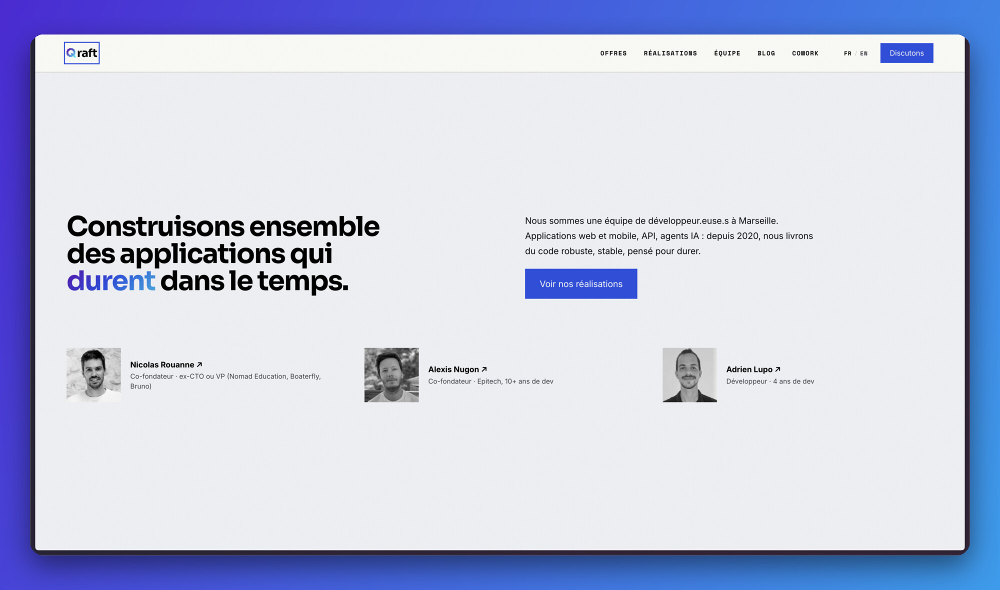
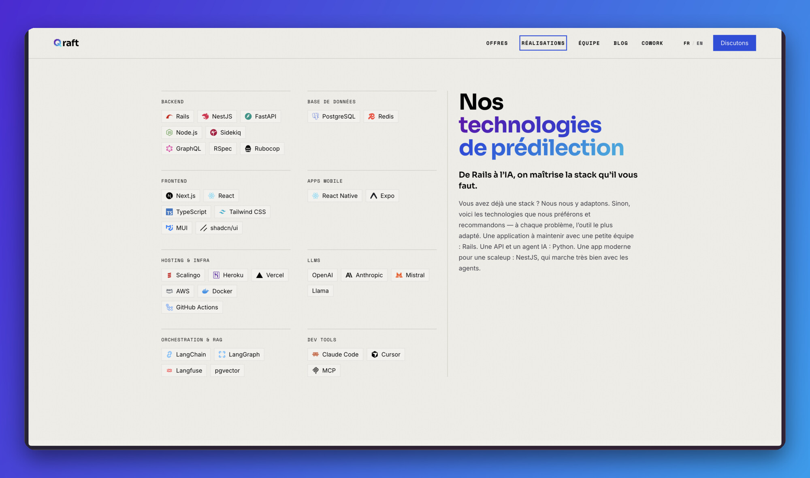
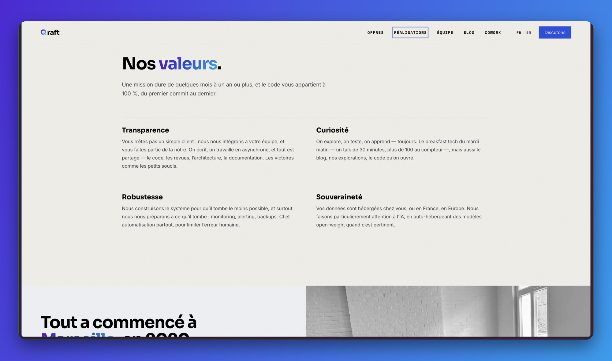
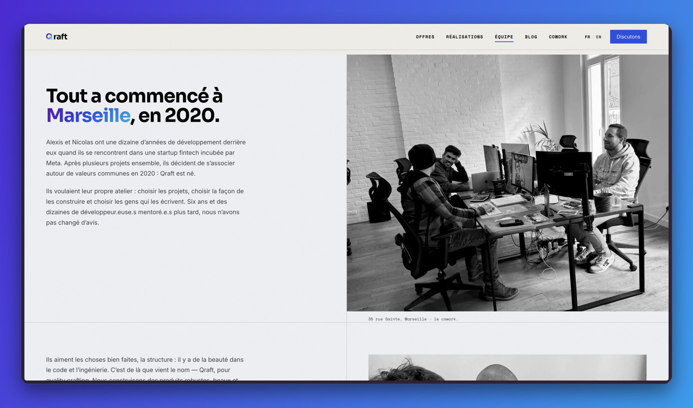
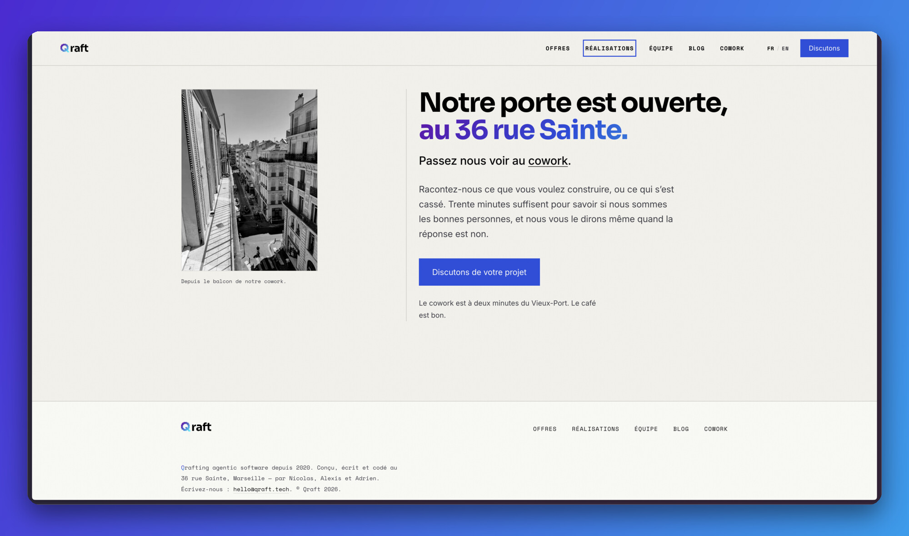

We've put a new site online. The old one told what Qraft is: a team of experts who build applications, and build them well. That's still true, but for a while now it hasn't said everything we do.

## 1. Applications, still

Web, mobile, APIs: it's our original trade and we still do it, in Rails, NestJS, FastAPI, Next.js, React Native. What has changed is that we no longer build them the same way. We develop with AI every day - Claude Code, Cursor, agents doing part of the work - and the applications themselves embed more and more AI: an assistant, a RAG, an agent plugged into business data.

## 2. AI agents

That's the first thing that got added. A LangGraph agent runs in production at Smartbox, and we're building others, C'Evidentia's among them. We start from the client's proprietary knowledge, often a plain Markdown knowledge base, and pick the simplest architecture that does the job. RAG or an agent graph come in when Markdown is no longer enough, not before.

## 3. Agentic teams

That's the second. Existing teams of developers ask us to help them use AI in their daily work: on their product, in their repo, to move faster without losing quality. We review their code, we build an AI workflow with them that holds up, and we stay reachable for the hard decisions. It's the genuinely new part of the job, and the one we're asked for the most right now.

## 4. What hasn't changed

The name comes from quality crafting: building things of quality, with code, that last. That's still the DNA. AI doesn't replace it, it accelerates it - we go faster and further on what has set us apart since 2020. We use it every day, we've adapted, and the site had to say so clearly.

That's why a new site: one that looks more like us, and explains better what we do.

→ [qraft.tech](https://qraft.tech/)
