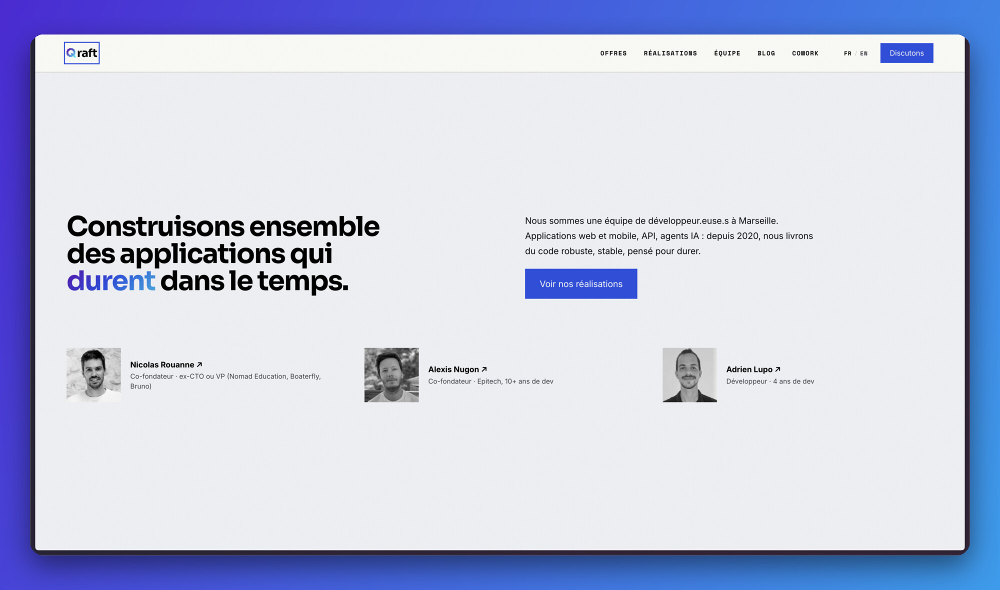
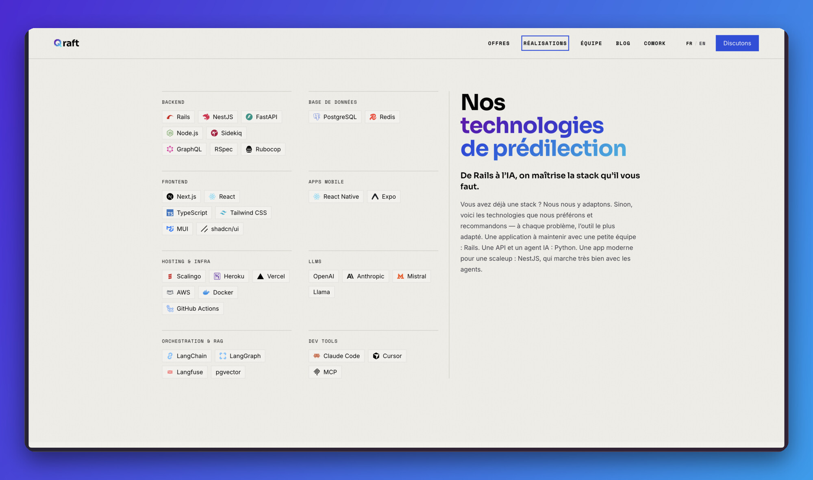
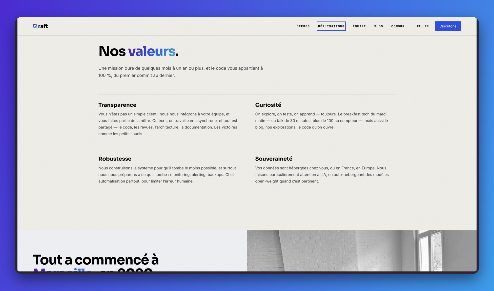
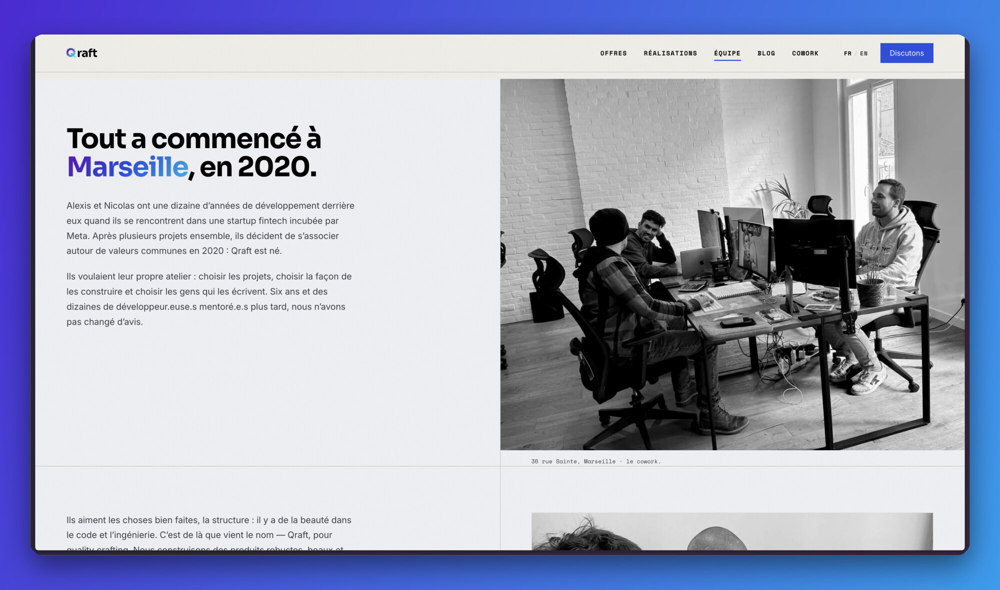
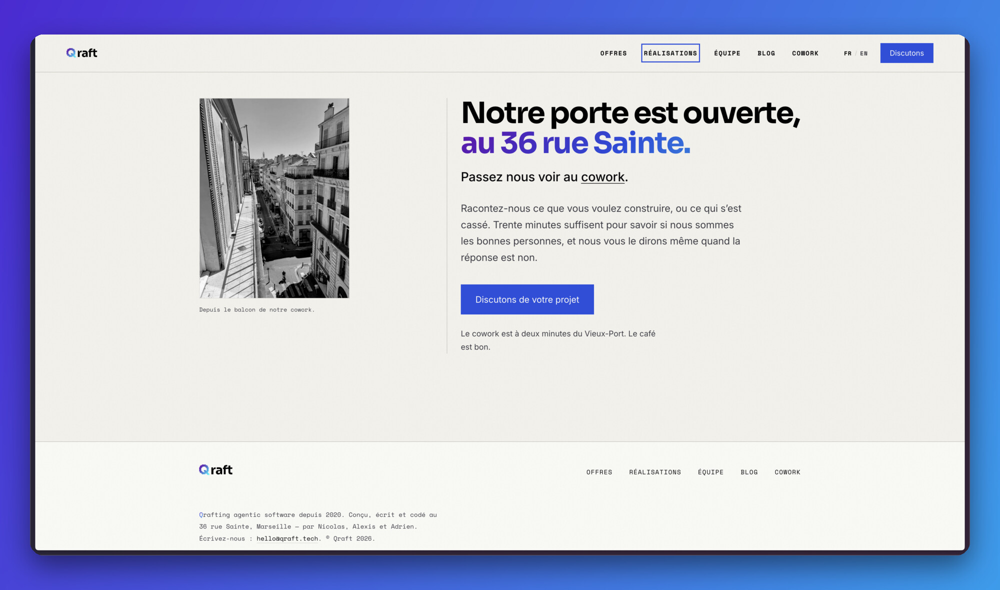

On a mis en ligne un nouveau site. L'ancien racontait ce qu'est Qraft : une équipe d'experts qui construit des applications, bien. C'est toujours vrai, mais depuis un moment ça ne dit plus tout ce qu'on fait.

## 1. Des applications, toujours

Web, mobile, API : c'est notre métier d'origine et on le fait toujours, en Rails, NestJS, FastAPI, Next.js, React Native. Ce qui a changé, c'est qu'on ne les construit plus de la même façon. On développe avec l'IA au quotidien - Claude Code, Cursor, des agents qui font une partie du travail - et les applications elles-mêmes embarquent de plus en plus d'IA : un assistant, un RAG, un agent branché sur les données métier.

## 2. Des agents IA

C'est la première chose qui s'est ajoutée. Un agent LangGraph tourne en production chez Smartbox, on en construit d'autres, chez C'Evidentia notamment. On part des connaissances propriétaires du client, souvent un simple référentiel en Markdown, et on choisit l'architecture la plus simple qui fait le travail. Le RAG ou le graphe d'agents viennent quand le Markdown ne suffit plus, pas avant.

## 3. Des équipes agentic

C'est la deuxième. Des équipes de développeurs et développeuses qui existent déjà nous demandent de les aider à utiliser l'IA dans leur quotidien : sur leur produit, dans leur repo, pour aller plus vite sans perdre en qualité. On relit leur code, on monte avec eux un workflow IA qui tient debout, et on reste joignables pour les décisions difficiles. C'est la partie du métier qui est vraiment nouvelle, et c'est celle qu'on nous demande le plus en ce moment.

## 4. Ce qui n'a pas changé

Le nom vient de quality crafting : faire des choses de qualité, avec du code, qui durent dans le temps. C'est toujours l'ADN. L'IA ne remplace pas ça, elle l'accélère - on va plus vite et plus loin sur ce qui nous différencie depuis 2020. On l'utilise tous les jours, on s'est adaptés, et il fallait que le site le dise clairement.

Voilà pourquoi un nouveau site : un site qui nous ressemble plus, et qui explique mieux ce qu'on fait.

→ [qraft.tech](https://qraft.tech/)
