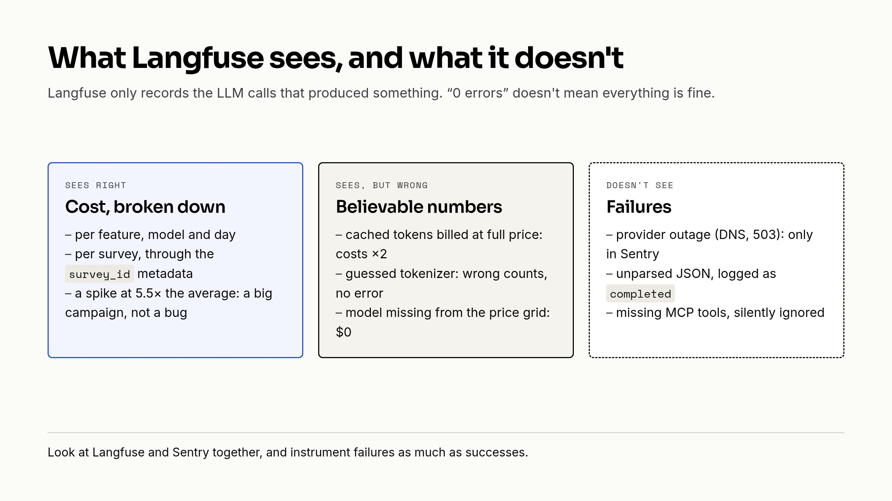

At the end of August, we found out after the fact that a single feature of our app had cost about $440 in four days. No alert, and no simple way to tell which customer was behind it. Yet we were already tracing our LLM calls in Langfuse.

This is the companion to [our article on evals](https://qraft.tech/en/blog/llm-evals-what-they-are-for-and-how-we-run-them-with-langfuse): evals check what goes to production, this one is about what happens once it's there. How much it costs, for whom, and what breaks without warning.



## One generation per call

Every LLM call in the app goes through a single wrapper. It opens a [Langfuse generation](https://langfuse.com/docs/observability/data-model) named after the feature making the call, and also writes a row to a log table, marked `failed` if the call raises.

```ruby
Langfuse.observe(feature.to_s, as_type: :generation) do |gen|
  gen.model = model
  gen.input = input

  result = yield

  gen.update(model: result.model_id, output: { role: 'assistant', content: result.content })
  gen.usage_details = usage_details(result)
  gen.update_trace(
    user_id: user&.id&.to_s,
    session_id:,
    tags: [feature.to_s],
    metadata: langfuse_metadata(survey:, survey_customer:)
  )
```

That gives cost per feature, per model and per day with nothing more to do. It's a good base, but while digging into the cost spike, we realised some of the numbers were wrong.

## Wrong but believable numbers

The first problem came from caching. Langfuse prices each type of token separately, and we reported all input tokens in the same place. Cached tokens, which cost 90 % less, were therefore priced in full. On the feature behind the spike, 248 million input tokens over a week showed up as $467, 78 % of the total. Reporting them separately was enough:

```ruby
# Langfuse sums the cost of each usage key independently, so cached input tokens must be reported
# apart from the fresh ones — otherwise they are billed at full price instead of the OpenAI cache
# rate. `input_cached_tokens` is the key Langfuse's OpenAI price grid recognises.
def usage_details(result)
  input = result.input_tokens.to_i
  cached = result.cached_tokens.to_i

  {
    input: input - cached,
    input_cached_tokens: cached,
    output: result.output_tokens,
    total: input + result.output_tokens.to_i
  }
end
```

Our cost series from before that fix were overestimated by about two times.

The second problem was quieter. Our token counter looked up the encoding from the model name, and fell back to an old encoding when it didn't know the model, which was the case for the whole new generation we had just migrated to:

```ruby
@tokenizer ||= Tiktoken.encoding_for_model(tiktoken_model) || Tiktoken.get_encoding('cl100k_base')
```

No error, just wrong counts. We now pin the encoding (`o200k_base`) instead of guessing it.

And finally, two internal flows used models missing from Langfuse's price list, so they showed up at $0. Since then, a zero in a cost dashboard looks as suspicious to us as a spike.

## Cost per customer

Finding out who was behind the spike didn't take any code. Each trace carries the id of the survey it belongs to as metadata, and the Langfuse metrics API can filter on it, even though it can't break costs down by metadata. That's one query per survey:

```json
{"column": "metadata", "key": "survey_id", "operator": "=", "value": "<id>", "type": "stringObject"}
```

That was enough to understand what had happened. The traces carry the survey, not the customer account, though, so finding out who pays still goes through the database.

## A very simple threshold

We then added a threshold, checked every morning: we look at any day above three times the seven-day average, or above $100. It's crude, but it's enough for now. The first time it fired, a Friday came in at 5.5 times the average, 84 % of it from a single survey. The cost per call was normal: it was a large interview campaign launched that afternoon, not a bug. The threshold is there to make someone look, not to make the diagnosis.

For now, it's a routine that reads the metrics and writes a report every morning. It isn't a real alert yet.

## What Langfuse doesn't see

This is probably the most useful thing we learned. For a while, "0 errors in Langfuse" looked like good news to us, but Langfuse only records the calls that produced something. Several problems never showed up there.

Provider outages, first: a DNS failure on the OpenAI API in a background job, a 503 "overloaded" at 2am. We saw them in Sentry, not in Langfuse. Same for the call the new model refused because of a reasoning parameter (we tell that story in the evals article): there was no generation to record.

There were also results that were lost but marked as successful. After a model change, 2 to 4 % of a judge's reports came back as two JSON payloads stuck together. The parse error was swallowed, the log said `completed`, and Langfuse showed a perfectly normal call. We now read only the "final answer" part of the response.

The last case surprised us. Our assistant declares the MCP tools it is allowed to use, and OpenAI quietly ignores any the server doesn't expose. A staging redeploy made every tool disappear for a few hours, and nobody complained. We now compare the two lists on each turn:

```ruby
def warn_missing_mcp_tools(item)
  exposed = Array(item['tools']).pluck('name')
  missing = @scope.allowed_tools_for(@user) - exposed
  return if missing.empty?

  Rails.logger.warn("[Assistant] MCP server misses #{@scope.key} tools: #{missing.join(', ')}")
end
```

What we take from it: look at Langfuse and Sentry together, and instrument failures as much as successes.

## What's still pending

- A real automatic alert, rather than a report read in the morning.
- The customer account in the traces, so we no longer need the database.
- The provider's cost API to cross-check the numbers, but it needs an admin key the app doesn't have.
- The missing-tools check only logs a warning: nothing raises, and nothing reaches Langfuse 😅
