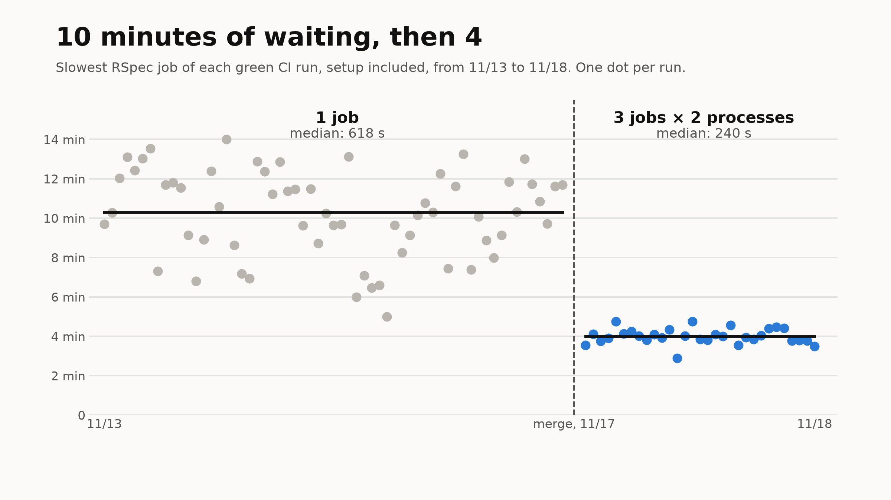
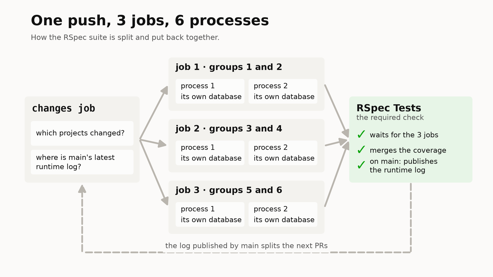
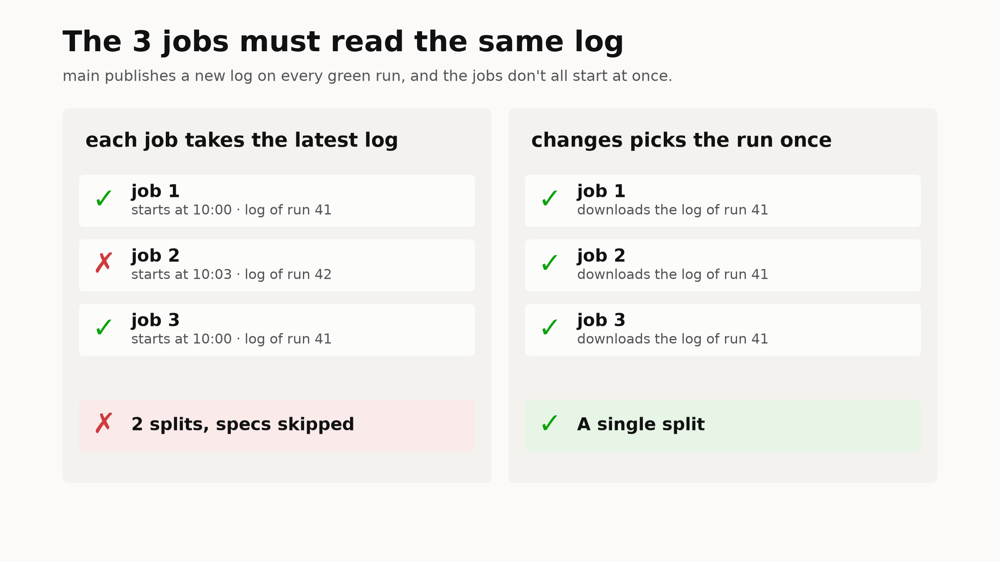
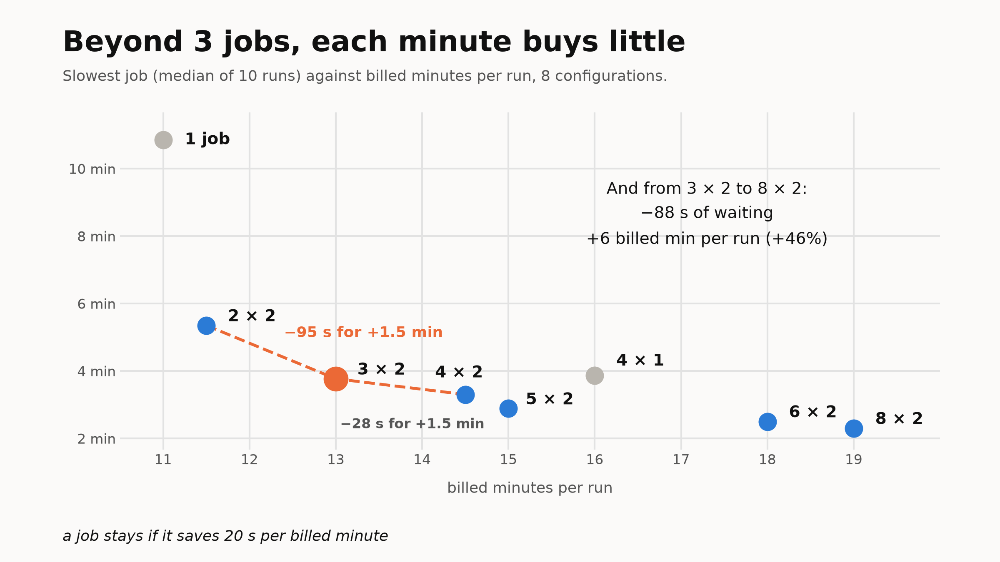
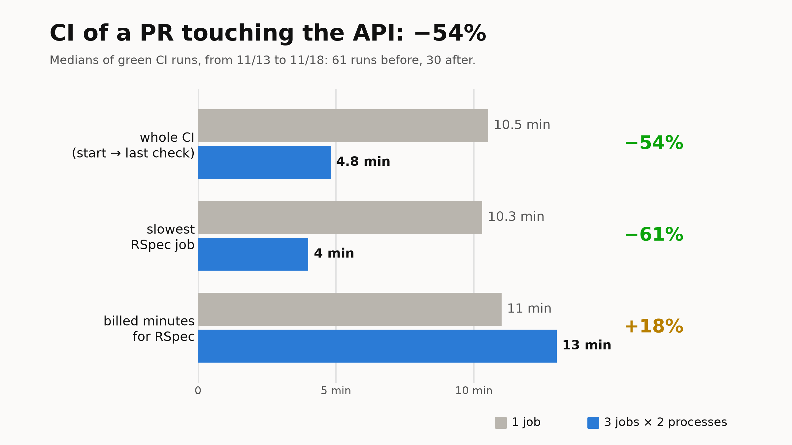

At one of our clients, a PR touching the API took 10 minutes to get through CI. Now it takes less than 5.

In [Running only the changed project's tests](/en/blog/running-only-the-changed-project-s-tests-without-losing-required-checks), we stopped running the tests of the parts of the code a PR doesn't touch. But for a PR touching the API, RSpec still ran in a single job. We split it across several runners: CI does the same work, but in parallel, so we wait less.



## Parallelizing: 3 jobs, 6 processes

We use [`parallel_tests`](https://github.com/grosser/parallel_tests). It cuts the suite into 6 groups of files. Each job of the matrix takes 2, one per runner vCPU.



```yaml
strategy:
  matrix:
    groups: ["1,2", "3,4", "5,6"]
steps:
  - name: Prepare database
    run: |
      bin/rails db:schema:load
      # process 2's database, copied from process 1's
      psql "$POSTGRES_URL" -c "CREATE DATABASE app_test2 TEMPLATE app_test"

  - name: Run RSpec
    run: |
      bundle exec parallel_rspec -n 6 --only-group ${{ matrix.groups }} \
        --group-by ${{ inputs.runtime-log-run && 'runtime' || 'filesize' }} spec
```

Each process has its own test database: `database.yml` appends `TEST_ENV_NUMBER` to its name.

## Groups of the same duration

The slowest job sets the wait, so we want the 6 groups to take about as long as each other. `parallel_tests` can balance them if it has each spec file's duration, in a log. Without a log, it splits by file size, which is less accurate.

We keep that log in an [artifact](https://docs.github.com/en/actions/tutorials/store-and-share-data): GitHub Actions lets a run store files (here for 14 days), which another run can then download. Every green run on `main` publishes its own:

```yaml
- name: Upload runtime log
  if: github.ref == 'refs/heads/main'
  uses: actions/upload-artifact@v7
  with:
    name: rspec-runtime-log
    path: api/tmp/parallel_runtime_rspec.log
    retention-days: 14
```

Each job computes the split itself, from the log. For the 3 jobs to land on the same split, they must read the same log. But `main` publishes a new one on every green run, and the 3 jobs don't necessarily start at the same time: each waits for a free runner. If a `main` run finishes between two starts, two jobs split with two different logs. Some files then fall into no group that runs, and CI stays green.



So the `changes` job, which already runs before the tests, picks the run once, and the 3 jobs download that run's log:

```yaml
# changes job
- name: Find main's RSpec runtime log
  id: runtime-log
  run: |
    echo "run=$(gh api "repos/$GITHUB_REPOSITORY/actions/artifacts?name=rspec-runtime-log&per_page=100" \
      -q '[.artifacts[] | select(.workflow_run.head_branch == "main" and (.expired | not))] | max_by(.created_at) | .workflow_run.id // empty')" >> "$GITHUB_OUTPUT"

# each of the 3 jobs
- name: Download main's runtime log
  if: ${{ inputs.runtime-log-run }}
  uses: actions/download-artifact@v7
  with:
    name: rspec-runtime-log
    run-id: ${{ inputs.runtime-log-run }}
    github-token: ${{ github.token }}
    path: api/tmp
```

## How many jobs?

GitHub bills each job rounded up to the minute, and each job pays its setup (about 50 s here). We measured 8 configurations, 10 runs each, and kept a simple rule: one more job must save at least 20 s per extra billed minute.



Going from 3 × 2 to 8 × 2 would save 88 s of waiting, for 6 more billed minutes on every run: +46% on the RSpec bill. Beyond 3 jobs, rounding to the minute also comes down to a few seconds: a real 5 × 2 run was billed 18 minutes instead of the expected 15.

And 4 jobs of one process cost more than 3 jobs of 2, and finish later: each runner's second vCPU sits idle.

## Overall



On a PR touching the API, the whole CI goes from 10.5 to 4.8 minutes median (−54%), for 2 more billed minutes per run (+18%). The suite itself still does the same work, spread over 6 processes. For it to do less, the specs themselves have to get lighter: that's the next article.

> [!NOTE]
> `ubuntu-latest` runners land on different CPUs (7 models during our measurements), and the same suite can take from 477 to 730 s. That's what scatters the dots before parallelization. The 8 configurations are compared on the same CPU.
