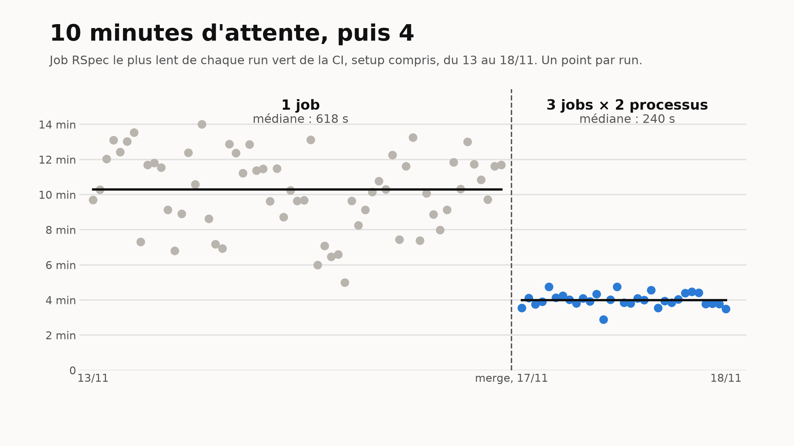
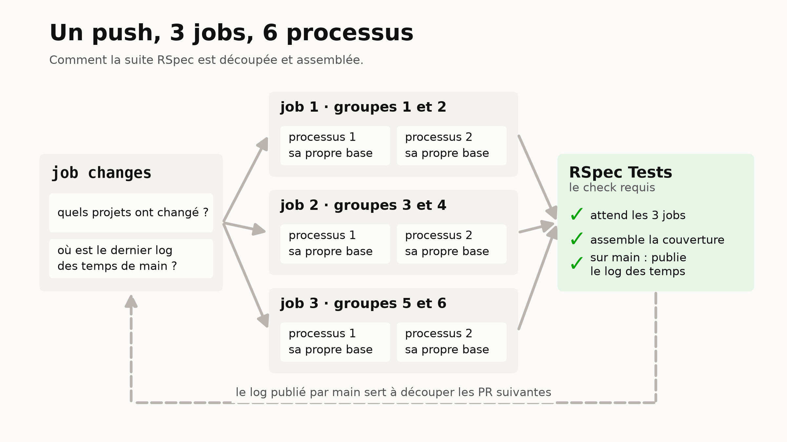
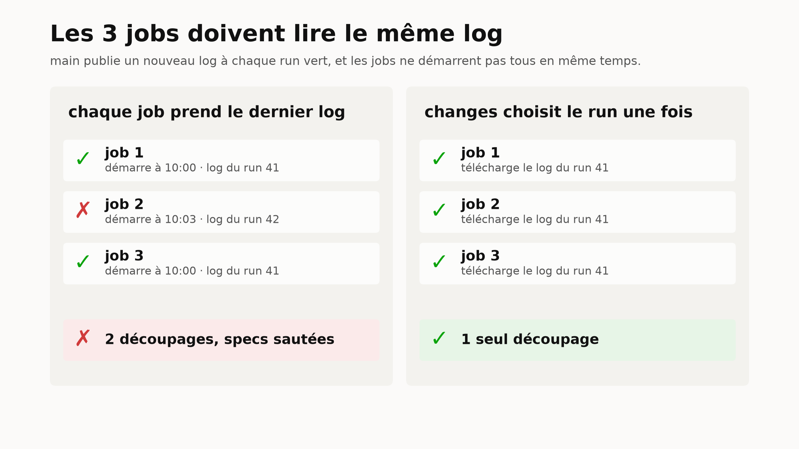
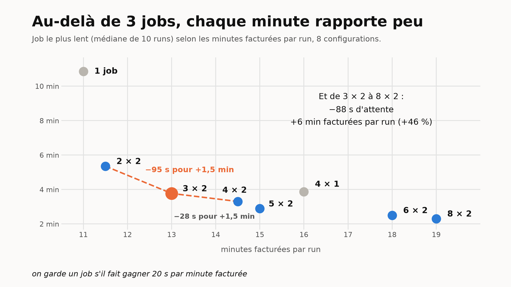
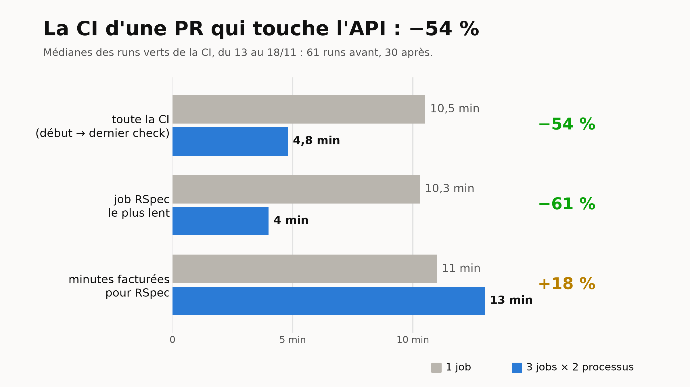

Chez un de nos clients, une PR qui touche l'API mettait 10 minutes à passer la CI. Maintenant, elle en met moins de 5.

Dans [Ne lancer que les tests du projet modifié](/blog/ne-lancer-que-les-tests-du-projet-modifie-sans-perdre-les-checks-requis), on avait arrêté de lancer les tests des parties du code qu'une PR ne touche pas. Mais pour une PR qui touche l'API, RSpec tournait toujours sur un seul job. On l'a réparti sur plusieurs runners : la CI fait le même travail, mais en parallèle, donc on attend moins.



## Paralléliser : 3 jobs, 6 processus

On utilise [`parallel_tests`](https://github.com/grosser/parallel_tests). Il coupe la suite en 6 groupes de fichiers. Chaque job de la matrice en prend 2, un par vCPU du runner.



```yaml
strategy:
  matrix:
    groups: ["1,2", "3,4", "5,6"]
steps:
  - name: Prepare database
    run: |
      bin/rails db:schema:load
      # la base du processus 2, copiée depuis celle du processus 1
      psql "$POSTGRES_URL" -c "CREATE DATABASE app_test2 TEMPLATE app_test"

  - name: Run RSpec
    run: |
      bundle exec parallel_rspec -n 6 --only-group ${{ matrix.groups }} \
        --group-by ${{ inputs.runtime-log-run && 'runtime' || 'filesize' }} spec
```

Chaque processus a sa propre base de test : `database.yml` ajoute `TEST_ENV_NUMBER` à son nom.

## Des groupes de même durée

C'est le job le plus lent qui fixe l'attente, donc on veut que les 6 groupes durent à peu près autant. `parallel_tests` sait les équilibrer s'il a le temps de chaque fichier de spec, dans un log. Sans log, il découpe par taille de fichier, ce qui est moins juste.

Ce log, on le garde dans un [artifact](https://docs.github.com/fr/actions/tutorials/store-and-share-data) : GitHub Actions permet à un run de stocker des fichiers (ici pendant 14 jours), qu'un autre run peut ensuite télécharger. Chaque run vert de `main` publie le sien :

```yaml
- name: Upload runtime log
  if: github.ref == 'refs/heads/main'
  uses: actions/upload-artifact@v7
  with:
    name: rspec-runtime-log
    path: api/tmp/parallel_runtime_rspec.log
    retention-days: 14
```

Chaque job calcule le découpage lui-même, à partir du log. Pour que les 3 jobs tombent sur le même découpage, ils doivent donc lire le même log. Or `main` en publie un nouveau à chaque run vert, et les 3 jobs ne démarrent pas forcément en même temps : chacun attend un runner libre. Si un run de `main` finit entre deux démarrages, deux jobs découpent avec deux logs différents. Des fichiers ne tombent alors dans aucun groupe lancé, et la CI reste verte.



Le job `changes`, qui tourne déjà avant les tests, choisit donc le run une seule fois, et les 3 jobs téléchargent le log de ce run :

```yaml
# job changes
- name: Find main's RSpec runtime log
  id: runtime-log
  run: |
    echo "run=$(gh api "repos/$GITHUB_REPOSITORY/actions/artifacts?name=rspec-runtime-log&per_page=100" \
      -q '[.artifacts[] | select(.workflow_run.head_branch == "main" and (.expired | not))] | max_by(.created_at) | .workflow_run.id // empty')" >> "$GITHUB_OUTPUT"

# chacun des 3 jobs
- name: Download main's runtime log
  if: ${{ inputs.runtime-log-run }}
  uses: actions/download-artifact@v7
  with:
    name: rspec-runtime-log
    run-id: ${{ inputs.runtime-log-run }}
    github-token: ${{ github.token }}
    path: api/tmp
```

## Combien de jobs ?

GitHub facture chaque job arrondi à la minute supérieure, et chaque job paie son setup (environ 50 s ici). On a mesuré 8 configurations, 10 runs chacune, et gardé une règle simple : un job de plus doit faire gagner au moins 20 s par minute facturée en plus.



Passer de 3 × 2 à 8 × 2 ferait gagner 88 s d'attente, pour 6 minutes facturées de plus à chaque run : +46 % sur la facture RSpec. Au-delà de 3 jobs, l'arrondi à la minute se joue en plus à quelques secondes : un vrai run en 5 × 2 a été facturé 18 minutes au lieu des 15 prévues.

Et 4 jobs d'un processus coûtent plus cher que 3 jobs de 2, et finissent plus tard : le deuxième vCPU de chaque runner ne sert à rien.

## Au total



Sur une PR qui touche l'API, toute la CI passe de 10,5 à 4,8 minutes en médiane (−54 %), pour 2 minutes facturées de plus par run (+18 %). La suite, elle, fait toujours le même travail, répartie sur 6 processus. Pour qu'elle en fasse moins, il faut alléger les specs elles-mêmes : ce sera le prochain article.

> [!NOTE]
> Les runners `ubuntu-latest` tombent sur des CPU différents (7 modèles pendant nos mesures), et la même suite peut prendre de 477 à 730 s. C'est ce qui disperse les points avant la parallélisation. Les 8 configurations sont comparées à CPU égal.
