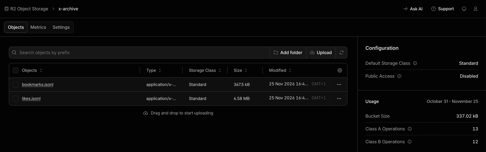
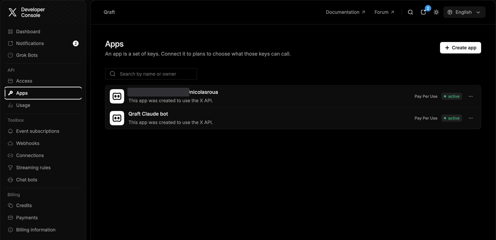
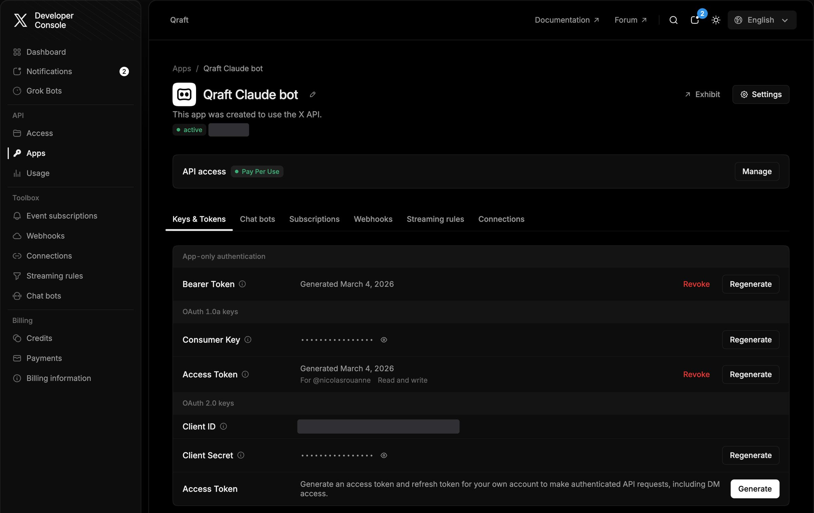
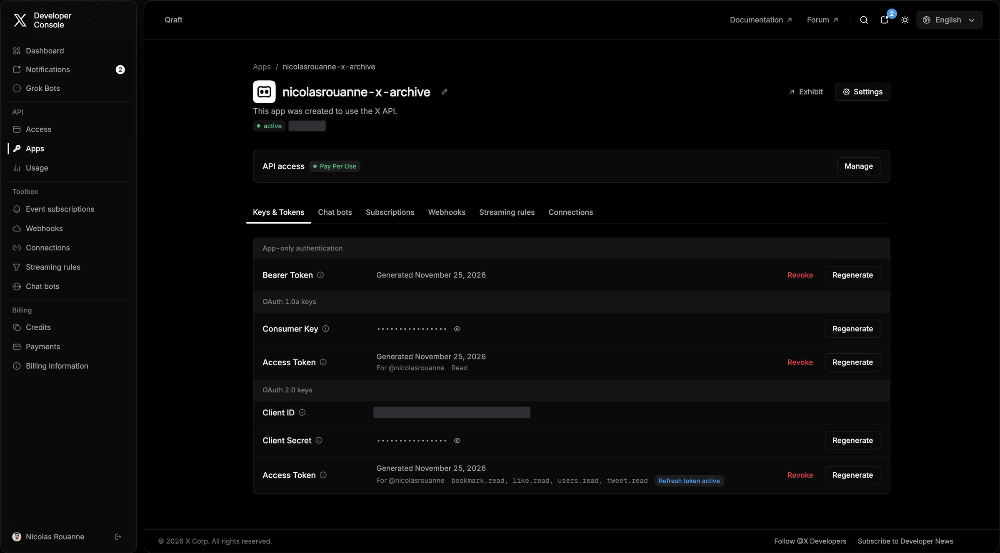
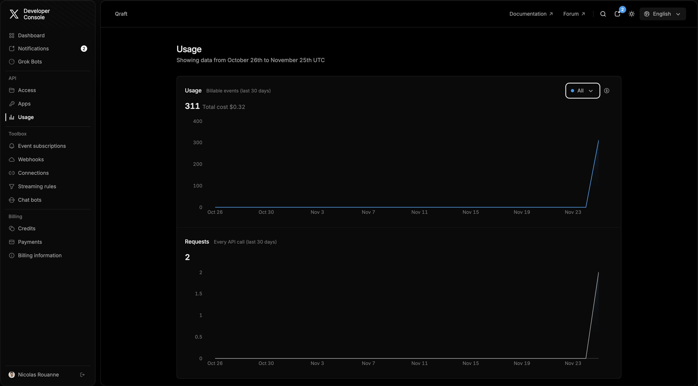
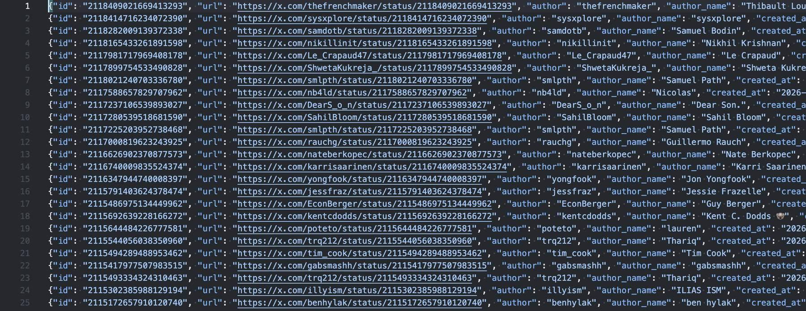

Twitter is a bit of a database for me. What I like and bookmark there is what I want to find again later: a tool, a thread, an argument someone made. I wanted to search it easily, and above all I wanted an agent to be able to search it for me.

The starting point was [birdclaw](https://github.com/steipete/birdclaw), Peter Steinberger's repo. It imports the X archive into SQLite and exposes it to agents, as a CLI and an MCP server. But the archive is a frozen snapshot: you request it from X, wait 1 to 4 days, and to stay up to date birdclaw goes through the paid API anyway. My first reaction was "so every day I'd have to import the archive again?". I also looked at tools that read X with the browser's session cookies, which is against X's terms of service, and at userscripts that export by hand. None of them kept the data fresh without effort.

## What the X API costs now

My first constraint was not to pay for the API. Then I checked what it costs today. In February 2026 X dropped its subscriptions for prepaid, pay-per-use billing. Reading your own likes and bookmarks, with an app you own, counts as an "owned read" and costs $0.001 per post, against $0.005 for a regular read. A post read twice on the same UTC day is billed once ([pricing](https://docs.x.com/x-api/getting-started/pricing)).

At that price, the official API was the simplest option. And since birdclaw needs it anyway for the sync, I built directly on it.

## Two API calls and a file

The need fits in two API calls, one for likes and one for bookmarks, and somewhere to write the result. So it's a Python script, under 400 lines, with no dependency, and three commands:

- `x-archive auth` connects my account with OAuth 2.0, read-only: `tweet.read`, `users.read`, `like.read` and `bookmark.read`
- `x-archive sync` fetches what's new
- `x-archive search <words>` searches

The storage is two JSONL files, one post per line, in a Cloudflare R2 bucket. My agents on the laptop and those on the server read the same copy, with no sync between machines.



## Cleaning up the X console

To use the API, you need an app in the X developer console. When I opened it, there were already two, and I didn't want a mess.



The first one had been generated by X when the developer account was created. The second, "Qraft Claude bot", I had no memory of creating, and I had never used it. It had been holding a token since March 4 with read **and write** access to my account.



I deleted both. Only one app is left, `nicolasrouanne-x-archive`, read-only. The name `x-archive` alone was already taken across the whole X platform, hence the prefix.



## Testing before paying

Before loading everything, I fetched a single page: 100 likes and 100 bookmarks. The console's Usage page showed 311 billable events for $0.32, that is 186 unique posts plus 125 authors.



So author profiles are billed too. But at the same $0.001 as posts, where I feared $0.01, ten times more.

## Never paying twice

Each page read is paid for, so the script writes it to disk before sending it to R2. If the upload fails, the next sync picks up what was already bought instead of reading it again.

The full load brought back 5,643 likes, from October 4, 2009 to today, and 199 bookmarks. X counts 5,907 likes; the rest can't be read anymore, because the posts were deleted or the accounts closed. 63 pages, a few minutes, around 8,050 billable events, so around $8 once and for all. After that, I estimate it at about $2 a month.



## Every morning at 6:57

The sync runs on my agent server, in an [Orca](https://github.com/stablyai/orca) automation every morning at 6:57. The sync is the automation's _precheck_, the command that runs before the agent:

```bash
--precheck "! /usr/local/bin/x-archive sync >> ~/.local/state/x-archive.log 2>&1"
```

If the sync succeeds, no agent starts, so it costs nothing in LLM. If it fails, an agent starts, reads the log and sends me a Slack DM with the cause.

## What the agents see

An agent searches with the same command as me. `x-archive search steipete`, or `x-archive search --bookmarks R2` to search only the bookmarks, returns the date, the author, the link and the full text of each post. t.co links are expanded, and the search ignores case and accents.
