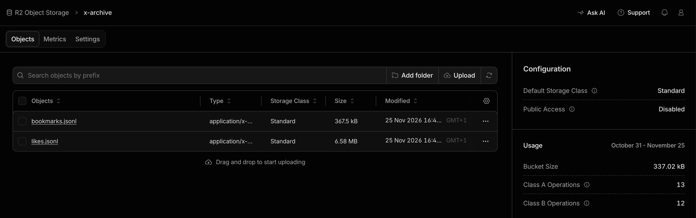
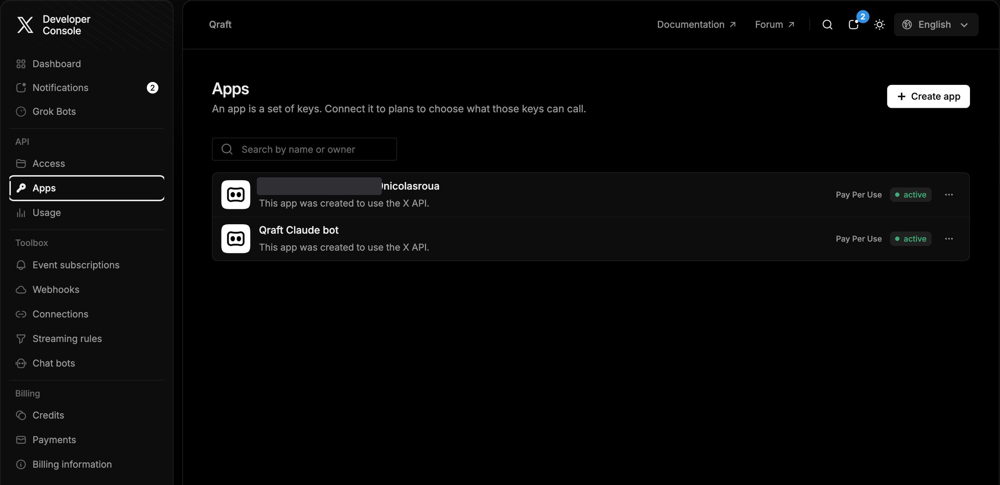
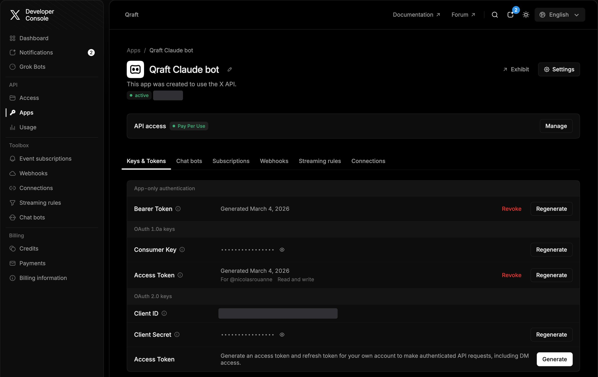
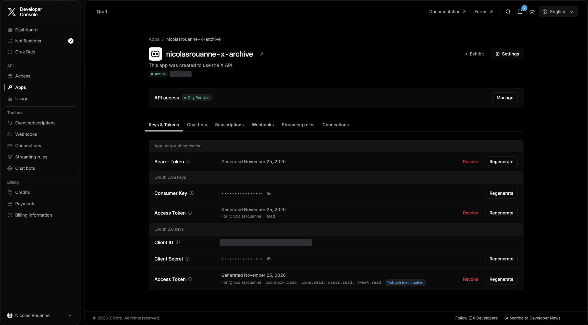
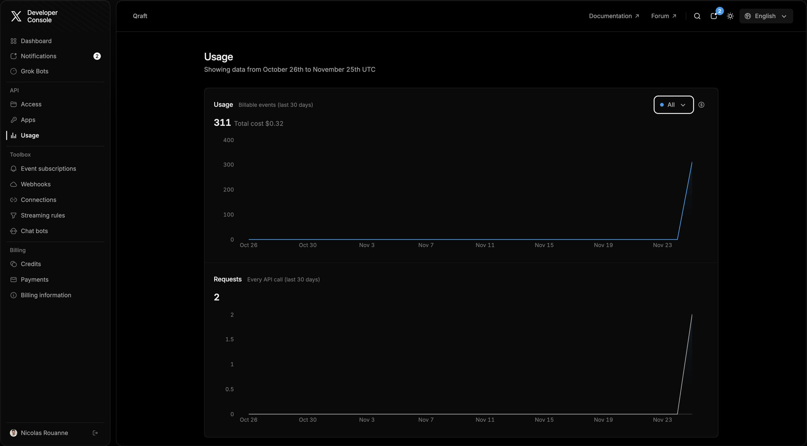
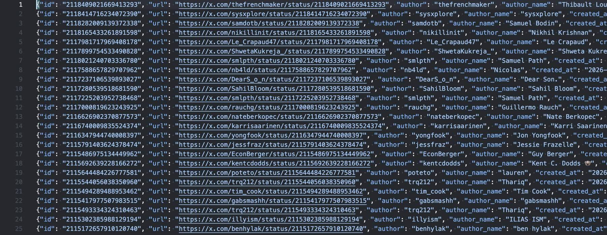

Twitter, c'est un peu ma base de données. Ce que j'y like et mets en signet, c'est ce que je veux retrouver plus tard : un outil, un thread, un argument que quelqu'un a posé. Je voulais pouvoir chercher dedans facilement, et surtout qu'un agent puisse aller chercher dedans pour moi.

Le point de départ, c'est [birdclaw](https://github.com/steipete/birdclaw), le repo de Peter Steinberger. Il importe l'archive X dans SQLite et l'expose aux agents, en CLI et en serveur MCP. Mais l'archive est une photo figée : on la demande à X, on attend de 1 à 4 jours, et pour rester à jour birdclaw passe de toute façon par l'API payante. Ma première réaction, c'était « tous les jours il va falloir que j'importe l'archive ? ». J'ai aussi regardé les outils qui lisent X avec les cookies de session du navigateur, ce qui est hors des CGU de X, et des userscripts qui exportent à la main. Aucun ne gardait les données à jour sans effort.

## Ce que coûte l'API X maintenant

Ma première contrainte, c'était de ne pas payer l'API. Puis j'ai regardé ce qu'elle coûte aujourd'hui. En février 2026, X a abandonné ses abonnements pour du prépayé à l'usage. Lire ses propres likes et signets, avec une app qu'on possède, compte comme une « owned read » et coûte 0,001 $ par post, contre 0,005 $ pour une lecture normale. Un même post relu le même jour UTC n'est facturé qu'une fois ([la grille tarifaire](https://docs.x.com/x-api/getting-started/pricing)).

À ce prix, l'API officielle était la solution la plus simple. Et puisque birdclaw en a besoin de toute façon pour la synchro, j'ai construit directement dessus.

## Deux appels d'API et un fichier

Le besoin tient en deux appels d'API, un pour les likes et un pour les signets, et un endroit où écrire le résultat. C'est donc un script Python de moins de 400 lignes, sans dépendance, avec trois commandes :

- `x-archive auth` connecte mon compte en OAuth 2.0, en lecture seule : `tweet.read`, `users.read`, `like.read` et `bookmark.read`
- `x-archive sync` récupère ce qui est nouveau
- `x-archive search <mots>` cherche

Le stockage, ce sont deux fichiers JSONL, un post par ligne, dans un bucket Cloudflare R2. Mes agents du laptop et ceux du serveur lisent la même copie, sans synchro entre machines.



## Le ménage dans la console X

Pour utiliser l'API, il faut une app dans la console développeur de X. En l'ouvrant, j'en ai trouvé deux, et je ne voulais pas que ce soit le bazar.



La première avait été générée par X à la création du compte développeur. La deuxième, « Qraft Claude bot », je ne me rappelais pas l'avoir créée, et je ne l'avais jamais utilisée. Elle portait depuis le 4 mars un jeton en lecture **et en écriture** sur mon compte.



J'ai supprimé les deux. Il ne reste qu'une app, `nicolasrouanne-x-archive`, en lecture seule. Le nom `x-archive` tout court était déjà pris sur toute la plateforme X, d'où le préfixe.



## Tester avant de payer

Avant de tout charger, j'ai récupéré une seule page : 100 likes et 100 signets. La page « Usage » de la console a affiché 311 événements facturables pour 0,32 $, soit 186 posts uniques et 125 auteurs.



Les profils d'auteurs sont donc facturés aussi. Mais au même 0,001 $ que les posts, alors que je craignais 0,01 $, dix fois plus.

## Ne rien payer deux fois

Chaque page lue est payée, donc le script l'écrit sur disque avant de l'envoyer à R2. Si l'envoi échoue, la synchro suivante reprend ce qui a déjà été acheté au lieu de le relire.

Le chargement complet a ramené 5 643 likes, du 4 octobre 2009 à aujourd'hui, et 199 signets. X compte 5 907 likes ; le reste n'est plus lisible, parce que les posts ont été supprimés ou les comptes fermés. 63 pages, quelques minutes, environ 8 050 événements facturables, donc environ 8 $ une fois pour toutes. Ensuite, je l'estime à 2 $ par mois environ.



## Tous les matins à 6h57

La synchro tourne sur mon serveur d'agents, dans une automation [Orca](https://github.com/stablyai/orca), tous les matins à 6h57. La synchro est le _precheck_ de l'automation, la commande qui passe avant l'agent :

```bash
--precheck "! /usr/local/bin/x-archive sync >> ~/.local/state/x-archive.log 2>&1"
```

Si la synchro réussit, aucun agent ne démarre, donc aucun coût de LLM. Si elle échoue, un agent démarre, lit le log et m'envoie un DM Slack avec la cause.

## Ce que voient les agents

Un agent cherche avec la même commande que moi. `x-archive search steipete`, ou `x-archive search --bookmarks R2` pour ne chercher que dans les signets, sort la date, l'auteur, le lien et le texte complet de chaque post. Les liens t.co sont dépliés, et la recherche ignore la casse et les accents.
