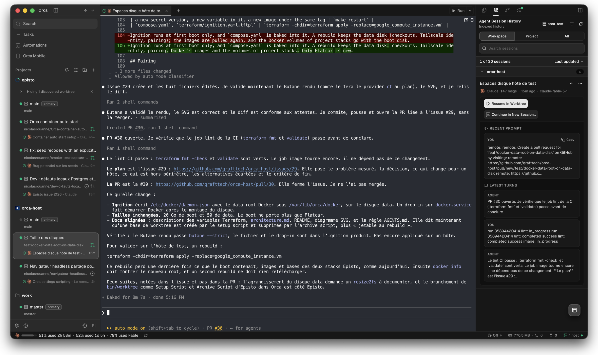
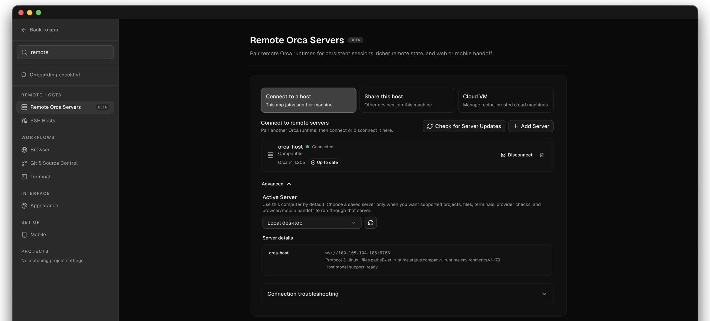
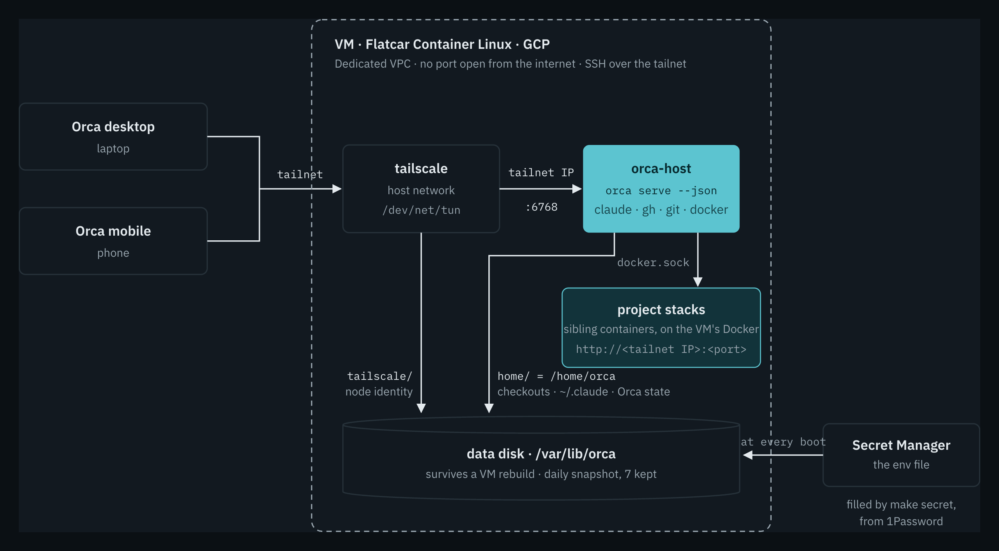
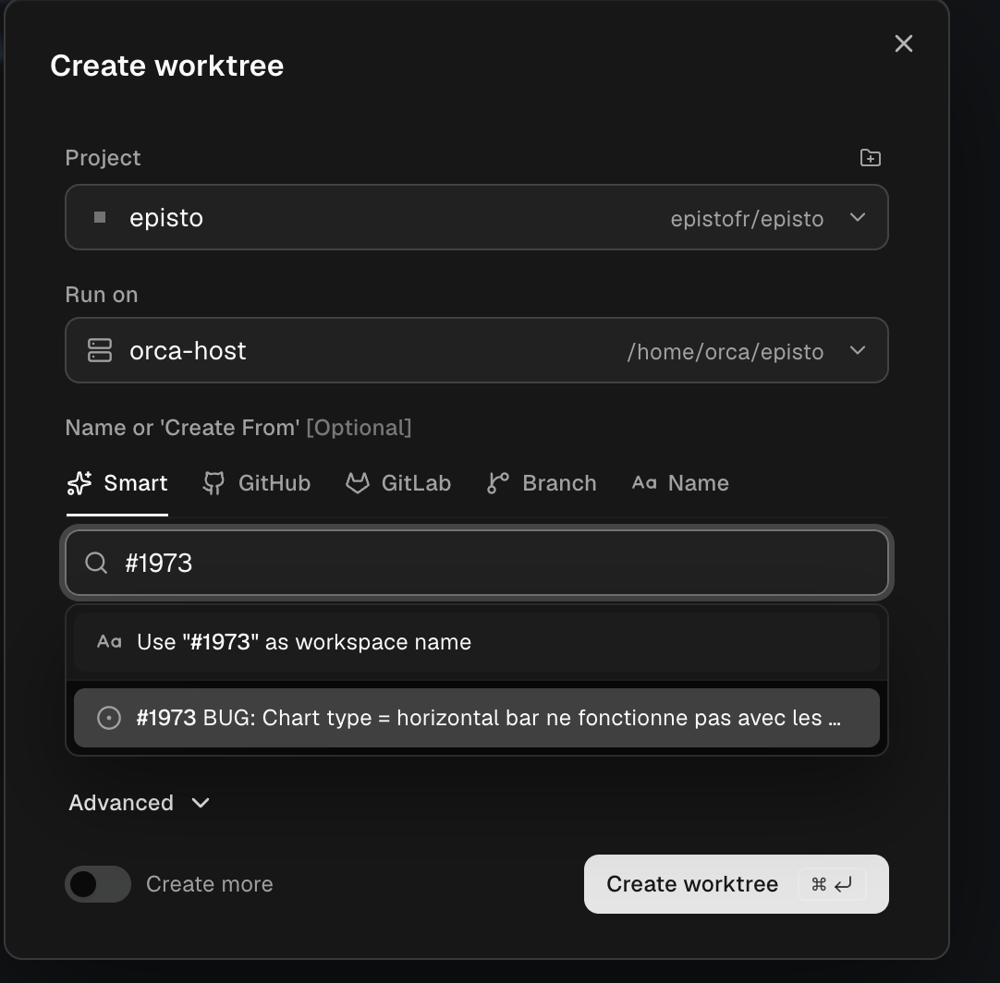
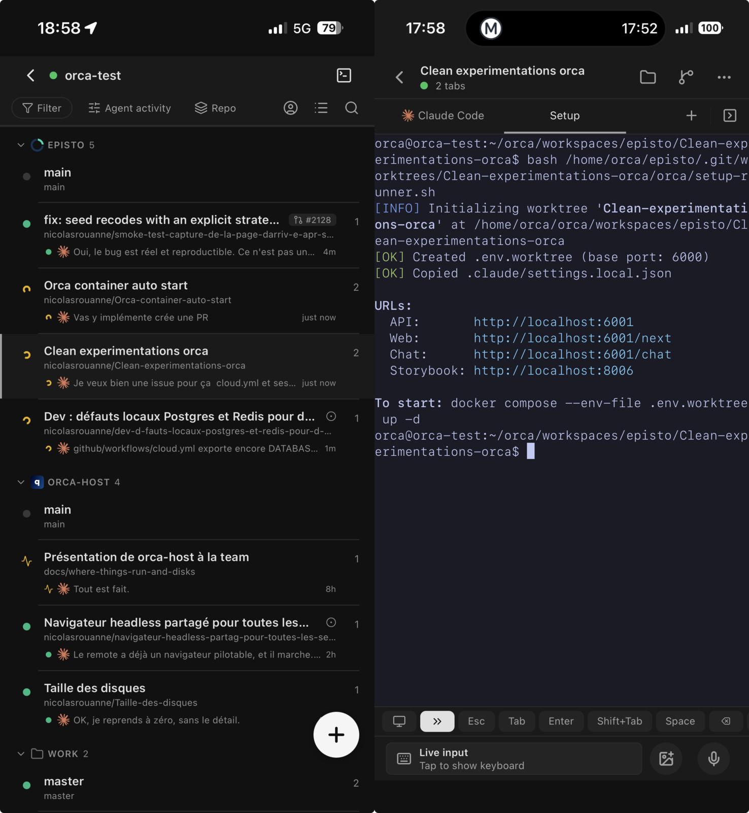
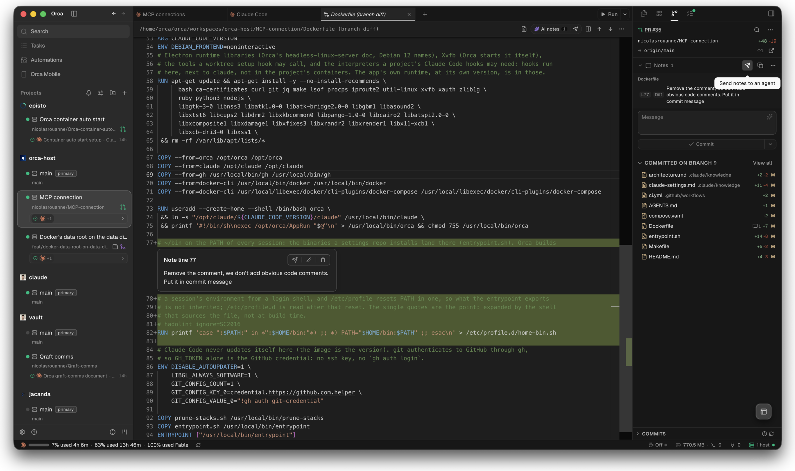

For a while now I have been refining my Claude Code workflow, or more generally my agentic engineering. I find myself writing skills in [my Claude repository](https://nicolasrouanne.github.io/agent-skills/), everything organised, versioned, I have built my personal brain.

But I feel like I am back in the early 2000s, when our FTP servers ran on our own computer. The crazy part is that we all walk around the open space with the laptop half open so as not to cut a session. There is an abstraction we are missing: "Ship my laptop", publish my computer so it works from anywhere.

What we ended up building: one [Orca](https://github.com/stablyai/orca) server per person, with all their projects on it, driven from the laptop or the phone. The repository is public: [qrafttech/orca-host](https://github.com/qrafttech/orca-host).



## 1. The problem

As long as the agent lives on the developer's machine, it inherits every one of its limits:

- **The session stops with the laptop.** Lid closed, battery flat, network change: the task in progress is lost or suspended.
- **Nothing from the phone.** No way to start a worktree, reread a session or unblock a question away from the desk.
- **The agent and the stacks share the machine.** Several sessions in parallel, each with its database and its server, and the laptop overheats.
- **Every workstation is configured by hand.** Tokens, permissions, skills, versions: as many workstations, as many variants.

What I want is simple: keep control over my sessions, an environment to test in, and an agent that can check its own work.

## 2. The options

I started in July with the simplest idea: a dedicated machine, always on, with my credentials on it. A Mac mini under the desk. I set it aside: one more machine to maintain, while I was pushing my routines to the cloud.

In early September I reframed it: rather one machine per task, disposable, ten in parallel if needed. I looked at what exists:

- **GitHub Codespaces** is an IDE in the cloud. Very good for developing remotely in VS Code, not for letting an agent go and picking it up later.
- **Claude Code in the cloud** is the steering I wanted - I list my sessions, I take back control - but without the CPU to run my containers and databases.
- **Sandboxes** ([E2B](https://e2b.dev/), [Daytona](https://www.daytona.io/), Morph) are an API to run code in a disposable machine. Far too low level for me.
- [**Coder**](https://coder.com/) is self-hosted workspaces described in Terraform. The closest, but one more service to operate.

We first built a home-made host, [qrafttech/remote-agent](https://github.com/qrafttech/remote-agent): a self-hosted GitHub Actions runner starts a Claude Code session in a disposable container, and a draft PR comes out. It works for a task you launch and forget, not for a session you pick up from your phone.

On September 17, a call with a peer who runs an Orca server 24/7 on a VPS for their team. Local trial that same afternoon: one worktree per task, our eight-container stack, clean teardown. That evening, the home-made host was replaced. Orca is three pieces:

- **Orca.** A desktop and mobile client that drives Claude Code sessions in git worktrees: one worktree per task, a Claude pane, terminals, a setup hook per project.
- **`orca serve`****.** The same engine, without the interface. Clients connect to it with a pairing link and drive everything remotely.
- **orca-host.** Our part: `orca serve` on a VM, with what a worktree needs close at hand (Claude Code, `gh`, `git`, Docker).

Orca is open source (MIT); orca-host changes nothing in it, it packages and hosts it. Of Orca's three remote modes, only the [Remote Orca Server](https://www.onorca.dev/docs/remote-servers) keeps the session running with the laptop closed and works from mobile. That's the one we host.



→ Doc: [headless Linux server](https://github.com/stablyai/orca/blob/main/docs/reference/headless-linux-server.md).

## 3. What we built

Basically, we just scripted the setup, to get a machine that does not drift and to control what is installed. Nothing in it knows a project.



**The image** pins everything that runs on the host, Orca to my client's version:

```docker
ARG ORCA_VERSION=1.4.205
ARG CLAUDE_CODE_VERSION=2.1.276
ARG GH_VERSION=2.101.0
ARG DOCKER_VERSION=29.8.1
```

**Everything that is mine fits in one env file**: the Claude, GitHub and Tailscale tokens, my git identity, and the repository of my Claude settings (permissions, `CLAUDE.md`, skills, MCP), pulled at every start. The file lives in 1Password; the VM rereads it from [Secret Manager](https://cloud.google.com/secret-manager) at every boot.

**The VM is disposable, the disk is not.** An immutable OS ([Flatcar](https://www.flatcar.org/)) configured by [Ignition](https://coreos.github.io/ignition/) from Terraform, and the home, the Tailscale identity and the Docker images on a separate disk, snapshotted daily. I rebuild the VM in one command without losing anything.

Nothing gets in from the internet: everything goes through [Tailscale](https://tailscale.com/). Bringing a host up, once the secrets are in 1Password:

```bash
make bootstrap   # once per GCP project: the state bucket
make init        # once per checkout
make apply       # VPC, service account, secret, disk + snapshots, VM
make secret      # the env file, from 1Password to Secret Manager
make pair        # the desktop client, then the phone (QR)
```

→ The details are in the [README](https://github.com/qrafttech/orca-host#readme) and [`architecture.md`](https://github.com/qrafttech/orca-host/blob/main/.claude/knowledge/architecture.md).

## 4. Day to day

I open Orca, on the laptop or the phone. I create a worktree, its hook runs `docker compose` on the VM, the app answers at `http://<tailnet IP>:<port>`.



I close the computer, I leave. The session goes on, the history is over there, my routines too.



What belongs to the project stays in its repository (`orca.yaml`, worktree scripts, `.env`, images). And orca-host is not a shared server, nor a CI, nor a deployment environment: it's the agent's workstation.

This article, I am writing from a session on that host. In three days, about thirty sessions ran there, including two fixes to the host itself: Docker's data root moved to the data disk when the boot disk filled up, and a `prune-stacks` that stops the stacks of deleted worktrees.



## What's still pending

- **By hand**: the Tailscale tag, the Tailscale auth key, the Claude and GitHub tokens, the first clone of a project.
- **One pairing link per process**: `make pair` restarts the container twice.
- **The GitHub token**: fine-grained tokens can't read GHCR, and without `read:org` the mobile app's GitHub picker fails to create a worktree.
- **Cost**: about $126/month at GCP defaults, against about €25 before tax for a comparable OVH VPS, which would have neither an immutable image, nor Ignition, nor Secret Manager. Not decided.
