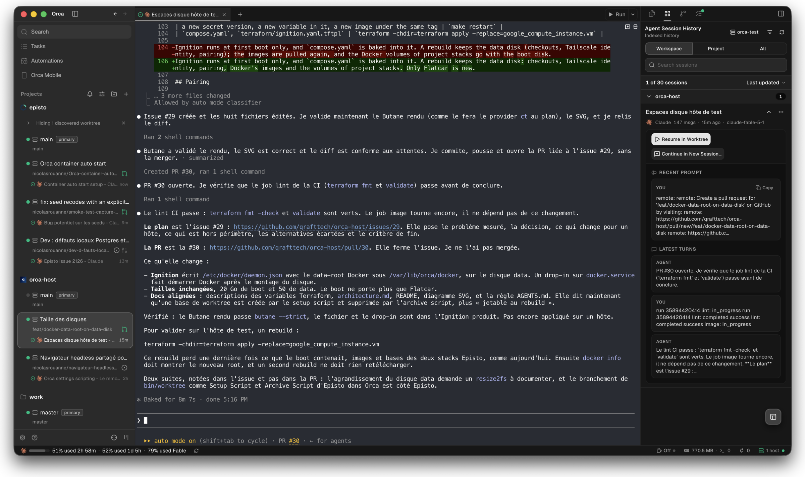
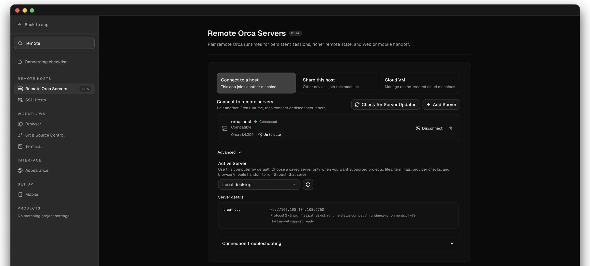
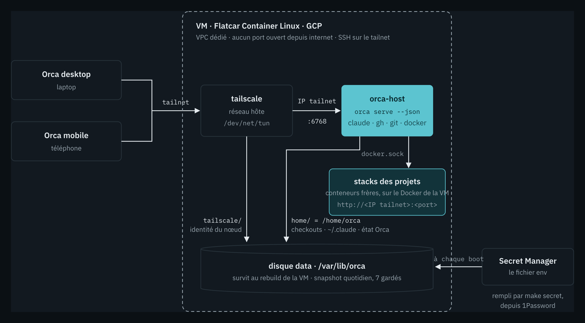
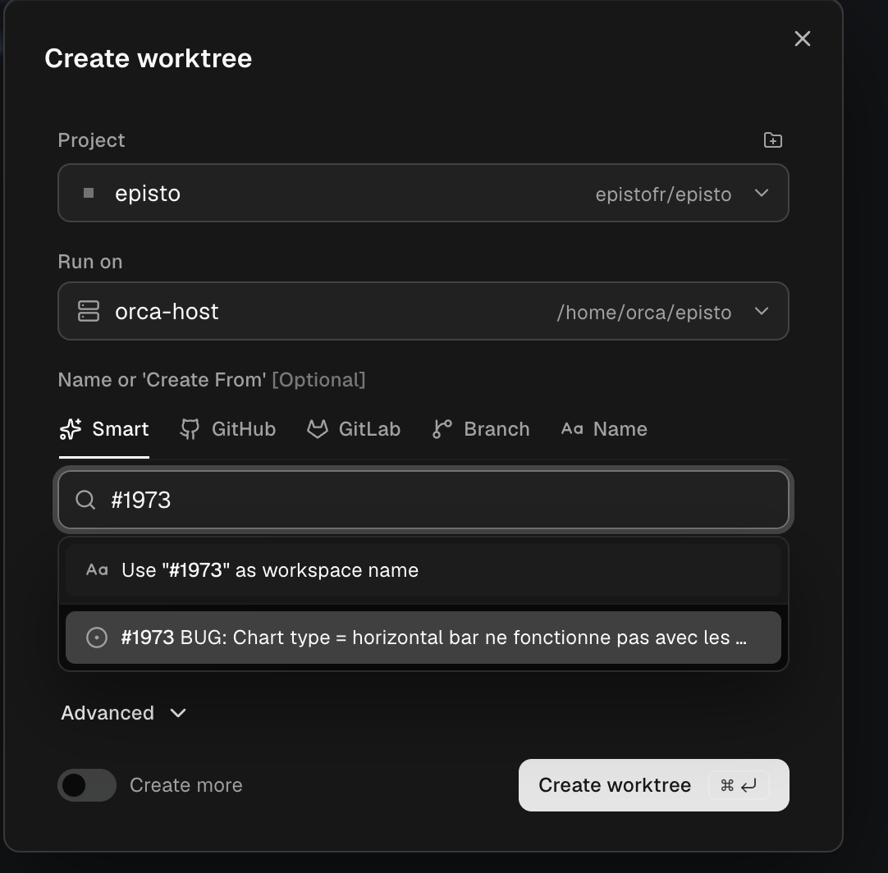
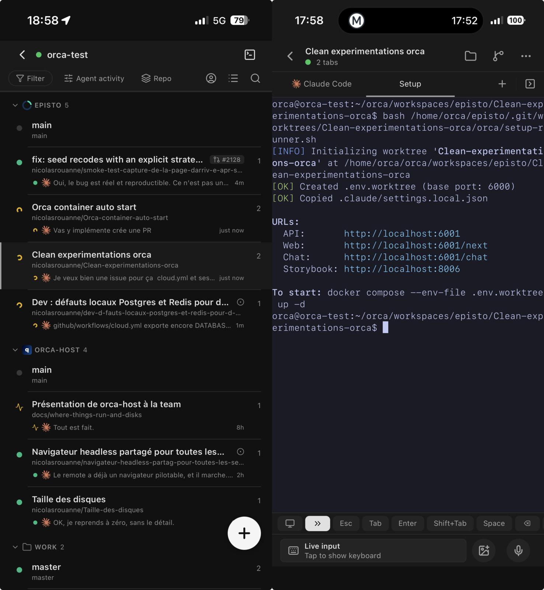
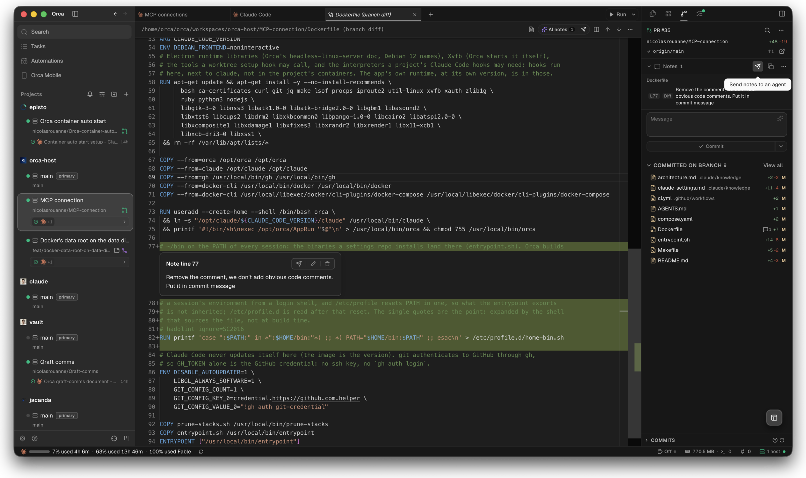

Depuis quelque temps, je peaufine mon workflow Claude Code, ou plus généralement mon agentic engineering. Je me retrouve à écrire des skills dans [mon repo Claude](https://nicolasrouanne.github.io/agent-skills/), tout est organisé, versionné, j'ai construit mon personal brain.

Mais j'ai l'impression d'être revenu au début des années 2000, quand nos serveurs FTP tournaient sur notre ordi. Le truc de fou, c'est qu'on est tous à se balader avec l'ordi à moitié ouvert dans l'open space pour ne pas couper une session. Il y a une abstraction qu'on rate : « Ship my laptop », publier mon ordi pour qu'il fonctionne n'importe où.

Ce qu'on a fini par monter : un serveur [Orca](https://github.com/stablyai/orca) par personne, tous ses projets dessus, piloté depuis le laptop ou le téléphone. Le repo est public : [qrafttech/orca-host](https://github.com/qrafttech/orca-host).



## 1. Le problème

Tant que l'agent vit sur la machine du dev, il en hérite toutes les limites :

- **La session s'arrête avec le laptop.** Couvercle fermé, batterie vide, réseau qui change : la tâche en cours est perdue ou suspendue.
- **Rien depuis le téléphone.** Pas moyen de lancer un worktree, relire une session ou débloquer une question hors du bureau.
- **L'agent et les stacks se partagent la machine.** Plusieurs sessions en parallèle, chacune avec sa base et son serveur, et le laptop chauffe.
- **Chaque poste se configure à la main.** Tokens, permissions, skills, versions : autant de postes, autant de variantes.

Ce que je veux est simple : garder le contrôle sur mes sessions, un environnement pour tester, et un agent qui puisse contrôler son travail lui-même.

## 2. Les pistes

J'ai commencé en juillet par l'idée la plus simple : une machine dédiée, toujours allumée, avec mes credentials dessus. Un Mac mini sous le bureau. Je l'ai laissée de côté : une machine de plus à entretenir, alors que je poussais mes routines vers le cloud.

Début septembre, j'ai reformulé : plutôt une machine par tâche, jetable, dix en parallèle s'il faut. J'ai regardé ce qui existe :

- **GitHub Codespaces**, c'est un IDE dans le cloud. Très bien pour développer à distance dans VS Code, pas pour lâcher un agent et le reprendre plus tard.
- **Claude Code dans le cloud**, c'est le pilotage que je voulais - je liste mes sessions, je reprends la main - mais sans le CPU pour faire tourner mes conteneurs et mes bases.
- **Les sandboxes** ([E2B](https://e2b.dev/), [Daytona](https://www.daytona.io/), Morph), c'est une API pour exécuter du code dans une machine jetable. Beaucoup trop bas niveau pour moi.
- [**Coder**](https://coder.com/), ce sont des workspaces self-hosted décrits en Terraform. Le plus proche, mais un service de plus à opérer.

On a d'abord construit un host maison, [qrafttech/remote-agent](https://github.com/qrafttech/remote-agent) : un runner GitHub Actions self-hosted lance une session Claude Code dans un conteneur jetable, et une draft PR en sort. Ça marche pour une tâche qu'on lance et qu'on oublie, pas pour une session qu'on reprend depuis son téléphone.

Le 17 septembre, un call avec un pair qui fait tourner un serveur Orca 24/7 sur un VPS pour son équipe. Essai local l'après-midi même : un worktree par tâche, notre stack de huit conteneurs, teardown propre. Le soir, le host maison était remplacé. Orca, c'est trois briques :

- **Orca.** Un client desktop et mobile pour piloter des sessions Claude Code dans des worktrees git : un worktree par tâche, un pane Claude, des terminaux, un hook de setup par projet.
- **`orca serve`****.** Le même moteur, sans interface. Les clients s'y connectent avec un lien d'appairage et pilotent tout à distance.
- **orca-host.** Notre part : `orca serve` sur une VM, avec ce qu'un worktree a besoin d'avoir sous la main (Claude Code, `gh`, `git`, Docker).

Orca est open source (MIT) ; orca-host n'en modifie rien, il l'emballe et l'héberge. Des trois modes distants d'Orca, seul le [Remote Orca Server](https://www.onorca.dev/docs/remote-servers) laisse la session tourner laptop fermé et marche depuis le mobile. C'est celui qu'on héberge.



→ Doc : [headless Linux server](https://github.com/stablyai/orca/blob/main/docs/reference/headless-linux-server.md).

## 3. Ce qu'on a construit

Au fond, on a juste scripté le setup, pour avoir une machine qui ne diverge pas et maîtriser ce qui est installé. Rien dedans ne connaît un projet.



**L'image** épingle tout ce qui tourne sur l'hôte, Orca sur la version de mon client :

```docker
ARG ORCA_VERSION=1.4.205
ARG CLAUDE_CODE_VERSION=2.1.276
ARG GH_VERSION=2.101.0
ARG DOCKER_VERSION=29.8.1
```

**Ce qui est à moi tient dans un fichier env** : les tokens Claude, GitHub et Tailscale, mon identité git, et le repo de mes réglages Claude (permissions, `CLAUDE.md`, skills, MCP), tiré à chaque démarrage. Le fichier vit dans 1Password ; la VM le relit depuis [Secret Manager](https://cloud.google.com/secret-manager) à chaque boot.

**La VM est jetable, le disque ne l'est pas.** Un OS immuable ([Flatcar](https://www.flatcar.org/)) configuré par [Ignition](https://coreos.github.io/ignition/) depuis Terraform, et le home, l'identité Tailscale et les images Docker sur un disque à part, snapshoté chaque jour. Je refais la VM en une commande sans rien perdre.

Rien n'entre depuis internet : tout passe par [Tailscale](https://tailscale.com/). Monter un hôte, une fois les secrets dans 1Password :

```bash
make bootstrap   # une fois par projet GCP : le bucket d'état
make init        # une fois par checkout
make apply       # VPC, service account, secret, disque + snapshots, VM
make secret      # le fichier env, de 1Password vers Secret Manager
make pair        # le client desktop, puis le téléphone (QR)
```

→ Le détail est dans le [README](https://github.com/qrafttech/orca-host#readme) et [`architecture.md`](https://github.com/qrafttech/orca-host/blob/main/.claude/knowledge/architecture.md).

## 4. Au quotidien

J'ouvre Orca, sur le laptop ou le téléphone. Je crée un worktree, son hook lance `docker compose` sur la VM, l'app répond sur `http://<IP tailnet>:<port>`.



Je ferme l'ordi, je pars. La session continue, l'historique est là-bas, mes routines aussi.



Ce qui est propre au projet reste dans son repo (`orca.yaml`, scripts de worktree, `.env`, images). Et orca-host n'est ni un serveur partagé, ni une CI, ni un environnement de déploiement : c'est le poste de travail de l'agent.

Cet article, je l'écris depuis une session sur cet hôte. En trois jours, une trentaine de sessions y ont tourné, dont deux corrections de l'hôte lui-même : le data root Docker déplacé sur le disque data quand le disque de boot s'est rempli, et un `prune-stacks` qui arrête les stacks des worktrees supprimés.



## Ce qui reste

- **À la main** : le tag Tailscale, la clé d'auth Tailscale, les tokens Claude et GitHub, le premier clone d'un projet.
- **Un lien d'appairage par process** : `make pair` redémarre le conteneur deux fois.
- **Le token GitHub** : les tokens fine-grained ne lisent pas GHCR, et sans `read:org` le picker GitHub de l'app mobile échoue à créer un worktree.
- **Le coût** : environ 126 $/mois aux défauts GCP, contre environ 25 € HT pour un VPS OVH comparable, qui n'aurait ni image immuable, ni Ignition, ni Secret Manager. Pas tranché.
