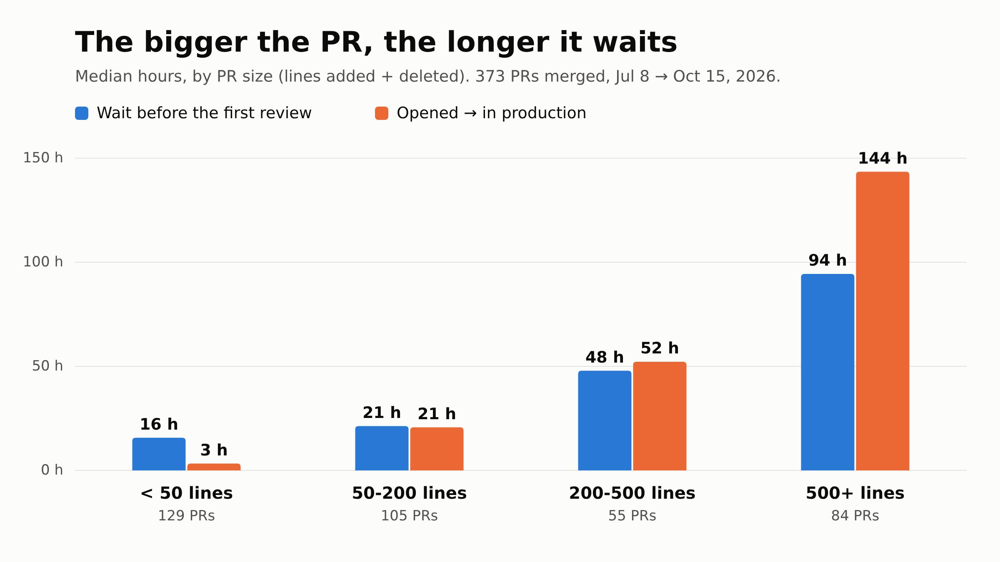

On one of the products we work on, a team of about six developers in a Rails + Vue monorepo, the Q4 tech OKRs all come back to the same thing: code review has become the bottleneck. The targets are concrete: no PR open for more than a week (there were 31 at the start of the quarter), 7 PRs out of 10 reviewed within the day (4 out of 10 at the time), 9 frontend PRs out of 10 shipped with a test (1 out of 10, against nearly 9 out of 10 on the backend), and CI feedback in under 5 minutes (about 8 and a half). The main measure we follow, without a target, is the time from opening a PR to having it in production.

Those figures were computed by hand from the GitHub API, once, for the OKR meeting. The plan was to recompute them every month "with the same method". We'd rather have them up to date on their own, in a tool the team already opens, so we send them to PostHog from GitHub Actions.

## Three events, sent at the right moment

The whole thing is one workflow and one Node script with no dependencies. It sends three events to a dedicated PostHog project, separate from the product analytics:

- `pr_merged`: one per PR, with its size, the wait before the first human review, ready → merge, opened → production, whether a human reviewed it, whether it touches frontend or backend and comes with a test there;
- `ci_feedback`: one per push, with the developer's wait and the duration of each check;
- `prs_open`: a daily snapshot of the open PRs, those older than a week, and the drafts.

Each event is sent by the GitHub event that makes it true, which is what the workflow's triggers say:

```yaml
on:
  # A successful "Deploy All" on main puts the merged PRs in production: it sends their `pr_merged`.
  # The other ones are the CI checks run in parallel on every push: when the last one finishes,
  # it sends a `ci_feedback` with the wait (slowest check) and each check's duration.
  workflow_run:
    workflows: ["Deploy All", "API - Tests", "API - Lint", "Web - Lint", "Chat - Tests"]
    types: [completed]
  schedule:
    - cron: "0 6 * * *"
  workflow_dispatch:
    inputs:
      since:
        description: "Backfill the PRs merged since (YYYY-MM-DD)"
        required: true
```

`pr_merged` doesn't go out on merge but on the production deploy that follows. Since the main measure is the time until production, a merged PR isn't done until it is live. When `Deploy All` succeeds on `main`, the script takes every PR merged since the previous deploy and sends them with that deploy's date.

For the CI, the developer waits for the slowest of the four checks that run in parallel. Each check triggers the workflow when it finishes. The script lists the runs of the same commit and does nothing while one is missing: the last one to finish sends the event, so there is exactly one per push. A run cancelled by a newer push sends nothing.

```js
const checks = workflow_runs.filter((r) => r.name in CI_CHECKS);
const done = checks.filter((r) => r.status === "completed");
if (new Set(done.map((r) => r.name)).size < Object.keys(CI_CHECKS).length) return [];
if (done.some((r) => r.conclusion === "cancelled")) return [];
```

The `workflow_dispatch` imports the history: it replays the production deploys since a date and sends the PRs they shipped. To make that safe, each event's uuid is derived from a stable key (the PR number, the commit, the day). PostHog deduplicates events that share a uuid, so a replay, or a backfill that overlaps the live events, adds nothing:

```js
// Same key → same uuid, so that a re-run or a backfill overlapping live events does not duplicate them.
function uuid(key) {
  const hex = createHash("sha1").update(key).digest("hex");
  return `${hex.slice(0, 8)}-${hex.slice(8, 12)}-5${hex.slice(13, 16)}-8${hex.slice(17, 20)}-${hex.slice(20, 32)}`;
}
```

The events go to PostHog's `/batch` endpoint with the project's ingestion key. That key can only send events, so it sits in plain text in the workflow rather than in a secret. Bots and Dependabot are left out, and a review only counts if it comes from a human other than the author.

The backfill imported 846 PRs, everything shipped since the monorepo was created in January.

## Checking against the hand-made figures

Before trusting a dashboard, we compared it with the figures computed by hand for the OKR meeting, over the same period (July 8 to October 9). PostHog finds 321 PRs where the hand count had 315, a median wait of 43.8 hours before the first review against 44, 43% of reviewed PRs reviewed within a day against "4 out of 10", and 39% merged without a human review against "a bit more than one in three". Close enough to trust it, without knowing exactly which six PRs the two counts disagree on.

## What the data says

The first thing that stands out is the size of the PRs.



Under 50 lines, a PR is in production in 3 hours (median). Over 500 lines, it waits 94 hours for its first review and reaches production after 144. These large PRs are almost one in four (84 out of 373 since July). The small ones reach production faster than they get reviewed because most of them get no human review at all: 69% of PRs under 50 lines are merged without one. Across the team, the median PR went from 16 lines in February to about 100 since June.

The median time to production barely moves from month to month, around 22 hours. What hurts is the tail: since May, one PR in four takes more than 90 to 160 hours depending on the month. The median wait before the first review, on the other hand, went from 2 hours in February to 47 hours in October.

On tests, the backend went from 17% of PRs with a test in February to 89% in October. The frontend stays around 10%, with no visible trend. Of all the targets, it is the furthest away.

## One dashboard, built on the OKR document

The dashboard follows the OKR document: three sections (review, frontend tests, CI), each starting with its target and the starting point. Each chart has one bar per month since July, the value written on the bar, and the target as a horizontal line. The open-PR snapshot is shown per day, from the day it started being recorded: earlier days would show a misleading zero.

The most useful part isn't a chart but a table: the ten slowest PRs of the last 30 days, with a link to each. It is what gets discussed in the retro, because a median says the problem exists, and those ten PRs say where.

We left out any comparison between developers. The OKR document says the wait comes from collaboration (waiting for a colleague to be available), not from how long the review itself takes, and figures per person would quickly read like a ranking.

A few things remain open. The time spent reviewing, which the OKR document also wants to follow, can't be measured from what GitHub records. The CI wait only counts `main`, like the original measure, and doesn't have much data yet. And the open-PR count starts on the day the workflow was merged: there is no history before that.
