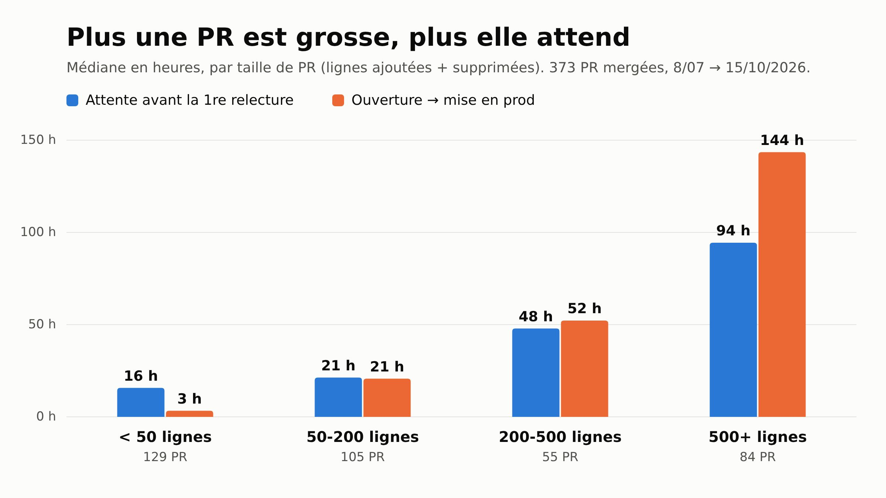

Sur un des produits sur lesquels on travaille, une équipe d'environ six développeurs dans un monorepo Rails + Vue, les OKR tech du trimestre reviennent tous à la même chose : la review est devenue le goulot d'étranglement. Les cibles sont concrètes : plus aucune PR ouverte depuis plus d'une semaine (31 en début de trimestre), 7 PR sur 10 relues dans la journée (4 sur 10 à ce moment-là), 9 PR front sur 10 livrées avec un test (1 sur 10, contre près de 9 sur 10 côté back), et un retour de CI en moins de 5 minutes (environ 8 et demie). La mesure principale qu'on suit, sans cible, c'est le temps entre l'ouverture d'une PR et sa mise en production.

Ces chiffres avaient été calculés à la main depuis l'API GitHub, une fois, pour la réunion OKR. L'idée était de les recalculer chaque mois « avec la même méthode ». On préfère les avoir à jour tout seuls, dans un outil que l'équipe ouvre déjà, donc on les envoie à PostHog depuis GitHub Actions.

## Trois événements, envoyés au bon moment

Le tout tient en un workflow et un script Node sans dépendance. Il envoie trois événements à un projet PostHog dédié, séparé de l'analytics produit :

- `pr_merged` : un par PR, avec sa taille, l'attente avant la première relecture humaine, ready → merge, ouverture → prod, relue ou non par un humain, front ou back touché et avec un test ;
- `ci_feedback` : un par push, avec l'attente du développeur et la durée de chaque check ;
- `prs_open` : un relevé quotidien des PR ouvertes, de celles qui ont plus d'une semaine, et des drafts.

Chaque événement est envoyé par l'événement GitHub qui le rend vrai, et c'est ce que disent les déclencheurs du workflow :

```yaml
on:
  # A successful "Deploy All" on main puts the merged PRs in production: it sends their `pr_merged`.
  # The other ones are the CI checks run in parallel on every push: when the last one finishes,
  # it sends a `ci_feedback` with the wait (slowest check) and each check's duration.
  workflow_run:
    workflows: ["Deploy All", "API - Tests", "API - Lint", "Web - Lint", "Chat - Tests"]
    types: [completed]
  schedule:
    - cron: "0 6 * * *"
  workflow_dispatch:
    inputs:
      since:
        description: "Backfill the PRs merged since (YYYY-MM-DD)"
        required: true
```

`pr_merged` ne part pas au merge mais au déploiement en production qui suit. Comme la mesure principale est le temps jusqu'à la prod, une PR mergée n'est pas finie tant qu'elle n'est pas en ligne. Quand `Deploy All` réussit sur `main`, le script prend toutes les PR mergées depuis le déploiement précédent et les envoie avec la date de ce déploiement.

Pour la CI, le développeur attend le plus lent des quatre checks qui tournent en parallèle. Chaque check déclenche le workflow quand il se termine. Le script liste les runs du même commit et ne fait rien tant qu'il en manque un : c'est le dernier à finir qui envoie l'événement, donc il y en a exactement un par push. Un run annulé par un push plus récent n'envoie rien.

```js
const checks = workflow_runs.filter((r) => r.name in CI_CHECKS);
const done = checks.filter((r) => r.status === "completed");
if (new Set(done.map((r) => r.name)).size < Object.keys(CI_CHECKS).length) return [];
if (done.some((r) => r.conclusion === "cancelled")) return [];
```

Le `workflow_dispatch` importe l'historique : il rejoue les déploiements en prod depuis une date et envoie les PR qu'ils ont livrées. Pour que ce soit sans risque, l'uuid de chaque événement est dérivé d'une clé stable (le numéro de PR, le commit, le jour). PostHog dédoublonne les événements qui partagent un uuid, donc rejouer l'import, ou un import qui chevauche les événements en direct, n'ajoute rien :

```js
// Same key → same uuid, so that a re-run or a backfill overlapping live events does not duplicate them.
function uuid(key) {
  const hex = createHash("sha1").update(key).digest("hex");
  return `${hex.slice(0, 8)}-${hex.slice(8, 12)}-5${hex.slice(13, 16)}-8${hex.slice(17, 20)}-${hex.slice(20, 32)}`;
}
```

Les événements partent sur l'endpoint `/batch` de PostHog avec la clé d'ingestion du projet. Cette clé ne permet que d'envoyer des événements, elle est donc en clair dans le workflow plutôt qu'en secret. Les bots et Dependabot sont exclus, et une relecture ne compte que si elle vient d'un humain autre que l'auteur.

L'import a chargé 846 PR, tout ce qui a été livré depuis la création du monorepo en janvier.

## Vérifier contre les chiffres faits à la main

Avant de faire confiance à un dashboard, on l'a comparé aux chiffres calculés à la main pour la réunion OKR, sur la même période (8 juillet au 9 octobre). PostHog trouve 321 PR là où le calcul à la main en comptait 315, une attente médiane de 43,8 heures avant la première relecture contre 44, 43 % des PR relues l'ont été dans la journée contre « 4 sur 10 », et 39 % sont mergées sans relecture humaine contre « un peu plus d'une sur trois ». Assez proche pour lui faire confiance, sans savoir exactement sur quelles six PR les deux comptes divergent.

## Ce que disent les données

La première chose qui ressort, c'est la taille des PR.



Sous 50 lignes, une PR est en prod en 3 heures (médiane). Au-delà de 500 lignes, elle attend 94 heures sa première relecture et arrive en prod au bout de 144. Ces grosses PR représentent presque une PR sur quatre (84 sur 373 depuis juillet). Les petites arrivent en prod plus vite qu'elles ne sont relues parce que la plupart ne le sont pas du tout par un humain : 69 % des PR de moins de 50 lignes sont mergées sans relecture humaine. Sur toute l'équipe, la PR médiane est passée de 16 lignes en février à environ 100 depuis juin.

Le temps médian jusqu'à la prod ne bouge presque pas d'un mois à l'autre, autour de 22 heures. Ce qui fait mal, c'est la queue : depuis mai, une PR sur quatre met plus de 90 à 160 heures selon les mois. L'attente médiane avant la première relecture, elle, est passée de 2 heures en février à 47 heures en octobre.

Côté tests, le back est passé de 17 % des PR avec un test en février à 89 % en octobre. Le front reste autour de 10 %, sans tendance visible. De toutes les cibles, c'est la plus éloignée.

## Un seul dashboard, calqué sur le document OKR

Le dashboard suit le document OKR : trois parties (review, tests front, CI), chacune ouverte par sa cible et son point de départ. Chaque graphique a une barre par mois depuis juillet, la valeur écrite dessus, et la cible en ligne horizontale. Le relevé des PR ouvertes est affiché par jour, à partir du jour où il a commencé : les jours d'avant afficheraient un zéro trompeur.

La partie la plus utile n'est pas un graphique mais un tableau : les dix PR les plus lentes des 30 derniers jours, avec un lien vers chacune. C'est ce dont on parle en rétro, parce qu'une médiane dit que le problème existe, et ces dix PR disent où.

On n'a mis aucune comparaison entre développeurs. Le document OKR dit que l'attente vient de la collaboration (attendre qu'un collègue soit disponible), pas du temps de relecture lui-même, et des chiffres par personne ressembleraient vite à un classement.

Quelques points restent ouverts. Le temps passé à relire, que le document OKR veut aussi suivre, n'est pas mesurable avec ce que GitHub enregistre. L'attente CI ne compte que `main`, comme la mesure d'origine, et n'a pas encore beaucoup de données. Et le nombre de PR ouvertes commence le jour où le workflow a été mergé : il n'y a pas d'historique avant.
