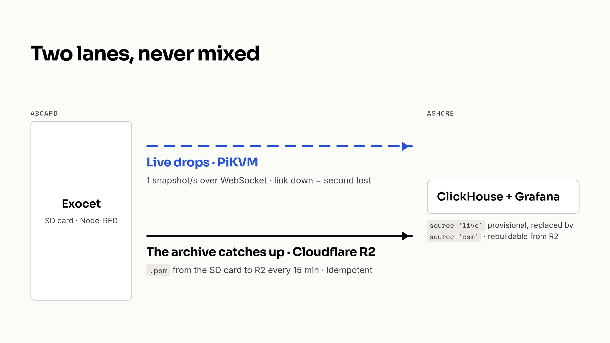
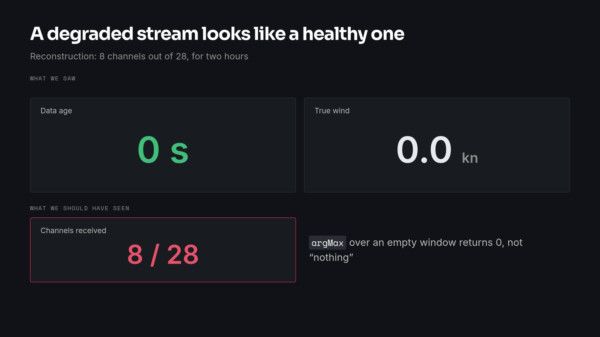

On a server, when an agent breaks something, you restart. On a racing sailboat, restarting the navigation computer cuts the autopilot.

Jacanda 3 is a MAT 11.80 racing the IRC Mediterranean circuit out of Marseille. Aboard, there is an Exocet navigation computer from Pixel sur Mer, which corrects the wind, computes leeway and polars in a Node-RED graph, and records everything to an SD card. There is also a B&G H5000 instrument processor, a chartplotter, a navigation PC, and a Peplink router whose only internet access is 4G. A very powerful box full of intelligence: we did not want to bypass it, we wanted to master it. See the data live from shore, archive everything, and put the boat's configuration under git.

I did it in September with Claude Code, from Marseille, through the boat's network. One useful clarification: today, nothing aboard does machine learning. The AI is the agent that built the system and operates it. And it is very different ground from web development: the link drops, the boat powers off, every megabyte comes out of a 4G data plan, and some actions can only happen at the dock.

## 1. Reaching the boat

First attempt: an L2TP/IPsec VPN on the Peplink. It did not work. I took a PiKVM (a Raspberry Pi, ~3 W) that was lying around aboard and reflashed it as a [Tailscale](https://tailscale.com/kb/1201/4via6-subnets) subnet router, in 4via6 mode. The boat's network uses the same subnet as every home router, and without 4via6 the home network wins as soon as you are at home. One rule set early: Tailscale is for administration, not for carrying the data.

The first real problem showed up in the timestamps: the Exocet's clock was 228.8 s ahead, and drifting by about 3 s a day. Race data timestamped to within four minutes is not worth much. Now the Exocet syncs on NTP when 4G is up, on GPS when it drops, and serves time to the rest of the boat:

```text
internet NTP (via Peplink WAN)  ──┐
                                  ├──► chrony on the Exocet ──► NTP server for the LAN
GPS $RMC (out_TimeSync tab       ──┘      (picks the best         (nav PC, PiKVM,
 → gpsd on 127.0.0.1:8112)                 source live)             laptops…)
```

The detail that made me smile: the GPS → gpsd chain already existed in the Exocet's graph, fully wired, in a disabled tab. All that was left was to enable it and configure NTP. We went from +228.8 s to +4 ms.

## 2. When the link drops

On a boat, losing the link is not an incident, it is the normal state. Offshore, 4G disappears. The server reflex would be a queue: buffer during the outage, replay when it comes back. Except that on return, you would replay an hour of stale "live".

So I split two lanes, and I never mix them.

**Live drops.** A publisher on the PiKVM reads the Exocet's stream (through the API its web app uses, undocumented), turns it into one full snapshot per second and pushes it ashore over a WebSocket. If the link drops, that second is lost, on purpose:

```python
async def send(self, msg):
    if msg.get("type") == "session":
        self.session = msg
    if self.ws is None and time.monotonic() < self.next_try:
        return  # dropped, by design
    try:
        if self.ws is None:
            self.ws = await websockets.connect(self.url, ...)
            if self.session is not None and msg is not self.session:
                await self.ws.send(json.dumps(self.session))
        await self.ws.send(json.dumps(msg))
    except Exception:
        self.next_try = time.monotonic() + RETRY_S
        ...
```

Two details: it retries at most every 5 s (not one TLS handshake per snapshot over 4G), and every reconnection first resends a `session` message describing the channels and their units. The stream stays readable even for someone joining mid-race.

**The archive catches up.** The Exocet's SD card is the source of truth. A second container copies the `.psm` recordings to [Cloudflare R2](https://developers.cloudflare.com/r2/) every 15 minutes, idempotently: it resumes where it stopped.

**One store, disposable.** Ashore, a GCP VM runs [ClickHouse](https://clickhouse.com/) and Grafana. Live rows arrive with `source='live'` and are provisional: when the full recording is reloaded from R2 (`source='psm'`, full rate), it replaces them. The store rebuilds entirely from R2, so it can be thrown away.



The most instructive bug came from there. After an Exocet restart, the publisher resolved only 8 channels out of 28, and streamed like that for two hours. The dashboard looked perfect: the "Data age" indicator green, at 0 s. And the wind showed 0.0, because ClickHouse's `argMax` aggregate over an empty window returns 0 rather than nothing. A degraded stream looks exactly like a healthy one. It is still open.



The reverse happened too: on the evening we went live, the wind vane went silent for a quarter of an hour. My first reaction: "did we break something in the pixel?". No, it was a real gap on the sensor side, and the live lane had just shown it.

## 3. Power and the data plan

On the electrical side, I will be honest: we measured almost nothing. The only solid number is the PiKVM at ~3 W. What we really optimised is the resource we do measure: the 4G data plan.

- The Exocet was sending 653 variables to the manufacturer's cloud, which nobody read. Turned off.
- Live only runs while the Exocet records. At the dock, the boat was producing 24-hour files for nothing. The publisher polls the recorder state every 5 s: in testing, a stop cut the stream in 3 s.

```python
async def until_recording():
    """Return once the Exocet records; say so once when it doesn't."""
    idle = False
    while not await asyncio.to_thread(recording):
        if not idle:
            print("# recorder off — live lane idle", file=sys.stderr)
            idle = True
        await asyncio.sleep(RECORDER_POLL_S)
```

- The archive is throttled to 256 KiB/s to leave room for live:

```bash
docker run -d --name psm-archive --restart=always -e RCLONE_BWLIMIT=256k \
  -v <state dir>:/work -v <rclone.conf>:/root/.config/rclone/rclone.conf:ro \
  psm-archive --host <box LAN address> --every 900 --state /work/state.json
```

- Listing the R2 bucket every 15 minutes would have cost as much data as the recordings themselves: state is kept locally, and the listing runs once a day. Along the way, 889 `HEAD` requests became a single 231 KB `LIST`.

Order of magnitude: 38 MB of archive per sailing day at the median, so about 1 GB a month if the boat records every day. The history to bring back, 9.4 GB, stayed paused for a while so as not to burn the plan, then 7.5 GB finally went over 4G on 28 September.

And since power can cut at any time: the PiKVM keeps a read-only filesystem. Docker's state lives on a 23 GB partition that was doing nothing, mounted at `/data` with `nofail`. A corrupted partition can never block the boot, so it can never cut remote access.

## 4. The boat under git

The Exocet's behaviour is its graph (21 flows, 743 nodes), and it only existed inside the box, edited by hand in a browser. Now it lives in the repo:

- the pull normalises everything, keys and nodes in a stable order. Two consecutive pulls are byte-identical, so every `git diff` is a real change made aboard;
- the push refuses to deploy if the box changed since the last pull, so it cannot overwrite an edit made aboard;
- the `rev` hash Node-RED returns is out of git. It is runtime state, like a Terraform state, not configuration. On top of that, the Exocet returns `rev: null` for hours after a deploy: we compare content, never the hash;
- the manufacturer's full configuration export is encrypted, and re-encrypted on every export: impossible to diff. It goes to R2 as a backup, not into git.

For deployment, the agent suggested a manual button. I wanted it to go out on merge. The problem: a deploy restarts the Exocet application, and with it the autopilot. Harmless alongside a pontoon, dangerous under way, and CI cannot ask a human where the boat is. So it asks the boat:

```python
CHANNEL = "GPS.SOG"
# The box reports SOG in knots. The threshold is in whatever unit it sends, and
# the unit seen is printed on every run — a box reporting m/s would make this
# stricter, never laxer, so the check stays conservative either way.
MAX_SOG = 0.5
WINDOW = 600
```

Under 0.5 knots for 10 minutes, otherwise the deploy stops without touching anything. No geofence: the boat races away from home all season, and a fence around the home marina would block exactly the deploys that matter at a regatta.

Two things git did not see. The heel offset (−0.3°) does not live in the graph but in the box's user settings, which are not versioned yet: 112 settings out of 234 are not at their default value. And on the network side, the compact export of a MikroTik switch (RouterOS 6) omits `disabled=yes`: replaying the config as is would have turned a disabled DHCP server back on.

## 5. Working with an agent aboard

What changes compared with web development:

- **Access is indirect and cautious.** Read-only by default, writes limited to the PiKVM's `/tmp`. One day I wrote to it "whoa, don't do anything for now. Did you do something?": it gave me the exact list of what it had read and written.
- **Boat off, agent blind.** "The boat is off, don't try to connect to it". No retry helps.
- **Moves that only happen at the dock, or with someone nearby.** Deploy the graph only at the dock, stop recording before moving the clock back, postpone the PiKVM reboot to "when someone is near the boat", a spare SD card aboard.
- **Don't saw off the branch you sit on.** To test the NTP failover to GPS, cutting 4G would have cut its own access. It pointed chrony at an address that never answers (`192.0.2.1`) to simulate the outage.
- **Repairing remotely, without IP.** A MikroTik switch added aboard split the LAN in two: the PiKVM could no longer see the Exocet. The agent connected to it at layer 2, with a MAC-Telnet client compiled on the PiKVM, and fixed it in Safe Mode, the RouterOS mode that rolls everything back if the session drops. The root cause is still unknown.
- **Domain expertise stays human.** "If it's disabled there's a reason", "ok deploy, monitor, i want proofs". And when four worktrees were running in parallel: "you're telling me your life story. I want facts, a state, not a story".

## What's still pending

- **No AI aboard today.** In this project, the AI is in the method, not in the boat.
- The partial stream that looks healthy is still open.
- The graph CI is written, not deployed. User settings are not versioned, and I don't know yet whether a deploy resets them.
- The failover to GPS has never been observed offshore. The 10 ms target is only verified on the Exocet, the only device that speaks NTP: the others are only bounded to a second or two.
- The 4G cost of live is an estimate (~1 KB/s, a few MB per race hour). Never measured on a real regatta day. Power consumption neither.
- Ashore, deleting the live rows then inserting the archive is not atomic.

The next regatta will tell whether all this holds at sea 😅
