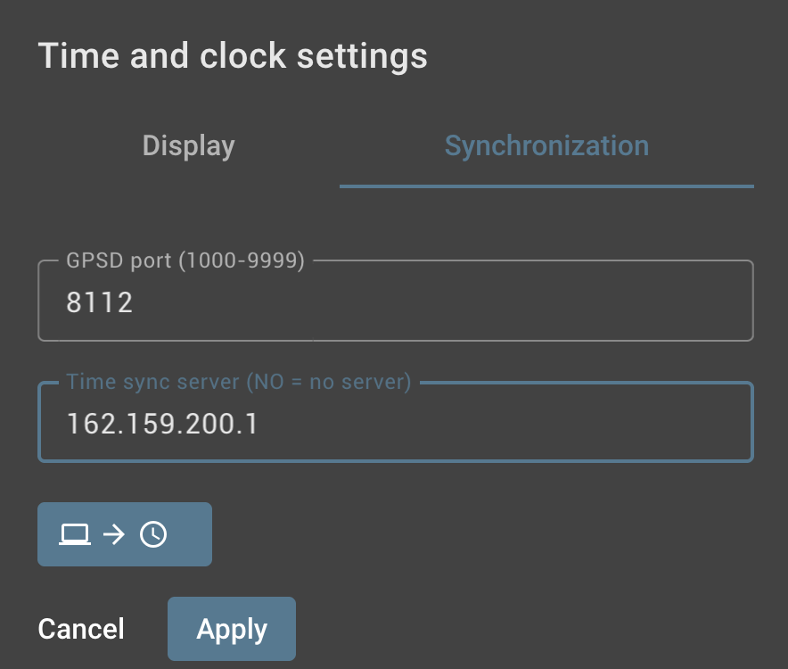
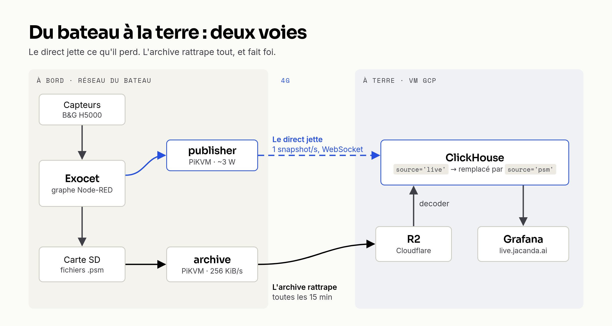
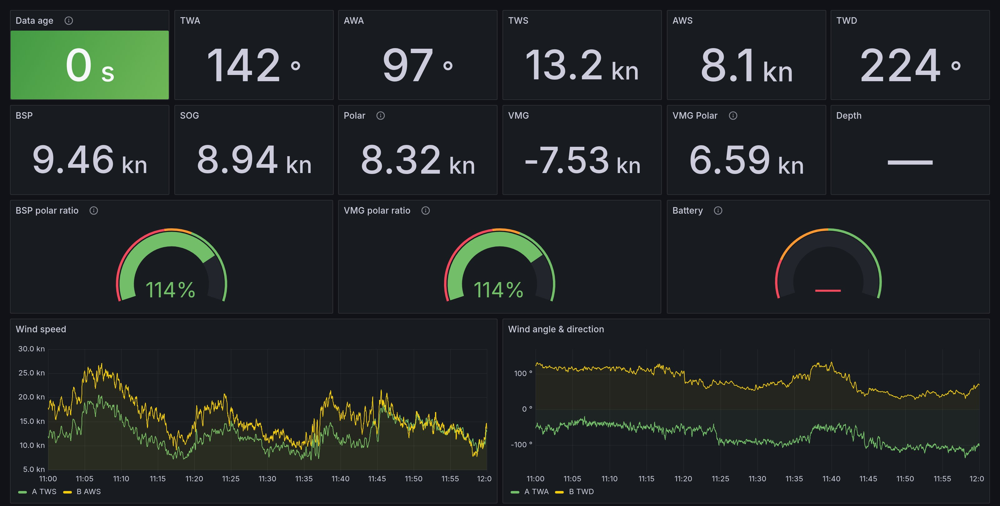
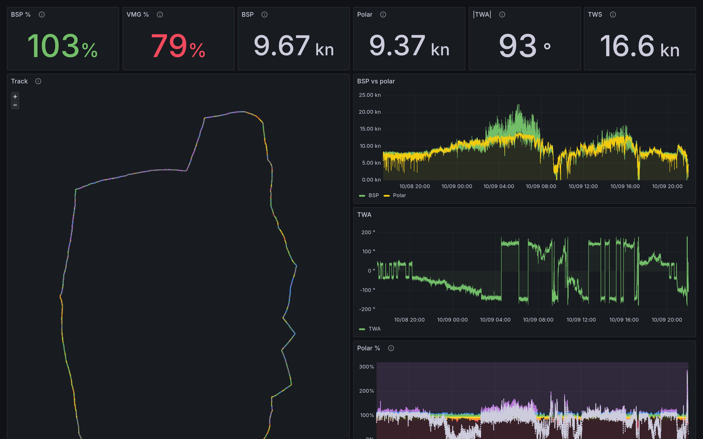
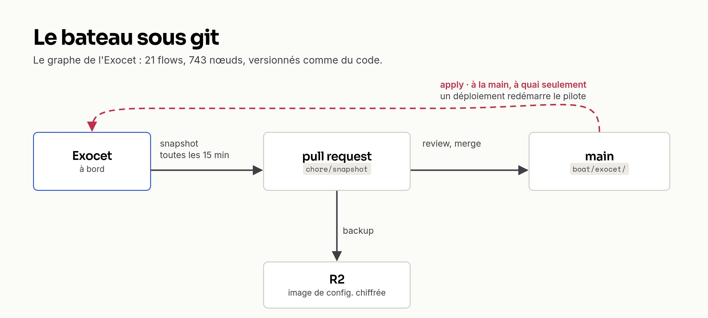
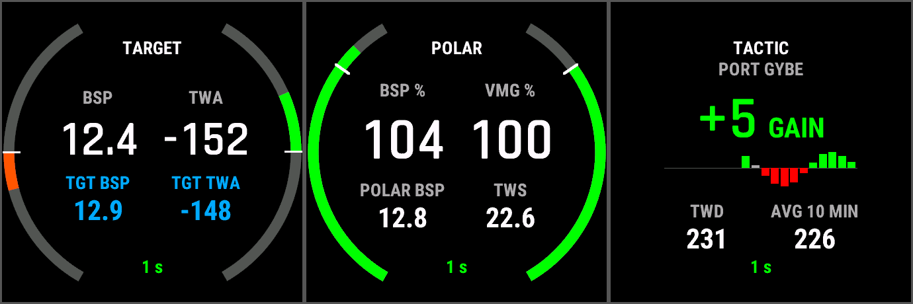

Sur un serveur, quand un agent casse quelque chose, on redémarre. Sur un voilier de course, redémarrer le calculateur de navigation coupe le pilote automatique.

Jacanda 3, c'est un MAT 11.80 qui court le circuit IRC Méditerranée depuis Marseille. À bord, il y a un calculateur Exocet de Pixel sur Mer, qui corrige le vent, calcule la dérive et les polaires dans un graphe Node-RED, et enregistre tout sur carte SD. Il y a aussi une centrale B&G H5000, un traceur, un PC de navigation, et un routeur Peplink dont le seul accès internet est la 4G. Une boîte hyper puissante et pleine d'intelligence : on ne voulait pas la contourner, on voulait la maîtriser. Voir les données en direct depuis la terre, tout archiver, et mettre la configuration du bateau sous git.

Je l'ai fait en septembre avec Claude Code, depuis Marseille, à travers le réseau du bateau. Précision utile : aujourd'hui, rien à bord ne fait de machine learning. L'IA, c'est l'agent qui a construit le système et qui l'opère. Et c'est un terrain très différent du dev web : le lien tombe, le bateau s'éteint, chaque mégaoctet se paie sur un forfait 4G, et certaines actions ne se font qu'à quai.

## 1. Atteindre le bateau

Premier essai : un VPN L2TP/IPsec sur le Peplink. Ça n'a pas marché. J'ai pris un PiKVM (un Raspberry Pi, ~3 W) qui traînait à bord, je l'ai reflashé en subnet router [Tailscale](https://tailscale.com/kb/1201/4via6-subnets), en mode 4via6. Le réseau du bord utilise le même sous-réseau que toutes les box domestiques, et sans 4via6 c'est le réseau de la maison qui gagne dès qu'on est chez soi. Une règle posée tôt : Tailscale sert à l'administration, pas au transport des données.

Le premier vrai problème s'est révélé en regardant les horodatages : l'horloge de l'Exocet avait 228,8 s d'avance, et elle dérivait d'environ 3 s par jour. Des données de course horodatées à quatre minutes près ne servent pas à grand-chose. Maintenant l'Exocet se cale sur NTP quand la 4G est là, sur le GPS quand elle tombe, et sert l'heure au reste du bord :

```text
internet NTP (via Peplink WAN)  ──┐
                                  ├──► chrony sur l'Exocet ──► serveur NTP pour le LAN
GPS $RMC (onglet out_TimeSync    ──┘      (choisit la meilleure    (PC nav, PiKVM,
 → gpsd sur 127.0.0.1:8112)                source en direct)         laptops…)
```

Le détail qui m'a fait sourire : la chaîne GPS → gpsd existait déjà dans le graphe de l'Exocet, entièrement câblée, dans un onglet désactivé. Il restait à l'activer et à configurer NTP. On est passés de +228,8 s à +4 ms.



## 2. Quand le lien tombe

Sur un bateau, la coupure n'est pas un incident, c'est l'état normal. Au large, la 4G disparaît. Le réflexe serveur serait une file : on bufferise pendant la coupure, on rejoue au retour. Sauf qu'au retour, on rejouerait une heure de « direct » périmé.

Alors j'ai séparé deux voies, et je ne les mélange jamais.



**Le direct jette.** Un publisher sur le PiKVM lit le flux de l'Exocet (via l'API que son app web utilise, pas documentée), en fait un snapshot complet par seconde et le pousse à terre en WebSocket. Si le lien tombe, la seconde est perdue, et c'est voulu :

```python
async def send(self, msg):
    if msg.get("type") == "session":
        self.session = msg
    if self.ws is None and time.monotonic() < self.next_try:
        return  # dropped, by design
    try:
        if self.ws is None:
            self.ws = await websockets.connect(self.url, ...)
            if self.session is not None and msg is not self.session:
                await self.ws.send(json.dumps(self.session))
        await self.ws.send(json.dumps(msg))
    except Exception:
        self.next_try = time.monotonic() + RETRY_S
        ...
```

Deux détails : on retente au plus toutes les 5 s (pas une poignée de main TLS par snapshot sur de la 4G), et chaque reconnexion renvoie d'abord un message `session` qui décrit les canaux et leurs unités. Le flux reste lisible même pour quelqu'un qui arrive en cours de course.

**L'archive rattrape.** La carte SD de l'Exocet fait foi. Un deuxième conteneur copie les enregistrements `.psm` vers [Cloudflare R2](https://developers.cloudflare.com/r2/) toutes les 15 minutes, de façon idempotente : il reprend là où il s'était arrêté.

**Un seul store, jetable.** À terre, une VM GCP fait tourner [ClickHouse](https://clickhouse.com/) et Grafana. Les lignes du direct arrivent avec `source='live'` et sont provisoires : quand l'enregistrement complet est rechargé depuis R2 (`source='psm'`, pleine fréquence), il les remplace. Le store se reconstruit entièrement depuis R2, donc on peut le jeter.



Le bug le plus instructif est venu de là. Après un redémarrage de l'Exocet, le publisher n'a retrouvé que 8 canaux sur 28, et il a streamé comme ça pendant deux heures. Le tableau de bord avait l'air parfait : l'indicateur « Data age » au vert, à 0 s. Et le vent affichait 0,0, parce que l'agrégat `argMax` de ClickHouse sur une fenêtre vide renvoie 0 plutôt que rien. Un flux dégradé ressemble exactement à un flux sain. C'est toujours ouvert.

L'inverse est arrivé aussi : le soir de la mise en service, la girouette s'est tue pendant un quart d'heure. Ma première réaction : « did we break something in the pixel? ». Non, c'était un vrai trou côté capteur, et c'est la voie directe qui venait de le montrer.



## 3. L'énergie et le forfait

Côté électricité, je vais être honnête : on n'a presque rien mesuré. Le seul chiffre solide, c'est le PiKVM à ~3 W. Ce qu'on a vraiment optimisé, c'est la ressource qu'on mesure : le forfait 4G.

- L'Exocet envoyait 653 variables au cloud du fabricant, que personne ne lisait. Coupé.
- Le direct ne tourne que quand l'Exocet enregistre. À quai, le bateau produisait des fichiers de 24 h pour rien. Le publisher interroge l'état de l'enregistreur toutes les 5 s : au test, un arrêt a coupé le flux en 3 s.

```python
async def until_recording():
    """Return once the Exocet records; say so once when it doesn't."""
    idle = False
    while not await asyncio.to_thread(recording):
        if not idle:
            print("# recorder off — live lane idle", file=sys.stderr)
            idle = True
        await asyncio.sleep(RECORDER_POLL_S)
```

- L'archive est bridée à 256 KiB/s pour laisser la place au direct :

```bash
docker run -d --name psm-archive --restart=always -e RCLONE_BWLIMIT=256k \
  -v <state dir>:/work -v <rclone.conf>:/root/.config/rclone/rclone.conf:ro \
  psm-archive --host <box LAN address> --every 900 --state /work/state.json
```

- Lister le bucket R2 toutes les 15 minutes aurait coûté autant de data que les enregistrements eux-mêmes : l'état est tenu en local, et le listing se fait une fois par jour. Au passage, 889 requêtes `HEAD` sont devenues un seul `LIST` de 231 Ko.

Ordre de grandeur : 38 Mo d'archive par jour de navigation en médiane, soit environ 1 Go par mois si le bateau enregistre tous les jours. L'historique à rapatrier, 9,4 Go, est resté en pause un moment pour ne pas griller le forfait, puis 7,5 Go sont finalement passés par la 4G le 28 septembre.

Et comme l'alimentation peut couper n'importe quand : le PiKVM garde un système de fichiers en lecture seule. L'état de Docker vit sur une partition de 23 Go qui ne servait à rien, montée en `/data` avec `nofail`. Une partition corrompue ne peut jamais empêcher le boot, donc jamais couper l'accès distant.

## 4. Le bateau sous git

Le comportement de l'Exocet, c'est son graphe (21 flows, 743 nœuds), et il n'existait que dans la boîte, édité à la main dans un navigateur. Maintenant il vit dans le repo :

- le pull normalise tout, clés et nœuds dans un ordre stable. Deux pulls consécutifs sont identiques à l'octet près, donc chaque `git diff` est un vrai changement fait à bord ;
- le push refuse de déployer si la boîte a changé depuis le dernier pull, pour ne pas écraser une modification faite à bord ;
- le hash `rev` que renvoie Node-RED est sorti de git. C'est un état d'exécution, comme un state Terraform, pas de la configuration. En plus, l'Exocet renvoie `rev: null` pendant des heures après un déploiement : on compare le contenu, jamais le hash ;
- l'export de configuration complet du fabricant est chiffré, et rechiffré à chaque export : impossible à comparer. Il part en sauvegarde sur R2, pas dans git.



Pour le déploiement, l'agent proposait un bouton manuel. J'ai voulu que ça parte au merge. Le problème : un déploiement redémarre l'application de l'Exocet, donc le pilote. Inoffensif le long d'un ponton, dangereux en route, et la CI ne peut pas demander à un humain où est le bateau. Alors elle demande au bateau :

```python
CHANNEL = "GPS.SOG"
# The box reports SOG in knots. The threshold is in whatever unit it sends, and
# the unit seen is printed on every run — a box reporting m/s would make this
# stricter, never laxer, so the check stays conservative either way.
MAX_SOG = 0.5
WINDOW = 600
```

Moins de 0,5 nœud pendant 10 minutes, sinon le déploiement s'arrête sans rien toucher. Pas de géofence : le bateau court loin de chez lui toute la saison, et une barrière autour du port d'attache bloquerait justement les déploiements qui comptent en régate.

Deux choses que git ne voyait pas. L'offset de gîte (−0,3°) ne vit pas dans le graphe mais dans les réglages utilisateur de la boîte, qui ne sont pas encore versionnés : 112 réglages sur 234 ne sont pas à leur valeur par défaut. Et côté réseau, l'export compact d'un switch MikroTik (RouterOS 6) omet `disabled=yes` : rejouer la config telle quelle aurait rallumé un serveur DHCP désactivé.

## 5. Travailler avec un agent à bord

Ce qui change par rapport au dev web :

- **L'accès est indirect et prudent.** Lecture seule par défaut, écritures limitées au `/tmp` du PiKVM. Un jour je lui ai écrit « ouh là ne fait rien pour l'instant hein. Tu as fait qqch? » : il m'a rendu la liste exacte de ce qu'il avait lu et écrit.
- **Bateau éteint, agent aveugle.** « Le bateau est éteint, essaie pas de t'y connecter ». Pas de retry qui tienne.
- **Des gestes qui ne se font qu'à quai, ou avec quelqu'un à côté.** Déployer le graphe seulement à quai, arrêter l'enregistrement avant de reculer l'horloge, reporter le reboot du PiKVM à « quand quelqu'un est près du bateau », une carte SD de secours à bord.
- **Ne pas scier la branche.** Pour tester la bascule NTP vers le GPS, couper la 4G aurait coupé son propre accès. Il a pointé chrony vers une adresse qui ne répond jamais (`192.0.2.1`) pour simuler la panne.
- **Réparer à distance, sans IP.** Un switch MikroTik ajouté à bord a coupé le LAN en deux : le PiKVM ne voyait plus l'Exocet. L'agent s'y est connecté en couche 2, avec un client MAC-Telnet compilé sur le PiKVM, et a corrigé en Safe Mode, le mode de RouterOS qui annule tout si la session tombe. La cause racine reste inconnue.
- **L'expertise métier reste humaine.** « If it's disabled there's a reason », « ok deploy, monitor, i want proofs ». Et quand quatre worktrees tournaient en parallèle : « tu racontes ta vie. Je veux des faits, un état, pas une histoire ».

## Ce qui reste

- **Pas d'IA à bord aujourd'hui.** Dans ce projet, l'IA est dans la méthode, pas dans le bateau.
- Le bug du flux partiel qui a l'air sain est toujours ouvert.
- La CI du graphe est écrite, pas déployée. Les réglages utilisateur ne sont pas versionnés, et je ne sais pas encore si un déploiement les réinitialise.
- La bascule sur le GPS n'a jamais été observée au large. La cible de 10 ms n'est vérifiée que sur l'Exocet, seul appareil qui parle NTP : les autres sont seulement bornés à une ou deux secondes.
- Le coût 4G du direct est une estimation (~1 Ko/s, quelques Mo par heure de course). Jamais mesuré sur une vraie journée de régate. La consommation électrique non plus.
- Côté terre, la suppression des lignes du direct puis l'insertion de l'archive ne sont pas atomiques.



La prochaine régate dira si tout ça tient en mer 😅
