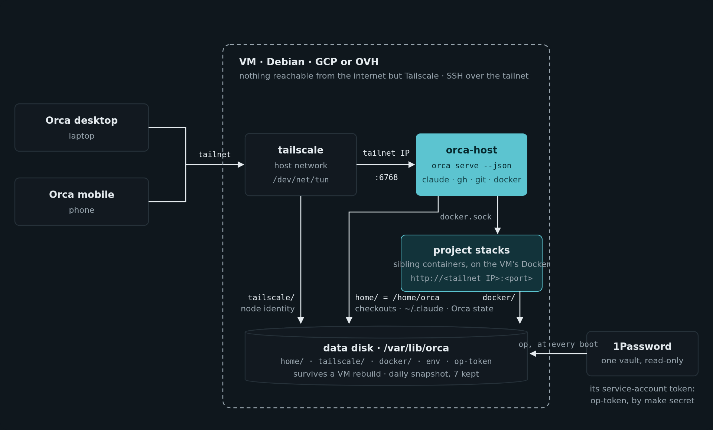
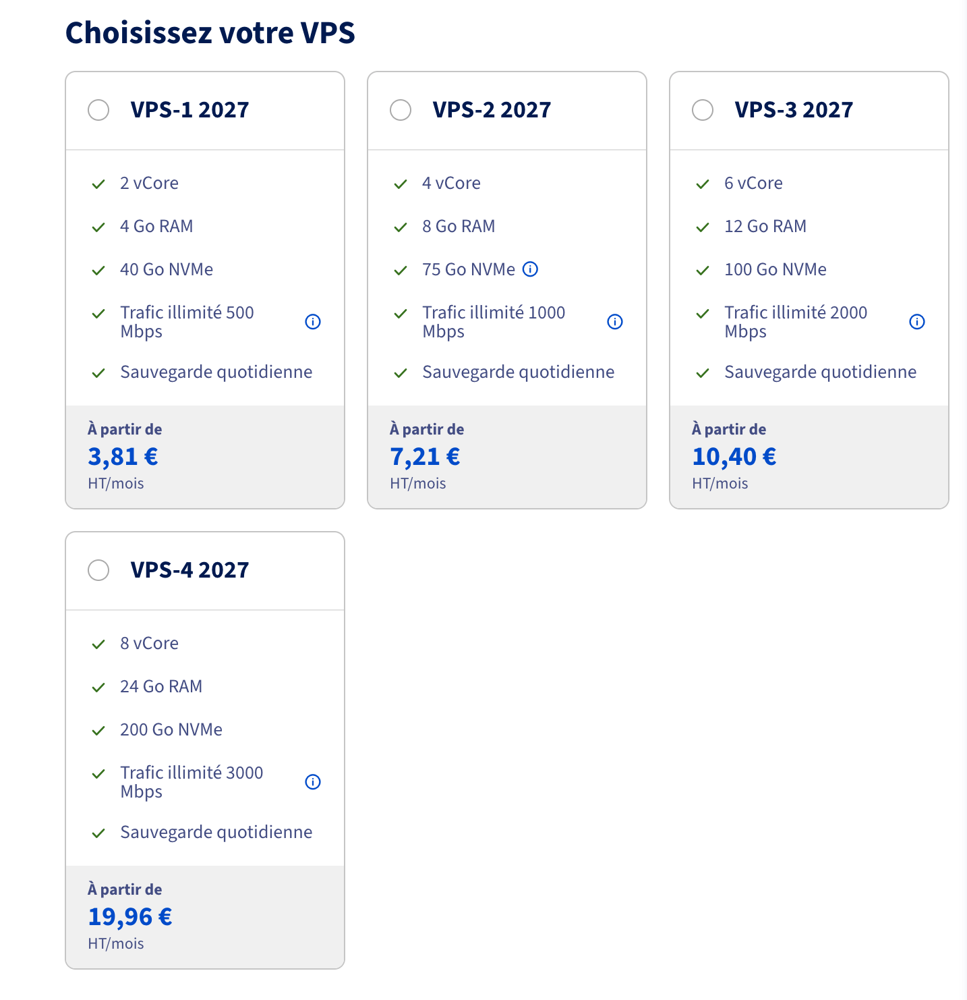
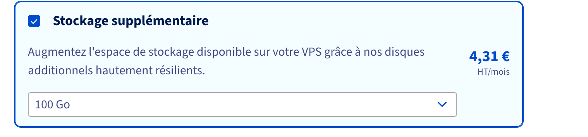

On the teams we work with, each developer has their own Orca host: a VM that runs their Claude Code sessions and their worktrees around the clock, which they drive from the Orca desktop app or from their phone, over Tailscale. Until now, that was Flatcar on GCP, at about $150 a month per person. [Last week's article](/en/blog/moving-my-coding-agents-to-an-ovh-vps-with-a-single-boot-script) told how the host became the same Debian on every provider. This one is the team's side: which machine to take, what it costs, and what changes for the people using it.

## OVH or GCP

Both work, from the same repository. Pick one with `PROVIDER=gcp` or `PROVIDER=ovh`:

| | Google Cloud | OVH |
|---|---|---|
| Price | about $135 to $160 a month (4 vCPU, 16 GB) | about €15 to €24 a month excl. VAT |
| The machine | a VM, created and deleted by `make` | a VPS, ordered from OVH and cancelled in its control panel |
| Your data | a disk copied in two zones, a snapshot a day | the VPS's additional disk, and OVH's daily backup |
| Out of stock | switch to the disk's other zone | wait, or pick another datacenter |

GCP keeps the more resilient data. OVH divides the bill by five to ten, with more RAM.

## Which VPS

- **VPS-4**: 8 vCores, 24 GB of RAM, 200 GB, €19.96 excl. VAT a month on a one-year commitment. That's the one I recommend for working on several projects at once: Orca, a dozen sessions and a few Docker stacks fit in it.
- **VPS-3**: 6 vCores, 12 GB, 100 GB, €10.40. Enough for one or two projects at a time.
- **Plus a 100 GB additional disk**, €4.31. Take it: the host puts everything that must survive on it (checkouts, sessions, the Tailscale identity, the pairing), and it survives a reinstall of the VPS. Its device goes in the host's tfvars, `data_device`.

That's about €24 for the recommended setup, and €15 for the small one, daily backup included. Order the VPS in OVH's control panel, with Debian 13 and the additional disk, and put its name in the tfvars: Terraform takes it from there. Terraform can also order it itself, but I haven't tried that path for real yet.

## What changes for the people using it

- **The configuration is a file.** A host's variables are a `.env.tpl` versioned in your own repository, secrets as 1Password references, instead of a 1Password note. A new variable is a line and a `make restart`, no rebuild.
- **The MCP servers are exactly those of `config/mcp.json`** in your settings repository, at every start: one removed there is removed on the host.
- **Deleted worktrees clean up after themselves.** Within five minutes, their Docker stack goes, volumes and built images included, and the build cache stays under 10 GB.
- **Your own image follows the base by itself.** Two files to copy into its repository: Dependabot opens a pull request when the base moves, and a workflow merges it once your CI has built the image.
- **The README is written for people now**: the install in six steps, the two providers side by side, a worked example to add your own tools, and the errors a first install runs into.

## Moving over

A Flatcar host's data disk can't be kept: Debian's Docker doesn't start the containers Flatcar's left on it. The simplest is to start from scratch: a new host with the README, then the old one deleted, with `make destroy` on GCP, from OVH's control panel for a VPS. Checkouts come back with a clone, and a project's databases with its setup hook.

Everything is in [qrafttech/orca-host](https://github.com/qrafttech/orca-host).
