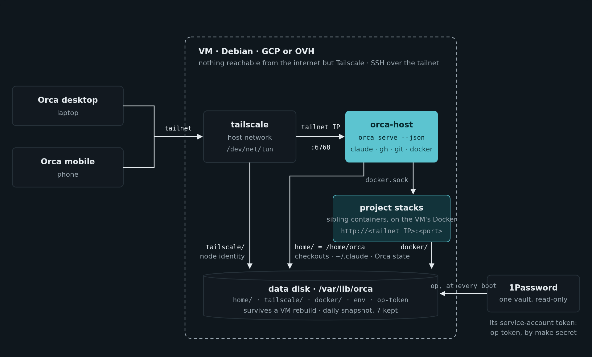
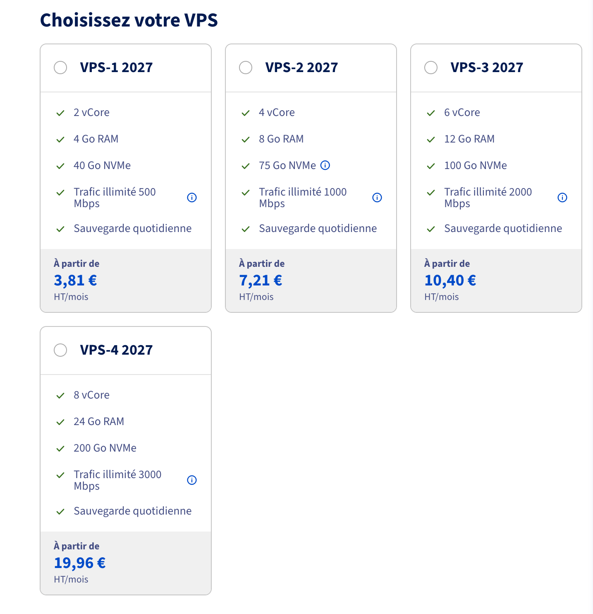
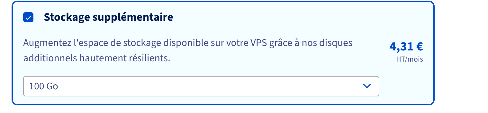

Dans les équipes avec qui on travaille, chaque dev a son propre hôte Orca : une VM qui fait tourner ses sessions Claude Code et ses worktrees jour et nuit, qu'il pilote depuis l'app Orca desktop ou depuis son téléphone, par Tailscale. Jusqu'ici, c'était Flatcar sur GCP, pour environ 126 $ par mois et par personne. [L'article de la semaine dernière](/blog/mes-agents-de-code-sur-un-vps-ovh-avec-un-seul-script-de-demarrage) racontait comment l'hôte est devenu la même Debian chez tous les providers. Celui-ci, c'est le côté équipe : quelle machine prendre, ce que ça coûte, et ce qui change pour ceux qui s'en servent.

## OVH ou GCP

Les deux marchent, depuis le même dépôt. On choisit avec `PROVIDER=gcp` ou `PROVIDER=ovh` :

| | Google Cloud | OVH |
|---|---|---|
| Prix | environ 126 $ par mois (4 vCPU, 16 Go) | environ 15 à 24 € HT par mois |
| La machine | une VM, créée et supprimée par `make` | un VPS, commandé chez OVH et résilié dans son panneau |
| Les données | un disque copié dans deux zones, un snapshot par jour | le disque additionnel du VPS, et la sauvegarde quotidienne d'OVH |
| Rupture de stock | on passe dans l'autre zone du disque | on attend, ou on prend un autre datacenter |

GCP garde des données plus résilientes. OVH divise la facture par cinq à sept, avec plus de RAM.

## Quel VPS

- **VPS-4** : 8 vCores, 24 Go de RAM, 200 Go, 19,96 € HT par mois engagé sur un an. C'est celui que je recommande pour bosser sur plusieurs projets en parallèle : Orca, une douzaine de sessions et quelques stacks Docker y tiennent.
- **VPS-3** : 6 vCores, 12 Go, 100 Go, 10,40 €. Suffisant pour un ou deux projets à la fois.
- **Plus un disque additionnel de 100 Go**, 4,31 €. Prenez-le : l'hôte y met tout ce qui doit survivre (les checkouts, les sessions, l'identité Tailscale, l'appairage), et il survit à une réinstallation du VPS. Son périphérique va dans le tfvars de l'hôte, `data_device`.

Ça fait environ 24 € pour la config recommandée, et 15 € pour la petite, sauvegarde quotidienne comprise. Commandez le VPS dans le panneau OVH, avec Debian 13 et le disque additionnel, et mettez son nom dans le tfvars : Terraform prend la suite. Terraform sait aussi le commander lui-même, mais je n'ai pas encore testé ce chemin-là pour de vrai.

## Ce qui change pour ceux qui s'en servent

- **La configuration est un fichier.** Les variables d'un hôte sont un `.env.tpl` versionné dans votre propre dépôt, les secrets en références 1Password, au lieu d'une note 1Password. Une nouvelle variable, c'est une ligne et un `make restart`, sans rebuild.
- **Les serveurs MCP sont exactement ceux de `config/mcp.json`** dans votre dépôt de settings, à chaque démarrage : un serveur retiré là est retiré de l'hôte.
- **Les worktrees supprimés se nettoient tout seuls.** En cinq minutes, leur stack Docker part, volumes et images buildées compris, et le cache de build reste sous 10 Go.
- **Votre propre image suit la base toute seule.** Deux fichiers à copier dans son dépôt : Dependabot ouvre une PR quand la base bouge, et un workflow la merge dès que votre CI a construit l'image.
- **Le README est écrit pour des humains** : l'installation en six étapes, les deux providers côte à côte, un exemple complet pour ajouter ses propres outils, et les erreurs qu'on rencontre à la première installation.

## Passer dessus

On ne garde pas le disque de données d'un hôte Flatcar : le Docker de Debian ne démarre pas les conteneurs que celui de Flatcar y a laissés. Le plus simple, c'est de repartir de zéro : un nouvel hôte avec le README, puis on supprime l'ancien, avec `make destroy` sur GCP, depuis le panneau OVH pour un VPS. Les checkouts reviennent avec un clone, et les bases de données d'un projet avec son setup hook.

Tout est dans [qrafttech/orca-host](https://github.com/qrafttech/orca-host).
