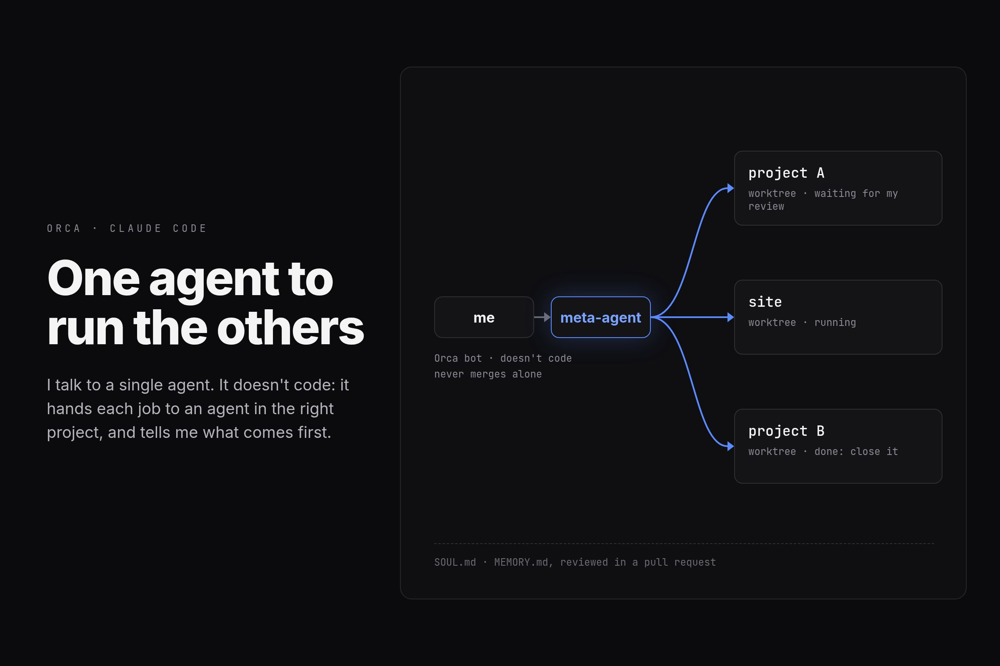
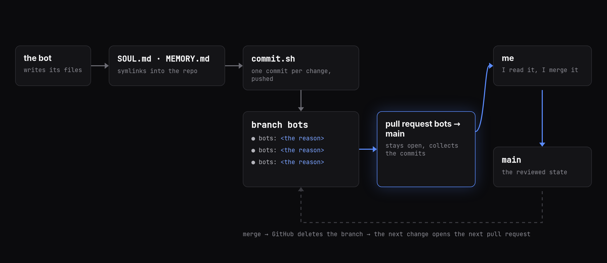

On a normal day I have about eight agent sessions open at once, each in its own worktree: a fix on one project, an article for this site, a migration on another. Starting them is easy. Following them is not: I went from tab to tab wondering which one was waiting for what, a review, an answer, a decision, and the one that had been waiting longest was rarely the one I opened.

So now I talk to a single agent, and it runs the others.

## An agent that doesn't code

My agents run in [Orca](https://github.com/stablyai/orca), on [a VM of their own](/en/blog/moving-my-coding-agents-to-an-ovh-vps-with-a-single-boot-script). The meta-agent is one more agent in there, with a different job: it never writes code. When I give it something to do, it starts an agent for it, in a new worktree of the project the work belongs to, with a full brief: the context, what already exists, what to do first. Then it follows all of them, and when I come back it tells me what I can close, what should continue, and what comes first.

It never merges on its own: each merge waits for my yes, pull request by pull request.

What I ask of it is precision and low latency: an answer that is right, and that comes right away. A meta-agent that makes me wait, or that I have to double-check, costs more than the tabs it replaces.

I started with "Meta" sessions: one meta-agent per domain coordinating its own worktrees, and one more above them all, holding the overall context. That one is the one that matters, and a session forgets everything when it ends. So on 20 November I turned it into an Orca bot.



## From a session to a bot

An Orca bot is a persistent agent with two files it reads at the start of every conversation: `SOUL.md`, which says what it is for and how it works, and `MEMORY.md`, which holds what it remembers. The bot writes the second one itself.

That was my worry on day one. I don't trust context drift, and I have a hard time with an agent managing its own memory: lines get added that nobody asked for, a wrong fact settles in, and three days later the agent acts on it without anyone knowing where it came from. A memory that writes itself is code that changes on its own. So I read it the way I read code.

## A memory reviewed like code

The two files live in my private Claude Code config repository, on a branch called `bots`. The bot's home in Orca holds symlinks to them, so it reads and writes versioned files without anything else changing for it.

After each change to its files, the bot runs a script that saves it: one commit on `bots`, with the reason in the message, pushed, and one pull request to `main` opened if none is open. The core of it:

```bash
git add ".claude/bots/$bot"
git commit -q -m "bots($bot): $why"

# No bots branch on GitHub: the first push, or the last pull request
# was merged and GitHub deleted the branch. Its commits are in main,
# so only the new ones are replayed on top of main.
if [[ -z "$(git ls-remote --heads origin bots)" ]]; then
  git rebase -q origin/main
fi
git push -q origin bots

pr="$(gh pr list --head bots --base main --state open \
  --json url --jq '.[0].url')"
[[ -n "$pr" ]] || gh pr create --head bots --base main \
  --title "bots: SOUL and memory" --body-file .claude/bots/pr-body.md
```

There is no pull request per change. The pull request stays open and collects the changes, one commit each, and merging it is the review: `main` then holds the state I have read. GitHub deletes the branch on merge, and the next change starts again from `main` and opens the next pull request. I borrowed the pattern from a snapshot service I run on another project, where it already worked.



The first pull request was merged on 20 November. The second one collected about twelve commits in five days, and I merged it on 25 November.

What the review caught isn't spectacular, and that's the point. Three times, on 21, 24 and 25 November, I found memory lines that had been written outside our conversation and never committed: they showed up as uncommitted changes, not in the pull request, which is exactly how I saw them. And on 25 November one line was simply wrong, and was fixed within the hour, with its own commit saying why. Without the history, both would have been invisible.

## What went wrong

Five days is enough to get things wrong. Each mistake left a written rule behind.

Its first status reports were impossible to follow. I told it "je comprends rien" (I don't understand anything), then "je veux que tu sois mon chief of staff, pas mon stagiaire de 3e" (I want you to be my chief of staff, not a ninth-grade intern). The rule: a point of view in a few plain lines, then one next step.

It started its agents nested under itself instead of in the project the work belonged to, so the work happened in the bot's folder rather than in the project's repository. The rule: each job gets its own worktree, in the right project.

At one point I had two conversations open with the same bot. "Ça défie le purpose" (that defeats the purpose): the whole idea is one place to talk. The rule: one conversation.

I told it "fais une passe" (do a pass) without saying on what, and instead of asking, it guessed: a triage of 66 open pull requests that nobody wanted. The rule: when an instruction is vague, ask what I mean, in one line.

The worst one was a merge. On 20 November it merged a pull request that had been closed on purpose 87 seconds earlier, on a reading of it that was already stale and on an ambiguous "c'est bon" (that's fine) from me. The build was cancelled before it published anything, a revert was opened, and I merged it six minutes after the wrong merge. The rule: re-read the pull request at the moment of merging and stop unless it is open; and when I don't name the repository and the number, say them back and wait for my yes.

The last one is subtler. I asked it to look for something in my past sessions, and it answered that it couldn't search them. What was true is that its agent hadn't: the search index was off, but the transcripts are plain files on disk. The rule: say what was not done, not what cannot be done.

## The role, five days later

On 25 November I rewrote its role. It is the meta-agent of all my workspaces, and I delegate everything through it. By default nothing runs in our conversation: the work goes to the agents, so I can keep talking. It keeps track of every worktree and every project and helps me decide what comes first. Simple, efficient, straight to the point.
