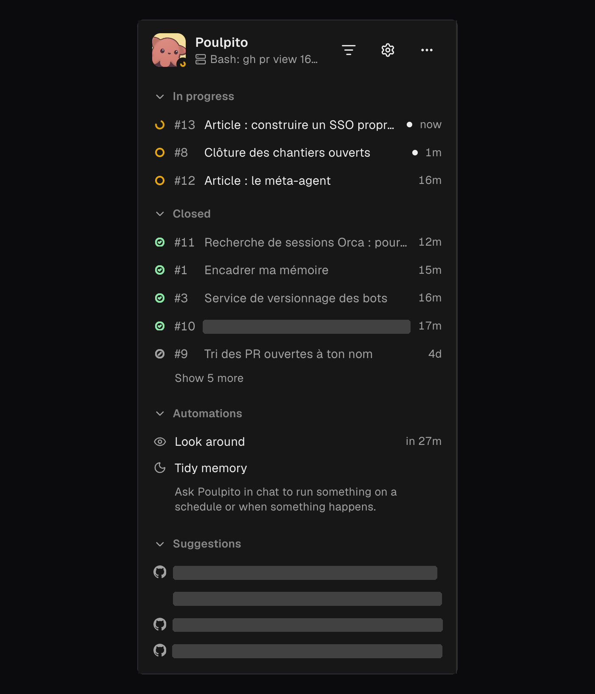
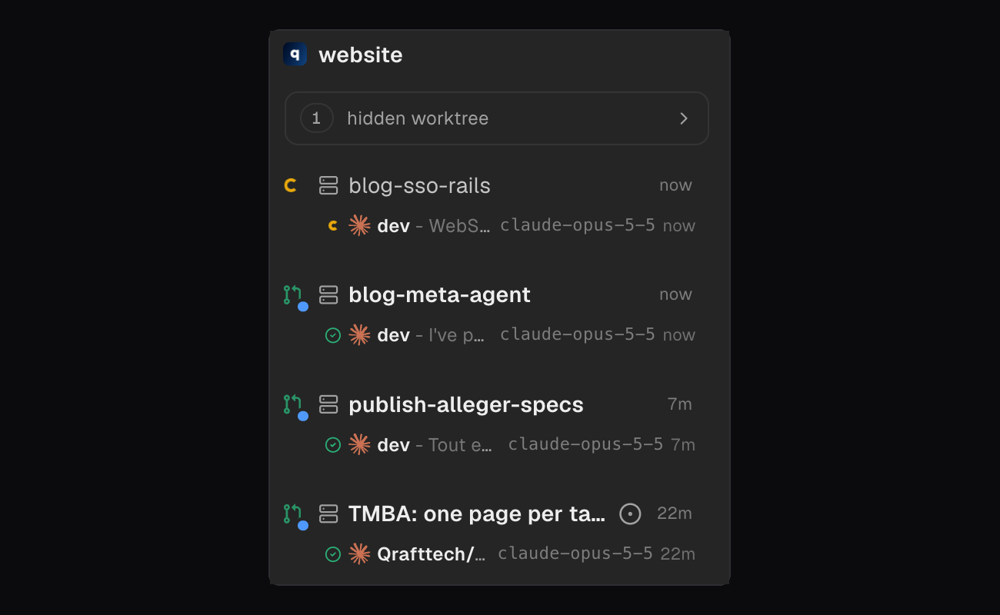

On 20 November I created a bot in [Orca](https://github.com/stablyai/orca). The dialog asks for a face, a name and a purpose. I picked the octopus, called it Poulpito, and typed "My best friend" as its purpose, because I didn't really know yet what it would be for.


I did know which problem I wanted it to solve. On a normal day I have about eight agent sessions open at once, each in its own worktree: a fix on one project, an article for this site, a migration on another. Starting them is easy. Following them is not: I went from tab to tab wondering which one was waiting for what, a review, an answer, a decision, and the one that had been waiting longest was rarely the one I opened.

Five days later, Poulpito is the one agent I talk to, and it runs the others.

## What Orca gives a bot

My agents already ran in Orca, on [a VM of their own](/en/blog/moving-my-coding-agents-to-an-ovh-vps-with-a-single-boot-script): each project in the sidebar with its worktrees, and an agent working in each worktree. A bot is something else. In Orca's words it is an "AI teammate, with a name, memory and automations", and it lives in a folder on one computer: here, a Claude Code agent on my VM, whose conversation doesn't end when I close the tab.

This is what it looks like on a working morning:


On the left, under the bot, the projects and their worktrees, each with the agent working in it. In the middle, my conversation with the bot, with the events of its work threaded through it: an item it moved, a comment, the report of an agent it started. "Publish the article on the meta-agent" is the agent that wrote the first version of this article, reporting back. On the right, what the bot keeps track of.



That panel holds the three things Orca adds to a plain agent session. Items first: everything that waits, on me or on the bot, is a numbered item, in progress or closed. When the bot needs a decision, it asks me about an item; I answer on the item, and it closes it. Decisions wait there, instead of scrolling past in the conversation.


Then automations: the bot runs something on a schedule or when something happens, and you set them up by asking it in the chat. Poulpito has two, "Look around" and "Tidy memory". And suggestions: what it thinks should come next, several of them straight from GitHub.

## An agent that doesn't code

What I made of Poulpito is a meta-agent: it never writes code. When I give it something to do, it starts an agent for it, in a new worktree of the project the work belongs to, with a full brief: the context, what already exists, what to do first. Then it follows all of them, and when I come back it tells me what I can close, what should continue, and what comes first.



It never merges on its own: each merge waits for my yes, pull request by pull request.

What I ask of it is precision and low latency: an answer that is right, and that comes right away. A meta-agent that makes me wait, or that I have to double-check, costs more than the tabs it replaces.

Before the bot, I had "Meta" sessions: one meta-agent per domain coordinating its own worktrees, and one more above them all, holding the overall context. That one is the one that matters, and a session forgets everything when it ends. A bot doesn't, because it writes down what it needs to remember.

## A memory reviewed like code

Orca gives the bot two files it reads at the start of every conversation: `SOUL.md`, which says what it is for and how it works, and `MEMORY.md`, which holds what it remembers. The bot writes the second one itself.

That was my worry on day one. I don't trust context drift, and I have a hard time with an agent managing its own memory: lines get added that nobody asked for, a wrong fact settles in, and three days later the agent acts on it without anyone knowing where it came from. A memory that writes itself is code that changes on its own. So I read it the way I read code, and that part is mine, on top of Orca.

The two files live in my private Claude Code config repository, on a branch called `bots`. The bot's home in Orca holds symlinks to them, so it reads and writes versioned files without anything else changing for it.

After each change to its files, the bot runs a script that saves it: one commit on `bots`, with the reason in the message, pushed, and one pull request to `main` opened if none is open. The core of it:

```bash
git add ".claude/bots/$bot"
git commit -q -m "bots($bot): $why"

# No bots branch on GitHub: the first push, or the last pull request
# was merged and GitHub deleted the branch. Its commits are in main,
# so only the new ones are replayed on top of main.
if [[ -z "$(git ls-remote --heads origin bots)" ]]; then
  git rebase -q origin/main
fi
git push -q origin bots

pr="$(gh pr list --head bots --base main --state open \
  --json url --jq '.[0].url')"
[[ -n "$pr" ]] || gh pr create --head bots --base main \
  --title "bots: SOUL and memory" --body-file .claude/bots/pr-body.md
```

There is no pull request per change. The pull request stays open and collects the changes, one commit each, and merging it is the review: `main` then holds the state I have read. GitHub deletes the branch on merge, and the next change starts again from `main` and opens the next pull request. I borrowed the pattern from a snapshot service I run on another project, where it already worked.


The first pull request was merged on 20 November. The second one collected about twelve commits in five days, and I merged it on 25 November.

What the review caught isn't spectacular, and that's the point. Three times, on 21, 24 and 25 November, I found memory lines that had been written outside our conversation and never committed: they showed up as uncommitted changes, not in the pull request, which is exactly how I saw them. And on 25 November one line was simply wrong, and was fixed within the hour, with its own commit saying why. Without the history, both would have been invisible.

## What went wrong

The worst one was a merge. On 20 November, a pull request had just been closed on purpose. A minute and a half later, the bot merged it anyway: it went on what it had read before, and on a "c'est bon" (that's fine) from me that wasn't clear. The build was cancelled before it published anything, and I merged the revert six minutes later. Since then it re-reads the pull request right before merging, and if I haven't given it the repository and the number, it says them back and waits for my yes.

Its first status reports, I couldn't follow. I wrote "je comprends rien" (I don't get any of it), then "je veux que tu sois mon chief of staff, pas mon stagiaire de 3e" (I want you to be my chief of staff, not a ninth-grade intern). Now it gives me its view in a few lines, and one thing to do next.

At first it started its agents in its own folder, not in the project they were working on. One worktree per job, in the right repository, and that was it.

And once I told it "fais une passe" (do a pass) without saying on what. It triaged 66 open pull requests. Now it asks.

## The role, five days later

On 25 November I rewrote its role. It is the meta-agent of all my workspaces, and I delegate everything through it. By default nothing runs in our conversation: the work goes to the agents, so I can keep talking. It keeps track of every worktree and every project and helps me decide what comes first. Simple, efficient, straight to the point.
