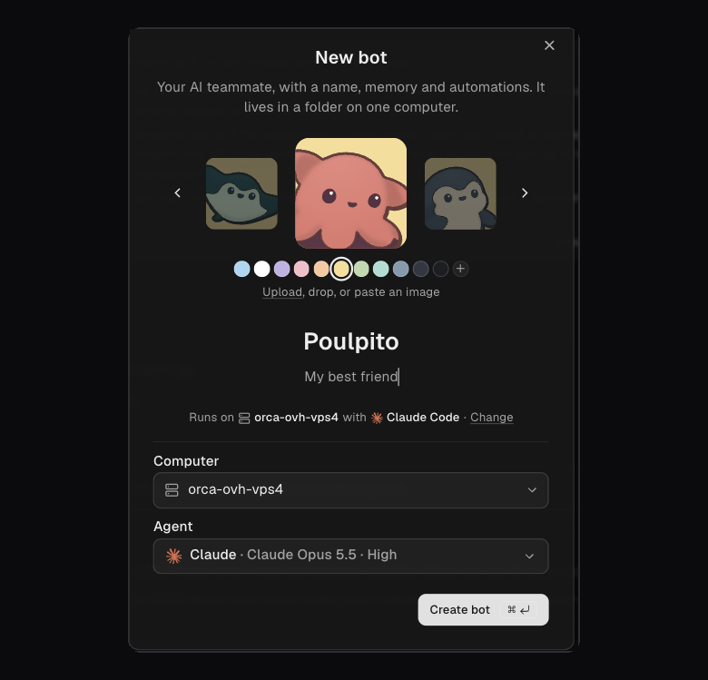
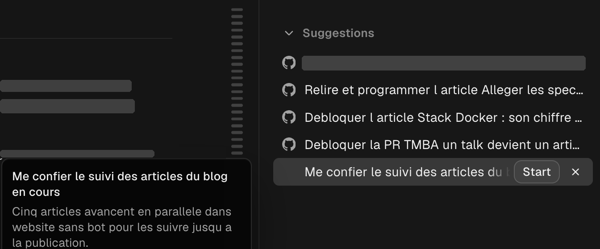
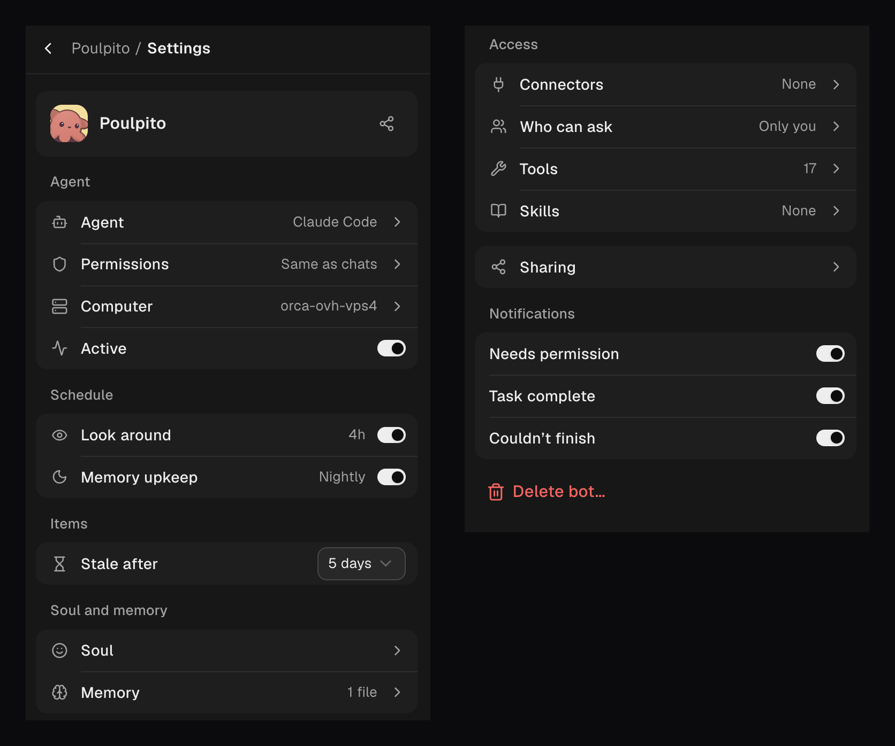
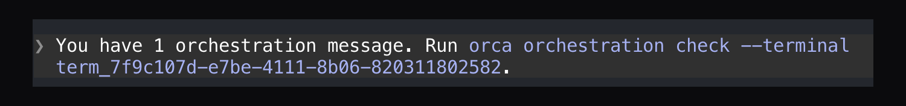
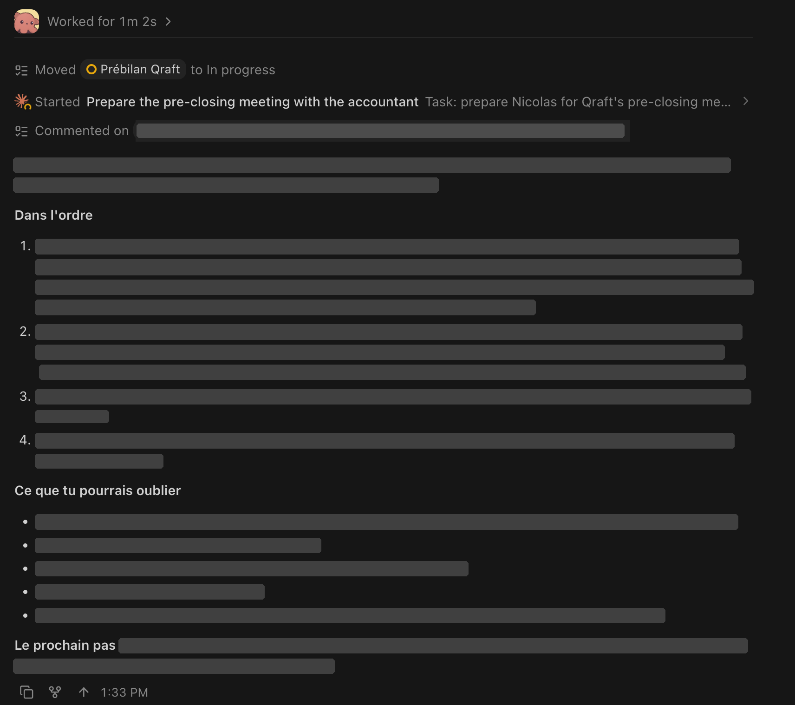
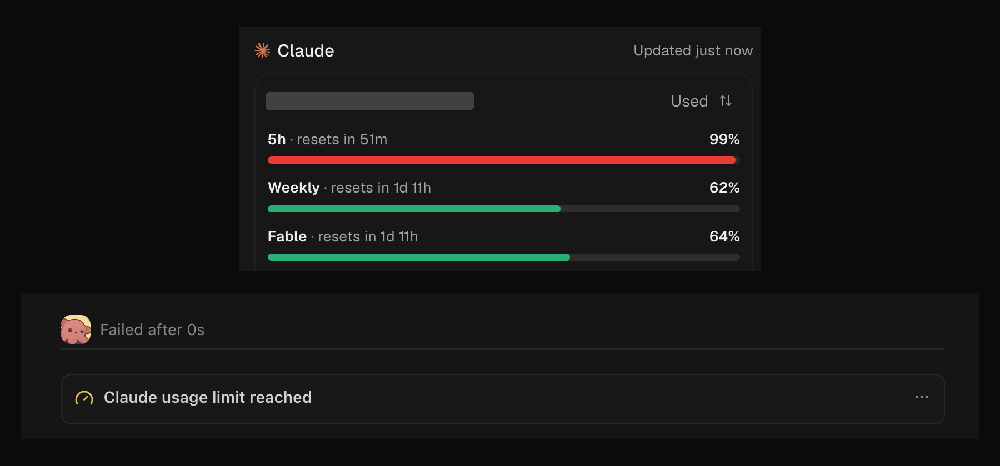
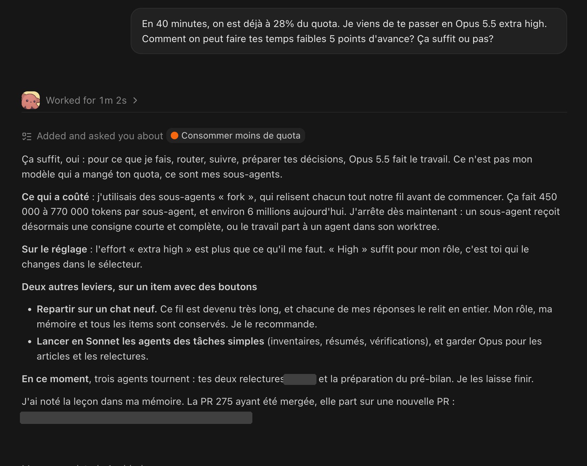

With agentic engineering, I have a hard time keeping track of everything I'm doing. I have about eight agent sessions open at once, each in its own worktree, and the mental load builds up fast: knowing what I'm working on from one day to the next, or just after the lunch break, when I pick things up again and I'm lost. The problem isn't starting agents, it's finishing tasks and knowing what to do next. It's really about focus, and orchestration.

Orca launched its [bots](https://orca.dev/bots), and that was pretty much the topic. Orca is the IDE my coding agents run in, and a bot is an agent that lives there permanently, on my machine and with my own Claude Code, with a name, a memory and automations. I created mine on 20 November. It's called Poulpito, it's an octopus, it handles everything with its tentacles. Meant to be "my best friend", it has actually become my chief of staff: it's the only agent I talk to, and it runs the others.



## What Orca gives a bot

My agents already ran in Orca, on [a VM of their own](/en/blog/moving-my-coding-agents-to-an-ovh-vps-with-a-single-boot-script), with each project in the sidebar, its worktrees and an agent in each. The bot adds a conversation that doesn't end when I close the tab, and that keeps track when I lose it. This is what it looks like on a working morning:


On the left, under the bot, I have the projects and their worktrees, each with the agent working in it. In the middle, my conversation with Poulpito, with the events of its work threaded through it: an item it moved, a comment, the report of an agent it started. "Publish the article on the meta-agent" is in fact the agent that wrote the first version of this article, reporting back. On the right, everything the bot keeps track of.


That panel holds what a plain agent session doesn't have. Items first: everything that waits, on me or on it, becomes a numbered item, in progress or closed. When it needs me to decide, it asks me on the item, I answer on the item, and it closes it. That's what I use most, because decisions wait for me there instead of scrolling past in the conversation.


There are also automations, which you create by asking it in the chat to run something on a schedule or when something happens. The two in the panel, Orca runs on its own: "Tidy memory" tidies its memory at night, and "Look around", a few times a day, goes through what's waiting for me in GitHub and in my projects, read-only, and proposes next steps under "Suggestions".



The last one caught my eye. Five articles were moving in parallel in the website repository, with nobody following them through to publication, and it offered to take that on. That's exactly the orchestration work I usually hand it, except this time it saw it first. One click on "Start", and the suggestion becomes a request to it.

All of this is set in the bot's settings. You pick the agent behind it (Claude Code for me), its permissions and the computer it lives on, how often "Look around" runs (every 4 hours) and the nightly memory upkeep, after how many days an item that doesn't move gets flagged (5 days), its soul and its memory, what it has access to, and the notifications: when it needs a permission, when a task is done, when it couldn't finish. Mine has no connectors, and I'm the only one who can talk to it.



## An agent that doesn't code

What I made of Poulpito is a meta-agent: it never writes code. When I give it something to do, it starts an agent for it, in a new worktree of the project the work belongs to, with a full brief: the context, what already exists, what to do first. Then it follows all of them, and when I come back it tells me what I can close, what should continue, and what comes first. It never merges on its own: each merge waits for my yes, pull request by pull request.


The agents it starts and the bot talk through Orca's orchestration messages: when an agent is done, or has a question, it sends a message, and it shows up like this in the other one's terminal.



Poulpito reads those messages, gives me an update, and moves on. One lunchtime, for example, it had put a date on my four priorities, started an agent to prepare a meeting with my accountant, and listed what I might forget, with a single next step at the end.



What I expect from it is precision and low latency: an answer that is right, and that comes right away. If it makes me wait, or if I have to double-check what it tells me, I go back to my tabs. Before it, I had tried "Meta" sessions: one meta-agent per domain coordinating its own worktrees, and one more above them all, holding the overall context. That last one was the one that mattered, and it forgot everything at the end of each session. The bot writes down what it needs to remember.

## A memory reviewed like code

Orca gives the bot two files it reads at the start of every conversation: `SOUL.md`, which says what it is for and how it works, and `MEMORY.md`, which holds what it remembers, and which the bot writes itself. That's what worried me from day one. I don't trust context drift, and I have a hard time letting an agent manage its own memory: I pictured lines added that I never asked for, a wrong fact settling in, and the agent acting on it three days later without me knowing where it came from. To me it was code that changes on its own, so I decided to review it like code. That part is what I added on top of Orca.

The two files live in my private Claude Code config repository, on a branch called `bots`, and the bot's folder in Orca holds symlinks to them: it reads and writes versioned files without anything else changing for it. After each change, it runs a script that makes a commit on `bots` with the reason in the message, pushes it, and opens a pull request to `main` if none is open. The core of it:

```bash
git add ".claude/bots/$bot"
git commit -q -m "bots($bot): $why"

# No bots branch on GitHub: the first push, or the last pull request
# was merged and GitHub deleted the branch. Its commits are in main,
# so only the new ones are replayed on top of main.
if [[ -z "$(git ls-remote --heads origin bots)" ]]; then
  git rebase -q origin/main
fi
git push -q origin bots

pr="$(gh pr list --head bots --base main --state open \
  --json url --jq '.[0].url')"
[[ -n "$pr" ]] || gh pr create --head bots --base main \
  --title "bots: SOUL and memory" --body-file .claude/bots/pr-body.md
```

So there is no pull request per change: it stays open and collects the commits, and when I merge it, it's because I've read it, and `main` holds the state I read. GitHub deletes the branch on merge, and the next change starts again from `main` and opens the next pull request. I borrowed the idea from a snapshot service I run on another project, where it already worked.


Honestly, for now I don't really know what to do with it. It lets me follow what it writes down and how it evolves, and keep it in hand, but I don't see much more value than that. Mostly it's the same process as for everything else: I already version [my Claude Code configs and my skills](/en/blog/managing-multiple-claude-code-workspaces-from-a-single-repo) the same way, with symlinks into a repository and commits I read.

## What it cost me

The downside is the quota. I burned through it very fast, probably because I had stayed on Fable, with conversations that were too long: around noon, Poulpito stopped dead on "Claude usage limit reached", with my five-hour quota at 99%.



After the reset, I was already at 28% within 40 minutes. I switched it to Opus 5.5 and asked it what was costing so much. According to it, it wasn't so much the model as its sub-agents: it started them as "forks", and each one re-read our whole thread before starting, 450,000 to 770,000 tokens per sub-agent. It now gives them a short brief, or sends the work to an agent in its worktree, and it suggested starting a fresh conversation and running the simple tasks on Sonnet. I haven't found the right setup yet; that's the next thing to sort out.



## The role, five days later

In the first days it didn't write well: the tone was wrong. It also started its agents in its own folder, instead of in the project they were working on. I told it, and that was enough. On 25 November I rewrote its role: it is the meta-agent of all my workspaces, and I delegate everything through it. By default nothing runs in our conversation, the work goes to the agents so I can keep talking to it. It keeps track of every worktree and every project, helps me decide what comes first, and I ask it to be simple, efficient and straight to the point.
