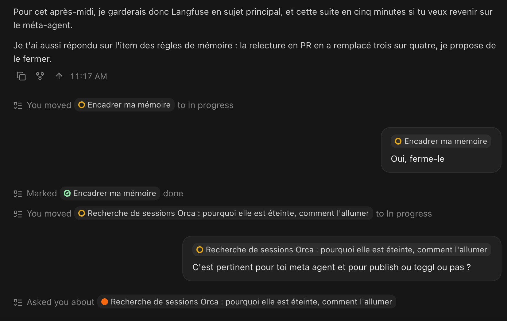
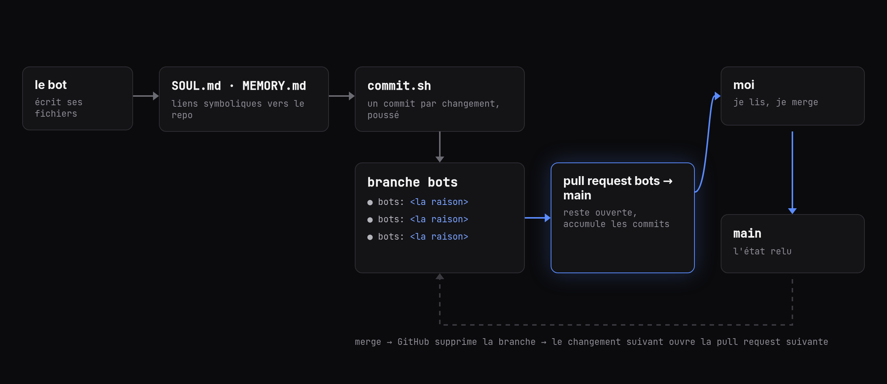

Avec l'agentic engineering, j'ai beaucoup de mal à garder en tête tout ce que je fais. J'ai à peu près huit sessions d'agents ouvertes en même temps, chacune dans son worktree, et la charge mentale monte vite : savoir sur quoi je travaille d'un jour sur l'autre, ou simplement après la pause de midi, quand je reprends et que je suis perdu. Le problème, ce n'est pas de lancer des agents, c'est de finir les tâches et de savoir enchaîner. En fait, c'est le focus, et l'orchestration.

Depuis quelque temps, je voyais passer sur Twitter des gens qui ne parlaient plus qu'à un seul agent, pour se simplifier la vie. Et puis Orca a lancé ses [bots](https://orca.dev/bots), et c'était un peu le sujet. Orca, c'est l'IDE dans lequel tournent mes agents de code, et un bot, c'est un agent qui y vit en permanence, sur ma machine et avec mon propre Claude Code, avec un nom, une mémoire et des automatisations. J'ai créé mon premier bot le 20 novembre. Il s'appelle Poulpito, comme le doudou de mon fils, et c'est « my best friend ». Bon, en fait, c'est plutôt devenu mon chief of staff : c'est le seul agent à qui je parle, et c'est lui qui pilote les autres.


## Ce qu'Orca donne à un bot

Mes agents tournaient déjà dans Orca, sur [une VM à eux](/blog/mes-agents-de-code-sur-un-vps-ovh-avec-un-seul-script-de-demarrage), avec chaque projet dans la barre latérale, ses worktrees et un agent dans chacun. Le bot s'ajoute à ça avec une conversation qui ne s'arrête pas quand je ferme l'onglet, et qui garde le fil quand je le perds. Voilà à quoi ça ressemble un matin de travail :


À gauche, sous le bot, j'ai les projets et leurs worktrees, chacun avec l'agent qui y travaille. Au centre, ma conversation avec Poulpito, avec les événements de son travail au fil de l'eau : un item qu'il a déplacé, un commentaire, le rapport d'un agent qu'il a lancé. « Publish the article on the meta-agent », c'est d'ailleurs l'agent qui a écrit la première version de cet article, en train de lui rendre compte. À droite, tout ce que le bot suit.


Dans ce panneau, il y a ce qu'une simple session d'agent n'a pas. Les items d'abord : tout ce qui attend, moi ou lui, devient un item numéroté, en cours ou fermé. Quand il a besoin que je tranche, il me pose la question sur l'item, je réponds sur l'item, et il le ferme. C'est ce qui me sert le plus, parce que les décisions m'attendent là au lieu de défiler dans la conversation.



Il y a aussi les automatisations, qu'on crée en lui demandant dans le chat de lancer quelque chose à heure fixe ou quand un événement arrive. Les deux qu'on voit dans le panneau, Orca les fait tourner tout seul : « Tidy memory » range sa mémoire la nuit, et « Look around », quelques fois par jour, fait le tour de ce qui m'attend dans GitHub et dans mes projets, en lecture seule, et me propose des suites sous « Suggestions ».


La dernière m'a intéressé. Cinq articles avançaient en parallèle dans le repo du site, sans personne pour les suivre jusqu'à la publication, et il m'a proposé de s'en charger. C'est exactement le travail d'orchestration que je lui confie d'habitude, sauf que cette fois c'est lui qui l'a vu. Un clic sur « Start », et la suggestion devient une demande que je lui fais.

## Un agent qui ne code pas

Ce que j'ai fait de Poulpito, c'est un méta-agent : il n'écrit jamais de code. Quand je lui confie quelque chose, il lance un agent pour ça, dans un nouveau worktree du projet concerné, avec un brief complet : le contexte, ce qui existe déjà, la première chose à faire. Ensuite il les suit tous, et quand je reviens il me dit ce que je peux fermer, ce qui doit continuer, et par quoi commencer. Il ne merge jamais de lui-même : chaque merge attend mon oui, pull request par pull request.


Ce que j'attends de lui, c'est de la précision et peu de latence : une réponse juste, et tout de suite. S'il me fait attendre, ou si je dois revérifier ce qu'il me dit, je retourne dans mes onglets. Avant lui, j'avais essayé avec des sessions « Meta » : un méta-agent par domaine, qui coordonnait ses propres worktrees, et un de plus au-dessus de tous, qui tenait le contexte d'ensemble. C'est ce dernier qui comptait, et il oubliait tout à la fin de chaque session. Le bot, lui, écrit ce dont il doit se souvenir.

## Une mémoire relue comme du code

Orca donne au bot deux fichiers qu'il lit au début de chaque conversation : `SOUL.md`, qui dit à quoi il sert et comment il travaille, et `MEMORY.md`, qui contient ce dont il se souvient, et que le bot écrit lui-même. C'est ça qui m'inquiétait dès le premier jour. Je me méfie beaucoup du context drift, et j'ai du mal à laisser un agent gérer sa propre mémoire : j'imaginais des lignes ajoutées sans que je les demande, un fait faux qui s'installe, et l'agent qui agit dessus trois jours plus tard sans que je sache d'où ça vient. Pour moi, c'était du code qui change tout seul, alors j'ai décidé de le relire comme du code. Ça, c'est ce que j'ai ajouté par-dessus Orca.

Les deux fichiers vivent dans le repo privé de ma config Claude Code, sur une branche `bots`, et le dossier du bot dans Orca contient des liens symboliques vers eux : il lit et écrit des fichiers versionnés sans que rien d'autre ne change pour lui. Après chaque changement, il lance un script qui fait un commit sur `bots` avec la raison dans le message, le pousse, et ouvre une pull request vers `main` s'il n'y en a pas déjà une. Le cœur du script :

```bash
git add ".claude/bots/$bot"
git commit -q -m "bots($bot): $why"

# No bots branch on GitHub: the first push, or the last pull request
# was merged and GitHub deleted the branch. Its commits are in main,
# so only the new ones are replayed on top of main.
if [[ -z "$(git ls-remote --heads origin bots)" ]]; then
  git rebase -q origin/main
fi
git push -q origin bots

pr="$(gh pr list --head bots --base main --state open \
  --json url --jq '.[0].url')"
[[ -n "$pr" ]] || gh pr create --head bots --base main \
  --title "bots: SOUL and memory" --body-file .claude/bots/pr-body.md
```

Il n'y a donc pas une pull request par changement : elle reste ouverte et accumule les commits, et quand je la merge, c'est que j'ai relu, et `main` contient l'état que j'ai lu. GitHub supprime la branche au merge, et le changement suivant repart de `main` et ouvre la pull request suivante. J'ai repris ce principe d'un service de snapshots que je fais tourner sur un autre projet, où il marchait déjà.



J'ai mergé la première pull request le 20 novembre, et la deuxième le 25, avec une douzaine de commits accumulés en cinq jours. Ce que j'ai attrapé en relisant n'a rien de spectaculaire. Trois fois, les 21, 24 et 25 novembre, j'ai trouvé des lignes de mémoire écrites en dehors de notre conversation et jamais commitées : elles apparaissaient comme des changements non commités, pas dans la pull request, et c'est justement comme ça que je les ai vues. Et le 25, une ligne était tout simplement fausse ; elle a été corrigée dans l'heure, avec son propre commit qui dit pourquoi. Sans l'historique, je ne les aurais pas vues.

## Le rôle, cinq jours après

Les premiers jours, il écrivait mal : le ton n'était pas le bon. Il lançait aussi ses agents dans son propre dossier, au lieu de les lancer dans le projet sur lequel ils travaillaient. Je le lui ai dit, et ça a suffi. Le 25 novembre, j'ai réécrit son rôle : c'est le méta-agent de tous mes espaces de travail, et je lui délègue tout. Par défaut, rien ne tourne dans notre conversation, le travail part aux agents pour que je puisse continuer à lui parler. Il garde le fil de chaque worktree et de chaque projet, il m'aide à décider par quoi commencer, et je lui demande d'être simple, efficace et droit au but.
