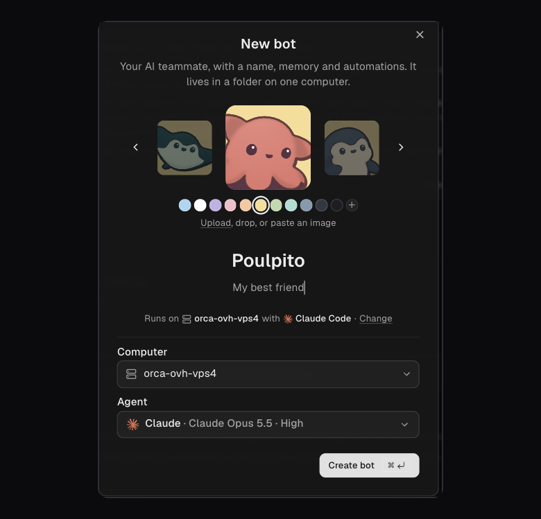
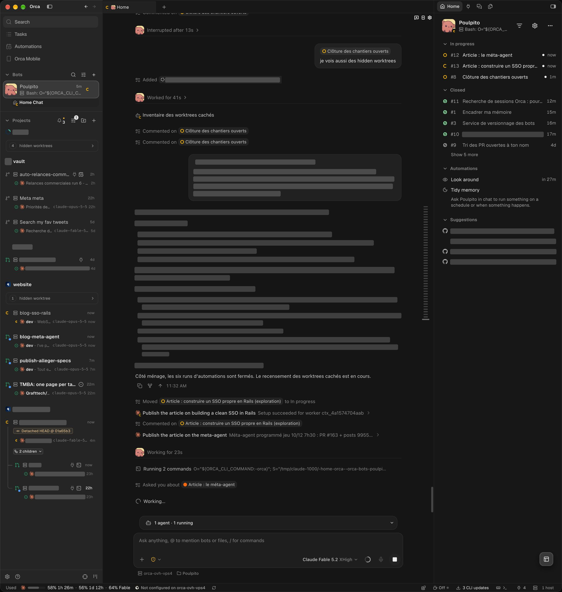
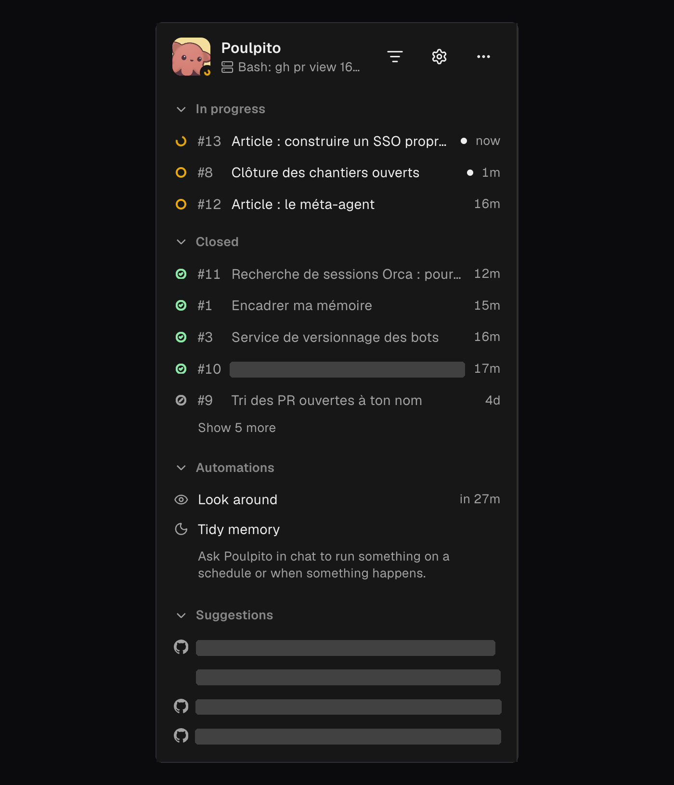
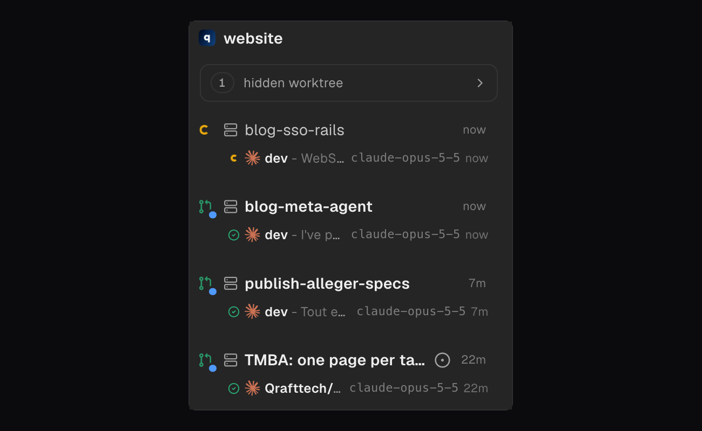

Le 20 novembre, j'ai créé un bot dans [Orca](https://github.com/stablyai/orca). La fenêtre demande une tête, un nom et une raison d'être. J'ai pris le poulpe, je l'ai appelé Poulpito, et j'ai tapé « My best friend » comme raison d'être, parce que je ne savais pas encore bien à quoi il allait servir.



Je savais en revanche quel problème je voulais régler. Un jour normal, j'ai à peu près huit sessions d'agents ouvertes en même temps, chacune dans son worktree : un fix sur un projet, un article pour ce site, une migration sur un autre. Les lancer, c'est facile. Les suivre, beaucoup moins : je passais d'un onglet à l'autre à me demander lequel attendait quoi, une relecture, une réponse, une décision, et celui qui attendait depuis le plus longtemps était rarement celui que j'ouvrais.

Cinq jours plus tard, Poulpito est le seul agent à qui je parle, et c'est lui qui pilote les autres.

## Ce qu'Orca donne à un bot

Mes agents tournaient déjà dans Orca, sur [une VM à eux](/blog/mes-agents-de-code-sur-un-vps-ovh-avec-un-seul-script-de-demarrage) : chaque projet dans la barre latérale avec ses worktrees, et un agent qui travaille dans chaque worktree. Un bot, c'est autre chose. Dans les mots d'Orca, c'est un « AI teammate, with a name, memory and automations », qui vit dans un dossier sur une machine : ici, un agent Claude Code sur ma VM, dont la conversation ne s'arrête pas quand je ferme l'onglet.

Voilà à quoi ça ressemble un matin de travail :



À gauche, sous le bot, les projets et leurs worktrees, chacun avec l'agent qui y travaille. Au centre, ma conversation avec le bot, avec les événements de son travail au fil de l'eau : un item déplacé, un commentaire, le rapport d'un agent qu'il a lancé. « Publish the article on the meta-agent », c'est l'agent qui a écrit la première version de cet article, qui rend compte. À droite, ce que le bot suit.



Ce panneau contient les trois choses qu'Orca ajoute à une simple session d'agent. D'abord les items : tout ce qui attend, moi ou le bot, est un item numéroté, en cours ou fermé. Quand le bot a besoin d'une décision, il me pose la question sur un item ; je réponds sur l'item, et il le ferme. Les décisions attendent là, au lieu de défiler dans la conversation.


Ensuite les automatisations : le bot lance quelque chose à heure fixe ou quand un événement arrive, et on les crée en le lui demandant dans le chat. Poulpito en a deux, « Look around » et « Tidy memory ». Et les suggestions : ce qu'il pense être la suite, dont plusieurs viennent directement de GitHub.

## Un agent qui ne code pas

Ce que j'ai fait de Poulpito, c'est un méta-agent : il n'écrit jamais de code. Quand je lui confie quelque chose, il lance un agent pour ça, dans un nouveau worktree du projet concerné, avec un brief complet : le contexte, ce qui existe déjà, la première chose à faire. Ensuite il les suit tous, et quand je reviens il me dit ce que je peux fermer, ce qui doit continuer, et par quoi commencer.



Il ne merge jamais de lui-même : chaque merge attend mon oui, pull request par pull request.

Ce que je lui demande, c'est de la précision et peu de latence : une réponse juste, et tout de suite. Un méta-agent qui me fait attendre, ou que je dois revérifier, coûte plus cher que les onglets qu'il remplace.

Avant le bot, j'avais des sessions « Meta » : un méta-agent par domaine, qui coordonnait ses propres worktrees, et un de plus au-dessus de tous, qui tenait le contexte d'ensemble. C'est celui-là qui compte, et une session oublie tout quand elle se termine. Un bot, non, parce qu'il écrit ce dont il doit se souvenir.

## Une mémoire relue comme du code

Orca donne au bot deux fichiers qu'il lit au début de chaque conversation : `SOUL.md`, qui dit à quoi il sert et comment il travaille, et `MEMORY.md`, qui contient ce dont il se souvient. Le second, c'est le bot qui l'écrit.

C'était ma crainte dès le premier jour. Je me méfie beaucoup du context drift, et j'ai du mal avec un agent qui gère sa propre mémoire : des lignes s'ajoutent sans que personne les ait demandées, un fait faux s'installe, et trois jours plus tard l'agent agit dessus sans qu'on sache d'où ça vient. Une mémoire qui s'écrit toute seule, c'est du code qui change tout seul. Alors je la relis comme du code, et ça, c'est ce que j'ai ajouté par-dessus Orca.

Les deux fichiers vivent dans le repo privé de ma config Claude Code, sur une branche `bots`. Le dossier du bot dans Orca contient des liens symboliques vers eux : il lit et écrit des fichiers versionnés, sans que rien d'autre ne change pour lui.

Après chaque changement dans ses fichiers, le bot lance un script qui l'enregistre : un commit sur `bots`, avec la raison dans le message, poussé, et une pull request vers `main` ouverte s'il n'y en a pas déjà une. Le cœur du script :

```bash
git add ".claude/bots/$bot"
git commit -q -m "bots($bot): $why"

# No bots branch on GitHub: the first push, or the last pull request
# was merged and GitHub deleted the branch. Its commits are in main,
# so only the new ones are replayed on top of main.
if [[ -z "$(git ls-remote --heads origin bots)" ]]; then
  git rebase -q origin/main
fi
git push -q origin bots

pr="$(gh pr list --head bots --base main --state open \
  --json url --jq '.[0].url')"
[[ -n "$pr" ]] || gh pr create --head bots --base main \
  --title "bots: SOUL and memory" --body-file .claude/bots/pr-body.md
```

Il n'y a pas une pull request par changement. La pull request reste ouverte et accumule les changements, un commit chacun, et la merger, c'est la relecture : `main` contient alors l'état que j'ai lu. GitHub supprime la branche au merge, et le changement suivant repart de `main` et ouvre la pull request suivante. J'ai repris le principe d'un service de snapshots que je fais tourner sur un autre projet, où il marchait déjà.


La première pull request a été mergée le 20 novembre. La deuxième a accumulé une douzaine de commits en cinq jours, et je l'ai mergée le 25 novembre.

Ce que la relecture a attrapé n'a rien de spectaculaire, et c'est bien le sujet. Trois fois, les 21, 24 et 25 novembre, j'ai trouvé des lignes de mémoire écrites en dehors de notre conversation et jamais commitées : elles apparaissaient comme des changements non commités, pas dans la pull request, et c'est justement comme ça que je les ai vues. Et le 25 novembre, une ligne était tout simplement fausse, et elle a été corrigée dans l'heure, avec son propre commit qui dit pourquoi. Sans l'historique, les deux seraient passées inaperçues.

## Ce qui a mal tourné

Cinq jours, c'est assez pour se tromper. Chaque erreur a laissé une règle écrite derrière elle.

Ses premiers points d'étape étaient impossibles à suivre. Je lui ai dit « je comprends rien », puis « je veux que tu sois mon chief of staff, pas mon stagiaire de 3e ». La règle : un point de vue en quelques lignes simples, puis une seule prochaine étape.

Il lançait ses agents imbriqués sous lui au lieu de les lancer dans le projet concerné, donc le travail se faisait dans le dossier du bot plutôt que dans le repo du projet. La règle : chaque tâche a son propre worktree, dans le bon projet.

À un moment, j'avais deux conversations ouvertes avec le même bot. « Ça défie le purpose » : toute l'idée, c'est un seul endroit où parler. La règle : une seule conversation.

Je lui ai dit « fais une passe » sans dire sur quoi, et au lieu de demander, il a deviné : un tri de 66 pull requests ouvertes que personne n'avait demandé. La règle : quand une consigne est vague, demander ce que je veux dire, en une ligne.

La pire, c'est un merge. Le 20 novembre, il a mergé une pull request qui avait été fermée exprès 87 secondes plus tôt, sur une lecture déjà périmée et sur un « c'est bon » ambigu de ma part. Le build a été annulé avant d'avoir publié quoi que ce soit, un revert a été ouvert, et je l'ai mergé six minutes après le mauvais merge. La règle : relire la pull request au moment de merger, et s'arrêter si elle n'est pas ouverte ; et quand je ne nomme pas le repo et le numéro, me les redire et attendre mon oui.

La dernière est plus subtile. Je lui ai demandé de chercher quelque chose dans mes sessions passées, et il m'a répondu qu'il ne pouvait pas les fouiller. Ce qui était vrai, c'est que son agent ne l'avait pas fait : l'index de recherche était coupé, mais les transcripts sont de simples fichiers sur le disque. La règle : dire ce qui n'a pas été fait, pas ce qui ne peut pas l'être.

## Le rôle, cinq jours après

Le 25 novembre, j'ai réécrit son rôle. C'est le méta-agent de tous mes espaces de travail, et je lui délègue tout. Par défaut, rien ne tourne dans notre conversation : le travail part aux agents, pour que je puisse continuer à parler. Il garde le fil de chaque worktree et de chaque projet, et m'aide à décider par quoi commencer. Simple, efficace, droit au but.
