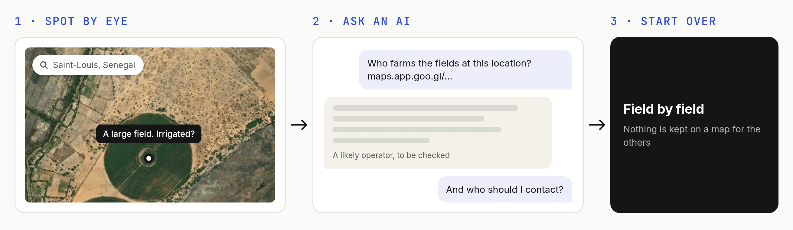
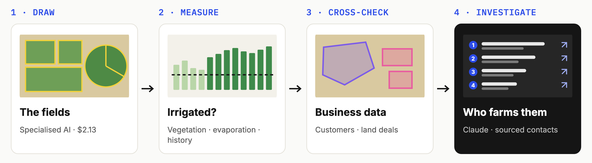
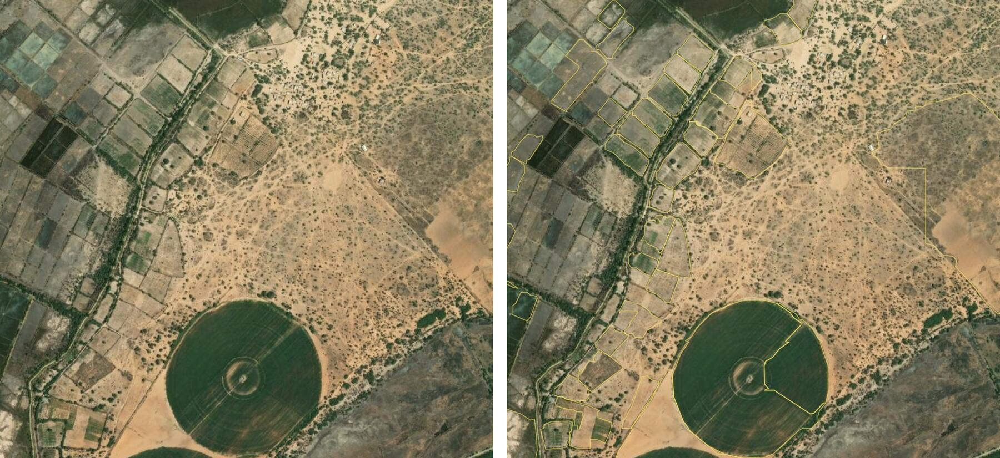
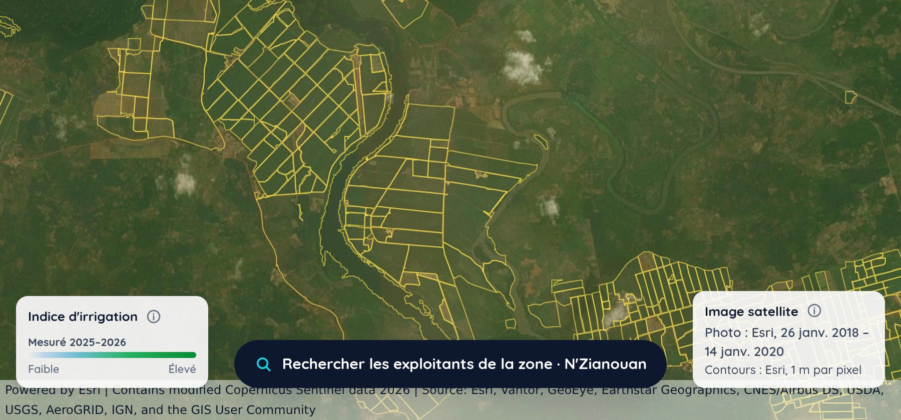
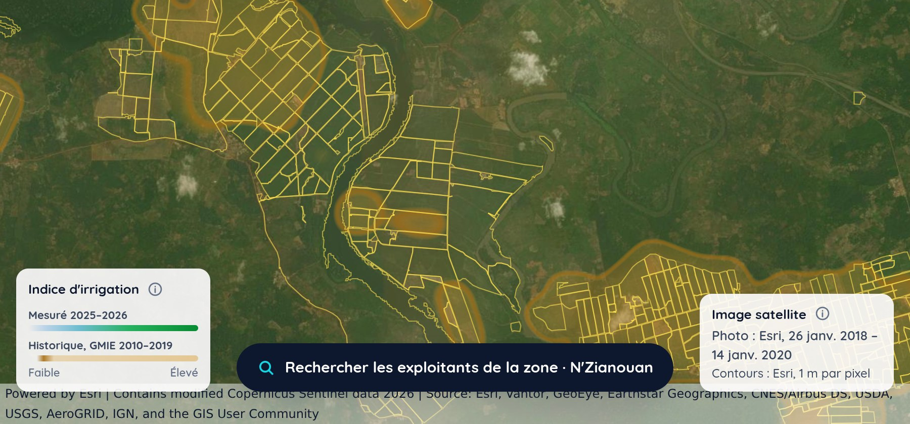
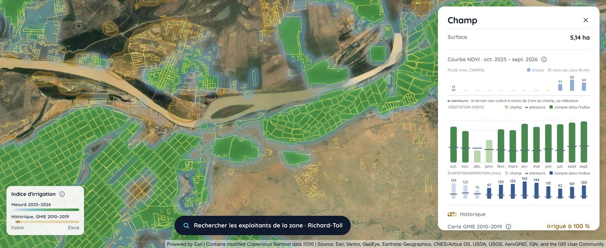
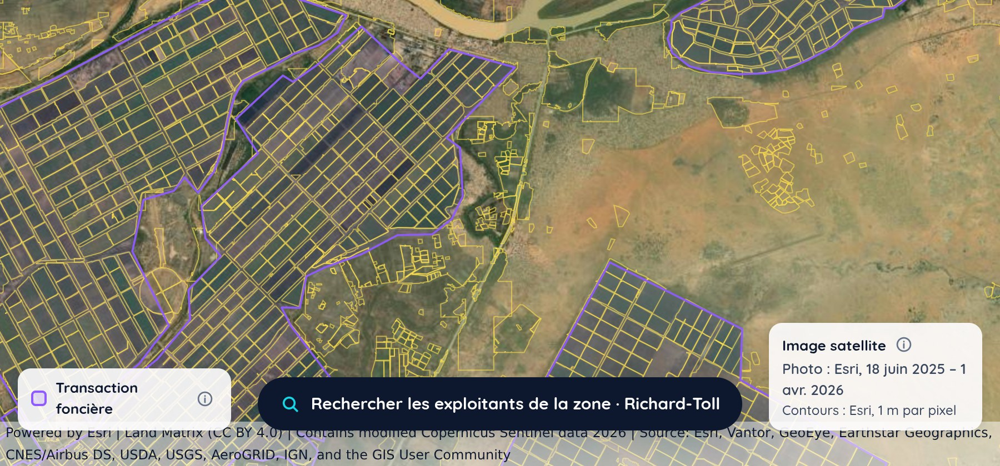
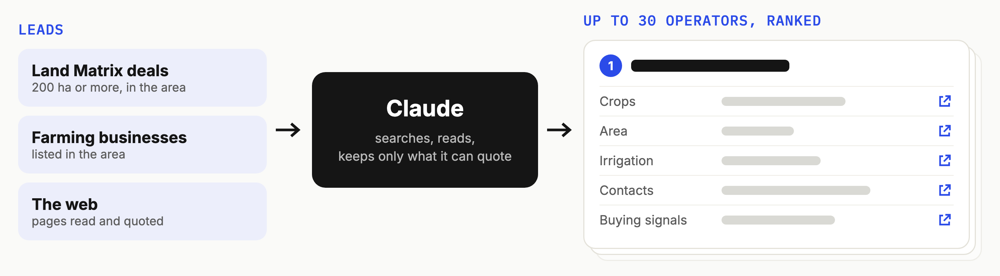

One of our clients sells irrigation equipment in Senegal and Côte d'Ivoire. Its sales reps look for **large irrigated farms that aren't customers yet**.

## How they searched

We started by watching how they prospect. They open Google Maps in satellite view and scan a region by eye: they follow a river or go around a lake, look for large fields, and click the business listings pinned next to them. On site, they ask local people who farms a given plot.

The team had also started testing something else: pasting a field's Google Maps link into ChatGPT and asking who farms it. It is often right, because even remote farms have a Google listing. During our workshop, it did find one producer, then it attributed another plot to the neighbour, 40 metres away.

It works, but one field at a time. The satellite view shows crop rows, not whether they are watered. And nothing a rep finds is kept on a map for the others.

We put those steps into **a map built for prospecting**.

Here is how it works. I pick an area, I see the fields, I spot the ones that are probably irrigated, then I run a search on who farms them. For now it's a prototype, over 5 areas of 50 × 50 km around farms that are already customers.

## 1. Drawing the fields

Everything starts with the field outlines. Without them, we can't measure a field or compare it with what surrounds it.

### An open database that looked like enough

[Fields of The World](https://fieldsofthe.world/) publishes field outlines for the whole planet, already computed: about 1.6 billion fields a year, under an open licence, in a format a web map loads directly. **We thought this step was settled.** All that was left was to lay those outlines over the satellite photo, and a coding agent writes that very quickly.

Looking at the map up close, it didn't hold. The outlines are jagged. Neighbouring plots are merged into a single polygon, 259 ha for a village irrigation scheme near Podor, in Senegal. Football pitches count as fields, and obvious fields along the river are missing. Around N'Douci, in Côte d'Ivoire, large flat patches cover forest and plantations.

, confidence threshold at 69%.")

The database gives a confidence score for each outline. We tried to sort with it, without success: desert was scored at 75%, and real fields at 79%.

The reason is simple: the database is computed on images from the Sentinel-2 satellite, which have a resolution of 10 m per pixel.

### A model found on Hugging Face

We looked for other solutions, and came across [Delineate Anything](https://huggingface.co/MykolaL/DelineateAnything), published on Hugging Face. It is **a model trained to spot fields on a photo**, and nothing else. It learned on 74 million fields in 61 countries, and an ordinary satellite photo is all it needs. We give it the one from the base map, at about 1 m per pixel.

With that, we can draw the fields one by one.

It isn't perfect. It misses fields, especially where the photo is old, and some outlines still need correcting by hand.

It is small enough to run on a MacBook, and we thought that would do. For our 5 areas, it would have taken about 18 hours of compute. We ended up with **92,098 outlines for $2.13**. I'll explain how in an upcoming article.

, with only the Fields layer shown.")

## 2. Seeing which fields are irrigated

Next, we need to know which of these fields are watered. On a photo, you can't tell. The map **compares each field with the uncultivated land around it**, within 2 km, month by month, from October 2025 to September 2026. It relies on two satellite measurements:

- **vegetation**, with the NDVI from Sentinel-2 imagery: a field that stays green while the bush around it is dry is probably watered;
- **evapotranspiration**, with the FAO's WaPOR data: a watered field gives off much more water than the dry ground around it.

A month counts when the field is **clearly greener or wetter than its surroundings**. From three months on, roughly one crop cycle, the field carries its full weight in the irrigation index, a green heat layer on the map.

**In Senegal, it works well.** Around the irrigation schemes, the dunes and bare land stay dry all year, and a watered field clearly stands out against them.

: irrigated fields are in green.")

**In tropical forest, it doesn't work.** In southern Côte d'Ivoire there is no real dry season: in our first Ivorian area, no month got less than 26 mm of rain. The plantation, the forest and the rubber trees around it are all equally green, and give off as much water. When nothing is short of water, a watered field looks just like its neighbours. And some months, clouds hide the ground.

**So we added historical data.** GMIE is a published map of irrigated land from 2010 to 2019. The map shows it in ochre, and it works a little better. In this area, it brings out 210 fields, mostly plantation blocks, where our two measurements saw none. But it describes the past decade, not the current year. It is a lead to check.

Clicking a field shows its area, the monthly rainfall, its vegetation and evapotranspiration curves against those of its surroundings, and the share of the field that GMIE marked as irrigated.

## 3. Adding business data

Two layers help sort things out. **Existing customers' sites**, in pink, come from the company's customer database: the rep sees straight away which farms are already equipped. **Land deals of 200 ha or more**, in purple, come from the [Land Matrix](https://landmatrix.org/), a public database that tells who invested, in which crops and over what area. Large farming projects often show up there.

## 4. Looking into the farm operators with Claude

The last step is finding out who farms the fields. That's what the team asked ChatGPT, one field at a time. A button, "Rechercher les exploitants de la zone" (search the area's operators), hands that search to **Claude**, for the whole area at once. It starts from the Land Matrix deals and the farming businesses listed in the area, searches the web and reads the pages it finds.

It returns **a list of up to 30 operators**, ranked by the area they report, the number of sources and whether a contact is available. For each one, there are its crops, its area, how it irrigates, the people to contact with their phone or email, and dated buying signals. **Each piece of information links to its source**, and the code drops any whose quote it can't find in a page that was read.

The list is **shared by all the reps**, who run it again when they want to refresh it. This is the most experimental part of the map: we haven't yet measured whether the operators it lists are the ones who actually farm the area.

## In the end

The rep starts from an area and ends up with **a list of operators to call**. They follow the same steps as before, in a single tool, and the work done for one area serves the whole team.
