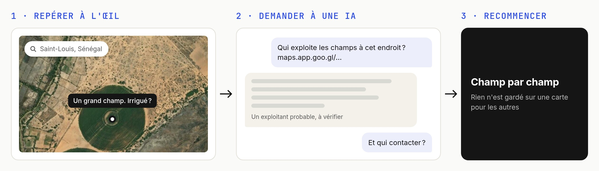
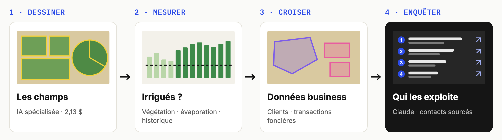
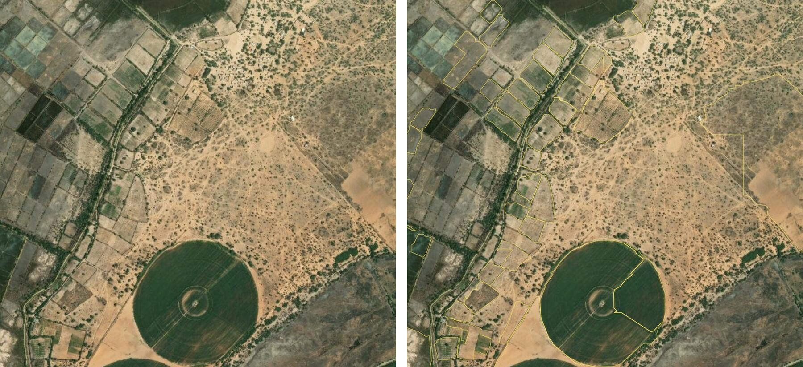
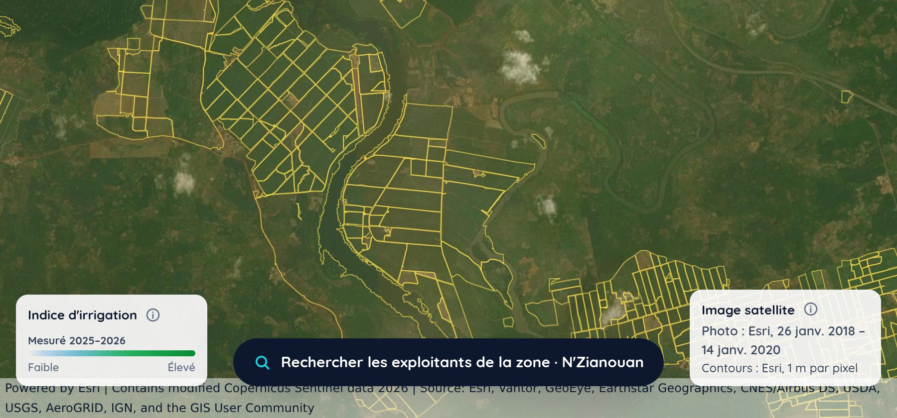
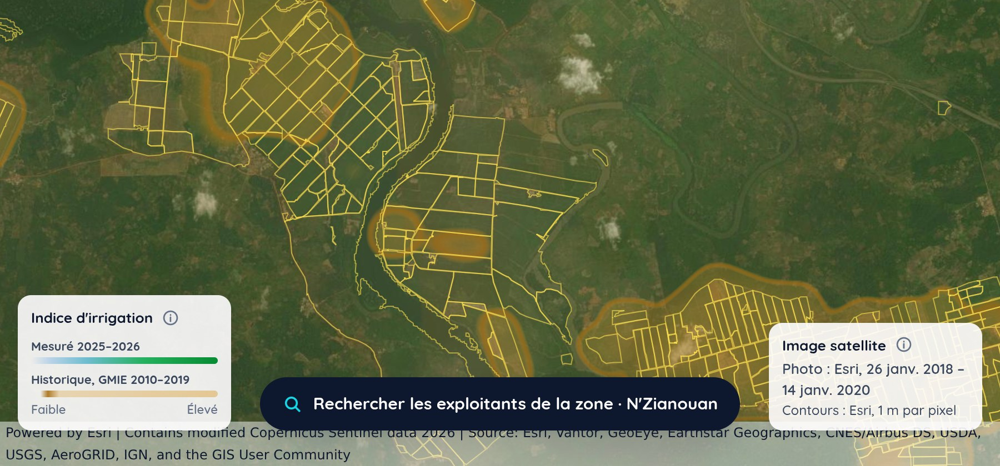
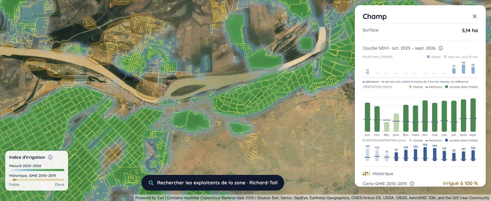
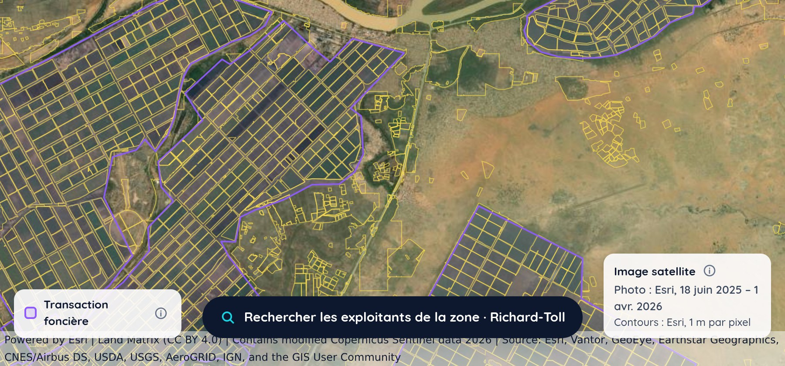
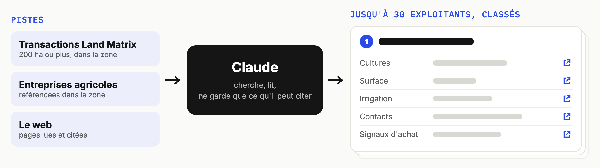

Un de nos clients vend du matériel d'irrigation au Sénégal et en Côte d'Ivoire. Ses commerciaux cherchent **les grandes exploitations irriguées qui ne sont pas encore clientes**.

## Comment ils cherchaient

On a commencé par regarder avec eux comment ils prospectent. Ils ouvrent Google Maps en vue satellite et parcourent une région à l'œil : ils suivent un fleuve ou font le tour d'un lac, cherchent de grands champs, cliquent sur les fiches d'entreprises posées à côté. Sur place, ils demandent aux gens du coin qui exploite telle parcelle.

L'équipe avait aussi commencé à tester autre chose : coller le lien Google Maps d'un champ dans ChatGPT et lui demander qui l'exploite. Ça tombe souvent juste, parce que même les exploitations isolées ont une fiche Google. Pendant notre atelier, il a bien retrouvé un producteur, puis il a attribué une autre parcelle au voisin, à 40 mètres de là.

Ça marche, mais champ par champ. La vue satellite montre des rangs de culture, pas s'ils sont arrosés. Et rien de ce qu'un commercial trouve n'est gardé sur une carte pour les autres.

On a repris ces gestes dans **une carte dédiée à la prospection**.

Voilà comment ça marche. Je choisis une zone, je vois les champs, je repère ceux qui sont probablement irrigués, puis je lance une recherche sur leurs exploitants. C'est pour l'instant un prototype, sur 5 zones de 50 × 50 km autour d'exploitations déjà clientes.

## 1. Dessiner les champs

Tout part des contours des champs. Sans eux, on ne peut pas mesurer un champ ni le comparer à ce qui l'entoure.

### Une base ouverte qui avait l'air de suffire

[Fields of The World](https://fieldsofthe.world/) publie les contours des champs de toute la planète, déjà calculés : environ 1,6 milliard de champs par an, sous licence ouverte, dans un format qu'une carte web charge directement. **On a cru que cette étape était réglée.** Il restait à poser ces contours sur la photo satellite, et un agent de code écrit ça très vite.

En regardant la carte de près, ça ne tenait pas. Les contours sont en dents de scie. Des parcelles voisines sont fondues en un seul polygone, 259 ha pour un périmètre villageois près de Podor, au Sénégal. Des terrains de foot comptent comme des champs, et des champs évidents au bord du fleuve manquent. Autour de N'Douci, en Côte d'Ivoire, de grands aplats recouvrent la forêt et les plantations.

, seuil de confiance à 69 %.")

La base donne un indice de confiance pour chaque contour. On a essayé de trier avec, sans succès : du désert était noté à 75 %, et de vrais champs à 79 %.

La raison est simple : la base est calculée sur les images du satellite Sentinel-2, qui ont une résolution de 10 m par pixel.

### Un modèle trouvé sur Hugging Face

On a cherché d'autres solutions, et on est tombés sur [Delineate Anything](https://huggingface.co/MykolaL/DelineateAnything), publié sur Hugging Face. C'est **un modèle entraîné pour repérer les champs sur une photo**, et rien d'autre. Il a appris sur 74 millions de champs dans 61 pays, et une photo satellite ordinaire lui suffit. On lui donne celle du fond de carte, à environ 1 m par pixel.

Avec ça, on arrive à dessiner les champs un par un.

Il n'est pas parfait. Il rate des champs, surtout là où la photo est ancienne, et il reste des contours à corriger à la main.

Il est assez petit pour tourner sur un MacBook, et on a cru que ça suffirait. Pour nos 5 zones, il aurait fallu environ 18 heures de calcul. On a fini avec **92 098 contours pour 2,13 $**. Je raconte comment dans un prochain article.

, avec seulement la couche Champs affichée.")

## 2. Voir quels champs sont irrigués

Ensuite, il faut savoir lesquels de ces champs sont arrosés. Sur une photo, ça ne se voit pas. La carte **compare chaque champ à la terre non cultivée qui l'entoure**, dans un rayon de 2 km, mois par mois, d'octobre 2025 à septembre 2026. Elle s'appuie sur deux mesures satellite :

- **la végétation**, avec le NDVI des images Sentinel-2 : un champ qui reste vert quand la brousse autour est sèche est probablement arrosé ;
- **l'évapotranspiration**, avec les données WaPOR de la FAO : un champ arrosé rend beaucoup plus d'eau à l'air que le sol sec autour de lui.

Un mois compte quand le champ est **nettement plus vert ou plus humide que ses alentours**. À partir de trois mois, à peu près un cycle de culture, le champ pèse de tout son poids dans l'indice d'irrigation, une couche de chaleur verte sur la carte.

**Au Sénégal, ça marche bien.** Autour des périmètres irrigués, les dunes et les terres nues restent sèches toute l'année, et un champ arrosé s'en détache nettement.

 : les champs irrigués sont en vert.")

**En forêt tropicale, ça ne marche pas.** Dans le sud de la Côte d'Ivoire, il n'y a pas vraiment de saison sèche : sur notre première zone ivoirienne, aucun mois n'est passé sous 26 mm de pluie. La plantation, la forêt et les hévéas autour sont aussi verts les uns que les autres, et rendent autant d'eau à l'air. Quand rien ne manque d'eau, un champ arrosé ne se distingue pas de ses voisins. Et certains mois, les nuages cachent le sol.

**On a donc ajouté des données historiques.** GMIE est une carte publiée des terres irriguées entre 2010 et 2019. La carte l'affiche en ocre, et ça marche un peu mieux. Sur cette zone, elle fait ressortir 210 champs, surtout des blocs de plantation, là où nos deux mesures n'en voyaient aucun. Mais elle décrit la décennie passée, pas l'année en cours. C'est une piste à vérifier.

En cliquant sur un champ, le commercial voit sa surface, la pluie du mois, ses courbes de végétation et d'évapotranspiration face à celles de ses alentours, et la part du champ que GMIE marquait irriguée.

## 3. Ajouter les données business

Deux couches aident à trier. **Les sites des clients existants**, en rose, viennent de la base clients de l'entreprise : le commercial voit tout de suite les exploitations déjà équipées. **Les transactions foncières de 200 ha ou plus**, en violet, viennent de la [Land Matrix](https://landmatrix.org/), une base publique qui dit qui a investi, dans quelles cultures et sur quelle surface. Les grands projets agricoles y apparaissent souvent.

## 4. Enquêter sur les exploitants avec Claude

La dernière étape, c'est trouver qui exploite les champs. C'est ce que l'équipe demandait à ChatGPT, un champ à la fois. Un bouton, « Rechercher les exploitants de la zone », confie cette recherche à **Claude**, pour toute la zone d'un coup. Il part des transactions Land Matrix et des entreprises agricoles référencées dans la zone, cherche sur le web et lit les pages qu'il trouve.

Il rend **une liste d'au plus 30 exploitants**, classés selon la surface qu'ils annoncent, le nombre de sources et la présence d'un contact. Pour chacun, on a ses cultures, sa surface, sa façon d'irriguer, les personnes à contacter avec leur téléphone ou leur e-mail, et des signaux d'achat datés. **Chaque information renvoie à sa source**, et le code écarte celles dont il ne retrouve pas la citation dans une page lue.

La liste est **partagée entre tous les commerciaux**, qui la relancent quand ils veulent l'actualiser. C'est la partie la plus expérimentale de la carte : on n'a pas encore mesuré si les exploitants listés sont bien ceux qui cultivent la zone.

## Au final

Le commercial part d'une zone et arrive à **une liste d'exploitants à appeler**. Il suit les mêmes étapes qu'avant, dans un seul outil, et le travail fait pour une zone sert à toute l'équipe.
