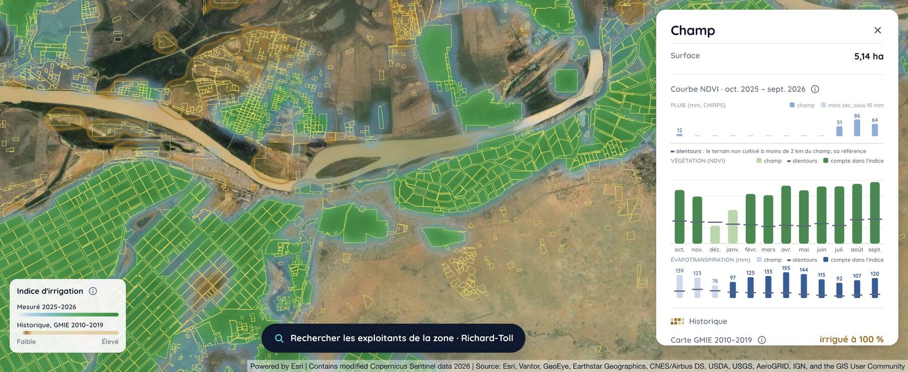

Telaqua, one of our clients, sells irrigation equipment in Senegal and Côte d'Ivoire. Its sales reps look for large irrigated farms that aren't customers yet.

## The need

We started by watching how they prospect. They open a satellite view, spot fields that look watered, then ask an AI who farms them and how to reach them. It works, but it takes time.

We put those steps into a tool built for prospecting: a map. The rep picks an area, sees the fields, spots the ones that are probably irrigated, then runs a search on who farms them. For now it's a proof of concept, over five 50 × 50 km areas around Telaqua's customers' sites.

, with only the Fields layer shown.")

## 1. Drawing the fields

Everything starts with the field outlines. Field boundary databases already exist, but on our areas they were too imprecise. So we had an AI draw the fields, on a satellite photo at about 1 m per pixel.

We picked a specialised AI, found on Hugging Face, rather than a general-purpose one. It does one thing, spotting fields on a photo, and it's small enough to run on a GPU rented by the minute. That's what brings the cost down: 92,098 outlines across the five areas, for $2.13 of compute. I'll cover how we chose the model and ran it in an upcoming article.

## 2. Seeing which fields are irrigated

Next, we need to know which of these fields are watered. The map compares each field with the uncultivated land around it, within 2 km, month by month, from October 2025 to September 2026. It relies on two satellite measurements:

- vegetation, with the NDVI from Sentinel-2 imagery: a field that stays green while the bush around it is dry is probably watered;
- evapotranspiration, with the FAO's WaPOR data: a watered field gives off much more water than the dry ground around it.

A month counts when the field is clearly greener or wetter than its surroundings. From three months on, roughly one crop cycle, the field carries its full weight in the irrigation index, a green heat layer on the map. An ochre layer adds the history: GMIE, a published map of irrigation from 2010 to 2019.

.")

Clicking a field shows its area, the monthly rainfall, its vegetation and evapotranspiration curves against those of its surroundings, and the share of the field that GMIE marked as irrigated.

## 3. Adding business data

Two layers help sort things out. Telaqua's customers' sites, in pink, come from its customer database: the rep sees straight away which farms are already equipped. Land deals of 200 ha or more, in purple, come from the [Land Matrix](https://landmatrix.org/), a public database that tells who invested, in which crops and over what area. Large farming projects often show up there.

## 4. Looking into the farm operators with Claude

The last step is finding out who farms the fields. A button, "Rechercher les exploitants de la zone" (search the area's operators), hands that search to Claude. It starts from the Land Matrix deals and the farming businesses listed in the area, searches the web and reads the pages it finds.

It returns a list of up to 30 operators, ranked by the area they report, the number of sources and whether a contact is available. For each one, there are its crops, its area, how it irrigates, the people to contact with their phone or email, and dated buying signals. Each piece of information links to its source, and the code drops any whose quote it can't find in a page that was read.

The list is shared by all the reps, who run it again when they want to refresh it.

## In the end

The rep starts from an area and ends up with a list of operators to call. They follow the same steps as before, in a single tool, and the work done for one area serves the whole team.
