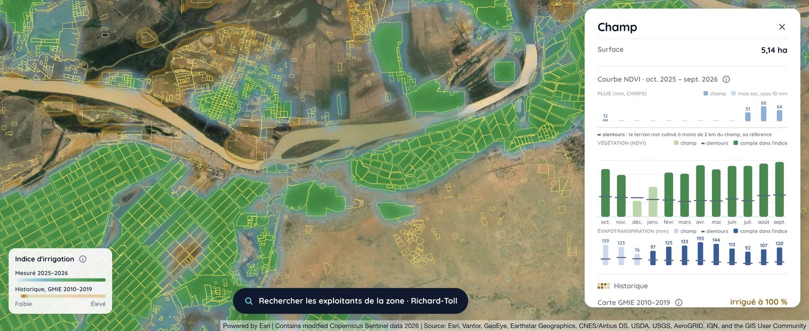

Telaqua, un de nos clients, vend du matériel d'irrigation au Sénégal et en Côte d'Ivoire. Ses commerciaux cherchent les grandes exploitations irriguées qui ne sont pas encore clientes.

## Le besoin

On a commencé par regarder avec eux comment ils prospectent. Ils ouvrent une vue satellite, repèrent des champs qui ont l'air arrosés, puis font une recherche dans une IA pour savoir qui les exploite et comment le joindre. Ça marche, mais ça prend du temps.

On a repris ces gestes dans un outil dédié à la prospection : une carte. Le commercial choisit une zone, voit les champs, repère ceux qui sont probablement irrigués, puis lance une recherche sur leurs exploitants. C'est pour l'instant une preuve de concept, sur cinq zones de 50 × 50 km autour de sites de clients de Telaqua.

, avec seulement la couche Champs affichée.")

## 1. Dessiner les champs

Tout part des contours des champs. Des bases de contours existent déjà, mais sur nos zones elles étaient trop imprécises. On a donc fait dessiner les champs par une IA, sur une photo satellite à environ 1 m par pixel.

On a pris une IA spécialisée, trouvée sur Hugging Face, plutôt qu'une IA généraliste. Elle ne sait faire qu'une chose, repérer les champs sur une photo, et elle est assez petite pour tourner sur un GPU loué à la minute. C'est ce qui fait tomber le coût : 92 098 contours sur les cinq zones, pour 2,13 $ de calcul. Je raconte le choix du modèle et son exécution dans un prochain article.

## 2. Voir quels champs sont irrigués

Reste à savoir lesquels de ces champs sont arrosés. La carte compare chaque champ à la terre non cultivée qui l'entoure, dans un rayon de 2 km, mois par mois, d'octobre 2025 à septembre 2026. Elle s'appuie sur deux mesures satellite :

- la végétation, avec le NDVI des images Sentinel-2 : un champ qui reste vert quand la brousse autour est sèche est probablement arrosé ;
- l'évapotranspiration, avec les données WaPOR de la FAO : un champ arrosé rend beaucoup plus d'eau à l'air que le sol sec autour de lui.

Un mois compte quand le champ est nettement plus vert ou plus humide que ses alentours. À partir de trois mois, à peu près un cycle de culture, le champ pèse de tout son poids dans l'indice d'irrigation, une couche de chaleur verte sur la carte. Une couche ocre ajoute l'historique : GMIE, une carte publiée de l'irrigation entre 2010 et 2019.

.")

En cliquant sur un champ, le commercial voit sa surface, la pluie du mois, ses courbes de végétation et d'évapotranspiration face à celles de ses alentours, et la part du champ que GMIE marquait irriguée.

## 3. Ajouter les données business

Deux couches aident à trier. Les sites des clients de Telaqua, en rose, viennent de sa base clients : le commercial voit tout de suite les exploitations déjà équipées. Les transactions foncières de 200 ha ou plus, en violet, viennent de la [Land Matrix](https://landmatrix.org/), une base publique qui dit qui a investi, dans quelles cultures et sur quelle surface. Les grands projets agricoles y apparaissent souvent.

## 4. Enquêter sur les exploitants avec Claude

Le dernier geste, c'est trouver qui exploite les champs. Un bouton, « Rechercher les exploitants de la zone », confie cette recherche à Claude. Il part des transactions Land Matrix et des entreprises agricoles référencées dans la zone, cherche sur le web et lit les pages qu'il trouve.

Il rend une liste d'au plus 30 exploitants, classés selon la surface qu'ils annoncent, le nombre de sources et la présence d'un contact. Pour chacun, on a ses cultures, sa surface, sa façon d'irriguer, les personnes à contacter avec leur téléphone ou leur e-mail, et des signaux d'achat datés. Chaque information renvoie à sa source, et le code écarte celles dont il ne retrouve pas la citation dans une page lue.

La liste est partagée entre tous les commerciaux, qui la relancent quand ils veulent l'actualiser.

## Au final

Le commercial part d'une zone et arrive à une liste d'exploitants à appeler. Il suit les mêmes étapes qu'avant, dans un seul outil, et le travail fait pour une zone sert à toute l'équipe.
