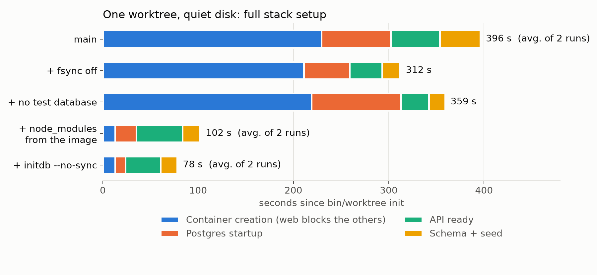
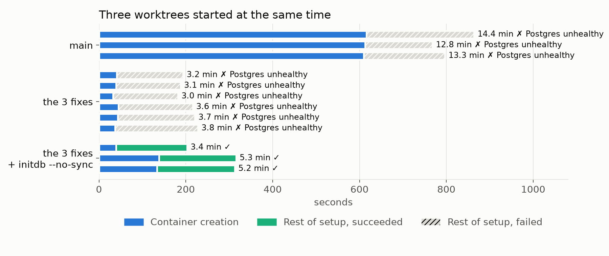
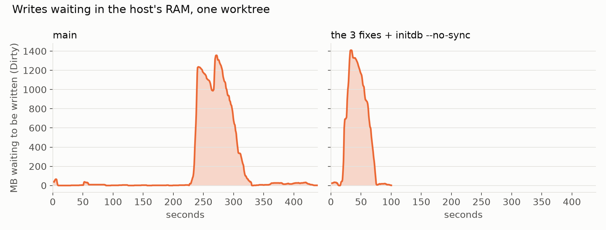

On a Rails app we work on, every task handed to an agent goes into its own worktree, and every worktree brings up its own Docker stack: Postgres, Redis, the API and Sidekiq, the Vite front end, a chat and an email editor in Node, nginx in front. The agent can run the app, the tests, look at the page it just changed, without stepping on the others.

All of this runs on [one VM per developer](/en/blog/an-orca-host-for-every-developer-on-ovh-or-gcp-what-it-costs-and-what-changes): a VPS with 8 vCores and 24 GB of RAM, plus an extra 100 GB volume that holds both the worktrees and Docker's storage. And that disk decides everything: about 80 fsyncs per second, and ~250 files created per second when you ask a lot of it.

A fresh worktree took 6 min 36 to be ready. Worse: when three agents started at the same time, none of them made it. We measured, fixed, measured again.

## How we measured

The repo's setup script runs `bin/worktree init && bin/worktree start --setup-db`: it generates the worktree's config (ports, compose project name), runs `docker compose up`, waits for Postgres and the API, then `rails db:create db:schema:load db:seed`. We timed it on a fresh worktree, each time from `main` with one or more fixes applied on top. The Docker images were already in the build cache in every case: we measure the startup, not the build.

During each run, a loop read the disk counters every second (`/sys/block/sdb/stat`: bytes written, number of flushes), the memory waiting to be written (`Dirty` in `/proc/meminfo`) and the host's RAM, plus `docker stats` every four seconds for each container's memory.

The limits: one or two runs per variant sequentially, three to six in parallel, on a host where two other stacks were running idle. Two identical runs can differ by ~50 s, so small differences mean nothing.

## One worktree on its own



### The web container blocks everyone

On `main`, the first phase lasts 3 min 50, and it is the creation of a single container, the front end. The compose file mounted the whole folder:

```yaml
volumes:
  - ./web:/app
  - /app/node_modules
```

The `./web:/app` bind mount hides the `node_modules` installed in the image, hence the anonymous `/app/node_modules` volume that makes it visible again. But Docker fills a new anonymous volume by copying the image's content: 567 MB, 51,000 files, for every new worktree. And `docker compose up` starts no container until all of them are created: Postgres waits for the `node_modules` copy before it starts.

We now mount the sources and the config files one by one, and `node_modules` comes straight from the image:

```yaml
volumes:
  - ./web/src:/app/src
  - ./web/index.html:/app/index.html
  - ./web/package.json:/app/package.json
  - ./web/yarn.lock:/app/yarn.lock
  - ./web/vite.config.js:/app/vite.config.js
  # … the other config files at the root of web/
```

The web container is created 11 to 15 s after the setup starts, instead of 3 min 50. The startup `yarn install` no longer downloads the 118 MB of cache the bind mount was hiding either.

There are two downsides. Every new file at the root of `web/` has to be added to the list. And a file bind mount follows the inode: after a `git pull` that replaces `package.json`, the container keeps the old version until a `docker compose up -d --force-recreate web`. The alternative we are looking at: keep the `./web:/app` mount and install `node_modules` one level up, in the image's `/node_modules`. Node walks up the parent folders to resolve modules, there is no list to maintain anymore, but a change to `yarn.lock` means rebuilding the image.

### Postgres without fsync

The Postgres of this compose file is only used locally and in worktrees. We run it without disk syncs:

```yaml
command: postgres -c fsync=off -c synchronous_commit=off -c full_page_writes=off
```

It is the setting [the Postgres docs](https://www.postgresql.org/docs/current/non-durability.html) give for throwaway databases. On one run, the setup comes down to 5 min 12, and the number of disk flushes goes from 5,835 to 2,243. The price: if the VM crashes mid-write, the database can be corrupted. We throw it away and run the seed again.

### And initdb, which it does not cover

`fsync=off` is a server setting. But on the first start on an empty volume, the official image first runs `initdb`, which creates the cluster then syncs all its files to disk, and `fsync=off` does not touch that. It has to be told separately:

```yaml
environment:
  POSTGRES_INITDB_ARGS: --no-sync
```

Alone on a quiet disk, it does not change much: Postgres is ready 22 to 25 s after the start, instead of 29 to 41 s. The full setup goes from 1 min 42 to 1 min 18 on average. The effect is elsewhere, we are getting there.

## Three worktrees at the same time

The real use is several agents starting their task within the same minute. We started three setups three seconds apart.



On `main`, all three fail, after 12 min 48 to 14 min 24. Creating the web containers takes 10 minutes on its own (three copies of 51,000 files on the same disk), then Postgres is declared unhealthy.

With the three fixes (web mount, `fsync=off`, no test database), the containers are created in 30 to 45 s… and all three fail anyway, after 3 to 4 minutes. The Postgres logs stop at:

```
running bootstrap script ... ok
performing post-bootstrap initialization ... ok
```

The next line should be `syncing data to disk ... ok`. It never comes: `initdb` waits for its files to be on disk, while the two other stacks have ~2 GB of writes pending there. The healthcheck allows a 120 s `start_period` then five tries five seconds apart: it gives up first, and `docker compose up` exits with an error. We ran the series again: 6 failures out of 6.

With `POSTGRES_INITDB_ARGS: --no-sync`, `initdb` finishes in 3 s, and the three setups go through, in 3 min 23, 5 min 16 and 5 min 13.

## RAM and disk



RAM barely moves from one variant to the next. Postgres stays under 100 MB. A full stack takes about 3 GB on the host, three take about 7: out of 24 GB, it fits.

What matters is what is waiting to be written. When the containers start, the kernel piles up 1.3 to 1.6 GB of writes in memory for one worktree, ~2.2 GB for three, then flushes them to disk. As long as nobody asks for a sync, it goes fine. One `fsync` at the wrong moment, and it waits behind all of that.

Written to disk per worktree: 3.6 GB on `main`, 2.5 GB with everything.

## What we did not keep

We also expected a gain from not loading the test database at setup. In development, Rails applies `db:schema:load` to the test database on top of the dev one, and `SKIP_TEST_DATABASE=1` avoids it: rspec loads it itself on its first run. Measured, it makes no visible difference: schema and seed take under 20 s once Postgres runs without fsync. The initial estimate (over four minutes) had been made while three setups were already saturating the disk.

And the disk is still the bottleneck. Two of the three parallel setups still take 5 min, including over 2 min of container creation: these settings stop wasting it, they do not make it faster.
