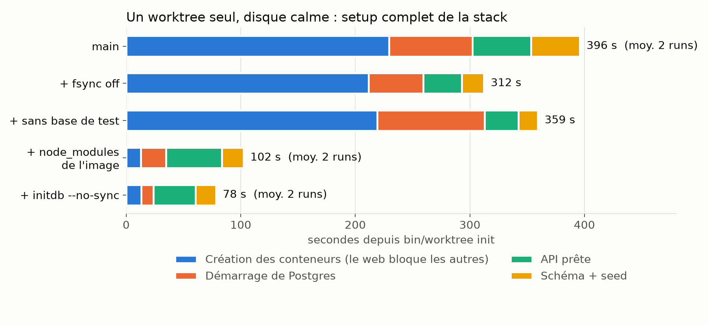
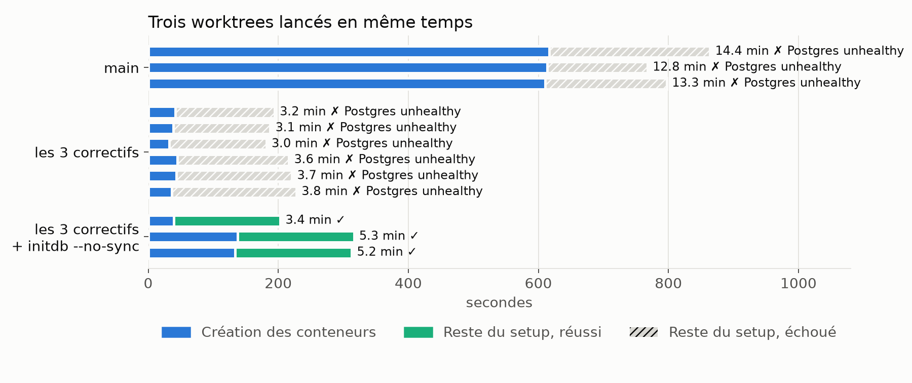
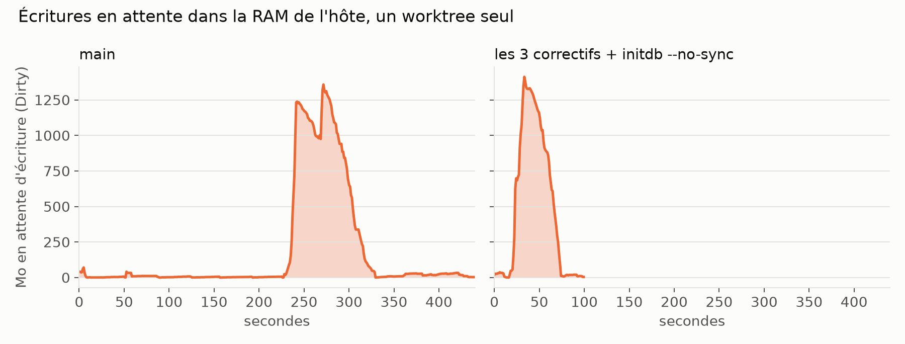

Sur une app Rails sur laquelle on travaille, chaque tâche confiée à un agent part dans son propre worktree, et chaque worktree monte sa propre stack Docker : Postgres, Redis, l'API et Sidekiq, le front Vite, un chat et un éditeur d'emails en Node, nginx devant. L'agent peut lancer l'app, les tests, regarder la page qu'il vient de modifier, sans marcher sur les autres.

Tout ça tourne sur une VM par dev : un VPS à 8 vCores et 24 Go de RAM, avec un volume additionnel de 100 Go qui porte à la fois les worktrees et le stockage de Docker. Et c'est ce disque qui décide de tout : environ 80 fsync par seconde, et ~250 fichiers créés par seconde quand on lui en demande beaucoup.

Un worktree neuf mettait 6 min 36 à être prêt. Pire : quand trois agents démarraient en même temps, aucun n'y arrivait. On a mesuré, corrigé, remesuré.

## Comment on a mesuré

Le script de setup du repo fait `bin/worktree init && bin/worktree start --setup-db` : il génère la config du worktree (ports, nom du projet compose), lance `docker compose up`, attend Postgres et l'API, puis `rails db:create db:schema:load db:seed`. On l'a chronométré sur un worktree neuf, à chaque fois depuis `main` avec un ou plusieurs correctifs appliqués par-dessus. Les images Docker étaient déjà dans le cache de build dans tous les cas : on mesure le démarrage, pas le build.

Pendant chaque run, une boucle relevait toutes les secondes les compteurs du disque (`/sys/block/sdb/stat` : octets écrits, nombre de flushs), la mémoire en attente d'écriture (`Dirty` dans `/proc/meminfo`) et la RAM de l'hôte, et `docker stats` toutes les quatre secondes pour la mémoire de chaque conteneur.

Les limites : un ou deux runs par variante en séquentiel, trois à six en parallèle, sur un hôte où deux autres stacks tournaient à vide. L'écart entre deux runs identiques atteint ~50 s, donc les petites différences ne veulent rien dire.

## Un worktree seul



### Le conteneur web bloque tout le monde

Sur `main`, la première phase dure 3 min 50, et c'est la création d'un seul conteneur, le front. Le compose montait le dossier entier :

```yaml
volumes:
  - ./web:/app
  - /app/node_modules
```

Le bind mount `./web:/app` cache le `node_modules` installé dans l'image, d'où le volume anonyme `/app/node_modules` qui le rend visible. Mais un volume anonyme neuf, Docker le remplit en copiant le contenu de l'image : 567 Mo, 51 000 fichiers, à chaque nouveau worktree. Et `docker compose up` ne démarre aucun conteneur tant qu'ils ne sont pas tous créés : Postgres attend la copie de `node_modules` pour démarrer.

On monte maintenant les sources et les fichiers de config un par un, et `node_modules` vient directement de l'image :

```yaml
volumes:
  - ./web/src:/app/src
  - ./web/index.html:/app/index.html
  - ./web/package.json:/app/package.json
  - ./web/yarn.lock:/app/yarn.lock
  - ./web/vite.config.js:/app/vite.config.js
  # … les autres fichiers de config à la racine de web/
```

Création du conteneur : de 3 min 50 à 11-15 s. Le `yarn install` du démarrage ne retélécharge plus non plus les 118 Mo de cache que le bind mount masquait.

Ça a deux revers. Tout nouveau fichier à la racine de `web/` doit être ajouté à la liste. Et un bind mount de fichier suit l'inode : après un `git pull` qui remplace `package.json`, le conteneur garde l'ancienne version jusqu'à un `docker compose up -d --force-recreate web`. L'alternative qu'on regarde : laisser le montage `./web:/app` et installer `node_modules` un cran au-dessus, dans `/node_modules` de l'image. Node remonte les dossiers parents pour résoudre les modules, il n'y a plus de liste à tenir, mais un changement de `yarn.lock` demande de reconstruire l'image.

### Postgres sans fsync

Le Postgres de ce compose ne sert qu'en local et dans les worktrees. On le lance sans synchronisation disque :

```yaml
command: postgres -c fsync=off -c synchronous_commit=off -c full_page_writes=off
```

C'est le réglage que [la doc Postgres](https://www.postgresql.org/docs/current/non-durability.html) donne pour les bases jetables. Sur un run, le setup passe de 6 min 36 à 5 min 12 et le nombre de flushs disque de 5 835 à 2 243. Le prix : si la VM plante en pleine écriture, la base peut être corrompue. On la jette et on relance le seed.

### Et initdb, qui n'est pas concerné

`fsync=off` est un réglage du serveur. Or au premier démarrage sur un volume vide, l'image officielle lance d'abord `initdb`, qui crée le cluster puis synchronise tous ses fichiers sur disque, et ça, `fsync=off` ne le touche pas. Il faut le lui dire à part :

```yaml
environment:
  POSTGRES_INITDB_ARGS: --no-sync
```

Seul sur un disque calme, ça ne change pas grand-chose : Postgres est prêt en 22-25 s au lieu de 29-41. Le setup complet passe de 1 min 42 à 1 min 18 en moyenne. L'effet est ailleurs, on y vient.

## Trois worktrees en même temps

Le vrai usage, c'est plusieurs agents qui démarrent leur tâche dans la même minute. On a lancé trois setups à trois secondes d'intervalle.



Sur `main`, les trois échouent après 13 à 14 minutes. La création des conteneurs web prend 10 minutes à elle seule (trois copies de 51 000 fichiers sur le même disque), puis Postgres est déclaré unhealthy.

Avec les trois correctifs (montage du web, `fsync=off`, pas de base de test), les conteneurs sont créés en 30-40 s… et les trois échouent quand même, au bout de 3 à 4 minutes. Les logs de Postgres s'arrêtent sur :

```
running bootstrap script ... ok
performing post-bootstrap initialization ... ok
```

La ligne suivante devrait être `syncing data to disk ... ok`. Elle n'arrive jamais : `initdb` attend que ses fichiers soient sur le disque, pendant que les deux autres stacks y ont ~2 Go d'écritures en attente. Le healthcheck accorde 120 s de `start_period` puis cinq essais à cinq secondes : il abandonne avant, et `docker compose up` sort en erreur. On a refait la série : 6 échecs sur 6.

Avec `POSTGRES_INITDB_ARGS: --no-sync`, `initdb` finit en 3 s, et les trois setups passent, en 3 min 23, 5 min 16 et 5 min 13.

## La RAM et le disque



La RAM ne bouge presque pas d'une variante à l'autre. Postgres reste sous 100 Mo. Une stack complète prend environ 3 Go sur l'hôte, trois en prennent environ 7 : sur 24 Go, ça tient.

Ce qui compte, c'est ce qui attend d'être écrit. Au démarrage des conteneurs, le noyau accumule jusqu'à 1,3 à 1,6 Go d'écritures en mémoire pour un worktree, ~2,2 Go pour trois, puis les vide sur le disque. Tant que personne ne demande de synchronisation, ça se passe bien. Un `fsync` au mauvais moment, et il attend derrière tout ça.

Écrit sur le disque par worktree : 3,6 Go sur `main`, 2,5 Go avec tout.

## Ce qu'on n'a pas gardé

On pensait aussi gagner en ne chargeant pas la base de test au setup. En développement, Rails applique `db:schema:load` à la base de test en plus de celle de dev, et `SKIP_TEST_DATABASE=1` l'évite : rspec la charge lui-même au premier lancement. Mesuré, ça ne change rien de visible : schéma et seed prennent moins de 20 s une fois Postgres sans fsync. L'estimation de départ (plus de quatre minutes) avait été faite pendant que trois setups saturaient déjà le disque.

Et le disque reste le goulot. Deux des trois setups en parallèle mettent encore 5 min, dont plus de 2 min de création de conteneurs : ces réglages évitent de l'user pour rien, ils ne le rendent pas plus rapide.
