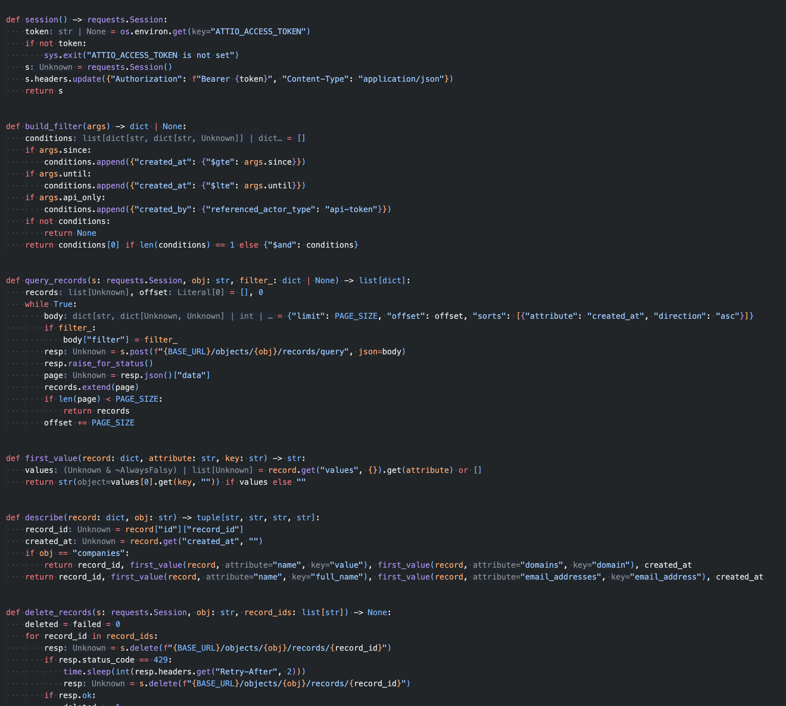
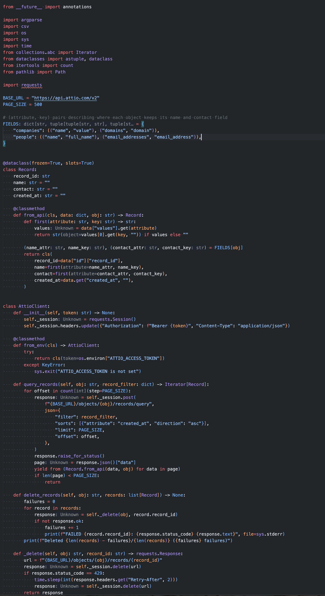

The prompt in the title isn't mine — it comes from Sébastien Vian, CTO of [Wisetax](https://www.wisetax.fr/), hosted in our coworking space in Marseille. He drops it on LLM-generated Python, and it made me laugh enough to try it the same morning on a real script. The rewrite was nice; the conversation that followed turned out to be the interesting part.

The context: our CRM (Attio) was polluted by an old bulk import, and I wanted a scripted cleanup — a single file, [requests](https://requests.readthedocs.io/) as the only dependency, dry run by default, a hard confirmation gate before anything gets deleted.

## 1. The naive script is a reasonable default

Claude's first version is flat functions and explicit state — no cleverness:

```python
def query_records(s: requests.Session, obj: str, filter_: dict | None) -> list[dict]:
    records, offset = [], 0
    while True:
        body = {"limit": PAGE_SIZE, "offset": offset,
                "sorts": [{"attribute": "created_at", "direction": "asc"}]}
        if filter_:
            body["filter"] = filter_
        resp = s.post(f"{BASE_URL}/objects/{obj}/records/query", json=body)
        resp.raise_for_status()
        page = resp.json()["data"]
        records.extend(page)
        if len(page) < PAGE_SIZE:
            return records
        offset += PAGE_SIZE
```

Nothing wrong with it. It works, anyone can read it, and the per-object formatting is a plain `if obj == "companies"` branch. For a script you run twice and delete, that's arguably the right level — and it's what a model produces by default, because it's what the average reader can follow.



## 2. What "pythonista" changes

One prompt later — the exact quote from the title — same behavior, different shape:

- pagination becomes a generator: [`itertools.count(step=PAGE_SIZE)`](https://docs.python.org/3/library/itertools.html#itertools.count) plus `yield from`, no offset bookkeeping, no list accumulation
- records become a frozen [dataclass](https://docs.python.org/3/library/dataclasses.html) with a `from_api` classmethod that owns the unwrapping of Attio's `{"values": {...}}` format
- the `if obj == "companies"` branching becomes a declarative `FIELDS` mapping — which also feeds argparse's `choices`, so the valid objects have a single source of truth
- a [`match`](https://docs.python.org/3/reference/compound_stmts.html#the-match-statement) [statement](https://docs.python.org/3/reference/compound_stmts.html#the-match-statement) composes the query filter, and the env var is read [EAFP-style](https://docs.python.org/3/glossary.html#term-EAFP) (`os.environ[...]` + `except KeyError`)

```python
FIELDS = {
    "companies": (("name", "value"), ("domains", "domain")),
    "people": (("name", "full_name"), ("email_addresses", "email_address")),
}

def query_records(self, obj: str, record_filter: dict) -> Iterator[Record]:
    for offset in count(step=PAGE_SIZE):
        response = self._session.post(
            f"{BASE_URL}/objects/{obj}/records/query",
            json={"filter": record_filter, "limit": PAGE_SIZE, "offset": offset,
                  "sorts": [{"attribute": "created_at", "direction": "asc"}]},
        )
        response.raise_for_status()
        page = response.json()["data"]
        yield from (Record.from_api(data, obj) for data in page)
        if len(page) < PAGE_SIZE:
            return
```

## 3. Make it justify the idioms

The rewrite passed `session` as an argument to every function:

```python
def query_records(s: requests.Session, obj: str, filter_: dict | None) -> list[dict]: ...
def delete_records(s: requests.Session, obj: str, record_ids: list[str]) -> None: ...
```

I didn't see why, so I asked the question as-is: "why would you pass session to each method?". Answer: the dependency is visible in the signature, and in a test you hand it a fake session without ever touching the network. The alternatives: a module-level global (shorter, but the dependency becomes invisible), or a class (more structure than 150 lines need).

I still preferred the class version — you read `client.query_records(...)` and the session becomes an internal detail. Ten lines of refactoring:

```python
class AttioClient:
    def __init__(self, token: str) -> None:
        self._session = requests.Session()
        self._session.headers.update({"Authorization": f"Bearer {token}"})

    @classmethod
    def from_env(cls) -> AttioClient:
        try:
            return cls(os.environ["ATTIO_ACCESS_TOKEN"])
        except KeyError:
            sys.exit("ATTIO_ACCESS_TOKEN is not set")

    def query_records(self, obj: str, record_filter: dict) -> Iterator[Record]:
        ...
```

Same exercise for `cls()`, which I rarely use: it's the `@classmethod` convention, like `self`, and `from_env` is an "alternative constructor" — the same naming as [`datetime.fromtimestamp()`](https://docs.python.org/3/library/datetime.html#datetime.datetime.fromtimestamp) in the stdlib.

The model proposes, I question what I wouldn't have written, it lays out the alternatives, I decide.



## 4. What's still pending

`frozen=True, slots=True` on a throwaway script is probably too much, and the `match` over three conditions is taste. The naive version would have cleaned the CRM just fine.

I'll still do it again for scripts I intend to keep — probably not for a true one-shot 😅
