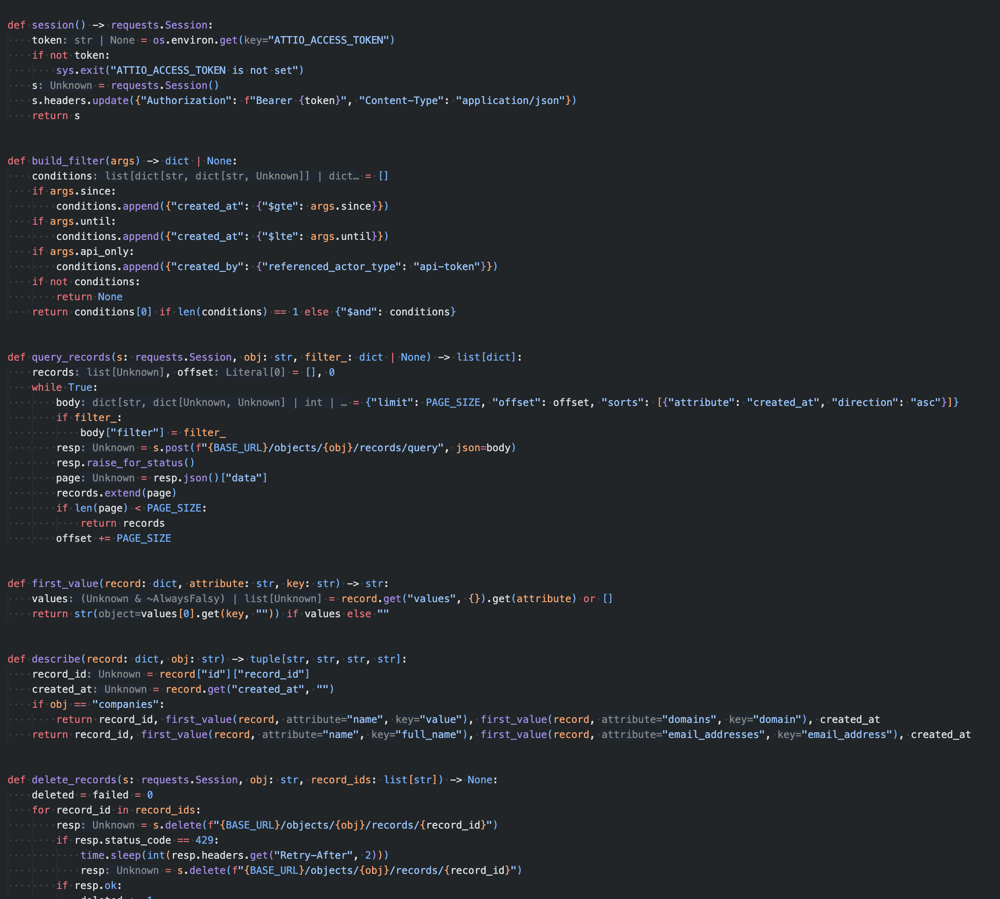
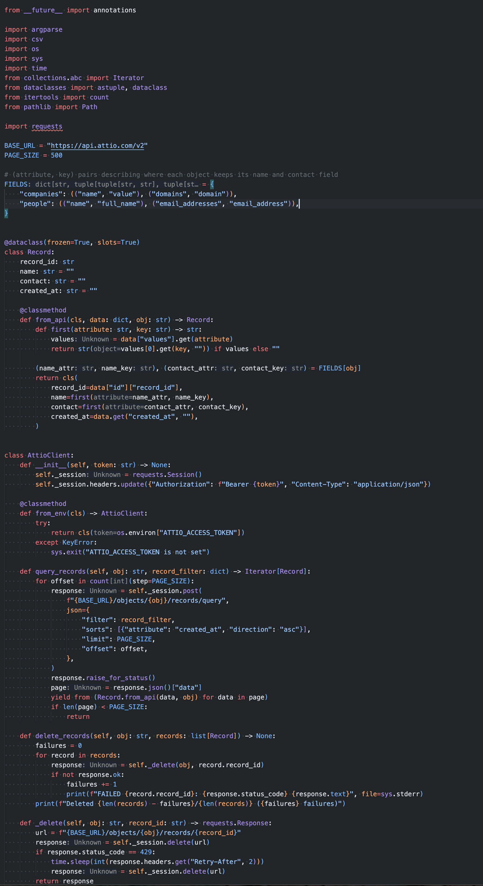

Le prompt du titre n'est pas de moi — il vient de Sébastien Vian, CTO de [Wisetax](https://www.wisetax.fr/), hébergée dans notre coworking à Marseille. Il le dégaine sur du Python généré par LLM, et ça m'a suffisamment fait rire pour l'essayer le matin même sur un vrai script. La réécriture était sympa ; c'est la conversation qui a suivi qui s'est révélée intéressante.

Le contexte : notre CRM (Attio) était pollué par un vieil import en masse, et je voulais un nettoyage entièrement scripté — un seul fichier, [requests](https://requests.readthedocs.io/) comme unique dépendance, dry run par défaut, une confirmation explicite avant toute suppression.

## 1. Le script naïf est un défaut raisonnable

La première version de Claude, c'est des fonctions plates et de l'état explicite — zéro malice :

```python
def query_records(s: requests.Session, obj: str, filter_: dict | None) -> list[dict]:
    records, offset = [], 0
    while True:
        body = {"limit": PAGE_SIZE, "offset": offset,
                "sorts": [{"attribute": "created_at", "direction": "asc"}]}
        if filter_:
            body["filter"] = filter_
        resp = s.post(f"{BASE_URL}/objects/{obj}/records/query", json=body)
        resp.raise_for_status()
        page = resp.json()["data"]
        records.extend(page)
        if len(page) < PAGE_SIZE:
            return records
        offset += PAGE_SIZE
```

Rien à reprocher. Ça marche, tout le monde peut le lire, et le formatage par type d'objet est un simple branchement `if obj == "companies"`. Pour un script qu'on lance deux fois puis qu'on jette, c'est sans doute le bon niveau — et c'est ce qu'un modèle produit par défaut, parce que c'est ce que le lecteur moyen sait suivre.



## 2. Ce que « pythonista » change

Un prompt plus tard — la citation exacte du titre — même comportement, autre forme :

- la pagination devient un générateur : [`itertools.count(step=PAGE_SIZE)`](https://docs.python.org/3/library/itertools.html#itertools.count) plus `yield from`, plus de comptabilité d'offset ni d'accumulation de liste
- les enregistrements deviennent une [dataclass](https://docs.python.org/3/library/dataclasses.html) frozen avec une classmethod `from_api` qui encapsule le déballage du format `{"values": {...}}` d'Attio
- le branchement `if obj == "companies"` devient un mapping déclaratif `FIELDS` — qui alimente aussi les `choices` d'argparse : une seule source de vérité pour les objets valides
- un [`match`](https://docs.python.org/3/reference/compound_stmts.html#the-match-statement) compose le filtre de requête, et la variable d'env est lue façon [EAFP](https://docs.python.org/3/glossary.html#term-EAFP) (`os.environ[...]` + `except KeyError`)

```python
FIELDS = {
    "companies": (("name", "value"), ("domains", "domain")),
    "people": (("name", "full_name"), ("email_addresses", "email_address")),
}

def query_records(self, obj: str, record_filter: dict) -> Iterator[Record]:
    for offset in count(step=PAGE_SIZE):
        response = self._session.post(
            f"{BASE_URL}/objects/{obj}/records/query",
            json={"filter": record_filter, "limit": PAGE_SIZE, "offset": offset,
                  "sorts": [{"attribute": "created_at", "direction": "asc"}]},
        )
        response.raise_for_status()
        page = response.json()["data"]
        yield from (Record.from_api(data, obj) for data in page)
        if len(page) < PAGE_SIZE:
            return
```

## 3. Lui faire justifier les idiomes

La réécriture passait `session` en argument de chaque fonction :

```python
def query_records(s: requests.Session, obj: str, filter_: dict | None) -> list[dict]: ...
def delete_records(s: requests.Session, obj: str, record_ids: list[str]) -> None: ...
```

Je ne voyais pas pourquoi, alors j'ai posé la question telle quelle : « why would you pass session to each method? ». Réponse : la dépendance est visible dans la signature, et en test on passe une fausse session sans toucher au réseau. Les alternatives : une globale de module (plus court, mais la dépendance devient invisible), ou une classe (plus de structure que nécessaire pour 150 lignes).

Je préférais quand même la version classe — on lit `client.query_records(...)` et la session devient un détail interne. Dix lignes de refactor :

```python
class AttioClient:
    def __init__(self, token: str) -> None:
        self._session = requests.Session()
        self._session.headers.update({"Authorization": f"Bearer {token}"})

    @classmethod
    def from_env(cls) -> AttioClient:
        try:
            return cls(os.environ["ATTIO_ACCESS_TOKEN"])
        except KeyError:
            sys.exit("ATTIO_ACCESS_TOKEN is not set")

    def query_records(self, obj: str, record_filter: dict) -> Iterator[Record]:
        ...
```

Même exercice pour `cls()`, que je ne pratiquais pas : c'est la convention des `@classmethod`, comme `self`, et `from_env` est un « constructeur alternatif » — le même nommage que [`datetime.fromtimestamp()`](https://docs.python.org/3/library/datetime.html#datetime.datetime.fromtimestamp) dans la stdlib.

Le modèle propose, je questionne ce que je n'aurais pas écrit, il donne les alternatives, je tranche.



## 4. Ce qui reste

`frozen=True, slots=True` sur un script jetable, c'est sans doute de trop, et le `match` sur trois conditions, c'est du goût. La version naïve aurait très bien nettoyé le CRM.

Je le referai quand même pour les scripts que je compte garder — probablement pas pour un vrai one-shot 😅
